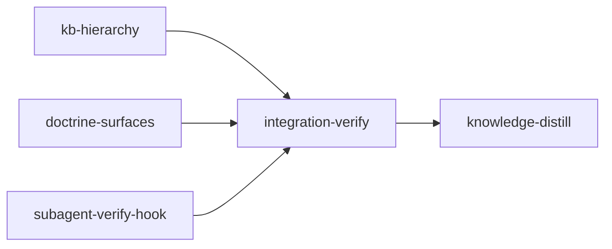

# Plan: Subagent Discipline & Hierarchical Knowledge

## Context

Opus 5 brought its own aggressive self-verification instinct. Inside loom that instinct
misfires in two places, and a third problem has been growing independently:

1. **Subagents re-verify endlessly.** Every worker runs the full `cargo test` /
   `cargo clippy` suite, often repeatedly, then the coordinator runs it, then the main
   agent runs it again. The same suite is executed N+1 times per stage for one stage's
   worth of signal. Prose alone will not stop it — the model overrides prose it is
   instinctively inclined to ignore.
2. **Knowledge does not scale.** `doc/loom/knowledge/` in this repo is 3,271 lines across
   7 flat files (`architecture.md` alone is 736). CLAUDE.md tells every agent to read ALL
   of it before any work. The GC subsystem's answer is a 200-line-per-file / 800-line-total
   cap, which is nonsense for a real project: the only way to satisfy it is to delete
   hard-won lessons. Knowledge must grow; what must stay small is what an agent reads to
   orient itself.
3. **Model allocation is upside-down.** The plan-writer skill biases stage `model` toward
   sonnet and treats opus as exceptional, which produces stages where a cheap model does
   the orchestration badly, or an opus stage does the bulk implementation itself. The
   intended shape is the inverse: opus always orchestrates and never implements; the
   implementation is delegated to as few subagents as the work allows.

**Intended outcome:** one full test suite run per stage (by the main agent); knowledge that
grows without bound while orientation stays ~100 lines; and a documented model playbook —
opus orchestrates, sonnet/haiku/opus subagents implement, fable advises on failures — that
loom teaches through every guidance channel it owns.

**Backwards compatibility is REQUIRED and is a deliberate exception to this repo's
"no backwards compatibility" rule** (project `CLAUDE.md`): loom is installed against
existing user repos whose `doc/loom/knowledge/` is already populated flat. An older loom
project must keep working unchanged; new projects get the hierarchy; the upgrade is opt-in.

## Goals

- Subagents stop running project-wide verification — enforced by a hook, not just prose.
- Knowledge becomes a 3-tier hierarchy (generated `INDEX.md` → tier-1 summaries → tier-2
  topic files) so a stage agent orients from ~100 lines instead of 3,000.
- `loom knowledge gc` maintains the hierarchy (extract, dedupe, relink, reindex) instead of
  trimming to a line cap. The aggregate line cap is removed entirely.
- The model playbook (opus orchestrates / subagents implement / fable advises) lands in
  `skills/loom-plan-writer/SKILL.md`, `CLAUDE.md.template`, the agent definitions, and
  loom's own stage-type defaults.
- **Non-goal:** migrating other repos' knowledge automatically. The upgrade is opt-in
  (`loom knowledge index` or `loom knowledge gc`), never implicit, never destructive.
- **Non-goal:** fixing the pre-existing gap that `.github/workflows/release.yml` publishes
  no hook assets (so `install_hooks_remote` cannot fetch them). Noted, out of scope.

## Execution Diagram



`knowledge-bootstrap` is **deliberately skipped**: `loom knowledge check --min-coverage 50`
currently reports 100% source coverage (18/18 modules) with all seven files populated,
which is the skill's documented skip criterion.

> ⚠️ **Why the first stage is called `kb-hierarchy` and not `knowledge-hierarchy`.**
> `plan/schema/detect.rs::detect_stage_type` honours an explicit `stage_type` ONLY when it
> differs from `Standard`; for a `standard` stage it falls through to an id/name substring
> heuristic where any id or name containing "knowledge" is reclassified as
> `StageType::Knowledge`. That would give this implementation stage no worktree, commits
> straight to `main`, and `merged = true` automatically. `loom plan verify` confirmed the
> misclassification on the first draft. **No `standard` stage's id or name may contain the
> substring "knowledge".**

---

## Canonical Wording (copy VERBATIM — three stages must agree)

Two blocks below are written by more than one stage. They are authoritative here so the
surfaces cannot drift; `integration-verify` cross-greps them.

### BLOCK-A — subagent no-verify rule

```text
VERIFICATION IS THE MAIN AGENT'S JOB - NOT YOURS:
- Do NOT verify your work. No full build, no full test suite, no linter, no
  formatter, no type-checker, and never a repeated or looping check.
- AT MOST ONE narrowly-scoped check over the files YOU wrote (e.g.
  `cargo test <your_module>::`), run ONCE. Skip it if you are unsure.
- Report instead: files changed, assumptions made, anything unresolved.
  The MAIN AGENT compiles, tests, lints, and fixes.
```

Exception: `integration-verify` stages. Their whole purpose is full-suite verification, and
their review subagents are supposed to run it. The hook and the signal wording both carve
them out (see `subagent-verify-hook`).

### BLOCK-B — model allocation playbook

```text
1. ORCHESTRATION IS ALWAYS OPUS. Every stage's main agent is opus. The
   orchestrator does NOT implement — it decomposes the work, hands each
   subagent full context, then verifies and commits. That is all.
2. IMPLEMENTATION IS ALWAYS DELEGATED, to as FEW subagents as the work
   allows: haiku (rare — trivial mechanical edits), sonnet (the common
   case), opus (genuinely challenging work). Spawn BY AGENT TYPE.
3. DEBUGGING OR REPEATED FAILURE → spawn a `loom-advisor` (fable) subagent:
   narrow scope, full detail supplied by the orchestrator, advice returned.
   Do not let an implementer thrash on the same failure twice.
```

---

## Stages

### 1. `kb-hierarchy` — the hierarchy, end to end

**Why one stage and not two.** The data layer and the CLI share a compile unit: removing
`DEFAULT_MAX_TOTAL_LINES` from `fs/knowledge/gc.rs` breaks `cli/types_memory.rs`,
`commands/knowledge/{gc,check,audit}.rs` in the same build. Splitting them guarantees a
broken intermediate worktree.

**Layout (new).** Tier-2 directory name is mechanically the tier-1 file stem, so
`KnowledgeFile::Architecture` ⇒ `architecture/`:

```text
doc/loom/knowledge/
  INDEX.md                       # generated map, ~100 lines — read this first
  architecture.md                # tier-1: summaries + pointers
  architecture/
    signal-generation.md         # tier-2: full detail, uncapped
    merge-recovery.md
  mistakes.md
  mistakes/
    phantom-merges.md
  ... (same for entry-points, patterns, conventions, stack, concerns)
```

A tier-1 section that outgrows the threshold is replaced by a summary + link:

```markdown
## Signal Generation Pipeline

Agent prompts are assembled in a 4-section Manus KV-cache layout; four
stage-type prefix generators live in `orchestrator/signals/cache.rs`.
→ [architecture/signal-generation.md](architecture/signal-generation.md)
```

**Layout detection is one predicate:** hierarchical iff `INDEX.md` exists at the knowledge
root. Everything else keys off that.

**Subagent territories (DISJOINT):**

| Subagent | Files owned (write) | Files read-only |
| --- | --- | --- |
| 1 — data layer (`loom-software-engineer`) | `loom/src/fs/knowledge/**` | `loom/src/validation.rs`, `loom/src/fs/locking.rs` |
| 2 — CLI handlers (`loom-software-engineer`) | `loom/src/commands/knowledge/**` | `loom/src/fs/knowledge/**` |
| 3 — registration (`loom-software-engineer`) | `loom/src/cli/types_memory.rs`, `loom/src/cli/dispatch.rs`, `loom/src/completions/dynamic/commands.rs`, `loom/src/completions/dynamic/tests/tests_commands.rs` | `loom/src/commands/knowledge/mod.rs` |

**FOUNDATION STEP — the orchestrator writes this BEFORE fanning out**, because subagents 2
and 3 compile against it: the new type signatures in `loom/src/fs/knowledge/types.rs`
(`KnowledgeTarget`, `KnowledgeLayout`) and the new `GcMetrics`/`Tier1Metrics`/`TopicMetrics`
struct definitions in `loom/src/fs/knowledge/gc.rs`. Bodies can be `todo!()`-free minimal
implementations; subagent 1 fills them in.

**Data layer (`loom/src/fs/knowledge/`):**

- `types.rs` — add:
  - `enum KnowledgeLayout { Legacy, Hierarchical }`
  - `enum KnowledgeTarget { Tier1(KnowledgeFile), Topic { category: KnowledgeFile, slug: String } }`
    with `parse(s: &str) -> Result<Self>` (`"patterns"` → Tier1 via the existing alias
    table; `"patterns/merge-lock"` → Topic), `relative_path() -> PathBuf`
    (`patterns.md` / `patterns/merge-lock.md`). Slug validation REUSES
    `crate::validation::validate_id` (`loom/src/validation.rs:51`) — it already rejects
    path traversal, reserved names, and >128 chars. Do not write a new validator.
- `index.rs` (NEW) — `TopicEntry { category, slug, path, title, blurb, line_count }`;
  `scan_topics(root)` walks `<root>/<category>/*.md` for each of the seven categories;
  `title` is the first `#` line, `blurb` the first `>` line (every existing knowledge
  file already follows that convention); `generate_index(root) -> String` renders a
  "read this first" preamble, a tier-1 table, and a tier-2 table grouped by category, all
  under a generated-file marker comment; `write_index(root)` writes it atomically.
- `dir.rs` — add `layout()`, `target_path(&KnowledgeTarget)`, `read_target`,
  `append_target`, `replace_section_target`, `list_topics`. `append_target` on a
  not-yet-existing topic file scaffolds `# <Title>` + `> <blurb>` first.
  `has_content()` must also count tier-2 files.
  **Index refresh:** `append_target`/`replace_section_target` refresh `INDEX.md` when
  `layout() == Hierarchical`, and must do so AFTER `locked_read_modify_write` releases its
  lock — never nested inside it. This is what makes `loom map` (which calls
  `KnowledgeDir::append`, `loom/src/commands/map.rs:53-71`) index-correct with zero edits
  to `map.rs`.
- `gc.rs` — rewrite the metric model:
  - `DEFAULT_MAX_TIER1_LINES: usize = 250` and `DEFAULT_MAX_TOPIC_LINES: usize = 500`
    replace `DEFAULT_MAX_FILE_LINES`.
  - **`DEFAULT_MAX_TOTAL_LINES` is DELETED.** No aggregate cap exists anywhere. Total lines
    are still reported, never a GC reason.
  - `SECTION_EXTRACT_THRESHOLD: usize = 40` — a tier-1 `##` section longer than this is an
    extraction candidate, recorded as `oversized_sections: Vec<(String, usize)>`. This is
    the field that turns GC from "trim" into "restructure".
  - New signals: `broken_links` (a tier-1 `](<category>/<slug>.md)` pointer whose file is
    missing), `orphan_topics` (a topic file no tier-1 file links to), `index_stale`
    (`INDEX.md` missing, or not listing every existing file).
  - Keep `duplicate_headers` and `promoted_block_count` unchanged.
  - Legacy layout adds exactly one advisory reason: flat layout, run
    `loom knowledge gc` to build the hierarchy. Never an aggregate-lines reason.

**CLI (`loom/src/commands/knowledge/`):**

- `show` with no argument: hierarchical → print `INDEX.md`; legacy → today's
  `generate_summary()`. `show <target>` accepts the existing tier-1 aliases unchanged AND
  `category/slug`.
- `update` / `replace-section`: parse the argument through `KnowledgeTarget::parse`;
  tier-1 behaviour is byte-for-byte unchanged.
- `index` (NEW subcommand): regenerate `INDEX.md`. On a legacy directory it CREATES it —
  this is the opt-in upgrade path.
- `init`: also create `INDEX.md`, so new projects start hierarchical.
- `list`: tier-1 files plus topics grouped by category.
- `audit`: render the new metrics; drop `--max-total-lines`, add `--max-topic-lines`.
- `check`: **blast-radius fix** — `analyze_src_coverage` (`check.rs:185-200`) reads ONLY
  `architecture.md`. Once architecture content moves to `architecture/*.md`, coverage
  collapses and every `loom knowledge check --min-coverage 50` acceptance criterion in every
  existing plan starts failing. It must concatenate `architecture.md` + `architecture/**.md`
  before calling `is_directory_mentioned`. Its GC advisory block (`check.rs:92-109`) moves
  to the new metrics.
- `bootstrap`: a from-scratch bootstrap must PRODUCE the hierarchy, not a flat dump.
  `build_system_prompt` (`bootstrap.rs:103-131`) currently teaches only
  `loom knowledge update <file>`; add tier routing to its numbered rules — a finding that
  fits in ≲40 lines goes in the tier-1 file, anything larger goes to
  `loom knowledge update <category>/<slug>` with a 2–4 line tier-1 summary + link — and make
  `loom knowledge index` the mandatory final step. Its tool allowlist
  (`bootstrap.rs:56-57`) is the wildcard `Bash(loom knowledge*)`, which already covers
  `index`; no allowlist change needed there (unlike `gc.rs`, which enumerates subcommands).
- `gc`: rewrite `build_gc_system_prompt` / `build_gc_initial_prompt` around restructuring —
  extract oversized sections into tier-2, replace them with a 2–4 line summary + link,
  merge duplicates, repair broken links, adopt orphans, delete only genuinely stale content,
  finish with `loom knowledge index`. Add a hard rule: **never delete a lesson to hit a line
  count — EXTRACT it.** On a legacy directory the first `gc` run performs the migration.
  Add `Bash(loom knowledge index*)` to the non-dry-run allowlist (`gc.rs:66-74`); keep
  `loom knowledge gc` excluded (recursion guard).

**Registration** — per `patterns.md § CLI Subcommand Registration Pattern`, clap is only
half: `cli/types_memory.rs` (Index variant + audit flag change), `cli/dispatch.rs`
(`KnowledgeCommands::Index` arm), and the hand-maintained completion tables in
`completions/dynamic/commands.rs` (`"knowledge"` subcommand list at line 58, and the
`["knowledge", "audit"]` flag arm at line 112) plus their tests.

**Backwards-compatibility contract (each item gets a test):**

1. A legacy directory (7 files, no `INDEX.md`, no subdirectories) behaves exactly as today
   for `show`, `update`, `replace-section`, `list`, `audit`, `check`.
2. `loom knowledge update patterns "..."` is unchanged in both layouts.
3. `loom knowledge init` creates `INDEX.md`.
4. The upgrade is opt-in only (`loom knowledge index` or `loom knowledge gc`); nothing
   auto-migrates and nothing is deleted.

### 2. `doctrine-surfaces` — guidance channels

Per `conventions.md § Guidance Delivery Channels Convention`, each rule goes in the channel
closest to the decision point. This stage owns every channel except the hook.

**Subagent territories (DISJOINT):**

| Subagent | Files owned (write) |
| --- | --- |
| 1 — signals (`loom-software-engineer`) | `loom/src/orchestrator/signals/**`, `loom/src/models/stage/types.rs` |
| 2 — template (`loom-software-engineer`) | `CLAUDE.md.template` |
| 3 — agents (`loom-software-engineer`) | `agents/*.md` (incl. new `agents/loom-advisor.md`) |
| 4 — skill + command (`loom-software-engineer`) | `skills/loom-plan-writer/SKILL.md`, `commands/distill.md` |

**Subagent 1 — signals (`loom/src/orchestrator/signals/`):**

- `cache.rs::append_subagent_restrictions` (line 66) takes an `agents_role: &str` tail
  already. Append BLOCK-A to the shared body, and pass an integration-verify-specific tail
  from `generate_integration_verify_stable_prefix` (line 468) that explicitly RESTORES
  full-suite verification for IV review subagents. The standard prefix (line 277) gets
  BLOCK-A unmodified.
- Knowledge reading protocol, in all four prefixes and in
  `format/sections.rs::format_semi_stable_section` (the Knowledge Base box, lines 22-33):
  when `INDEX.md` exists — `loom knowledge show` (the index) → the tier-1 file for your
  area → drill into `category/topic` only for what you touch. When it does not — read the
  tier-1 files, i.e. today's behaviour. Both branches must be described; the signal is
  static text and cannot detect the layout itself.
- `generate_knowledge_distill_stable_prefix` (line 491) step 4: add tier routing — inline
  if the section stays under ~40 lines, otherwise
  `loom knowledge update <category>/<slug>` plus a 2–4 line tier-1 summary + link; always
  finish with `loom knowledge index`.
- `format/sections.rs` Commands table (lines 231-240): add the topic-write and index forms.
- `models/stage/types.rs::default_model` (line 36): `StageType::Knowledge` currently returns
  `"sonnet"`; under BLOCK-B every stage orchestrator is opus, so all four arms return
  `"opus"`. Update the doc comments and the tests that assert the sonnet default.
- **Watch item:** changing a stable prefix changes its SHA-256 hash. Before finishing, grep
  `loom/src/orchestrator/signals/tests_cache.rs` and `tests.rs` for any pinned hash literal
  and update it; the cache tests also negative-assert that documentation prefixes carry no
  adversarial-review block — do not break that.

**Subagent 2 — `CLAUDE.md.template`:**

- Rule 5 subagent preamble: insert BLOCK-A verbatim.
- Rule 6c COORDINATOR PREAMBLE: the line "Before returning: verify your subtree (scoped
  build/tests covering YOUR territory only)" becomes the BLOCK-A one-scoped-check rule.
  WORKER PREAMBLE: append BLOCK-A.
- Rule 7: replace the current sonnet-default prose with BLOCK-B, keep the agent table and
  add a `loom-advisor` (fable) row.
- KNOWLEDGE-FIRST section: replace "read ALL files there before any other work" with the
  layout-aware protocol — with `INDEX.md`, read the index then the relevant tier-1 file then
  drill; without it, read all tier-1 files (unchanged legacy behaviour).
- Rule 12: document the tier-1 / tier-2 split and `loom knowledge index`.

**Subagent 3 — `agents/`:**

- `loom-software-engineer.md`: Approach item 3 ("Test as you go: Write tests, verify
  functionality") becomes "write tests; the main agent runs them". The Delegation bullet's
  "verify your subtree with scoped tests" becomes the one-scoped-check rule. "Self-Review
  Before Returning" stays (it is a read-only review) but must state explicitly that the
  review is done by READING the diff, not by running the suite. Drop "Zero IDE diagnostics
  before completing work" — that is a verification instruction.
- `loom-senior-software-engineer.md`: same treatment for its "Self-Review Before Returning".
- `agents/loom-advisor.md` (NEW): `model: fable`, `tools: Read, Glob, Grep, Bash`,
  read-only advisory role for debugging and repeated failures — receives full detail from
  the orchestrator, returns a diagnosis and a concrete next step, writes nothing.
  The frontmatter value is the bare short name `fable`, matching the existing convention in
  `loom-software-engineer.md` (`model: sonnet`) and `loom-code-reviewer.md` (`model: opus`).
  Installation needs no change — `install.sh:304` and `:140` glob `agents/loom-*.md`.

**Subagent 4 — skill + slash command:**

- `skills/loom-plan-writer/SKILL.md` §4 "Model Selection Per Stage": replace the
  sonnet-default table and the "opus orchestrates, sonnet executes" paragraph with BLOCK-B.
  Every stage sets `model: "opus"`; the sonnet/haiku/opus decision moves to the subagent
  level; the "keep sonnet stages small" guidance becomes "keep each subagent's assignment
  small". Update the §5 decision table's "as few subagents as possible" bias, the bookend
  defaults line (§3, all opus), and every YAML example in §10 that shows `model: "sonnet"`.
  Add the `loom-advisor` escalation rule: two failures on the same task ⇒ fable advisor,
  not a blind retry.
- Same file, knowledge sections: `knowledge-bootstrap` (§3) and `knowledge-distill` (§3)
  must describe tier routing and `loom knowledge index`; the boilerplate acceptance
  `rg -q "## " doc/loom/knowledge/architecture.md` still works in both layouts (a tier-1
  summary file keeps its `##` headings) — say so explicitly so nobody "fixes" it.
- `commands/distill.md`: add tier routing to the file-routing list.

### 3. `subagent-verify-hook` — enforcement

Prose is not enough; this is the channel `conventions.md` reserves for rules that must never
be violated.

**Step 1 — extract the detection, do not duplicate it.** `hooks/commit-filter.sh:136-239`
holds a proven, depth-agnostic subagent detector (`is_ancestor`,
`find_nearest_claude_ancestor`, `count_claude_processes_between`), consumed by the
`LOOM_MAIN_AGENT_PID`-in-ancestor-chain gate that begins at line 241. Move it into
`hooks/_common.sh` as
`loom_is_subagent()` (returns 0 when running under a subagent, non-zero otherwise), and have
`commit-filter.sh` source and call it. **`commit-filter.sh`'s behaviour must not change** —
its 12 integration tests in `loom/tests/integration/hooks_commit_filter.rs` are the
regression gate and must pass untouched.

**Step 2 — `hooks/subagent-verify-guard.sh` (NEW), PreToolUse:Bash.** Order of operations:

1. Read stdin with the mandatory `gtimeout` → `timeout` → `cat` cascade
   (`mistakes.md § Cross-Platform Timeout in Hooks`).
2. `source "$(dirname "$0")/_common.sh"`; `loom_is_subagent` or exit 0. A main agent is
   never affected.
3. **Integration-verify carve-out.** Read the stage type from
   `${LOOM_WORK_DIR}/stages/*-${LOOM_STAGE_ID}.md` using the same glob pattern
   `session-end.sh` already uses; if `stage_type: integration-verify`, exit 0. IV review
   subagents are supposed to run the full suite. `LOOM_STAGE_ID` is trustworthy here and
   only here, because step 2 already proved `LOOM_MAIN_AGENT_PID` is a live ancestor —
   i.e. we really are inside a loom session, not a shell with a leaked variable
   (`mistakes.md § Worktree-Isolation Hooks Gated on LOOM_STAGE_ID`).
4. `stripped=$(strip_embedded_content "$COMMAND")` before ANY pattern match, so
   `git commit -m "add cargo test for X"` is not blocked
   (`patterns.md § Hook Content-Stripping Pattern`).
5. Block (exit 2) project-wide verification runners; allow scoped ones:

   | Blocked (project-wide) | Allowed (scoped) |
   | --- | --- |
   | `cargo test` bare, `--all`, `--workspace`, `--all-targets` | `cargo test <filter>`, `--test <name>`, `-p <pkg>` |
   | `cargo build`, `cargo clippy`, `cargo fmt`, `cargo check` (any form) | — |
   | `pytest` bare, `go test ./...`, `tsc`, `eslint .` | `pytest <path>`, `go test ./pkg/...` |
   | `npm/bun/pnpm/yarn` `test`/`build`/`lint`/`typecheck` bare | `bun test <path>` |
   | `make test`/`build`/`check`/`lint` | — |

6. The exit-2 stderr message is BLOCK-A. That is the whole point of the hook: it re-injects
   the rule at the exact moment of violation.

No evasion escape hatch (`LOOM_ALLOW_...`) is added — `commit-filter.sh:108-110` already
treats unsetting the detection gate as an evasion, and a second opt-out would undo this one.

**Step 3 — registration, all four sites:**

- `loom/src/fs/permissions/constants.rs`: a `HOOK_SUBAGENT_VERIFY_GUARD` `include_str!`
  next to line 44, plus an entry in `LOOM_HOOKS` (line 59).
- `loom/src/fs/permissions/hooks.rs::loom_hooks_config_for_dir` (line 14): a `PreToolUse`
  / `matcher: "Bash"` entry alongside `commit-filter.sh`.
- `install.sh`: BOTH hardcoded `all_hooks` arrays (`install_hooks_remote` ~line 213 and
  `install_hooks` ~line 397).
- `loom/tests/integration/hooks_subagent_verify_guard.rs` (NEW) plus
  `pub mod hooks_subagent_verify_guard;` in `loom/tests/integration/mod.rs` — the test
  target is `[[test]] name = "integration" path = "tests/integration/mod.rs"`
  (`loom/Cargo.toml:51`), so an unregistered file is silently never compiled. Mirror
  `hooks_commit_filter.rs::setup_hook`, which installs `_common.sh` alongside the hook
  (`mistakes.md § Hook Integration Tests Need _common.sh`).

Test cases: main agent unaffected; subagent + `cargo test` blocked; subagent +
`cargo test signals::` allowed; subagent + `cargo clippy` blocked; subagent inside an
integration-verify stage unaffected; `git commit -m "...cargo test..."` not blocked.

### 4. `integration-verify`

Full build/test/lint at zero tolerance, parallel `loom-code-reviewer` subagents, and the
functional proof that all three workstreams are actually wired. Plus the cross-surface
consistency greps that no single stage can run (BLOCK-A in three places, BLOCK-B in two).

### 5. `knowledge-distill`

Curates memories into knowledge as usual, **and dogfoods the hierarchy on this repo** — the
end-to-end proof that the feature works on a real 3,271-line knowledge base. It extracts the
oversized sections of `architecture.md` (736 lines) into `architecture/*.md` via
`loom knowledge update architecture/<slug>`, leaves summaries + links behind, and runs
`loom knowledge index`. It must NOT run `loom knowledge gc` — that spawns a nested Claude
session inside a stage session.

---

<!-- loom METADATA -->

```yaml
loom:
  version: 1
  sandbox:
    enabled: true
    auto_allow: true
    excluded_commands: ["loom", "git"]
    filesystem:
      deny_read: ["~/.ssh/**", "~/.aws/**", "~/.config/gcloud/**", "~/.gnupg/**"]
      deny_write: ["doc/loom/knowledge/**"]
      allow_write:
        - "loom/src/**"
        - "loom/tests/**"
        - "loom/target/**"
        - "hooks/**"
        - "agents/**"
        - "skills/**"
        - "commands/**"
        - "CLAUDE.md.template"
        - "install.sh"
        - "README.md"
        - "CONTRIBUTING.md"
        - "doc/**"
    network:
      allowed_domains:
        - "crates.io"
        - "static.crates.io"
        - "index.crates.io"
        - "github.com"
      allow_local_binding: false
      allow_unix_sockets: []
  stages:
    - id: kb-hierarchy
      name: "Tiered KB Hierarchy and GC Rewrite"
      stage_type: standard
      model: "opus"
      reasoning_effort: "xhigh"
      description: |
        Build the 3-tier knowledge hierarchy (generated INDEX.md, tier-1 summary
        files, tier-2 topic files) and rewrite knowledge GC around maintaining it
        instead of enforcing line caps. Existing flat knowledge directories MUST
        keep working unchanged - this is a deliberate exception to the project's
        no-backwards-compatibility rule, because loom runs against user repos whose
        knowledge is already populated flat.

        YOU ARE AN ORCHESTRATOR. Do NOT implement. Decompose, hand each subagent
        full context, then verify and commit. Use as FEW subagents as the work
        allows. Use parallel subagents and skills to maximize performance.

        FOUNDATION STEP FIRST (you write this, before spawning anyone) - subagents 2
        and 3 compile against it:
          - loom/src/fs/knowledge/types.rs: enum KnowledgeLayout { Legacy,
            Hierarchical }; enum KnowledgeTarget { Tier1(KnowledgeFile),
            Topic { category: KnowledgeFile, slug: String } } with
            parse(&str) -> Result<Self> and relative_path() -> PathBuf.
          - loom/src/fs/knowledge/gc.rs: the new GcMetrics / Tier1Metrics /
            TopicMetrics struct definitions.

        SUBAGENT FILE ASSIGNMENTS (NO OVERLAP confirmed):
          Subagent 1 - data layer (loom-software-engineer):
            Files Owned: loom/src/fs/knowledge/**
            Read-Only: loom/src/validation.rs, loom/src/fs/locking.rs
          Subagent 2 - CLI handlers (loom-software-engineer):
            Files Owned: loom/src/commands/knowledge/**
            Read-Only: loom/src/fs/knowledge/**
          Subagent 3 - registration (loom-software-engineer):
            Files Owned: loom/src/cli/types_memory.rs, loom/src/cli/dispatch.rs,
              loom/src/completions/dynamic/commands.rs,
              loom/src/completions/dynamic/tests/tests_commands.rs
            Read-Only: loom/src/commands/knowledge/mod.rs

        SUBAGENT 1 - data layer:
          - types.rs: KnowledgeTarget::parse accepts the existing tier-1 aliases
            unchanged ("patterns", "patterns.md", "pattern", ...) and the new
            "category/slug" form. Validate slug with crate::validation::validate_id
            (validation.rs:51) - it already rejects traversal, reserved names and
            >128 chars. Do NOT write a new validator.
          - NEW index.rs: TopicEntry { category, slug, path, title, blurb,
            line_count }; scan_topics(root) walks <root>/<category>/*.md for all
            seven categories; title = first "# " line, blurb = first "> " line
            (every existing knowledge file follows this); generate_index(root)
            renders a read-this-first preamble + tier-1 table + tier-2 table grouped
            by category, under a generated-file marker; write_index(root) writes
            atomically.
          - dir.rs: add layout() (Hierarchical iff INDEX.md exists), target_path,
            read_target, append_target, replace_section_target, list_topics.
            append_target scaffolds "# Title" + "> blurb" when creating a topic
            file. has_content() must also count tier-2 files. append_target and
            replace_section_target refresh INDEX.md when layout is Hierarchical,
            AFTER locked_read_modify_write releases its lock - never nested inside
            it. This makes commands/map.rs:53-71 index-correct with no edit to it.
          - gc.rs rewrite: DEFAULT_MAX_TIER1_LINES = 250 and DEFAULT_MAX_TOPIC_LINES
            = 500 replace DEFAULT_MAX_FILE_LINES. DELETE DEFAULT_MAX_TOTAL_LINES
            entirely - there is NO aggregate cap; total lines are reported, never a
            reason. Add SECTION_EXTRACT_THRESHOLD = 40 and per-tier-1
            oversized_sections: Vec<(String, usize)>. Add broken_links (a tier-1
            "](<category>/<slug>.md)" pointer whose file is missing), orphan_topics
            (topic file no tier-1 links to), index_stale (INDEX.md missing or not
            listing every file). Keep duplicate_headers and promoted_block_count.
            Legacy layout adds exactly ONE advisory reason - flat layout, run
            loom knowledge gc - and never an aggregate-lines reason.
          - Tests: KnowledgeTarget::parse round-trips both forms and rejects
            traversal; index generation lists tier-1 and tier-2; a legacy dir
            reports Layout::Legacy and no aggregate-lines reason; oversized-section
            detection; broken-link and orphan detection.

        SUBAGENT 2 - CLI handlers:
          - show with no arg: Hierarchical prints INDEX.md, Legacy prints today's
            generate_summary(). show <target> takes tier-1 aliases AND
            "category/slug".
          - update / replace-section: route the argument through
            KnowledgeTarget::parse. Tier-1 behaviour must be byte-for-byte
            unchanged.
          - NEW index handler: regenerate INDEX.md; on a Legacy dir it CREATES it -
            the opt-in upgrade path.
          - init: also create INDEX.md so new projects start hierarchical.
          - list: tier-1 files plus topics grouped by category.
          - audit: render the new metrics; drop --max-total-lines, add
            --max-topic-lines.
          - check: BLAST-RADIUS FIX. analyze_src_coverage (check.rs:185-200) reads
            ONLY architecture.md. Once content moves to architecture/*.md, coverage
            collapses and every existing plan's
            "loom knowledge check --min-coverage 50" acceptance starts failing.
            Concatenate architecture.md + architecture/**.md before calling
            is_directory_mentioned. Move its GC advisory block (check.rs:92-109) to
            the new metrics.
          - bootstrap: a from-scratch bootstrap must PRODUCE the hierarchy, not a
            flat dump. build_system_prompt (bootstrap.rs:103-131) teaches only
            loom knowledge update <file> today; add tier routing to its numbered
            rules - a finding under ~40 lines goes in the tier-1 file, anything
            larger goes to loom knowledge update <category>/<slug> with a 2-4 line
            tier-1 summary and link - and make loom knowledge index the mandatory
            final step. Its allowlist (bootstrap.rs:56-57) is the wildcard
            Bash(loom knowledge*), which already covers index; no allowlist change
            is needed there.
          - gc: rewrite build_gc_system_prompt and build_gc_initial_prompt around
            RESTRUCTURING - extract oversized sections into tier-2, replace with a
            2-4 line summary plus a relative link, merge duplicates, repair broken
            links, adopt orphans, delete only genuinely stale content, finish with
            loom knowledge index. Add the hard rule: NEVER delete a lesson to hit a
            line count - EXTRACT it. State that on a legacy directory the first gc
            run performs the migration. Add Bash(loom knowledge index*) to the
            non-dry-run allowlist (gc.rs:66-74); keep loom knowledge gc excluded.
          - Backwards-compat tests (one per contract item): a legacy dir behaves
            exactly as today for show/update/replace-section/list/audit/check;
            update patterns "..." unchanged in both layouts; init creates INDEX.md;
            nothing auto-migrates.

        SUBAGENT 3 - registration. Clap is only HALF the registration (see
        knowledge patterns.md, CLI Subcommand Registration Pattern):
          - cli/types_memory.rs: add the Index variant to KnowledgeCommands; change
            the Audit flags (drop max_total_lines, add max_topic_lines) and their
            default_value_t constants.
          - cli/dispatch.rs: add the KnowledgeCommands::Index arm next to the
            existing knowledge arms (~line 120-146).
          - completions/dynamic/commands.rs: add "index" to the "knowledge"
            subcommand list (line 58) and fix the ["knowledge", "audit"] flag arm
            (line 112).
          - completions/dynamic/tests/tests_commands.rs: assert index completes and
            the audit flags are current.

        MEMORY: record mistakes/decisions/surprises via loom memory immediately;
        NEVER loom knowledge (implementation stage); NEVER Claude Code auto-memory.
      dependencies: []
      acceptance:
        - "cargo build"
        - "cargo test"
        - "cargo clippy --all-targets -- -D warnings"
        - "cargo fmt --check"
        - 'test -z "$(rg -l DEFAULT_MAX_TOTAL_LINES src/ || true)"'
        - 'cargo run -- knowledge index --help'
        - 'cargo run -- knowledge --help | rg -q "index"'
        - 'cargo run -- knowledge audit --help | rg -q "max-topic-lines"'
        - 'test -z "$(cargo run -- knowledge audit --help | rg "max-total-lines" || true)"'
        - 'rg -q "loom knowledge index" src/commands/knowledge/bootstrap.rs'
      files:
        - "loom/src/fs/knowledge/**"
        - "loom/src/commands/knowledge/**"
        - "loom/src/cli/types_memory.rs"
        - "loom/src/cli/dispatch.rs"
        - "loom/src/completions/dynamic/commands.rs"
        - "loom/src/completions/dynamic/tests/tests_commands.rs"
      working_dir: "loom"
      artifacts:
        - "src/fs/knowledge/index.rs"
        - "src/fs/knowledge/types.rs"
        - "src/fs/knowledge/gc.rs"
        - "src/fs/knowledge/dir.rs"
        - "src/commands/knowledge/mod.rs"
      wiring:
        - source: "src/fs/knowledge/dir.rs"
          pattern: "KnowledgeTarget"
          description: "KnowledgeDir resolves tier-1 and tier-2 targets"
        - source: "src/fs/knowledge/dir.rs"
          pattern: "write_index"
          description: "Append/replace refresh the generated INDEX.md"
        - source: "src/cli/dispatch.rs"
          pattern: "KnowledgeCommands::Index"
          description: "loom knowledge index dispatched from the CLI"
        - source: "src/commands/knowledge/check.rs"
          pattern: "list_topics"
          description: "Coverage analysis reads architecture tier-1 AND its tier-2 topics"
        - source: "src/commands/knowledge/bootstrap.rs"
          pattern: "loom knowledge index"
          description: "Bootstrap prompt builds the hierarchy and reindexes"
      wiring_tests:
        - name: "knowledge index subcommand is registered"
          command: "cargo run -- knowledge index --help"
          success_criteria:
            exit_code: 0

    - id: doctrine-surfaces
      name: "Guidance Surfaces: No-Verify Rule and Model Playbook"
      stage_type: standard
      model: "opus"
      reasoning_effort: "xhigh"
      description: |
        Land two doctrines across every guidance channel loom owns except the hook:
        (A) subagents do not verify, and (B) the model allocation playbook - opus
        orchestrates and never implements, subagents implement, fable advises on
        failures. Also land the layout-aware knowledge reading protocol.

        YOU ARE AN ORCHESTRATOR. Do NOT implement. Decompose, hand each subagent
        full context, then verify and commit. Use as FEW subagents as the work
        allows. Use parallel subagents and skills to maximize performance.

        BLOCK-A and BLOCK-B are quoted verbatim in the plan document under
        "Canonical Wording". Read them from doc/plans/ and copy them EXACTLY -
        integration-verify cross-greps the surfaces for agreement.

        SUBAGENT FILE ASSIGNMENTS (NO OVERLAP confirmed):
          Subagent 1 - signals (loom-software-engineer):
            Files Owned: loom/src/orchestrator/signals/**,
              loom/src/models/stage/types.rs
          Subagent 2 - template (loom-software-engineer):
            Files Owned: CLAUDE.md.template
          Subagent 3 - agents (loom-software-engineer):
            Files Owned: agents/*.md (including the new agents/loom-advisor.md)
          Subagent 4 - skill and slash command (loom-software-engineer):
            Files Owned: skills/loom-plan-writer/SKILL.md, commands/distill.md

        SUBAGENT 1 - signals:
          - cache.rs append_subagent_restrictions (line 66) already takes an
            agents_role tail. Append BLOCK-A to the shared body. Pass an
            integration-verify-specific tail from
            generate_integration_verify_stable_prefix (line 468) that explicitly
            RESTORES full-suite verification for IV review subagents; the standard
            prefix (line 277) gets BLOCK-A unmodified.
          - Knowledge reading protocol in all four prefixes and in
            format/sections.rs format_semi_stable_section (Knowledge Base box, lines
            22-33). Describe BOTH branches, because the signal is static text and
            cannot detect the layout: when INDEX.md exists, run loom knowledge show
            for the index, then read the tier-1 file for your area, then drill into
            category/topic only for what you touch; when it does not, read the
            tier-1 files as today.
          - generate_knowledge_distill_stable_prefix (line 491) step 4: add tier
            routing - inline when the section stays under ~40 lines, otherwise
            loom knowledge update <category>/<slug> plus a 2-4 line tier-1 summary
            and link; always finish with loom knowledge index.
          - format/sections.rs Commands table (lines 231-240): add the topic-write
            and index forms.
          - models/stage/types.rs default_model (line 36): StageType::Knowledge
            returns "sonnet" today; under BLOCK-B every stage orchestrator is opus,
            so all four arms return "opus". Update the doc comments and every test
            asserting the sonnet default.
          - WATCH ITEM: changing a stable prefix changes its SHA-256 hash. Grep
            tests_cache.rs and tests.rs for pinned hash literals and update them.
            The cache tests also negative-assert that documentation prefixes carry
            no adversarial-review block - do not break that.

        SUBAGENT 2 - CLAUDE.md.template:
          - Rule 5 subagent preamble: insert BLOCK-A verbatim.
          - Rule 6c COORDINATOR PREAMBLE: replace "Before returning: verify your
            subtree (scoped build/tests covering YOUR territory only)" with the
            BLOCK-A one-scoped-check rule. WORKER PREAMBLE: append BLOCK-A.
          - Rule 7: replace the sonnet-default prose with BLOCK-B; keep the agent
            table and add a loom-advisor (fable) row.
          - KNOWLEDGE-FIRST section: replace "read ALL files there before any other
            work" with the layout-aware protocol - with INDEX.md read the index then
            the relevant tier-1 file then drill; without it read all tier-1 files
            (unchanged legacy behaviour).
          - Rule 12: document the tier-1 / tier-2 split and loom knowledge index.

        SUBAGENT 3 - agents:
          - loom-software-engineer.md: Approach item 3 ("Test as you go: Write
            tests, verify functionality") becomes write tests, the main agent runs
            them. The Delegation bullet's "verify your subtree with scoped tests"
            becomes the one-scoped-check rule. Keep "Self-Review Before Returning"
            but state explicitly that the review is done by READING the diff, not by
            running the suite. Delete "Zero IDE diagnostics before completing work".
          - loom-senior-software-engineer.md: same treatment for its "Self-Review
            Before Returning" and any verification instruction.
          - NEW agents/loom-advisor.md: model fable, tools Read, Glob, Grep, Bash;
            read-only advisory role for debugging and repeated failures - receives
            full detail from the orchestrator, returns a diagnosis and a concrete
            next step, writes nothing. The frontmatter value is the bare short name
            fable, matching the existing convention in loom-software-engineer.md
            (model: sonnet) and loom-code-reviewer.md (model: opus). No install
            change is needed - install.sh globs agents/loom-*.md.

        SUBAGENT 4 - skill and slash command:
          - skills/loom-plan-writer/SKILL.md section 4 (Model Selection Per Stage):
            replace the sonnet-default table and the "opus orchestrates, sonnet
            executes" paragraph with BLOCK-B. Every stage sets model "opus"; the
            sonnet/haiku/opus decision moves to the subagent level; "keep sonnet
            stages small" becomes "keep each subagent's assignment small". Update
            the section 5 decision table toward as-few-subagents-as-possible, the
            section 3 bookend defaults (all opus), and every YAML example in section
            10 that shows model "sonnet". Add the escalation rule: two failures on
            the same task means spawn a loom-advisor (fable), not a blind retry.
          - Same file, knowledge sections: knowledge-bootstrap and knowledge-distill
            must describe tier routing and loom knowledge index. State explicitly
            that the boilerplate acceptance rg -q "## "
            doc/loom/knowledge/architecture.md still works in both layouts, because
            a tier-1 summary file keeps its ## headings - so nobody "fixes" it.
          - commands/distill.md: add tier routing to the file-routing list.

        MEMORY: record mistakes/decisions/surprises via loom memory immediately;
        NEVER loom knowledge (implementation stage); NEVER Claude Code auto-memory.
      dependencies: []
      acceptance:
        - "cargo build --manifest-path loom/Cargo.toml"
        - "cargo test --manifest-path loom/Cargo.toml"
        - "cargo clippy --manifest-path loom/Cargo.toml --all-targets -- -D warnings"
        - "cargo fmt --manifest-path loom/Cargo.toml --check"
        - 'rg -qF "AT MOST ONE narrowly-scoped check" loom/src/orchestrator/signals/cache.rs'
        - 'rg -qF "AT MOST ONE narrowly-scoped check" CLAUDE.md.template'
        - 'rg -qF "ORCHESTRATION IS ALWAYS OPUS" CLAUDE.md.template'
        - 'rg -qF "ORCHESTRATION IS ALWAYS OPUS" skills/loom-plan-writer/SKILL.md'
        - 'rg -q "loom knowledge index" loom/src/orchestrator/signals/cache.rs'
        - 'test -z "$(rg -l "Zero IDE diagnostics" agents/ || true)"'
        - 'test -z "$(rg -F "Knowledge => \"sonnet\"" loom/src/models/stage/types.rs || true)"'
        - 'rg -q "model: fable" agents/loom-advisor.md'
      files:
        - "loom/src/orchestrator/signals/**"
        - "loom/src/models/stage/types.rs"
        - "CLAUDE.md.template"
        - "agents/**"
        - "skills/loom-plan-writer/SKILL.md"
        - "commands/distill.md"
      working_dir: "."
      artifacts:
        - "agents/loom-advisor.md"
        - "CLAUDE.md.template"
        - "skills/loom-plan-writer/SKILL.md"
      wiring:
        - source: "loom/src/orchestrator/signals/cache.rs"
          pattern: "VERIFICATION IS THE MAIN AGENT"
          description: "No-verify rule injected into the runtime subagent restrictions"
        - source: "loom/src/orchestrator/signals/format/sections.rs"
          pattern: "INDEX"
          description: "Semi-stable knowledge box teaches the index-first protocol"
        - source: "loom/src/models/stage/types.rs"
          pattern: "StageType::Knowledge"
          description: "Knowledge stage default model raised to opus"

    - id: subagent-verify-hook
      name: "PreToolUse Guard: Subagents Do Not Verify"
      stage_type: standard
      model: "opus"
      reasoning_effort: "xhigh"
      description: |
        Enforce the no-verify rule at the tool boundary with a new PreToolUse:Bash
        hook. Prose is advisory; per the knowledge conventions.md Guidance Delivery
        Channels convention, a rule that must never be violated belongs in a hook.

        YOU ARE AN ORCHESTRATOR. Do NOT implement. Decompose, hand each subagent
        full context, then verify and commit. Use as FEW subagents as the work
        allows. Use parallel subagents and skills to maximize performance.

        BLOCK-A is quoted verbatim in the plan document under "Canonical Wording";
        the hook's exit-2 stderr message is BLOCK-A. Read it from doc/plans/ and
        copy it EXACTLY.

        SUBAGENT FILE ASSIGNMENTS (NO OVERLAP confirmed):
          Subagent 1 - shell (loom-senior-software-engineer):
            Files Owned: hooks/_common.sh, hooks/commit-filter.sh,
              hooks/subagent-verify-guard.sh
          Subagent 2 - registration and tests (loom-software-engineer):
            Files Owned: loom/src/fs/permissions/constants.rs,
              loom/src/fs/permissions/hooks.rs, install.sh,
              loom/tests/integration/hooks_subagent_verify_guard.rs,
              loom/tests/integration/mod.rs
            Read-Only: hooks/**, loom/tests/integration/hooks_commit_filter.rs

        SUBAGENT 1 - shell:
          STEP 1, extract - do not duplicate. commit-filter.sh:136-283 holds a
          proven, depth-agnostic subagent detector (is_ancestor,
          find_nearest_claude_ancestor, count_claude_processes_between, and the
          LOOM_MAIN_AGENT_PID-in-ancestor-chain gate). Move it into hooks/_common.sh
          as loom_is_subagent() returning 0 when running under a subagent, and have
          commit-filter.sh source and call it. commit-filter.sh behaviour MUST NOT
          change - the 12 tests in loom/tests/integration/hooks_commit_filter.rs are
          the regression gate and must pass untouched.

          STEP 2, hooks/subagent-verify-guard.sh (NEW), PreToolUse:Bash, in this
          order:
            1. Read stdin with the mandatory gtimeout / timeout / cat cascade
               (knowledge mistakes.md, Cross-Platform Timeout in Hooks).
            2. source "$(dirname "$0")/_common.sh"; loom_is_subagent or exit 0. A
               main agent is never affected.
            3. INTEGRATION-VERIFY CARVE-OUT: read the stage type from
               ${LOOM_WORK_DIR}/stages/*-${LOOM_STAGE_ID}.md using the same glob
               session-end.sh already uses; if stage_type is integration-verify,
               exit 0 - IV review subagents are supposed to run the full suite.
               LOOM_STAGE_ID is trustworthy here and ONLY here because step 2
               already proved LOOM_MAIN_AGENT_PID is a live ancestor (knowledge
               mistakes.md, Worktree-Isolation Hooks Gated on LOOM_STAGE_ID).
            4. stripped=$(strip_embedded_content "$COMMAND") BEFORE any pattern
               match, so git commit -m "add cargo test for X" is not blocked
               (knowledge patterns.md, Hook Content-Stripping Pattern).
            5. Block with exit 2 - project-wide runners: bare cargo test, and
               cargo test with --all / --workspace / --all-targets; cargo build,
               cargo clippy, cargo fmt, cargo check in any form; bare pytest;
               go test ./...; tsc; eslint .; npm/bun/pnpm/yarn test|build|lint|
               typecheck with no path; make test|build|check|lint.
               Allow - scoped runs: cargo test <filter>, cargo test --test <name>,
               cargo test -p <pkg>, pytest <path>, go test ./pkg/..., bun test
               <path>.
            6. stderr message on block is BLOCK-A verbatim.
          Use POSIX awk only, no gawk extensions (knowledge mistakes.md). Add NO
          escape hatch env var - commit-filter.sh:108-110 already treats unsetting
          the detection gate as evasion.

        SUBAGENT 2 - registration, ALL FOUR sites (a miss makes the hook silently
        dead):
          - loom/src/fs/permissions/constants.rs: add
            HOOK_SUBAGENT_VERIFY_GUARD include_str! next to line 44 and an entry in
            the LOOM_HOOKS table (line 59).
          - loom/src/fs/permissions/hooks.rs loom_hooks_config_for_dir (line 14):
            add a PreToolUse / matcher "Bash" entry alongside commit-filter.sh.
          - install.sh: BOTH hardcoded all_hooks arrays - install_hooks_remote
            (~line 213) and install_hooks (~line 397).
          - loom/tests/integration/hooks_subagent_verify_guard.rs (NEW) plus
            pub mod hooks_subagent_verify_guard; in
            loom/tests/integration/mod.rs. The test target is
            [[test]] name = "integration" path = "tests/integration/mod.rs"
            (loom/Cargo.toml:51), so an unregistered file is never compiled. Mirror
            hooks_commit_filter.rs setup_hook, which installs _common.sh alongside
            the hook (knowledge mistakes.md, Hook Integration Tests Need _common.sh).
          Test cases: main agent unaffected; subagent + cargo test blocked; subagent
          + cargo test signals:: allowed; subagent + cargo clippy blocked; subagent
          inside an integration-verify stage unaffected; git commit -m
          "...cargo test..." not blocked.

        MEMORY: record mistakes/decisions/surprises via loom memory immediately;
        NEVER loom knowledge (implementation stage); NEVER Claude Code auto-memory.
      dependencies: []
      acceptance:
        - "cargo build --manifest-path loom/Cargo.toml"
        - "cargo test --manifest-path loom/Cargo.toml"
        - "cargo clippy --manifest-path loom/Cargo.toml --all-targets -- -D warnings"
        - "cargo fmt --manifest-path loom/Cargo.toml --check"
        - "bash -n hooks/subagent-verify-guard.sh"
        - "bash -n hooks/_common.sh"
        - "bash -n hooks/commit-filter.sh"
        - 'rg -q "loom_is_subagent" hooks/_common.sh'
        - 'rg -q "loom_is_subagent" hooks/commit-filter.sh'
        - 'cargo test --manifest-path loom/Cargo.toml --test integration hooks_'
      files:
        - "hooks/**"
        - "loom/src/fs/permissions/constants.rs"
        - "loom/src/fs/permissions/hooks.rs"
        - "loom/tests/integration/**"
        - "install.sh"
      working_dir: "."
      artifacts:
        - "hooks/subagent-verify-guard.sh"
        - "loom/tests/integration/hooks_subagent_verify_guard.rs"
      wiring:
        - source: "loom/src/fs/permissions/constants.rs"
          pattern: "subagent-verify-guard.sh"
          description: "Hook embedded and listed in the LOOM_HOOKS install table"
        - source: "loom/src/fs/permissions/hooks.rs"
          pattern: "subagent-verify-guard.sh"
          description: "Hook registered as a global PreToolUse:Bash hook"
        - source: "loom/tests/integration/mod.rs"
          pattern: "hooks_subagent_verify_guard"
          description: "New hook test module compiled by the integration target"
        - source: "install.sh"
          pattern: "subagent-verify-guard.sh"
          description: "Hook shipped by both install paths"

    - id: integration-verify
      name: "Integration Verification"
      stage_type: integration-verify
      model: "opus"
      reasoning_effort: "xhigh"
      description: |
        Final verification after all three workstreams. Verify FUNCTIONAL
        INTEGRATION, not just tests passing. NEVER Claude Code auto-memory.

        CONTEXT: read this plan in doc/plans/, loom memory show --all, and
        doc/loom/knowledge/.

        BUILD AND TEST, zero tolerance - fix ALL warnings and failures, nothing is
        "pre-existing": full suite, clippy --all-targets as errors, fmt check,
        build.

        CODE REVIEW: spawn parallel loom-code-reviewer subagents (security,
        architecture, test coverage); fix ALL findings with an engineer agent, since
        the reviewer is read-only.

        CROSS-SURFACE CONSISTENCY - no single stage can check these, because the
        surfaces are owned by different stages:
          - BLOCK-A appears in loom/src/orchestrator/signals/cache.rs,
            CLAUDE.md.template, and hooks/subagent-verify-guard.sh, and the three
            copies agree.
          - BLOCK-B appears in CLAUDE.md.template and
            skills/loom-plan-writer/SKILL.md, and the two copies agree.
          - No surface still tells a subagent to run the full suite: grep agents/,
            CLAUDE.md.template, skills/, and the signal prefixes for leftover
            "verify your subtree", "Test as you go", "Zero IDE diagnostics".

        FUNCTIONAL VERIFICATION - prove each workstream is wired and usable:
          - loom knowledge index creates INDEX.md in a scratch directory, and
            loom knowledge show prints it.
          - loom knowledge update <category>/<slug> creates a tier-2 file and the
            index picks it up.
          - BACKWARDS COMPATIBILITY, the load-bearing one: build a scratch flat
            knowledge directory with the seven files and NO INDEX.md, then confirm
            loom knowledge show, list, audit, check and
            update patterns "## X" all behave as before and that nothing
            auto-migrated.
          - The hook: run hooks/subagent-verify-guard.sh directly with a synthetic
            PreToolUse payload and confirm a main-agent context is unaffected while
            a simulated subagent context blocks a full-suite command.
          - loom plan verify on this plan file still passes.

        Record discoveries to loom memory for knowledge-distill.
      dependencies:
        - "kb-hierarchy"
        - "doctrine-surfaces"
        - "subagent-verify-hook"
      acceptance:
        - "cargo build --manifest-path loom/Cargo.toml"
        - "cargo test --manifest-path loom/Cargo.toml"
        - "cargo clippy --manifest-path loom/Cargo.toml --all-targets -- -D warnings"
        - "cargo fmt --manifest-path loom/Cargo.toml --check"
        - 'cargo run --manifest-path loom/Cargo.toml -- knowledge index --help'
        - 'cargo run --manifest-path loom/Cargo.toml -- knowledge --help | rg -q "index"'
        - 'rg -qF "AT MOST ONE narrowly-scoped check" hooks/subagent-verify-guard.sh'
        - 'rg -qF "AT MOST ONE narrowly-scoped check" loom/src/orchestrator/signals/cache.rs'
        - 'rg -qF "ORCHESTRATION IS ALWAYS OPUS" skills/loom-plan-writer/SKILL.md'
        - 'test -z "$(rg -l "verify your subtree" CLAUDE.md.template agents/ skills/ loom/src/orchestrator/signals/ || true)"'
      working_dir: "."
      wiring:
        - source: "loom/src/fs/permissions/hooks.rs"
          pattern: "subagent-verify-guard.sh"
          description: "Guard hook is registered in the global hook table"
        - source: "loom/src/cli/dispatch.rs"
          pattern: "KnowledgeCommands::Index"
          description: "loom knowledge index reachable from the CLI dispatcher"
      wiring_tests:
        - name: "knowledge index subcommand is registered"
          command: "cargo run --manifest-path loom/Cargo.toml -- knowledge index --help"
          success_criteria:
            exit_code: 0
        - name: "guard hook is syntactically loadable"
          command: "bash -n hooks/subagent-verify-guard.sh"
          success_criteria:
            exit_code: 0

    - id: knowledge-distill
      name: "Knowledge Distillation and Self-Migration"
      stage_type: knowledge-distill
      model: "opus"
      reasoning_effort: "xhigh"
      description: |
        Curate all stage memories into permanent knowledge, then DOGFOOD the new
        hierarchy on this repository - the end-to-end proof that it works on a real
        3,271-line knowledge base. NEVER Claude Code auto-memory.

        YOU ARE AN ORCHESTRATOR. Delegate gathering to read-only subagents that
        return compact summaries; stay the SOLE writer of knowledge files.
        Use parallel subagents and skills to maximize performance.

        PART 1 - CURATE. Read this plan, loom memory show --all, and the current
        knowledge. Synthesize mistakes as actionable prevention rules, plus the new
        patterns, decisions and conventions, via loom knowledge update. Record in
        particular: the deliberate backwards-compatibility exception and why; the
        hook-versus-prose channel choice; and the check.rs coverage blast radius.

        PART 2 - SELF-MIGRATION. Run loom knowledge index to create INDEX.md, then
        restructure the largest tier-1 files. architecture.md is 736 lines,
        patterns.md 643, mistakes.md 647, entry-points.md 591. For each section
        longer than ~40 lines: move the body to a tier-2 topic with
        loom knowledge update <category>/<slug>, then use
        loom knowledge replace-section to leave a 2-4 line summary plus a relative
        link behind. Preserve every lesson - condense wording, never drop content.
        Finish with loom knowledge index and confirm loom knowledge audit reports a
        hierarchical layout with no orphans and no broken links.

        DO NOT run loom knowledge gc - it spawns a nested Claude session inside this
        stage session.

        PART 3 - DOCS. Update README.md and CONTRIBUTING.md for the user-facing
        changes: the loom knowledge index command, the tier-1/tier-2 layout, the
        removal of the aggregate line cap, and the new guard hook. Only the relevant
        sections.
      dependencies: ["integration-verify"]
      acceptance:
        - 'test -f doc/loom/knowledge/INDEX.md'
        - 'rg -q "## " doc/loom/knowledge/architecture.md'
        - 'rg -q "## " doc/loom/knowledge/patterns.md'
        - 'rg -q "## " doc/loom/knowledge/mistakes.md'
        - 'test -d doc/loom/knowledge/architecture'
      files:
        - "doc/loom/knowledge/**"
        - "README.md"
        - "CONTRIBUTING.md"
      working_dir: "."
      artifacts:
        - "doc/loom/knowledge/INDEX.md"
```

<!-- END loom METADATA -->
