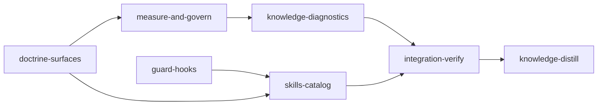

# Plan: Token-Usage Reduction (P0–P11)

## Overview

Apply every proposal from the August P0–P11 report (maintained at `doc/optimizations-suggestions-fable-astra-2026-10-18.md`) to loom:
measure what sessions actually consume, bound how far a session's context may grow, cut the
startup and signal boilerplate every request re-reads, and put the read/spawn/poll disciplines
into hooks instead of prose. Five implementation stages in two lanes, then the bookends.

## Goals

- **Measure first.** `loom usage` reads the same transcripts the bill is computed from, and the
  heartbeat carries real resident-token counts instead of the hardcoded `null` it has written
  since the governor was built.
- **Bound session growth.** An absolute token ceiling that the agent acts on from inside the
  session (loom's own handoff), with a daemon backstop, for orchestrators *and* subagents.
- **Delete resident text, don't move it.** `CLAUDE.md.template` 43,097 B → ≤ 26 KB and the
  standard signal's boilerplate floor ≤ 10 KB, with every rule preserved. Text moved between the
  system prompt and the signal saves nothing; only deletion does.
- **Hooks over doctrine** for spawn typing, read discipline, and polling — with deny branches
  built but off by default behind a config flag.
- **Non-goal:** no behavioural change to merge, worktree, adjudication, or completion paths.
- **Non-goal:** no backwards-compatibility or migration shims. The project is unreleased
  (`CLAUDE.md`); `context_budget` is replaced outright, not deprecated.

## Baseline observed at HEAD (373bfc99)

Run from the repository root before this plan was written:

| Command                                                                | Result                                                        |
| ---------------------------------------------------------------------- | ------------------------------------------------------------- |
| `cargo test --manifest-path loom/Cargo.toml`                           | 13 test binaries, all `test result: ok`; 3,206 passed, 0 failed |
| `cargo clippy --manifest-path loom/Cargo.toml --all-targets -- -D warnings` | exit 0, no output                                         |
| `cargo fmt --manifest-path loom/Cargo.toml --check`                    | exit 0, no output                                             |
| `loom knowledge sync`                                                  | "Catalog already current"; source graph published for 373bfc99 |

These three commands are every stage's gate. They are run with `--manifest-path` rather than
`working_dir: "loom"` because every stage in this plan also writes repository-root files
(`CLAUDE.md.template`, `hooks/`, `skills/`, `agents/`, `install.sh`), and `artifacts` /
`wiring.source` resolve relative to `working_dir` — so `working_dir: "."` throughout keeps every
path in the plan literal. Cargo writes only to `loom/target/` (inside the worktree) and the
per-user cargo caches, which loom pre-grants to every stage (`sandbox/package_caches.rs`).

`loom plan verify` currently emits one warning per cargo criterion —
`uses 'cargo' but Cargo.toml not found at` — because its build-tool preflight
(`plan/schema/validation.rs:838-872`) resolves `Cargo.toml` against `working_dir` and does not
read `--manifest-path`. Every one of those warnings is a false positive; all four commands were
run and observed green at HEAD, from the repository root, in exactly the form written into
`acceptance`. Rather than leave the noise, `measure-and-govern` fixes the preflight — it already
owns that file (task C4), and the empty path in the message is a second symptom of the same
function skipping its `repo_root` guard.

## Corrections to the source document, verified against the tree

The proposal document is accurate about the tree in most places. Eleven claims it makes are wrong
or incomplete, and each changes what a stage must build. **Where this plan and the source document
disagree, this plan is authoritative.**

1. **`post-tool-use.sh` is a SESSION hook, not a global one.** `fs/permissions/hooks/config.rs`
   registers exactly two global `PostToolUse` hooks (`ask-user-post.sh`,
   `loom-control-complete.sh`); `post-tool-use.sh` is emitted only by
   `loom/src/hooks/config.rs::to_settings_hooks` into a worktree's `settings.local.json`. It also
   `exit 0`s at `hooks/post-tool-use.sh:44` when `LOOM_STAGE_ID` / `LOOM_SESSION_ID` /
   `LOOM_WORK_DIR` are unset. **P10 therefore reaches loom stage sessions and their subagents
   only — not the interactive half of the bill.** The document's claim to the contrary is false.
   This plan does not make it global; that would change the crash/heartbeat contract for every
   non-loom session and is out of scope.
2. **`BASH_MAX_OUTPUT_LENGTH` defaults to 30,000 characters, not 150,000.** In the installed
   Claude Code 2.1.251 the resolver is `aee(name, envValue, default, cap)` called as
   `aee("BASH_MAX_OUTPUT_LENGTH", env, 30000, 150000)`: no env value or a non-positive one yields
   the **default** 30,000; a value above 150,000 is **capped**; there is no lower clamp. A value of
   12,000 is therefore honoured.
3. **`CLAUDE_CODE_AUTO_COMPACT_WINDOW` clamps to `[1, 1000000]`**, then to the model window —
   not "the 100k–1M range". The binary reads it through the same `aee` helper with
   `default = 1`, `cap = 1e6`, followed by `Math.max(1, effective)`.
4. **Open question 6 is settled: shortening `description:` is safe.** `loom/src/skills/index.rs`
   parses only YAML frontmatter, and prefers an explicit `triggers:` array over
   `extract_description_triggers(&metadata.description)`. **All 61 loom skills already carry
   explicit `triggers:` arrays**, so the description fallback is never reached for them and a
   160-character cap cannot degrade `skill-trigger.sh` matching.
5. **Open question 4 is settled: `loom map --outline` is fast enough for a hook and works from a
   worktree.** Measured 0.25 s wall from the main checkout. `commands/map.rs::load_graph` degrades
   deliberately when the cache cannot be written (a sandboxed worktree): it prints
   `warning: could not refresh ...` to **stderr** and answers from the published base layer. A
   hook must therefore discard stderr (`2>/dev/null`) so its deny message stays clean.
6. **`loom knowledge sync --check` cannot be an acceptance criterion.** `sync` calls
   `ContextStore::open`, which resolves through `WorkDir::main_project_root` and persists the
   catalog under `<main repo>/.loom/cache` — a write that escapes the worktree, which both
   settings emitters strip from `allow_write`. **`fs/knowledge/catalog.rs::build(root: &Path)` is
   pure**, so this plan ships a separate read-only **`loom knowledge check`** that resolves only
   the knowledge root and never opens the context store. That command *is* acceptance-safe.
7. **Retiring the context percentages has a wider blast radius than the document lists.** Beyond
   `models/constants.rs`, `Session.context_limit`, `handoff::detector` and
   `Session::update_context`, the percentage also lives in `handoff/schema/v2.rs`
   (`context_percent: f32`, `with_context_percent`, a `0.0..=100.0` validation and its tests),
   `handoff/generator/content.rs` + `formatter.rs`, `commands/stage/recover.rs:15`,
   `hooks/events.rs:45` (`HookEventKind::…{ context_percent }`), `orchestrator/monitor/context.rs`
   (`ContextHealth`, `context_usage_percent`), and `hooks/subagent-stop.sh:176`.
8. **BLOCK-C is byte-pinned into the signal prefixes, not only into the template.**
   `signals/tests_doctrine_waiting.rs::block_c_agrees_across_every_surface` asserts the
   subagent-waiting doctrine appears verbatim in `CLAUDE.md.template` **and** in
   `generate_stable_prefix()`, `generate_integration_verify_stable_prefix()` and
   `generate_knowledge_stable_prefix()`. P5's "replace the restated doctrine with a pointer"
   requires editing that test's surface list, not only the prose. The same applies to BLOCK-A
   (`tests_doctrine.rs`, four surfaces including `hooks/subagent-verify-guard.sh`), BLOCK-B
   (template + `skills/loom-plan-writer/SKILL.md`, plus literal pins on the codex model
   constants), and `KNOWLEDGE_CONSUMPTION_CONTRACT` (byte-equal to the template's
   `## KNOWLEDGE-FIRST` body, `tests_doctrine_prefixes.rs:124`).
9. **`parse.rs`'s `REQUIRED_SECTIONS` is only `["Target"]`, and it warns rather than fails.**
   The fuller list is the advisory `EXPECTED_SECTIONS`. Removing a signal section is not a
   read-back failure; the advisory list still needs updating so the warning stays meaningful.
10. **`gpt-5.6-sol` is not an implementer tier.** `hooks/codex-forward.sh:17` accepts exactly
    `gpt-5.6-terra` and `gpt-5.6-luna`; `gpt-5.6-sol` is `loom pressure`'s model
    (`commands/pressure/spawn.rs:78`) and the forwarder rejects it. Codex work in this plan uses
    **`gpt-5.6-terra`**.
11. **Registering a hook is FIVE sites, not four.** `hooks/<name>.sh`; a `HOOK_*`
    `include_str!` constant plus a `LOOM_HOOKS` row in `fs/permissions/constants.rs`; the
    registration (`fs/permissions/hooks/config.rs` for global, `loom/src/hooks/config.rs` for
    session); **both** `install.sh` arrays (`:213`, `:409`); and the count assertion in
    `commands/repair/settings_checks.rs:80`. A hook missing from any one site is silently dead.

Two further facts the document did not record, both load-bearing here:

- **`loom/maintainability-baseline.txt` is an exact-value debt ledger** enforced by
  `cargo test --test maintainability`, and it fails on *stale* entries as loudly as on new
  violations ("stale entry ... no longer violates its limit; remove it"). Shrinking
  `signals/cache.rs` (currently recorded at 1114) or `signals/format/sections.rs` (926) **requires
  lowering or removing those rows and the four `generate_*_stable_prefix` function rows**. It is a
  file several stages must touch; each stage edits only the rows for files it owns.
- **`hooks/subagent-stop.sh` already captures `transcript_path`** and writes it into
  `.work/subagents/<stage>/<agent>.json`. P0's transcript plumbing is partly built.

## Skill-catalog design (supersedes P2's per-project split)

P2 proposed splitting the 61-skill catalog into a global core plus per-project stack skills
installed by `loom init`. This plan ships the simpler design the repository owner asked for
instead, which saves the same ~3.7k resident tokens per main-session request with far less
machinery — no stack detection, no `loom init` change, no worktree `.claude/skills` symlinking,
no `loom repair` stack check:

- Nine skills stay installed at `~/.claude/skills/` (where Claude Code indexes them, so their
  `description:` is resident in every main-session request): the eight loom-mechanics skills
  `loom-plan-writer`, `loom-usage`, `loom-wiring-test`, `loom-before-after`,
  `loom-dead-code-check`, `loom-md-tables`, `loom-code-review`, `loom-debugging`, plus one new
  loader skill `loom-skills`.
- The other 53 install to `~/.claude/loom-skill-catalog/<name>/SKILL.md`, a directory Claude Code
  does not scan — so they cost nothing resident but stay on disk, complete, and readable.
- `loom-skills` is the loader. `Skill(skill="loom-skills", args="loom-rust")` loads a body that
  says: read `~/.claude/loom-skill-catalog/loom-rust/SKILL.md` in full and follow it. Invoked with
  no argument it prints the catalog table so the model can choose.
- **The repository layout does not change.** All 61 skills stay under `skills/` in the source
  tree (`signals/tests_doctrine.rs` `include_str!`s `skills/loom-plan-writer/SKILL.md`, so moving
  it is a compile error). Only the *install destination* is split.
- `install.sh` gains `--skills core|all` (default `core`) and copies **whole skill directories**
  rather than `SKILL.md` alone, which also fixes `loom-md-tables` (its body invokes
  `fix-md-tables.py`, never installed today). `dev-install.sh` forwards its arguments.

## Stage graph and why each stage exists

`knowledge-bootstrap` is **skipped**: `doc/loom/knowledge/` is populated and hierarchical
(`INDEX.md` present, every tier-1 file carries `##` sections) and `loom knowledge sync` reports
"Catalog already current" at HEAD — the plan-writer's stated skip condition. `loom plan verify`
emits an advisory warning about this; it is advisory, and this note is the answer.

Every non-bookend stage names the Stage Necessity question that forced it:

| Stage                    | Forced by | Reason                                                                                                                                                                                                                             |
| ------------------------ | --------- | ---------------------------------------------------------------------------------------------------------------------------------------------------------------------------------------------------------------------------------- |
| `doctrine-surfaces`      | —         | Root implementation stage of the doctrine lane.                                                                                                                                                                                    |
| `guard-hooks`            | —         | Root implementation stage of the tooling lane; shares no file with `doctrine-surfaces`.                                                                                                                                             |
| `measure-and-govern`     | **Q2**    | Writes `signals/format/sections.rs` and `signals/generate.rs`, which `doctrine-surfaces` also writes. Sequential after it so loom serialises the worktrees.                                                                        |
| `skills-catalog`         | **Q2**    | Writes `install.sh` (also `guard-hooks`), `fs/permissions/constants.rs` (also `guard-hooks`), and `skills/loom-plan-writer/SKILL.md` (also `doctrine-surfaces`). Sequential after both.                                            |
| `knowledge-diagnostics`  | **Q2**    | Writes `loom/src/cli/types.rs` and `loom/src/cli/dispatch.rs`, which `measure-and-govern` also writes for `loom usage`. Sequential after it.                                                                                       |

Q4 was weighed for `measure-and-govern`, the largest stage: it is kept whole rather than split
into "measure" then "govern" because both halves edit the *same* files (`hooks/post-tool-use.sh`,
`orchestrator/monitor/heartbeat.rs`, `models/session/**`), so splitting would be a Q2 serialisation
of one cohesive change rather than a real reduction. Its context is held down by a two-level
hierarchy (three coordinators over disjoint territories) rather than by a stage split.

## Execution Diagram



## Cross-stage contracts

Three data contracts cross a stage boundary. Each is pinned here so both sides agree, and each
consumer degrades rather than fails when the producer's output is absent.

**C1 — spawn ledger.** `guard-hooks`'s `hooks/spawn-guard.sh` appends one JSON object per line to
`${LOOM_WORK_DIR}/subagents/${LOOM_STAGE_ID}/spawns.jsonl`, written with plain `mkdir -p -m 700`
plus shell redirection (never through a Rust CLI path — `.work` is a symlink in a worktree and
loom's safe-write opens roots `O_NOFOLLOW`; see `hooks/subagent-stop.sh:125-137`). Exact keys, in
this order:

    ts, stage_id, session_id, caller, agent_type, model, model_source, description

`model_source` is one of `explicit` | `definition` | `table`. `measure-and-govern`'s `loom usage`
reads this file for its per-agent-type report and prints "no spawn ledger found" when it is
absent — it never errors.

**C2 — heartbeat schema.** `measure-and-govern` replaces `context_percent` with `context_tokens`
(`Option<u32>`, the sum of `input_tokens + cache_creation_input_tokens + cache_read_input_tokens`
from the last assistant record in the transcript) and adds `transcript_path` (`Option<String>`)
in `orchestrator/monitor/heartbeat.rs`, and updates all three writers
(`hooks/session-start.sh`, `hooks/post-tool-use.sh`, `hooks/subagent-stop.sh`) in the same stage.
`subagent-stop.sh` must carry the parent's existing `context_tokens` forward, never overwrite it
with the subagent's number or with `null`.

**C3 — knowledge diagnostics command.** `doctrine-surfaces` writes guidance in
`skills/loom-plan-writer/SKILL.md` naming **`loom knowledge check`** as the knowledge-distill
acceptance criterion; `knowledge-diagnostics` builds that command. The name is fixed here.
`doctrine-surfaces` merges first and briefly references a command that does not yet exist;
`integration-verify` proves the pair by running it.

## Stages

### 1. Doctrine surfaces (`doctrine-surfaces`)

Delivers P2's template diet, P5's signal diet, P6's doctrine half (single model rubric, batching,
worker sizing, briefs-as-files instructions), P8's preamble rewrite, P9's one-shot rule, P10's
report-and-stop rule and agent-definition `maxTurns`, P11's background-watch rule, P7's
repository reading protocol, and P1's Rule 3 / hard stop 4 rewrite.

**The governing constraint.** Four blocks are asserted byte-identical across surfaces owned by
different subagents. The stage's orchestrator settles each block's final text **first** and quotes
it verbatim into every worker's brief; no worker rewords a block.

| Block                             | Pinned by                          | Surfaces that must agree byte-for-byte                                                                                          |
| --------------------------------- | ---------------------------------- | --------------------------------------------------------------------------------------------------------------------------------- |
| BLOCK-A (no-verify)               | `tests_doctrine.rs`                | `CLAUDE.md.template`, `generate_stable_prefix()`, `generate_integration_verify_stable_prefix()`, `hooks/subagent-verify-guard.sh` |
| BLOCK-B (model playbook)          | `tests_doctrine.rs`                | `CLAUDE.md.template`, `skills/loom-plan-writer/SKILL.md`; plus literal pins on `CODEX_IMPLEMENTER_MODEL_TERRA` / `_LUNA` / `_EFFORT` |
| BLOCK-C (subagent waiting)        | `tests_doctrine_waiting.rs`        | `CLAUDE.md.template` and the standard / integration-verify / knowledge stable prefixes                                          |
| `KNOWLEDGE_CONSUMPTION_CONTRACT`  | `tests_doctrine_prefixes.rs:124`   | `cache.rs` constant == the template's `## KNOWLEDGE-FIRST` body                                                                  |

**Decision, settled:** BLOCK-C moves **out** of the three signal stable prefixes and stays only in
`CLAUDE.md.template`. `block_c_agrees_across_every_surface` is narrowed to the template alone, and
a new assertion requires the signal prefixes **not** to contain it — the doctrine reaches the agent
through CLAUDE.md, which is in the same session's context on every request. BLOCK-A stays in both
signal prefixes: it is pasted into subagent prompts from there. BLOCK-B stays where it is.

### 2. Guard hooks (`guard-hooks`)

Four new hooks (P3, P4, P8's brief injection, P11's poll denial), their five-site registration,
and the `loom subagents` columns that make spawn typing visible. Deny branches are built but sit
behind `[hooks] deny_enabled = false` read from `${LOOM_WORK_DIR}/config.toml` — flipping it needs
no code change and no second plan.

### 3. Measure and govern (`measure-and-govern`)

P0 (`loom usage`, real heartbeat tokens, the `handle_budget_exceeded` fix), P1 (the absolute token
ceiling and loom-native handoff), P10 (the same ceiling for subagents), and P6's mechanical half
(effort defaults, `loom plan verify` brief and file-overlap checks). Three coordinator territories.

### 4. Skills catalog (`skills-catalog`)

P2's catalog half, in the loader-skill form described above.

### 5. Knowledge diagnostics (`knowledge-diagnostics`)

P7's product half: the brief-first paragraph in every generated `INDEX.md`, a 120-character blurb
cap, three size diagnostics, and the read-only `loom knowledge check` that surfaces them.

### 6. Integration verification

Full gate at zero tolerance, parallel scoped reviewers, and functional proof that each new surface
is reachable: `loom usage --help`, `loom knowledge check`, `loom subagents list` columns, the four
new hooks present in a generated settings file, and the template/signal size ceilings.

### 7. Knowledge distillation

Curates this plan's memories, applies every `stale-knowledge:` correction in place, and performs
P7's repository housekeeping: spilling this repo's oversized tier-1 files
(`mistakes.md` 984 lines, `concerns.md` 822, `patterns.md` 754, `entry-points.md` 592,
`conventions.md` 591, `architecture.md` 516) into tier-2 topics until `loom knowledge check`
passes.

---

<!-- loom METADATA -->

```yaml
loom:
  version: 1

  sandbox:
    enabled: true
    auto_allow: true
    # NOTE: plan-level `filesystem` REPLACES the built-in defaults for any stage
    # that does not set its own override, so the parent-escape deny is restated
    # below. Two entries the canonical template carries are DELIBERATELY absent:
    # `loom plan verify` reports that `doc/loom/knowledge/**` in deny_write is
    # IGNORED (loom always grants that path so `loom knowledge update` can run
    # inside the sandbox), and that `.work/**` is already denied by default.
    # Codex write paths (~/.codex, the plugin state dir) and codex network
    # domains are added automatically to any stage whose `implementers`
    # includes codex (sandbox/settings/policy.rs) — no plan wiring needed.
    filesystem:
      deny_read:
        - "~/.ssh/**"
        - "~/.aws/**"
        - "~/.config/gcloud/**"
        - "~/.gnupg/**"
      deny_write:
        - "../../**"
      allow_write:
        - "loom/src/**"
        - "loom/tests/**"
        - "loom/resources/**"
        - "loom/maintainability-baseline.txt"
        - "hooks/**"
        - "skills/**"
        - "agents/**"
        - "CLAUDE.md.template"
        - "CLAUDE.md"
        - "install.sh"
        - "dev-install.sh"
        - "doc/plans/**"
    network:
      allowed_domains:
        - "crates.io"
        - "index.crates.io"
        - "static.crates.io"
        - "github.com"
        - "api.github.com"
        - "raw.githubusercontent.com"
      allow_local_binding: false
      allow_unix_sockets: []

  stages:
    - id: doctrine-surfaces
      name: "Doctrine Surfaces: Template, Signal, Agents, Plan-Writer"
      stage_type: standard
      model: "opus"
      reasoning_effort: "xhigh"
      subagent_timeout_secs: 600
      description: |
        Cut every agent-facing text surface loom controls, preserving every rule.
        Use parallel subagents and skills to maximize performance.

        WHY THIS IS ONE STAGE: four doctrine blocks are asserted BYTE-IDENTICAL
        across files that would otherwise belong to different stages. Splitting
        them guarantees a red gate on whichever merges second.

        FOUNDATION STEP (you, the orchestrator, do this BEFORE spawning anyone):
        settle the final text of the four pinned blocks, then quote each one
        VERBATIM into the brief of every subagent that must carry it. No
        subagent rewords a block; a subagent that needs a block pastes the text
        you gave it. The blocks and their surfaces:
          BLOCK-A  no-verify rule (loom/src/orchestrator/signals/tests_doctrine.rs)
                   CLAUDE.md.template, generate_stable_prefix,
                   generate_integration_verify_stable_prefix,
                   hooks/subagent-verify-guard.sh
          BLOCK-B  model playbook (same test file)
                   CLAUDE.md.template Rule 7, skills/loom-plan-writer/SKILL.md
          BLOCK-C  subagent waiting (tests_doctrine_waiting.rs)
                   CLAUDE.md.template ONLY after this stage - see task 4
          KNOWLEDGE_CONSUMPTION_CONTRACT (tests_doctrine_prefixes.rs)
                   cache.rs constant == template's ## KNOWLEDGE-FIRST body

        TASK 1 - CLAUDE.md.template: 43,097 bytes -> 26,624 bytes or fewer, with
        every rule kept. Apply exactly these edits:
          a. Delete the verbatim hard-stop recap at the end of the file; leave
             one line: "The six hard stops are at the top of this file."
          b. One subagent preamble. Rule 5's fence stays canonical and
             self-contained (it is pasted into worker prompts, and the
             integration-verify exception stays inside it per
             doc/loom/knowledge/mistakes/doctrine-and-acceptance.md). Rule 6c's
             worker addendum drops its duplicate BLOCK-A copy - the addendum is
             always appended AFTER a pasted Rule 5 fence, so the block is still
             present exactly once. The coordinator preamble stays
             self-contained; it is pasted alone.
          c. One model rubric. Rule 7's table and BLOCK-B stay. Rule 6c's
             "Model mix" paragraph becomes one sentence ending "per Rule 7".
             Hard stop 6 shrinks to two lines: the rule, not its elaboration.
          d. Merge Rules 6, 6b and 6c into one "### 6. SUBAGENTS": a three-row
             table (flat / hierarchy / teams: when, cost, who commits, which
             preamble), then the file-ownership table, then BLOCK-C, then the
             2-level cap. Add a "Shared context - quoted in the brief, do not
             open" column to the file-ownership table.
          e. Rewrite Rule 3 and hard stop 4 for the token ceiling: the trigger
             is no longer a percentage but the hook's message. Wording: "When
             the PostToolUse hook reports the context ceiling, finish the unit
             of work in progress and run `loom handoff --stage <id> --session
             <id> --trigger ceiling`, then stop." Delete the context-threshold
             percentage table in the LOOM ORCHESTRATION REFERENCE section.
          f. Rule 14 gains one batching sentence: "Independent reads, greps and
             commands go in ONE message; never issue a lone Read when the next
             two files are already known."
          g. Rule 12: shorten the worked examples; the mechanics live in
             /loom-plan-writer and in the signal.
          h. Rule 5's preamble first line changes from "READ CLAUDE.md
             IMMEDIATELY" to: "CLAUDE.md is already in your context; the rules
             below are the ones that bind you as a subagent. The knowledge you
             need for this task is quoted in this brief - do not open
             doc/loom/knowledge/ unless the brief says a pull came back empty."
             Keep the restrictions block: it is what makes a hook denial legible.
          i. Add to Rule 6: subagents are ONE-SHOT. Brief completely, wait with
             `loom subagents watch`, harvest with `loom subagents harvest`, let
             it end. Never message a finished subagent - each such message
             re-writes its entire conversation at the cache-write rate. A
             follow-up is a FRESH spawn whose brief quotes the previous report.
             Messaging a subagent that is still tool-wait/generating is
             different and rare.
          j. Add to Rule 6: waiting is free. Run ONE `loom subagents watch
             --timeout 3600` with the Bash tool's run_in_background; the harness
             re-invokes you when it exits and no request is made while it runs.
             Do NOT re-arm a foreground watch every 300 s and do NOT poll with
             `git status` / `wc -l` / `ls`.
          k. Add to Rule 6: a subagent that reports it hit its context ceiling
             is continued by a FRESH spawn of the same agent type whose brief is
             the original brief's remaining items plus that report - never by
             resuming it.
          l. Tighten prose throughout without removing a rule.
        Every deletion is a rule you must be able to point at somewhere else in
        the file. If you cannot, do not delete it.

        TASK 2 - repository CLAUDE.md (the checked-in project file, NOT the
        template): lines 5-8 currently mandate reading INDEX.md then the tier-1
        file. Replace with the brief-first protocol: "Your Knowledge Brief
        already quotes what retrieval judged relevant. Pull more with `loom
        knowledge context --query`. Open a file under doc/loom/knowledge/ only
        when a pull comes back empty; then read the tier-1 summary for the area,
        and only the tier-2 topics you touch."

        TASK 3 - signal stable prefixes (loom/src/orchestrator/signals/cache.rs
        and helpers.rs). Target: the standard stable prefix drops from ~16,136
        bytes to 5,000 or fewer. KEEP what is stage-specific and computed:
        ## Worktree Context, the path-boundaries table, the working_dir
        reminder, the completion sequence with its CODE_STAGE_GATE /
        CODE_STAGE_REVIEW constants, the memory command list, BLOCK-A, and
        KNOWLEDGE_CONSUMPTION_CONTRACT. REPLACE the restated doctrine -
        execution rules, delegation and hierarchies, agent teams, BLOCK-C,
        subagent restrictions, silent-failure check, git-staging rules, common
        footer - with a pointer under 300 bytes: "Binding rules:
        ~/.claude/CLAUDE.md. This signal overrides none of them." Do the same
        proportionally to the integration-verify, knowledge and
        knowledge-distill prefixes.

        TASK 4 - retire BLOCK-C from the signal. In
        tests_doctrine_waiting.rs, narrow block_c_agrees_across_every_surface to
        CLAUDE.md.template alone, and ADD an assertion that none of the four
        stable prefixes contains BLOCK-C. Update that file's module doc to say
        why: the doctrine reaches the agent through CLAUDE.md in the same
        session, so a second verbatim copy is pure residency cost.

        TASK 5 - semi-stable sections (signals/format/sections.rs). Compress the
        SESSION MEMORY REQUIRED box and command table to about 800 bytes.
        DELETE the ## Delegation Choices section (1.66 KB) - it duplicates
        Rule 6. Update EXPECTED_SECTIONS in signals/parse.rs to match whatever
        sections survive (REQUIRED_SECTIONS is only ["Target"] and only warns;
        leave it alone). Do NOT touch the context-percentage rendering at
        sections.rs:707 - measure-and-govern owns that line.

        TASK 6 - plan overview (signals/generate.rs, extract_plan_overview and
        read_plan_overview). Cap the extracted overview at 4,096 bytes,
        UNCONDITIONALLY, cutting at a line boundary and appending a single line
        naming the plan file for the rest. Do NOT add a per-stage opt-out here:
        the `plan_overview` schema field is measure-and-govern's task C1, which
        merges after you and wires the flag into this cap.

        TASK 7 - codex section (signals/format/codex.rs). Halve it. It restates
        the rules hooks/codex-forward.sh already prepends to every forwarded
        prompt; keep the lane names, the model/effort constants it interpolates,
        the sentinel protocol, and the file-ownership requirement.

        TASK 8 - agents/*.md. loom-senior-software-engineer and loom-advisor
        gain `effort: xhigh` in frontmatter so they think at full effort
        regardless of the orchestrator's setting. Every agent definition gains
        `maxTurns`: 150 for loom-software-engineer, loom-senior-software-engineer
        and loom-code-reviewer; 300 for coordinator use; loom-codex-forwarder
        and loom-advisor keep the default (omit the key). Change
        loom-code-reviewer's `model:` from opus to sonnet - a review subagent is
        a read-heavy, short-output job - and state in its body that
        integration-verify spawns it with an explicit `model: opus` override
        when architectural judgment is needed. Add to every implementer
        definition's body the report-and-stop rule from TASK 1(k).

        TASK 9 - skills/loom-plan-writer/SKILL.md. (a) Paste BLOCK-B verbatim
        from the foundation step. (b) Section 4: orchestrate at `high`, not
        `xhigh` - reasoning_effort: "high" becomes the documented default for
        every stage, with `xhigh` reserved for stages whose DESIGN is the hard
        part, and say so. (c) Add the worker-sizing rule: a worker task should
        complete within about 40 requests and 120k of context; a task needing
        more is two tasks, or a coordinator with two workers. (d) Add the
        briefs-as-files instruction: write each worker's brief to
        doc/plans/briefs/<plan-slug>/<stage-id>/<worker>.md, committed with the
        plan, and replace the EXECUTION PLAN block with a table of worker, role,
        tier, files owned, shared context, brief path; the orchestrator then
        spawns with a short fixed prompt plus "Your brief: <path>. Read it in
        full before anything else." (e) Add to knowledge-distill's acceptance
        guidance the command `loom knowledge check` (built by the
        knowledge-diagnostics stage of this plan; it is acceptance-safe because
        it never opens the context store). (f) Add the batching instruction from
        TASK 1(f) and the one-shot rule from TASK 1(i) wherever the skill tells
        an orchestrator how to wait.

        TASK 10 - hooks/subagent-verify-guard.sh. Paste BLOCK-A verbatim from
        the foundation step so tests_doctrine.rs stays green.

        TASK 11 - new size tests, in a new file
        loom/src/orchestrator/signals/tests_size.rs wired into the signals mod:
          - CLAUDE.md.template (via include_str!) is at most 26,624 bytes.
          - generate_stable_prefix() is at most 5,120 bytes.
          - The standard signal's stable + semi-stable boilerplate floor,
            measured through generate_signal_with_metrics on a test stage with
            no assignment, is at most 10,240 bytes.
          - extract_plan_overview never returns more than 4,096 bytes.
        Add to tests_doctrine.rs's RETIRED_PHRASES (using the same concat!
        splitting convention that file already uses, so the file never contains
        a phrase contiguously) the wording this stage retires: the "READ
        CLAUDE.md IMMEDIATELY" line, "if context exceeds 75%", and the
        "re-arm watch every" polling instruction.

        TASK 12 - loom/maintainability-baseline.txt. cache.rs is recorded at
        1114 lines and sections.rs at 926; four generate_*_stable_prefix
        function rows are recorded too. The ledger fails on STALE entries as
        loudly as on new violations, so lower or remove every row whose file or
        function this stage shrank. Edit ONLY rows for files this stage owns.

        SUBAGENT FILE ASSIGNMENTS (spawn in ONE message; territories disjoint):
          Subagent 1 - Template (loom-senior-software-engineer, opus):
            Owned: CLAUDE.md.template, CLAUDE.md
            Read-only: agents/*.md, skills/loom-plan-writer/SKILL.md
            Tasks 1, 2. Hardest judgment in the stage: every deleted line is a
            rule that must still be findable elsewhere in the file.
          Subagent 2 - Stable prefixes (loom-senior-software-engineer, opus):
            Owned: loom/src/orchestrator/signals/cache.rs,
                   loom/src/orchestrator/signals/helpers.rs
            Read-only: CLAUDE.md.template
            Tasks 3, 4 (the cache.rs half).
          Subagent 3 - Semi-stable and generation (loom-software-engineer, sonnet):
            Owned: loom/src/orchestrator/signals/format/sections.rs,
                   loom/src/orchestrator/signals/format/codex.rs,
                   loom/src/orchestrator/signals/generate.rs,
                   loom/src/orchestrator/signals/parse.rs
            Tasks 5, 6, 7.
          Subagent 4 - Static surfaces (loom-software-engineer, sonnet):
            Owned: agents/*.md, skills/loom-plan-writer/SKILL.md,
                   hooks/subagent-verify-guard.sh
            Tasks 8, 9, 10.
        SECOND WAVE, after subagents 1-4 return (their final text is this
        wave's input, so it cannot run in parallel):
          Subagent 5 - Tests and ledger (loom-software-engineer, sonnet):
            Owned: loom/src/orchestrator/signals/tests_size.rs (new),
                   loom/src/orchestrator/signals/tests_doctrine.rs,
                   loom/src/orchestrator/signals/tests_doctrine_waiting.rs,
                   loom/src/orchestrator/signals/tests_doctrine_prefixes.rs,
                   loom/src/orchestrator/signals/tests_cache.rs,
                   loom/src/orchestrator/signals/tests.rs,
                   loom/src/orchestrator/signals/mod.rs,
                   loom/maintainability-baseline.txt
            Tasks 4 (the test half), 11, 12.
        NO FILE OVERLAP between subagents confirmed.

        MEMORY: record mistakes, non-obvious decisions and surprises via
        `loom memory note` / `loom memory decision` IMMEDIATELY. NEVER
        `loom knowledge` (implementation stage). NEVER Claude Code auto-memory.
      dependencies: []
      acceptance:
        - "cargo test --manifest-path loom/Cargo.toml"
        - "cargo clippy --manifest-path loom/Cargo.toml --all-targets -- -D warnings"
        - "cargo fmt --manifest-path loom/Cargo.toml --check"
        - 'rg -qF "Binding rules: ~/.claude/CLAUDE.md" loom/src/orchestrator/signals/cache.rs'
        - 'rg -qF "CLAUDE.md is already in your context" CLAUDE.md.template'
        - 'rg -qF "doc/plans/briefs/" skills/loom-plan-writer/SKILL.md'
        - 'rg -qF "maxTurns" agents/loom-software-engineer.md'
        - 'rg -qF "loom knowledge check" skills/loom-plan-writer/SKILL.md'
      before_stage:
        - command: 'test "$(wc -c < CLAUDE.md.template)" -gt 26624'
          exit_code: 0
          description: "Before: the template is over the resident-cost ceiling (43,097 bytes at HEAD)"
        - command: 'rg -qF "READ CLAUDE.md IMMEDIATELY" CLAUDE.md.template'
          exit_code: 0
          description: "Before: the subagent preamble still opens by sending subagents to CLAUDE.md"
      after_stage:
        - command: 'test "$(wc -c < CLAUDE.md.template)" -gt 26624'
          exit_code: 1
          description: "After: the template fits under 26,624 bytes with every rule kept"
        - command: 'rg -qF "READ CLAUDE.md IMMEDIATELY" CLAUDE.md.template'
          exit_code: 1
          description: "After: the retired first line is gone from every copy of the preamble"
      files:
        - "CLAUDE.md.template"
        - "CLAUDE.md"
        - "agents/**"
        - "skills/loom-plan-writer/SKILL.md"
        - "hooks/subagent-verify-guard.sh"
        - "loom/src/orchestrator/signals/**"
        - "loom/maintainability-baseline.txt"
      working_dir: "."
      artifacts:
        - "CLAUDE.md.template"
        - "loom/src/orchestrator/signals/tests_size.rs"
        - "loom/src/orchestrator/signals/cache.rs"
        - "skills/loom-plan-writer/SKILL.md"
      wiring:
        - source: "loom/src/orchestrator/signals/mod.rs"
          pattern: "tests_size"
          description: "The new size-ceiling test module is compiled, not orphaned"
        - source: "loom/src/orchestrator/signals/tests_doctrine_waiting.rs"
          pattern: "must not carry BLOCK-C"
          description: "The signal prefixes are asserted free of the retired waiting doctrine"
      wiring_tests:
        - name: "template and signal size ceilings hold"
          command: "cargo test --manifest-path loom/Cargo.toml signals::tests_size"
          success_criteria:
            exit_code: 0
        - name: "every doctrine block still agrees across its surfaces"
          command: "cargo test --manifest-path loom/Cargo.toml signals::tests_doctrine"
          success_criteria:
            exit_code: 0

    - id: guard-hooks
      name: "Guard Hooks: Spawn Typing, Read Discipline, Polling"
      stage_type: standard
      model: "opus"
      reasoning_effort: "xhigh"
      implementers: ["claude", "codex"]
      subagent_timeout_secs: 900
      description: |
        Four new hooks, their five-site registration, and the `loom subagents`
        columns that make spawn typing visible.
        Use parallel subagents and skills to maximize performance.

        REGISTERING A HOOK IS FIVE SITES. A hook missing from any one is
        silently dead:
          1. hooks/<name>.sh
          2. a HOOK_* include_str! constant AND a LOOM_HOOKS row in
             loom/src/fs/permissions/constants.rs
          3. the registration: loom/src/fs/permissions/hooks/config.rs for a
             GLOBAL hook, loom/src/hooks/config.rs (HookEvent + script_name +
             all() + to_settings_hooks) for a SESSION hook
          4. BOTH install.sh arrays (the all_hooks list at :213 and at :409)
          5. the count assertion in loom/src/commands/repair/settings_checks.rs

        HOOK CONVENTIONS, already established in this repo - follow them
        exactly: warn = exit 0 with
        {"hookSpecificOutput":{"hookEventName":"PreToolUse","additionalContext":"LOOM_HOOK_WARN: ..."}}
        on stdout; deny = message on stderr and exit 2. Per-session state is
        keyed by LOOM_SESSION_ID / LOOM_STAGE_ID. Any write under .work uses
        plain `mkdir -p -m 700` plus shell redirection, never a Rust CLI path
        (.work is a symlink in a worktree and loom's safe-write opens roots
        O_NOFOLLOW; see hooks/subagent-stop.sh:125-137). Refuse to write
        through a symlinked target path, as post-tool-use.sh does.

        THE DENY SWITCH. Every deny branch in read-guard.sh and poll-guard.sh
        is built but GATED. Add a helper to hooks/_common.sh:
          loom_deny_enabled() - returns 0 only when LOOM_WORK_DIR is set and
          ${LOOM_WORK_DIR}/config.toml contains a line matching
          ^[[:space:]]*deny_enabled[[:space:]]*=[[:space:]]*true under a
          [hooks] table. Absent file, absent key, or any parse doubt -> return
          1 (disabled). Cache the answer for the process; it is read once.
        When it returns 1, a would-be deny emits its message as a
        LOOM_HOOK_WARN instead. spawn-guard.sh's untyped-spawn deny is NOT
        gated: it is a correctness guard with a named replacement.

        TASK A - hooks/spawn-guard.sh, PreToolUse, GLOBAL, matchers Task and
        Agent. Behaviour when LOOM_STAGE_ID is set; warn-only otherwise.
          1. Parse tool_input.subagent_type, tool_input.model,
             tool_input.description, and the caller's agent_id/agent_type from
             the payload.
          2. DENY (stderr, exit 2) when subagent_type is empty or one of
             general-purpose, claude, Plan: "Untyped spawn inherits this
             session's model. Use loom-software-engineer (sonnet, default) /
             loom-senior-software-engineer (opus) / loom-code-reviewer /
             loom-advisor (fable, read-only) / loom-codex-forwarder / Explore.
             Pass `model` only to escalate, and record why."
          3. NO model -> fill it in. Resolve from <cwd>/.claude/agents/<type>.md
             then ~/.claude/agents/<type>.md frontmatter `model:`; for built-ins
             use a table in the script (Explore -> sonnet, claude-code-guide ->
             sonnet). Emit
             {"hookSpecificOutput":{"hookEventName":"PreToolUse","permissionDecision":"allow","updatedInput":{<the original tool_input with "model" set>}}}.
             `updatedInput` is present in the installed Claude Code 2.1.251
             binary; if a probe shows the rewrite is not honoured, degrade to a
             LOOM_HOOK_WARN naming the resolved model and record the finding
             with `loom memory note` - never leave the spawn silently untyped.
          4. ESCALATION -> allow with a warning. An explicit `model` above the
             definition's tier (opus on loom-software-engineer; fable on
             anything but loom-advisor) gets "LOOM_HOOK_WARN: escalation above
             the agent's tier - Rule 7 point 4 requires evidence; record it with
             loom memory decision". NEVER denied.
             loom-senior-software-engineer at opus/xhigh is that agent's DEFINED
             tier, not an escalation: never warn on it.
          5. WARN when a loom-* agent type is spawned from a stage session
             without the Rule 5 preamble in its prompt (match on the fence's
             first line, which doctrine-surfaces rewrote - read the current
             CLAUDE.md.template for the exact string rather than hardcoding a
             stale one).
          6. RECORD one JSON object per line to
             ${LOOM_WORK_DIR}/subagents/${LOOM_STAGE_ID}/spawns.jsonl with
             exactly these keys in this order: ts, stage_id, session_id, caller,
             agent_type, model, model_source. model_source is explicit |
             definition | table. Add `description` last. This is contract C1 in
             the plan prose; loom usage reads it.

        TASK B - hooks/subagent-start.sh, event SubagentStart, SESSION hook.
        Records {agent_id, agent_type, ts} to
        ${LOOM_WORK_DIR}/subagents/${LOOM_STAGE_ID}/starts.jsonl. Add
        HookEvent::SubagentStart to loom/src/hooks/config.rs with its
        script_name, its all() entry and its to_settings_hooks rule. While in
        that file, DELETE HookEvent::PreferModernTools: to_settings_hooks never
        emits it (prefer-modern-tools.sh is registered globally instead), so the
        variant is dead. Keep the script and its global registration.

        TASK C - hooks/read-guard.sh, PreToolUse, GLOBAL, matcher Read. State
        ledger at ${LOOM_WORK_DIR}/hooks/reads/${LOOM_SESSION_ID}/<agent_id or
        main>.tsv in stage sessions, ${TMPDIR}/loom-reads/<session_id>.tsv
        otherwise; rows are path, full|range, lines, timestamp.
          1. UNBOUNDED read of a large file -> the outline instead. No offset
             and no limit, and the file exceeds 400 lines (READ_GUARD_LINE_LIMIT,
             aligned with CLAUDE.md Rule 17; skip binary and image extensions):
             run `loom map --outline "$path" 2>/dev/null` with a 2-second
             timeout. Discarding stderr is REQUIRED - in a worktree loom map
             prints "warning: could not refresh the working-tree source graph"
             and answers from the published base layer (commands/map.rs
             load_graph), and that warning must not land in the deny message.
             Measured latency from the main checkout: 0.25 s. If the graph has
             the file, DENY with the outline inline: "<path> is <n> lines.
             Outline: <outline> Read the ranges you need with offset/limit." If
             the graph does not cover it (markdown, JSON, plan files), WARN and
             allow, suggesting `rg -n "^#" <path>` and a range.
          2. REPEAT full read -> warn, then deny. Second unbounded read of a
             path this agent already read in full: "LOOM_HOOK_WARN: read in full
             at <ts>; cite it or read a range". Third and later: deny. Three or
             more identical ranges: warn.
          3. TIER-1 knowledge read in a stage session -> WARN only, never deny:
             a Read of doc/loom/knowledge/INDEX.md or a tier-1 file points at
             `loom knowledge context --stage <id> --query "..."`. The
             knowledge-consumption contract explicitly allows hand reading when
             a pull comes back empty.

        TASK D - hooks/poll-guard.sh, PreToolUse, GLOBAL, matcher Bash.
        Tokenise with _common.sh's loom_tokenize_command / loom_tokens_invoke.
          1. `sleep N` with N >= 30 warns, naming the replacement: one
             background `loom subagents watch --timeout 3600`.
          2. The same read-only command line (git status, ls, wc, test -f,
             sleep) seen three times in a session warns; five times denies.
             Build/test/lint commands are NEVER counted - the acceptance loop
             repeats them by design. Reuse subagent-verify-guard.sh's existing
             classification for that exemption rather than writing a second one.
          3. Bash-side file reads get TASK C's rules 1-3: `cat`, `sed -n`,
             `head` and `tail` of a path get the same line-count check, the same
             outline, and the same re-read ledger. About 4,100 file reads a
             month go through these because the harness's own auto-mode
             instruction recommends them, and a Read-tool hook never sees them.
             Bare `ls` and `find` keep prefer-modern-tools.sh's existing advice.
          4. A bare `git show <sha>` or `git diff <range>` with no path warns:
             "run --stat first, then per-file -- <path>". git show is the
             largest single producer of tool output after Read.

        TASK E - registration and plumbing. spawn-guard.sh, read-guard.sh and
        poll-guard.sh are GLOBAL PreToolUse hooks (fs/permissions/hooks/config.rs
        pre_tool_hooks, beside codex-forward-guard.sh's Task/Agent entries);
        subagent-start.sh is a SESSION hook. All four get their HOOK_* constant
        and LOOM_HOOKS row, both install.sh arrays, and the
        repair/settings_checks.rs count. Update
        loom/src/fs/permissions/tests/hooks_tests.rs, which asserts every
        HookEvent script_name is present in LOOM_HOOKS.

        TASK F - loom subagents columns. `loom subagents list` gains agent_type
        (from starts.jsonl, falling back to spawns.jsonl), model (from the
        transcript's first assistant message.model, which classify.rs already
        parses), requests, and peak resident tokens; it marks any subagent past
        the ceiling. Missing ledger files are NORMAL - render a dash, never an
        error. Owned files: loom/src/commands/subagents/**.

        TASK G - tests. New integration tests under loom/tests/integration/ in
        the style of the existing hooks_*.rs files (they invoke the hook script
        with a JSON payload on stdin and assert on exit code and output), one
        file per hook, wired into loom/tests/integration/mod.rs. At minimum:
        untyped spawn denied; typed spawn without model gets updatedInput with
        the definition's model; senior-engineer at opus produces no warning;
        unbounded read of a >400-line file denied with an outline; the same read
        with offset/limit allowed; a tier-1 knowledge read warns and does not
        deny; `sleep 300` warns; `cargo test` repeated five times is NOT denied;
        every deny branch is a warn when loom_deny_enabled() is false.

        EXECUTION PLAN (two waves; the second needs the first's files to exist
        for include_str!):
          WAVE 1 - spawn in ONE message:
            Subagent 1 - Spawn typing (loom-software-engineer, sonnet):
              Owned: hooks/spawn-guard.sh, hooks/subagent-start.sh
              Read-only: hooks/_common.sh, hooks/codex-forward-guard.sh,
                         agents/*.md
              Tasks A, B (the shell half).
            Subagent 2 - Read and poll discipline (loom-software-engineer, sonnet):
              Owned: hooks/read-guard.sh, hooks/poll-guard.sh
              Read-only: hooks/_common.sh, hooks/prefer-modern-tools.sh,
                         hooks/subagent-verify-guard.sh
              Tasks C, D.
            Subagent 3 - Shared helper (loom-codex-forwarder,
                         --model gpt-5.6-terra --effort xhigh, Bash timeout
                         900000 ms):
              Owned: hooks/_common.sh
              Add loom_deny_enabled() exactly as specified above, beside the
              existing loom_is_subagent. Change nothing else in the file. Do NOT
              run git.
            Subagent 4 - Subagents CLI (loom-codex-forwarder,
                         --model gpt-5.6-terra --effort xhigh, Bash timeout
                         900000 ms):
              Owned: loom/src/commands/subagents/**
              Task F. Entry points: `execute` in
              loom/src/commands/subagents/mod.rs, the row renderer in render.rs,
              and classify.rs's existing transcript streaming. Done when
              `cargo test --manifest-path loom/Cargo.toml commands::subagents`
              is green. Do NOT run git.
          WAVE 2 - after wave 1 returns:
            Subagent 5 - Registration (loom-codex-forwarder,
                         --model gpt-5.6-terra --effort xhigh, Bash timeout
                         900000 ms):
              Owned: loom/src/fs/permissions/constants.rs,
                     loom/src/fs/permissions/hooks/config.rs,
                     loom/src/fs/permissions/tests/**,
                     loom/src/hooks/config.rs,
                     loom/src/commands/repair/settings_checks.rs,
                     install.sh
              Task E, including the PreferModernTools deletion. Entry points:
              LOOM_HOOKS in constants.rs, pre_tool_hooks in
              fs/permissions/hooks/config.rs, HookEvent and to_settings_hooks in
              hooks/config.rs, the LOOM_HOOKS.len() assertion in
              repair/settings_checks.rs, and the two all_hooks arrays in
              install.sh. Done when `cargo test --manifest-path loom/Cargo.toml
              permissions` is green. Do NOT run git.
            Subagent 6 - Hook tests (loom-software-engineer, sonnet):
              Owned: loom/tests/integration/hooks_spawn_guard.rs (new),
                     loom/tests/integration/hooks_read_guard.rs (new),
                     loom/tests/integration/hooks_poll_guard.rs (new),
                     loom/tests/integration/mod.rs
              Task G.
        Territories are DISJOINT. Workers NEVER spawn subagents.

        LEDGER CONSTRAINT: this stage does NOT own
        loom/maintainability-baseline.txt - doctrine-surfaces runs concurrently
        and does. Keep every new test file under 400 lines and every new function
        under 50 so no ledger row is needed; split a long hook test file by hook
        rather than recording debt. If a row genuinely cannot be avoided, do NOT
        add it: report it and let integration-verify apply it.

        CODEX LANE: after every codex subagent returns, run `git status --short`
        yourself. Loom's hooks guard Claude Code's Bash tool, not commands codex
        runs inside its own session, so you are the only backstop. Never put a
        .work path in a codex brief.

        MEMORY: record mistakes, decisions and surprises via `loom memory` /
        `loom memory decision` IMMEDIATELY. NEVER `loom knowledge`. NEVER Claude
        Code auto-memory.
      dependencies: []
      acceptance:
        - "cargo test --manifest-path loom/Cargo.toml"
        - "cargo clippy --manifest-path loom/Cargo.toml --all-targets -- -D warnings"
        - "cargo fmt --manifest-path loom/Cargo.toml --check"
        - 'rg -qF "spawn-guard.sh" install.sh'
        - 'rg -qF "read-guard.sh" install.sh'
        - 'rg -qF "poll-guard.sh" install.sh'
        - 'rg -qF "subagent-start.sh" install.sh'
        - 'rg -qF "loom_deny_enabled" hooks/_common.sh'
      before_stage:
        - command: "test -f hooks/spawn-guard.sh"
          exit_code: 1
          description: "Before: nothing inspects tool_input.subagent_type or model on a spawn"
        - command: 'rg -qF "spawn-guard.sh" install.sh'
          exit_code: 1
          description: "Before: the installer knows nothing of the guard hooks"
      after_stage:
        - command: "test -f hooks/spawn-guard.sh"
          exit_code: 0
          description: "After: the spawn guard exists"
        - command: 'rg -qF "spawn-guard.sh" install.sh'
          exit_code: 0
          description: "After: it is installed, not merely written — the fifth-site failure mode"
      files:
        - "hooks/spawn-guard.sh"
        - "hooks/read-guard.sh"
        - "hooks/poll-guard.sh"
        - "hooks/subagent-start.sh"
        - "hooks/_common.sh"
        - "install.sh"
        - "loom/src/fs/permissions/**"
        - "loom/src/hooks/config.rs"
        - "loom/src/commands/repair/settings_checks.rs"
        - "loom/src/commands/subagents/**"
        # Narrowed deliberately, NOT "loom/tests/integration/**":
        # measure-and-govern runs concurrently and owns plan_verify.rs in the
        # same directory. Only mod.rs and the three new hook test files are ours.
        - "loom/tests/integration/mod.rs"
        - "loom/tests/integration/hooks_spawn_guard.rs"
        - "loom/tests/integration/hooks_read_guard.rs"
        - "loom/tests/integration/hooks_poll_guard.rs"
      working_dir: "."
      artifacts:
        - "hooks/spawn-guard.sh"
        - "hooks/read-guard.sh"
        - "hooks/poll-guard.sh"
        - "hooks/subagent-start.sh"
        - "loom/tests/integration/hooks_spawn_guard.rs"
      wiring:
        - source: "loom/src/fs/permissions/hooks/config.rs"
          pattern: '"spawn-guard.sh"'
          description: "spawn-guard is registered as a global PreToolUse hook, not merely present on disk"
        - source: "loom/src/fs/permissions/constants.rs"
          pattern: '"read-guard.sh", HOOK_READ_GUARD'
          description: "read-guard is embedded and installed, not merely written"
        - source: "loom/src/hooks/config.rs"
          pattern: "SubagentStart =>"
          description: "SubagentStart resolves to subagent-start.sh in the session hook map"
        - source: "loom/tests/integration/mod.rs"
          pattern: "hooks_spawn_guard"
          description: "The new hook tests are compiled by the integration harness"
      wiring_tests:
        - name: "every new hook is registered at all five sites"
          command: "cargo test --manifest-path loom/Cargo.toml permissions"
          success_criteria:
            exit_code: 0
        - name: "the guard hooks behave as specified"
          command: "cargo test --manifest-path loom/Cargo.toml --test integration"
          success_criteria:
            exit_code: 0

    - id: measure-and-govern
      name: "loom usage, Real Heartbeat Tokens, and the Context Ceiling"
      stage_type: standard
      model: "opus"
      reasoning_effort: "xhigh"
      implementers: ["claude", "codex"]
      subagent_timeout_secs: 900
      description: |
        Make loom able to see what a session consumes, then bound it.
        Use parallel subagents and skills to maximize performance.

        WHY IT MATTERS: both heartbeat writers hardcode "context_percent": null,
        so Session.context_tokens has been 0 for the life of every session and
        every budget comparison, banner and "COMPACTION IMMINENT" box has been
        evaluated against 0.0%. Loom's own handoff path has never once fired on
        context.

        DEFECTS TO FIX ON THE WAY (each independently verified in the tree):
          - handle_budget_exceeded (core/event_handler.rs:262-317) does NOT kill
            the session it hands off; it only removes it from active_sessions and
            re-queues, so the next poll spawns a second session over a live one.
          - loom handoff (commands/handoff/create.rs:98-113) stamps
            context_tokens: 0, context_limit: 0 into every handoff.
          - monitor/detection.rs round-trips an f32 percent through u32.
          - handoff::detector::check_context_threshold and
            Session::update_context have no callers.
          - Session::new() pins context_limit to 200k regardless of model.

        DECISION, SETTLED - the hook speaks through exit 2. PostToolUse
        additionalContext may or may not reach the model in 2.1.251; exit 2 with
        the text on stderr is the documented path that does, and the tool has
        already run so nothing is blocked. Use exit 2 for BOTH severities and
        make the 80% warning fire ONCE per session (a marker file beside the
        read ledger) so it is not noisy. Do not implement both channels.

        TERRITORY A - loom usage (new command).
          Files: loom/src/commands/usage/** (new), loom/src/cli/types.rs,
                 loom/src/cli/dispatch.rs
          Inputs: every *.jsonl under ~/.claude/projects/, main and subagent,
          resolved with the slug and layout rules already implemented in
          loom/src/commands/subagents/resolve.rs (import them; do not
          re-derive). Stream line by line, skipping unparseable lines the way
          classify.rs:28-31 does - a transcript is appended to while being read.
          DEDUPLICATE on message.id, first line wins: one API response is written
          as several lines sharing message.id with identical usage, and not
          deduplicating over-counts by about 2.3x.
          Flags: --since <duration|date> (default 7d); --project <path> (default:
          this repository's slug plus its .worktrees/* slugs) or --all; --stage
          <id>; --plan <name>; --windows 5h|week; --json.
          Report sections, each also emitted as JSON:
            1. Totals: requests, fresh input, cache writes (5m and 1h
               separately), cache reads, output, thinking.
            2. Three accountings per 5-hour window and per ISO week. S1
               unweighted (every input token); S2 API-weighted (reads x 0.1,
               writes x 1.25 or x 2 by TTL, output x 5); S3 writes + fresh +
               output only. Windows are clusters of requests separated by 5+
               hours of silence; approximate is enough.
            3. By model x scope (main/subagent).
            4. Session length: buckets 1-10, 11-25, 26-50, 51-100, 101-200,
               201-400, 400+; share of S1 and S2 per bucket; resident context at
               request index 1, 10, 30, 50, 100; peak percentiles.
            5. Tool-call shape: share of assistant messages with exactly one
               tool_use block; runs of 3+ consecutive single-tool requests.
            6. Reads: top files by bytes; same-file re-reads within a transcript;
               same-file reads across a parent session tree; unbounded reads over
               20k characters; reads under doc/loom/knowledge/. Count Bash-side
               reads (cat, sed -n, head, tail of a path) alongside Read, so the
               metric cannot be dodged by the tool used.
            7. Subagents: transcripts under 500 output tokens and their billed
               input; per agent type and model from the C1 spawn ledger; share of
               subagent requests whose model equals the parent's.
            8. Skills: Skill invocations by name.
            9. Polling: identical Bash command lines repeated 3+ times in one
               transcript; sleep N calls.
           10. Cache re-writes: per request, previous resident minus
               cache_read_input_tokens when over 10k; totals by scope, by gap
               since the previous request, by what preceded (a finished turn vs a
               tool), and by model; share of all cache writes.
           11. Subagent lifecycle: spawn-prompt class (Rule 5 / worker /
               coordinator / forwarder / none), whether a brief was present,
               requests before the first edit (median and p90), and messages sent
               to a subagent after its turn ended.
           12. Orchestrator edit requests per stage.
          Prices are NEVER printed; the unit is tokens. A --rates <toml> option
          may apply a user-supplied weighting later.
          KEEP EACH FILE UNDER 400 LINES AND EACH FUNCTION UNDER 50 - the
          maintainability ledger is exact and a new violation fails the gate.
          Split as commands/usage/mod.rs (dispatch), transcript.rs (streaming and
          dedup), accounting.rs (S1/S2/S3 and windowing), sections/*.rs
          (renderers), json.rs.

        TERRITORY B - heartbeat, governor and handoff.
          Files: loom/src/orchestrator/monitor/**,
                 loom/src/orchestrator/core/heartbeat_apply.rs,
                 loom/src/orchestrator/core/event_handler.rs,
                 loom/src/models/session/**, loom/src/models/constants.rs,
                 loom/src/handoff/**, loom/src/commands/handoff/**,
                 loom/src/commands/stage/recover.rs,
                 loom/src/commands/status/**, loom/src/hooks/events.rs,
                 hooks/post-tool-use.sh, hooks/session-start.sh,
                 hooks/subagent-stop.sh, hooks/pre-compact.sh
          B1. Heartbeat carries real numbers (contract C2). Heartbeat gains
              context_tokens: Option<u32> and transcript_path: Option<String>
              and LOSES context_percent. In hooks/post-tool-use.sh (the block at
              :67-104 that already parses the stdin JSON) read transcript_path
              from that JSON and, when loom_is_subagent is false, take the last
              assistant usage record from the transcript tail:
                tail -c 131072 "$TP" | jq -c 'select(.type == "assistant" and .message.usage != null) | .message.usage' | tail -n 1
              and write context_tokens = input_tokens +
              cache_creation_input_tokens + cache_read_input_tokens. Cost is one
              128 KB tail and one jq per tool call. session-start.sh writes the
              same fields (the transcript is usually empty then, so null).
              subagent-stop.sh's parent-heartbeat refresh must CARRY FORWARD the
              existing context_tokens - never overwrite it with the subagent's
              number or with null. Thread the field through
              MonitorEvent::HeartbeatReceived, apply_heartbeat and
              Session::record_heartbeat, where None continues to preserve the
              previous value. Record transcript_path on the session file the
              first time it is seen; follow
              doc/loom/knowledge/mistakes/sessions-and-liveness.md on spawn-site
              coverage when adding the field.
              CAUTION for whoever edits hooks/post-tool-use.sh: the heartbeat
              block is lines 67-104, but the script continues below it with the
              post-commit knowledge reminder and, at :175-181, a
              `loom context record-edit` call. The heartbeat write is guarded so
              that a refused symlinked path skips only the write, never the whole
              script. Preserve both properties.
          B2. Retire the percentages. Delete DEFAULT_CONTEXT_LIMIT,
              CONTEXT_WARNING_THRESHOLD, CONTEXT_CRITICAL_THRESHOLD,
              DEFAULT_CONTEXT_BUDGET, CONTEXT_ABSOLUTE_MAX, display::CONTEXT_*_PCT,
              Session.context_limit, handoff::detector, Session::update_context.
              The blast radius is WIDER than the source document lists - also
              update handoff/schema/v2.rs (context_percent: f32,
              with_context_percent, the 0.0..=100.0 validation and its tests),
              handoff/generator/content.rs and formatter.rs,
              commands/stage/recover.rs:15, hooks/events.rs:45,
              orchestrator/monitor/context.rs (ContextHealth and
              context_usage_percent), and hooks/subagent-stop.sh:176.
              THE ENUMERATION ABOVE IS WHAT `rg -l context_percent loom/src` AND
              `rg -l context_budget loom/src` RETURNED AT PLANNING TIME. Re-run
              both at the start of the sweep and work from THAT list - it is the
              authoritative one. At planning time context_budget alone reached 26
              files, including three the source document never mentions:
              loom/src/fs/stage_loading.rs (the round-trip that would silently
              drop a renamed field), loom/src/plan/amendment.rs, and
              loom/src/git/merge/status.rs. Replace
              the health bands with fractions of the ceiling: Green < 60%,
              Yellow 60-90%, Red >= 90%. `loom status` shows resident tokens per
              session. loom handoff reads the stage's heartbeat file for
              context_tokens instead of stamping 0, and
              handoff/recovery_format.rs renders tokens.
          B3. Hook-side ceiling detection, in hooks/post-tool-use.sh, using the
              resident count B1 just produced. Read the ceiling once (from the
              stage file, else ${LOOM_WORK_DIR}/config.toml's [context]
              ceiling_tokens, else 150000) and cache it beside the heartbeat.
              At >= 80%, ONCE per session (marker file): exit 2 with stderr
              naming the count, the ceiling, and the instruction to finish the
              current unit of work and prepare to hand off. At >= 100%, on every
              subsequent tool call: exit 2 with "CONTEXT CEILING REACHED: <n> >=
              <ceiling>. Run `loom handoff --stage <id> --session <id> --trigger
              ceiling` now, then stop. Do not start new work."
              SUBAGENT BRANCH (P10): where the main branch writes the heartbeat,
              the subagent branch (loom_is_subagent true) reads the same last-
              usage record from the SUBAGENT's transcript and compares it with
              subagent_ceiling_tokens (config default 120000). At 80%: "context
              <n>/<ceiling>: finish the unit of work in progress; do not open
              another file or start another item". At 100%, every subsequent
              tool call: "SUBAGENT CEILING REACHED: write your final report now -
              files changed, checks run, exactly what remains as numbered next
              steps - then end your turn. Do not start new work." The report is
              the handoff, in the worker's own words.
              NOTE, and put it in the module doc: post-tool-use.sh is a SESSION
              hook (loom/src/hooks/config.rs::to_settings_hooks), not a global
              one, and it exits at :44 when LOOM_STAGE_ID is unset. This governs
              loom stage sessions and their subagents ONLY. Do not claim it
              reaches interactive sessions.
          B4. Agent-authored handoff that ends the session. `loom handoff
              --trigger ceiling` writes the handoff as today AND transitions the
              stage to NeedsHandoff (models/stage/methods.rs:272 is the
              primitive; ask-user-pre.sh marking WaitingForInput from a hook is
              the precedent for a CLI-side status write). The daemon's existing
              detect_stage_changes then runs on_needs_handoff, which already
              kills, removes the signal and re-queues; the successor spawn
              already inlines the latest handoff. Nothing new on the daemon side
              for the happy path.
          B5. Daemon backstop. detection.rs compares context_tokens against
              1.25 x ceiling in absolute tokens (delete the f32-through-u32
              round-trip). On crossing, fold handle_budget_exceeded into the
              on_needs_handoff path so it KILLS the session it hands off -
              generate the handoff via handle_context_critical as today, then
              kill, remove the signal, re-queue. This path runs only when the
              agent ignored B3.

        TERRITORY C - schema, spawn environment and plan verification.
          Files: loom/src/plan/schema/**, loom/src/models/stage/**,
                 loom/src/orchestrator/terminal/native/**,
                 loom/src/orchestrator/signals/format/sections.rs
          C1. Schema. StageDefinition's context_budget: Option<u32> (percent)
              becomes context_ceiling_tokens: Option<u32>, validated >= 60000.
              Add a plan-level default in the loom: block and a global default
              [context] ceiling_tokens = 150000 plus subagent_ceiling_tokens =
              120000 in .work/config.toml. NO compatibility shim: the project is
              unreleased, so a plan carrying context_budget is a validation
              error naming the replacement. Add plan_overview: Option<bool> to
              StageDefinition and Stage so a stage can suppress the embedded
              plan overview; doctrine-surfaces already capped it at 4 KB.
          C2. Effort defaults. StageType::default_reasoning_effort returns
              "high" for every stage type and every model - delete the opus
              special case. In terminal/native/launch.rs:157-166 change the
              hardcoded ("opus", "xhigh") for SessionType::Merge and
              SessionType::BaseConflict to ("opus", "high"). Difficult
              implementation still thinks at full effort: doctrine-surfaces put
              effort: xhigh in loom-senior-software-engineer's and
              loom-advisor's frontmatter.
          C3. Wrapper environment (terminal/native/wrapper.rs, the exec env -i
              block at :220-255):
                CLAUDE_CODE_AUTO_COMPACT_WINDOW = 1.5 x ceiling. Verified in the
                installed 2.1.251 binary: the value is clamped to [1, 1000000]
                and then to the model window, so clamp loom's own value to
                1000000 before exporting. Ordering for a session that never hands
                off: hook instruction at 1.0x, daemon kill at 1.25x, Claude Code
                compaction at 1.5x - effectively unreachable, with
                pre-compact.sh's block-then-allow as the last resort.
                BASH_MAX_TIMEOUT_MS = 3600000, so one background
                `loom subagents watch --timeout 3600` is allowed.
                BASH_MAX_OUTPUT_LENGTH = 12000. Verified: the binary's resolver
                is aee(name, env, default=30000, cap=150000) with NO lower
                clamp, so 12000 is honoured and the DEFAULT is 30000 (the source
                document's "150,000 default" is wrong). This truncates a bare
                `git show`, an unpiped `rg` or a `cat` of a large file at the
                process boundary instead of letting it enter the context whole.
          C4. loom plan verify. Two additions to
              plan/schema/validation.rs::validate_structural_preflight (advisory
              warnings, the same severity as the five it already emits):
                - a stage description that references a brief path under
                  doc/plans/briefs/ which does not exist on disk;
                - two stages with no dependency path between them whose `files:`
                  globs overlap - the file-exclusivity invariant, checked
                  mechanically for the first time. Compare glob prefixes, not
                  filesystem expansion, so the check is deterministic and cheap.
              And FIX a false positive in the same file: the build-tool preflight
              (validation.rs:838-872, BUILD_TOOL_CHECKS plus
              criterion_uses_build_tool at :626) resolves a tool's config file
              against `working_dir` alone, so every cargo criterion in THIS plan
              warns - each stage runs `cargo ... --manifest-path loom/Cargo.toml`
              from working_dir "." because it also writes repository-root files.
              Teach it to honour an explicit manifest selector: when the
              criterion contains `--manifest-path <p>` (cargo), `--project-dir
              <p>` (bun) or `-C <p>` (make, go), resolve the config file against
              that path instead of working_dir. Also skip the check entirely when
              repo_root resolves to an empty path - that is what happens when
              `loom plan verify` runs outside an initialised workspace, and it is
              why the warning currently prints "not found at " with no path at
              all.
              Add fixture cases for all three to
              loom/tests/integration/plan_verify.rs.
          C5. sections.rs. Replace the context-percentage rendering at :707
              (`if usage >= 75.0`) and the "if context exceeds 75%" prose with
              "Context: <n> of <ceiling> tokens" read from the heartbeat at
              generation time. doctrine-surfaces owns the rest of this file and
              merges first; touch ONLY the context rendering.

        EXECUTION PLAN - HIERARCHICAL (2-LEVEL CAP):
          Coordinator A - loom usage (loom-senior-software-engineer, opus):
            Territory: loom/src/commands/usage/**, loom/src/cli/types.rs,
                       loom/src/cli/dispatch.rs
            Workers: A1 transcript.rs + accounting.rs (loom-codex-forwarder,
                     --model gpt-5.6-terra --effort xhigh, Bash timeout
                     900000 ms; entry points: resolve.rs's project_slug and
                     list_agent_files, classify.rs's line-skipping loop) .
                     A2 sections/*.rs + json.rs (loom-codex-forwarder, same
                     model/effort/timeout) . A3 mod.rs + CLI wiring
                     (loom-software-engineer, sonnet)
            Verify (optional, ONE scoped check, skip if unsure):
              cargo test --manifest-path loom/Cargo.toml commands::usage
          Coordinator B - Heartbeat and governor (loom-senior-software-engineer,
                          opus - the state machine and the percentage retirement
                          are the architectural work in this stage):
            Territory: loom/src/orchestrator/monitor/**,
                       loom/src/orchestrator/core/heartbeat_apply.rs,
                       loom/src/orchestrator/core/event_handler.rs,
                       loom/src/models/session/**,
                       loom/src/models/constants.rs, loom/src/handoff/**,
                       loom/src/commands/handoff/**,
                       loom/src/commands/stage/recover.rs,
                       loom/src/commands/status/**, loom/src/hooks/events.rs,
                       loom/src/commands/init/**, loom/src/commands/run/tests.rs,
                       loom/src/fs/stage_loading.rs,
                       loom/src/fs/tests_stage_loading_fields.rs,
                       loom/src/fs/tests_stage_loading_round_trip.rs,
                       loom/src/git/merge/status.rs,
                       loom/src/git/worktree/base.rs,
                       loom/src/orchestrator/core/mod.rs,
                       loom/src/orchestrator/signals/generate.rs,
                       loom/src/orchestrator/signals/types.rs,
                       loom/src/orchestrator/signals/tests_cache.rs,
                       loom/src/plan/graph/tests.rs,
                       loom/src/plan/amendment.rs,
                       hooks/post-tool-use.sh, hooks/session-start.sh,
                       hooks/subagent-stop.sh, hooks/pre-compact.sh
            Workers: B1 the four hook scripts (loom-software-engineer, sonnet) .
                     B2 heartbeat/monitor/session plumbing
                     (loom-senior-software-engineer, opus) . B3 the percentage
                     and context_budget retirement sweep across handoff/**,
                     status/**, init/**, fs/stage_loading*, git/, signals/
                     types+generate, plan/amendment.rs, recover.rs,
                     hooks/events.rs (loom-codex-forwarder, --model
                     gpt-5.6-terra --effort xhigh, Bash timeout 900000 ms;
                     entry points: `rg -l context_percent loom/src` and
                     `rg -l context_budget loom/src`, which it must RE-RUN
                     rather than trust the plan's snapshot)
            NOTE for coordinator B: B2 and B3 both touch the signals and models
            trees. Split by FILE, not by concern: give B3 the flat sweep files
            listed above and B2 the monitor/core/session/handoff plumbing, and
            settle the renamed field's exact name and type ONCE in your own brief
            before spawning either.
            Verify (optional, ONE scoped check, skip if unsure):
              cargo test --manifest-path loom/Cargo.toml orchestrator::monitor
          Coordinator C - Schema and spawn (loom-software-engineer, sonnet):
            Territory: loom/src/plan/schema/**, loom/src/models/stage/**,
                       loom/src/orchestrator/terminal/native/**,
                       loom/src/orchestrator/signals/format/sections.rs
            Workers: C1 schema fields + validation (loom-codex-forwarder,
                     --model gpt-5.6-terra --effort xhigh, Bash timeout
                     900000 ms) . C2 effort defaults + wrapper env
                     (loom-software-engineer, sonnet) . C3 plan verify checks +
                     fixtures (loom-software-engineer, sonnet)
            Verify (optional, ONE scoped check, skip if unsure):
              cargo test --manifest-path loom/Cargo.toml plan::schema
        Territories are DISJOINT. Workers NEVER spawn subagents. Coordinators
        return COMPACT summaries only; you run the full build/test/lint gate.
        loom/maintainability-baseline.txt is YOURS, not any coordinator's: apply
        every ledger change yourself after the gate tells you which rows moved.

        CODEX LANE: after every codex subagent returns, run `git status --short`
        yourself. Never put a .work path in a codex brief.

        MEMORY: record mistakes, decisions and surprises via `loom memory`
        IMMEDIATELY. NEVER `loom knowledge`. NEVER Claude Code auto-memory.
      dependencies: ["doctrine-surfaces"]
      acceptance:
        - "cargo test --manifest-path loom/Cargo.toml"
        - "cargo clippy --manifest-path loom/Cargo.toml --all-targets -- -D warnings"
        - "cargo fmt --manifest-path loom/Cargo.toml --check"
        - "cargo run --manifest-path loom/Cargo.toml --quiet -- usage --help"
        - 'cargo run --manifest-path loom/Cargo.toml --quiet -- usage --help | rg -q "since"'
        - 'rg -qF "context_tokens" hooks/post-tool-use.sh'
        - 'rg -qF "CONTEXT CEILING REACHED" hooks/post-tool-use.sh'
        - 'rg -qF "SUBAGENT CEILING REACHED" hooks/post-tool-use.sh'
        - 'rg -qF "BASH_MAX_OUTPUT_LENGTH" loom/src/orchestrator/terminal/native/wrapper.rs'
        - 'rg -qF "CLAUDE_CODE_AUTO_COMPACT_WINDOW" loom/src/orchestrator/terminal/native/wrapper.rs'
      before_stage:
        - command: "cargo run --manifest-path loom/Cargo.toml --quiet -- usage --help"
          exit_code: 2
          description: "Before: there is no usage subcommand (clap exits 2 on an unknown one)"
        - command: 'rg -qF "context_tokens" hooks/post-tool-use.sh'
          exit_code: 1
          description: "Before: the heartbeat writer records no resident-token count at all"
      after_stage:
        - command: "cargo run --manifest-path loom/Cargo.toml --quiet -- usage --help"
          exit_code: 0
          description: "After: loom usage is registered and runnable"
        - command: 'rg -qF "context_tokens" hooks/post-tool-use.sh'
          exit_code: 0
          description: "After: the heartbeat carries the real number the governor has never had"
      files:
        - "loom/src/commands/usage/**"
        - "loom/src/cli/types.rs"
        - "loom/src/cli/dispatch.rs"
        - "loom/src/orchestrator/monitor/**"
        - "loom/src/orchestrator/core/heartbeat_apply.rs"
        - "loom/src/orchestrator/core/event_handler.rs"
        - "loom/src/orchestrator/core/mod.rs"
        - "loom/src/orchestrator/terminal/native/**"
        - "loom/src/orchestrator/signals/format/sections.rs"
        - "loom/src/orchestrator/signals/generate.rs"
        - "loom/src/orchestrator/signals/types.rs"
        - "loom/src/orchestrator/signals/tests_cache.rs"
        - "loom/src/models/**"
        - "loom/src/plan/schema/**"
        - "loom/src/plan/graph/tests.rs"
        - "loom/src/plan/amendment.rs"
        - "loom/src/handoff/**"
        - "loom/src/commands/handoff/**"
        - "loom/src/commands/stage/recover.rs"
        - "loom/src/commands/status/**"
        - "loom/src/commands/init/**"
        - "loom/src/commands/run/tests.rs"
        - "loom/src/hooks/events.rs"
        - "loom/src/fs/stage_loading.rs"
        - "loom/src/fs/tests_stage_loading_fields.rs"
        - "loom/src/fs/tests_stage_loading_round_trip.rs"
        - "loom/src/git/merge/status.rs"
        - "loom/src/git/worktree/base.rs"
        - "loom/tests/integration/plan_verify.rs"
        - "loom/maintainability-baseline.txt"
        - "hooks/post-tool-use.sh"
        - "hooks/session-start.sh"
        - "hooks/subagent-stop.sh"
        - "hooks/pre-compact.sh"
      working_dir: "."
      artifacts:
        - "loom/src/commands/usage/mod.rs"
        - "loom/src/commands/usage/transcript.rs"
        - "loom/src/commands/usage/accounting.rs"
      wiring:
        - source: "loom/src/cli/dispatch.rs"
          pattern: "Commands::Usage"
          description: "loom usage is reachable from CLI dispatch, not just defined"
        - source: "loom/src/orchestrator/core/heartbeat_apply.rs"
          pattern: "context_tokens"
          description: "Real resident tokens reach the session record the daemon reads"
        - source: "loom/src/orchestrator/core/event_handler.rs"
          pattern: "kill_session"
          description: "The budget path now kills the session it hands off"
        - source: "loom/src/models/stage/types.rs"
          pattern: "context_ceiling_tokens"
          description: "The absolute ceiling replaces the percentage budget in the stage model"
      wiring_tests:
        - name: "loom usage is registered and runnable"
          command: "cargo run --manifest-path loom/Cargo.toml --quiet -- usage --help"
          success_criteria:
            exit_code: 0
        - name: "the governor and heartbeat paths pass their own suites"
          command: "cargo test --manifest-path loom/Cargo.toml orchestrator"
          success_criteria:
            exit_code: 0
        - name: "plan verify rejects the retired context_budget field"
          command: "cargo test --manifest-path loom/Cargo.toml plan::schema"
          success_criteria:
            exit_code: 0

    - id: skills-catalog
      name: "Skill Catalog: Nine Global Skills Plus a Loader"
      stage_type: standard
      model: "opus"
      reasoning_effort: "xhigh"
      implementers: ["codex", "claude"]
      subagent_timeout_secs: 900
      description: |
        Take 53 of the 61 loom skills out of the always-resident catalog without
        losing access to any of them.
        Use parallel subagents and skills to maximize performance.

        WHY: 61 loom skills carry 18,777 bytes of description: frontmatter,
        resident in EVERY request of every main session (subagents get no skills
        catalog). Across every transcript on this machine only 12 of the 61 have
        ever been invoked.

        THE DESIGN (this supersedes the source document's per-project stack
        split; the owner asked for this shape instead):
          - NINE skills install to ~/.claude/skills/, where Claude Code indexes
            them and their description: is resident: the eight loom-mechanics
            skills loom-plan-writer, loom-usage, loom-wiring-test,
            loom-before-after, loom-dead-code-check, loom-md-tables,
            loom-code-review, loom-debugging, plus the new loader loom-skills.
          - The other 53 install to ~/.claude/loom-skill-catalog/<name>/SKILL.md,
            a directory Claude Code does not scan. They cost nothing resident and
            stay complete and readable on disk.
          - THE REPOSITORY LAYOUT DOES NOT CHANGE. All 61 stay under skills/ in
            the source tree; loom/src/orchestrator/signals/tests_doctrine.rs
            include_str!s skills/loom-plan-writer/SKILL.md, so moving anything is
            a compile error. Only the INSTALL DESTINATION splits.

        TASK 1 - skills/core-skills.txt (new). One skill directory name per
        line, `#` comments allowed, the eight mechanics skills plus loom-skills.
        This is the single manifest both install.sh (bash) and self_update
        (Rust) read, so they cannot disagree - the failure mode
        doc/loom/knowledge/mistakes/pinned-literals-ledgers-and-wiring.md
        records. Add two Rust tests in loom/src/skills/ (which already scans
        SKILL.md files, so the harness exists): (a) every name in
        core-skills.txt has a matching skills/<name>/SKILL.md in the repository;
        (b) no skills/loom-*/SKILL.md has a `description:` line longer than 160
        characters. Test (b) is what the "no skill description exceeds the
        resident-cost cap" wiring test runs, and it is what stops the catalog
        regrowing one skill at a time.

        TASK 2 - skills/loom-skills/SKILL.md (new, the loader). Frontmatter:
        name: loom-skills; a description at most 160 characters saying it loads a
        loom domain skill on demand; a triggers: array covering the catalogued
        domains (rust, typescript, react, python, golang, kubernetes, terraform,
        docker, security, testing, caching, auth and so on) so skill-trigger.sh
        keeps matching. Body: (a) "Invoked with an argument, read
        ~/.claude/loom-skill-catalog/<argument>/SKILL.md in full with the Read
        tool and follow it as if it had been loaded directly. The argument is the
        full skill name, e.g. loom-rust." (b) a table of every catalogued skill:
        name and a summary of at most 60 characters, so an argument-less
        invocation lets the model choose. (c) "If the file is missing, the
        catalog is not installed; say so and continue without it."

        TASK 3 - descriptions. Cap `description:` at 160 characters in ALL 61
        skills/loom-*/SKILL.md files. This is SAFE and verified: loom/src/skills/
        index.rs parses only frontmatter and prefers an explicit triggers: array
        over extract_description_triggers(&description), and all 61 already carry
        explicit triggers:. Keep the first sentence - the part that lets a reader
        recognise the skill by name - and drop the enumerated use cases, which
        live in the body. Change NOTHING else in any skill file. Note:
        skills/loom-plan-writer/SKILL.md's BODY was rewritten by
        doctrine-surfaces, which merged before this stage; edit only its
        description: line.

        TASK 4 - install.sh. Parse arguments for the first time (main "$@" at
        :675 currently takes none): --skills core|all, default core. Rewrite
        install_skills and install_skills_remote to:
          - read skills/core-skills.txt;
          - copy the WHOLE skill directory, not SKILL.md alone - this also fixes
            loom-md-tables, whose body invokes fix-md-tables.py that has never
            been installed;
          - core skills to $CLAUDE_DIR/skills/<name>/, everything else to
            $CLAUDE_DIR/loom-skill-catalog/<name>/ (both created with mkdir -p);
          - with --skills all, install every skill to $CLAUDE_DIR/skills/ and
            REMOVE $CLAUDE_DIR/loom-skill-catalog/ so the two layouts never
            coexist;
          - with --skills core, remove any $CLAUDE_DIR/skills/loom-* directory
            that is not in core-skills.txt, so an upgrade from the old layout
            actually shrinks the catalog;
          - touch only loom-* directories under $CLAUDE_DIR/skills - the user's
            own skills live there too;
          - record the choice in $CLAUDE_DIR/loom-install.toml as
            skills = "core" | "all" so a later run without the flag keeps it.
        dev-install.sh forwards "$@" to install.sh.

        TASK 5 - loom/src/commands/self_update/mod.rs. It extracts skills.zip
        into ~/.claude/skills wholesale. Make it read
        $CLAUDE_DIR/loom-install.toml and place each extracted skill by the same
        rule as install.sh, so self-update cannot resurrect the 61-skill catalog
        on a machine installed with --skills core.
        LEDGER CONSTRAINT: this stage does NOT own
        loom/maintainability-baseline.txt - measure-and-govern runs concurrently
        and does. self_update/mod.rs is recorded there at exactly 438 lines, and
        that ledger fails on an exceeded value AND on a stale one. Keep the file
        at 438 lines or fewer by extracting the placement logic into a NEW file
        (a new file under 400 lines needs no ledger row). If a ledger edit
        genuinely cannot be avoided, do NOT make it: report it and let
        integration-verify apply it.

        TASK 6 - loom/src/skills/index.rs and loom/src/commands/skill_index/.
        SkillIndex::load_from_directory gains a second root so the index covers
        ~/.claude/skills AND ~/.claude/loom-skill-catalog; a skill found in both
        resolves to the skills/ copy. Record per skill whether it is installed or
        catalogued, and expose that on the index entry so skill-trigger.sh can
        render the right invocation.

        TASK 7 - hooks/skill-trigger.sh (Python). SKILLS_DIR gains a companion
        CATALOG_DIR = ~/.claude/loom-skill-catalog. _get_description falls back
        to the catalog. The suggestion line for a catalogued skill becomes:
          - loom-rust -- <desc> (matched: kw) -- load with Skill(skill="loom-skills", args="loom-rust")
        and stays "/loom-plan-writer" for an installed one. Keep MAX_SUGGESTIONS
        and MIN_SCORE unchanged.

        TASK 8 - read permission. Add "Read(~/.claude/loom-skill-catalog/**)" to
        BOTH LOOM_PERMISSIONS and LOOM_PERMISSIONS_WORKTREE in
        loom/src/fs/permissions/constants.rs, beside the existing
        "Read(~/.claude/hooks/loom/**)". Without it the loader's Read is a
        permission prompt in a headless stage. guard-hooks also writes this file
        and merged before this stage; add only these two lines.

        TASK 9 - check loom/src/commands/repair.rs's LOOM_SKILL_NAMES (:29). It
        is a legacy unprefixed-to-prefixed migration list, NOT an install
        manifest, so it should need no change; confirm that by reading its two
        call sites (:388, :1117) and record the finding with `loom memory note`
        rather than editing it on a hunch.

        SUBAGENT FILE ASSIGNMENTS (spawn in ONE message; territories disjoint):
          Subagent 1 - Descriptions (loom-codex-forwarder, --model
                       gpt-5.6-terra --effort xhigh, Bash timeout 900000 ms):
            Owned: the `description:` line of every skills/loom-*/SKILL.md
                   EXCEPT skills/loom-skills/SKILL.md
            Task 3. Entry point: each file's YAML frontmatter, lines 1-6. Done
            when no description: line in skills/loom-*/SKILL.md exceeds 160
            characters and every file still parses as frontmatter + body. Do NOT
            run git. Do NOT touch triggers: or any body text.
          Subagent 2 - Loader and manifest (loom-software-engineer, sonnet):
            Owned: skills/loom-skills/SKILL.md (new), skills/core-skills.txt (new)
            Task 2, and task 1's two FILES. Task 1's two Rust TESTS belong to
            subagent 4, which owns loom/src/skills/**; hand subagent 4 the exact
            manifest format you chose so it can parse it.
          Subagent 3 - Installers (loom-codex-forwarder, --model gpt-5.6-terra
                       --effort xhigh, Bash timeout 900000 ms):
            Owned: install.sh, dev-install.sh
            Task 4. Entry points: install_skills at install.sh:329,
            install_skills_remote near :320, and main "$@" at :675. Done when
            `bash -n install.sh` passes and `rg -q "loom-skill-catalog"
            install.sh` matches. Do NOT run git. Do NOT touch the hook arrays.
          Subagent 4 - Rust install and index (loom-codex-forwarder, --model
                       gpt-5.6-terra --effort xhigh, Bash timeout 900000 ms):
            Owned: loom/src/commands/self_update/**, loom/src/skills/**,
                   loom/src/commands/skill_index/**,
                   loom/src/fs/permissions/constants.rs
            Tasks 5, 6, 8, plus task 1's two Rust tests (the core-skills.txt
            existence test and the 160-character description cap). Entry points:
            the skills.zip arm in self_update/mod.rs near :291,
            SkillIndex::load_from_directory in skills/index.rs:24, the existing
            SKILL.md-scanning tests at the bottom of skills/index.rs, and
            LOOM_PERMISSIONS / LOOM_PERMISSIONS_WORKTREE in
            fs/permissions/constants.rs. Constraint the graph cannot show you:
            add ONLY the two Read(...) lines to constants.rs - guard-hooks
            rewrote LOOM_HOOKS in that same file and merged before you. Done when
            `cargo test --manifest-path loom/Cargo.toml skills` is green. Do NOT
            run git.
          Subagent 5 - Trigger hook (loom-software-engineer, sonnet):
            Owned: hooks/skill-trigger.sh
            Task 7.
        Task 9 is YOURS - it is a read and a memory note, not an edit.
        NO FILE OVERLAP between subagents confirmed.

        CODEX LANE: after every codex subagent returns, run `git status --short`
        yourself. Never put a .work path in a codex brief.

        MEMORY: record mistakes, decisions and surprises via `loom memory`
        IMMEDIATELY. NEVER `loom knowledge`. NEVER Claude Code auto-memory.
      dependencies: ["doctrine-surfaces", "guard-hooks"]
      acceptance:
        - "cargo test --manifest-path loom/Cargo.toml"
        - "cargo clippy --manifest-path loom/Cargo.toml --all-targets -- -D warnings"
        - "cargo fmt --manifest-path loom/Cargo.toml --check"
        - "bash -n install.sh"
        - "bash -n dev-install.sh"
        - "python3 -c 'import ast,sys; ast.parse(open(\"hooks/skill-trigger.sh\").read())'"
        - 'rg -qF "loom-skill-catalog" install.sh'
        - 'rg -qF "loom-skill-catalog" hooks/skill-trigger.sh'
        - 'rg -qF "loom-skill-catalog" loom/src/fs/permissions/constants.rs'
        - 'rg -qF "core-skills.txt" install.sh'
      before_stage:
        - command: 'rg -c "^description: .{161,}" skills/loom-rust/SKILL.md'
          exit_code: 0
          description: "Before: at least one skill description exceeds the 160-character resident-cost cap"
        - command: "test -f skills/core-skills.txt"
          exit_code: 1
          description: "Before: no skill manifest exists, so install.sh cannot split the catalog"
      after_stage:
        - command: 'rg -c "^description: .{161,}" skills/loom-rust/SKILL.md'
          exit_code: 1
          description: "After: no description exceeds the cap (rg exits 1 on no match)"
        - command: "test -f skills/core-skills.txt"
          exit_code: 0
          description: "After: the manifest both install.sh and self_update read exists"
      files:
        - "skills/**"
        - "install.sh"
        - "dev-install.sh"
        - "hooks/skill-trigger.sh"
        - "loom/src/commands/self_update/**"
        - "loom/src/skills/**"
        - "loom/src/commands/skill_index/**"
        - "loom/src/fs/permissions/constants.rs"
      working_dir: "."
      artifacts:
        - "skills/core-skills.txt"
        - "skills/loom-skills/SKILL.md"
      wiring:
        - source: "install.sh"
          pattern: "loom-skill-catalog"
          description: "The installer actually places catalogued skills outside the indexed directory"
        - source: "hooks/skill-trigger.sh"
          pattern: 'args="loom-'
          description: "Suggestions for catalogued skills name the loader invocation, not a dead /slash command"
        - source: "loom/src/commands/self_update/mod.rs"
          pattern: "loom-install.toml"
          description: "self-update honours the recorded layout instead of restoring 61 global skills"
      wiring_tests:
        - name: "every core-skills.txt entry exists in the repository"
          command: "cargo test --manifest-path loom/Cargo.toml skills"
          success_criteria:
            exit_code: 0
        - name: "no skill description exceeds the resident-cost cap"
          command: "cargo test --manifest-path loom/Cargo.toml skills::index"
          success_criteria:
            exit_code: 0

    - id: knowledge-diagnostics
      name: "Knowledge Base: Brief-First Protocol and Size Diagnostics"
      stage_type: standard
      model: "opus"
      reasoning_effort: "xhigh"
      implementers: ["codex", "claude"]
      subagent_timeout_secs: 900
      description: |
        Stop the product telling agents to read tier-1 knowledge files, and give
        it the diagnostics that keep those files small.
        Use parallel subagents and skills to maximize performance.

        WHY: 1,469 knowledge-file reads in 30 days wrote 4.4 M tokens into
        contexts; INDEX.md averaged 28k characters per read, patterns.md 22k,
        architecture.md 19.5k, mistakes.md 17k. The Knowledge Brief that already
        replaces those reads has a median of 679 tokens against a 1,500 budget.
        The reads happen because loom's own generated INDEX.md tells agents to
        make them.

        TASK 1 - loom/src/fs/knowledge/index.rs, generate_index. Replace the
        paragraph written into every generated INDEX.md ("Read this index first,
        then the tier-1 summary for the area you're working in, ...") with the
        brief-first protocol, worded to match the KNOWLEDGE_CONSUMPTION_CONTRACT
        doctrine-surfaces settled: "Your Knowledge Brief already quotes what
        retrieval judged relevant. Pull more with `loom knowledge context
        --query`. Open a file here only when a pull comes back empty; then read
        the tier-1 summary for the area, and only the tier-2 topics you touch."

        TASK 2 - loom/src/fs/knowledge/index.rs, extract_title_and_blurb. Cap
        the blurb at 120 characters, cutting at a word boundary and appending an
        ellipsis. Blurbs are uncapped today and INDEX.md is the single largest
        knowledge read.

        TASK 3 - loom/src/fs/knowledge/catalog.rs. Three new CatalogIssue
        variants, alongside the existing DuplicateHeading, GenericBlurb,
        BrokenLink and MissingSourceRef:
          OversizedSection { file, heading, lines } - a tier-1 section over 40
            lines (CLAUDE.md Rule 12's spill threshold, prose-only until now);
          OversizedFile { file, lines } - a tier-1 file over 250 lines;
          OversizedIndex { bytes } - INDEX.md over 8,192 bytes.
        TopicEntry already carries line_count (index.rs), so the file measure is
        available; count section lines while walking headings in process_file,
        where heading_counts is already accumulated. Keep the deterministic sort
        of `issues` intact.

        TASK 4 - `loom knowledge check`, a NEW read-only subcommand.
          File: loom/src/commands/knowledge/check.rs (new), wired through
          loom/src/commands/knowledge/mod.rs, loom/src/cli/types.rs
          (KnowledgeCommands::Check { strict: bool, json: bool }) and
          loom/src/cli/dispatch.rs's dispatch_knowledge.
          IT MUST NOT OPEN THE CONTEXT STORE. `loom knowledge sync` calls
          ContextStore::open, which resolves through WorkDir::main_project_root
          and persists under <main repo>/.loom/cache - a write that escapes a
          worktree and that both settings emitters strip from allow_write, so
          sync can never be an acceptance criterion. catalog::build(root: &Path)
          is pure. `check` resolves ONLY the knowledge root (KnowledgeDir), calls
          catalog::build, and prints catalog.issues. Exit 0 always, except exit 1
          when --strict is passed and at least one issue is present.
          Add a unit test that runs `check` against a temp knowledge root and
          asserts no path under .loom/ is created - that assertion is what keeps
          the command acceptance-safe as it changes.
          This is contract C3: doctrine-surfaces already named this exact command
          in skills/loom-plan-writer/SKILL.md as knowledge-distill's acceptance
          criterion.

        SUBAGENT FILE ASSIGNMENTS (spawn in ONE message; territories disjoint):
          Subagent 1 - Index (loom-codex-forwarder, --model gpt-5.6-terra
                       --effort xhigh, Bash timeout 900000 ms):
            Owned: loom/src/fs/knowledge/index.rs
            Tasks 1, 2. Entry points: generate_index and extract_title_and_blurb.
            Done when `cargo test --manifest-path loom/Cargo.toml
            fs::knowledge::index` is green. Do NOT run git.
          Subagent 2 - Catalog diagnostics (loom-codex-forwarder, --model
                       gpt-5.6-terra --effort xhigh, Bash timeout 900000 ms):
            Owned: loom/src/fs/knowledge/catalog.rs
            Task 3. Entry points: the CatalogIssue enum at :19, `build` at :150,
            and process_file. Constraint the graph cannot show you: `issues` must
            stay deterministically sorted - the catalog revision hash depends on
            it. Done when `cargo test --manifest-path loom/Cargo.toml
            fs::knowledge::catalog` is green. Do NOT run git.
          Subagent 3 - The check command (loom-software-engineer, sonnet):
            Owned: loom/src/commands/knowledge/**, loom/src/cli/types.rs,
                   loom/src/cli/dispatch.rs
            Task 4.
        NO FILE OVERLAP between subagents confirmed. Subagent 3 depends on
        subagent 2's new variants only for rendering; give it the exact variant
        names above so it does not need to wait.

        CODEX LANE: after every codex subagent returns, run `git status --short`
        yourself. Never put a .work path in a codex brief.

        MEMORY: record mistakes, decisions and surprises via `loom memory`
        IMMEDIATELY. NEVER `loom knowledge` (implementation stage). NEVER Claude
        Code auto-memory.
      dependencies: ["measure-and-govern"]
      acceptance:
        - "cargo test --manifest-path loom/Cargo.toml"
        - "cargo clippy --manifest-path loom/Cargo.toml --all-targets -- -D warnings"
        - "cargo fmt --manifest-path loom/Cargo.toml --check"
        - "cargo run --manifest-path loom/Cargo.toml --quiet -- knowledge check"
        - 'cargo run --manifest-path loom/Cargo.toml --quiet -- knowledge check --help | rg -q "strict"'
        - 'rg -qF "Your Knowledge Brief already quotes" loom/src/fs/knowledge/index.rs'
        - 'rg -qF "OversizedSection" loom/src/fs/knowledge/catalog.rs'
      before_stage:
        - command: 'rg -qF "Read this index first" loom/src/fs/knowledge/index.rs'
          exit_code: 0
          description: "Before: the generated INDEX.md still tells every agent to read tier-1 files"
        - command: "cargo run --manifest-path loom/Cargo.toml --quiet -- knowledge check"
          exit_code: 2
          description: "Before: there is no knowledge check subcommand (clap exits 2 on an unknown subcommand)"
      after_stage:
        - command: 'rg -qF "Read this index first" loom/src/fs/knowledge/index.rs'
          exit_code: 1
          description: "After: the tier-1 reading instruction is gone, replaced by the brief-first protocol"
        - command: "cargo run --manifest-path loom/Cargo.toml --quiet -- knowledge check"
          exit_code: 0
          description: "After: knowledge check runs and reports the catalog diagnostics"
      files:
        - "loom/src/fs/knowledge/**"
        - "loom/src/commands/knowledge/**"
        - "loom/src/cli/types.rs"
        - "loom/src/cli/dispatch.rs"
        - "loom/maintainability-baseline.txt"
      working_dir: "."
      artifacts:
        - "loom/src/commands/knowledge/check.rs"
      wiring:
        - source: "loom/src/cli/dispatch.rs"
          pattern: "KnowledgeCommands::Check"
          description: "loom knowledge check is reachable from dispatch, not just defined"
        - source: "loom/src/fs/knowledge/catalog.rs"
          pattern: "OversizedFile"
          description: "The size diagnostics are produced by catalog::build, not only declared"
      wiring_tests:
        - name: "loom knowledge check runs and never touches the context store"
          command: "cargo test --manifest-path loom/Cargo.toml knowledge::check"
          success_criteria:
            exit_code: 0
        - name: "the command is registered and runnable end to end"
          command: "cargo run --manifest-path loom/Cargo.toml --quiet -- knowledge check"
          success_criteria:
            exit_code: 0

    - id: integration-verify
      name: "Integration Verification"
      stage_type: integration-verify
      model: "opus"
      reasoning_effort: "xhigh"
      subagent_timeout_secs: 900
      description: |
        Final verification after all stages. Verify FUNCTIONAL INTEGRATION, not
        just tests passing. NEVER Claude Code auto-memory.
        Use parallel subagents and skills to maximize performance.

        CONTEXT: read doc/plans/ for this plan, `loom memory show --all`, and
        your Knowledge Brief.

        BUILD & TEST, zero tolerance - fix ALL warnings, errors and failures;
        nothing is "pre-existing":
          cargo test --manifest-path loom/Cargo.toml
          cargo clippy --manifest-path loom/Cargo.toml --all-targets -- -D warnings
          cargo fmt --manifest-path loom/Cargo.toml --check
          cargo build --manifest-path loom/Cargo.toml

        CODE REVIEW: spawn parallel loom-code-reviewer subagents with EXPLICIT
        `model: opus` (doctrine-surfaces defaulted that agent to sonnet), each
        SCOPED BY AREA rather than turned loose on the tree - a reviewer that
        reads 300k of files is a brief problem, and this plan's own P10 says so.
        Give each reviewer `git diff --stat` plus per-file diffs for its area,
        not whole files. Areas: (1) the hooks, for injection, quoting and
        fail-open behaviour; (2) the governor and heartbeat state machine, for
        the double-session hazard the old handle_budget_exceeded had; (3) loom
        usage, for transcript parsing robustness on torn last lines and
        deduplication correctness; (4) the doctrine surfaces, for a rule deleted
        without a home elsewhere. Fix ALL findings with an engineer agent - the
        reviewer is read-only - then re-run the full gate.

        FUNCTIONAL VERIFICATION - prove each surface is WIRED IN and usable:
          - loom usage --help exits 0 and lists --since, --project, --windows,
            --json; `loom usage --since 1d --all --json` produces parseable JSON
            or an explicit empty result, never a panic.
          - loom knowledge check exits 0 and prints diagnostics; with --strict on
            a knowledge tree carrying a deliberately oversized section it exits 1.
          - loom subagents list shows the agent-type and model columns.
          - All four new hooks appear in a generated settings file: assert on the
            output of the permissions/hooks generators, and confirm each is
            present in BOTH install.sh arrays and in LOOM_HOOKS.
          - The size ceilings hold: CLAUDE.md.template <= 26,624 bytes,
            generate_stable_prefix() <= 5,120 bytes, the standard signal's
            boilerplate floor <= 10,240 bytes.
          - A generated standard signal still contains BLOCK-A and the knowledge
            contract, and no longer contains BLOCK-C.
          - install.sh --skills core installs exactly the nine core skills to a
            temporary CLAUDE_DIR and the remaining 53 to loom-skill-catalog/
            (61 skills at HEAD plus the new loom-skills loader = 62 total);
            --skills all installs all 62 to skills/ and leaves no catalog dir.
            Run it against a throwaway directory, never against the real
            ~/.claude.
          - The plan_verify integration fixtures measure-and-govern added pass:
            a plan carrying the retired context_budget is rejected with a message
            naming context_ceiling_tokens; a plan whose cargo criterion uses
            --manifest-path produces NO "Cargo.toml not found" warning; two
            concurrent stages with overlapping files: globs produce one. Do NOT
            run `loom plan verify` against a real plan file in doc/plans/ as a
            gate - several of them are red at HEAD for unrelated reasons
            (PLAN-loom-config-command.md still carries sandbox.excluded_commands,
            which the verifier no longer supports), and the plan file for THIS
            plan is renamed by loom while it runs.

        CROSS-STAGE CONTRACTS (verify all three, they are the seams no single
        stage could test): C1 the spawns.jsonl key set that spawn-guard.sh writes
        and loom usage reads; C2 the heartbeat schema across all three writers
        and the Rust struct; C3 that the `loom knowledge check` named in
        skills/loom-plan-writer/SKILL.md is the command that actually exists.

        Record discoveries to `loom memory` for knowledge-distill, including any
        knowledge file the tree contradicts:
        `loom memory note "stale-knowledge: <file>#<heading> claims X; the tree
        does Y (file:line). Correction: <replacement text>"`.
        Do NOT curate knowledge here - that is knowledge-distill's job.
      dependencies: ["knowledge-diagnostics", "skills-catalog"]
      acceptance:
        - "cargo test --manifest-path loom/Cargo.toml"
        - "cargo clippy --manifest-path loom/Cargo.toml --all-targets -- -D warnings"
        - "cargo fmt --manifest-path loom/Cargo.toml --check"
        - "cargo build --manifest-path loom/Cargo.toml"
        - "cargo run --manifest-path loom/Cargo.toml --quiet -- usage --help"
        - "cargo run --manifest-path loom/Cargo.toml --quiet -- knowledge check"
        - "cargo run --manifest-path loom/Cargo.toml --quiet -- subagents list"
        - "bash -n install.sh"
        - "cargo test --manifest-path loom/Cargo.toml --test integration"
      working_dir: "."
      wiring:
        - source: "loom/src/cli/dispatch.rs"
          pattern: "Commands::Usage"
          description: "loom usage stayed wired through the merge of every stage"
        - source: "loom/src/fs/permissions/hooks/config.rs"
          pattern: '"read-guard.sh"'
          description: "The read guard survived the merge and is still globally registered"
        - source: "hooks/post-tool-use.sh"
          pattern: "CONTEXT CEILING REACHED"
          description: "The ceiling instruction reaches the agent through the surviving hook"
      wiring_tests:
        - name: "full suite green on the merged tree"
          command: "cargo test --manifest-path loom/Cargo.toml"
          success_criteria:
            exit_code: 0
        - name: "loom usage runs on real transcripts without panicking"
          command: "cargo run --manifest-path loom/Cargo.toml --quiet -- usage --since 1d --all --json"
          success_criteria:
            exit_code: 0
        - name: "the knowledge diagnostics command is reachable"
          command: "cargo run --manifest-path loom/Cargo.toml --quiet -- knowledge check"
          success_criteria:
            exit_code: 0

    - id: knowledge-distill
      name: "Knowledge Distillation"
      stage_type: knowledge-distill
      model: "sonnet"
      reasoning_effort: "high"
      description: |
        Curate every stage memory into permanent knowledge and right-size this
        repository's tier-1 files. NEVER Claude Code auto-memory.

        SINGLE-AGENT: do NOT spawn subagents. The memories are compact summaries;
        lean on them and keep code spot-reads narrow.

        Read the plan in doc/plans/, `loom memory show --all`, and the current
        knowledge files.

        CORRECTIONS FIRST. Sweep the memories for `stale-knowledge:` entries and
        apply EVERY one in place with
        `loom knowledge replace-section <file> "<heading>" "<body>"` - never with
        `loom knowledge update`, which APPENDS and would leave the wrong text
        standing directly above its own correction. Read each command's output:
        when the heading does not match, replace-section appends and SAYS so,
        which means the stale text is still there.

        THEN CURATE. Mistakes as actionable prevention rules; patterns;
        decisions with rationale; conventions. Use `loom knowledge update`. TIER
        ROUTING: a finding of about 40 lines or fewer goes inline in the tier-1
        file; anything larger goes to `loom knowledge update <category>/<slug>`
        with a 2-4 line summary plus a link left behind in tier-1. INDEX.md
        regenerates on every knowledge write; there is no final index step.
        Topics this plan will certainly produce, at minimum:
          - the four byte-pinned doctrine blocks and which test pins each, with
            the foundation-step pattern that keeps them in agreement;
          - the FIVE sites a hook must be registered at;
          - which loom commands open the shared context store and therefore
            cannot appear in a worktree stage's acceptance;
          - the absolute-token ceiling: where it is read, who enforces it, and
            what each of the three thresholds (1.0x hook, 1.25x daemon, 1.5x
            compaction) does;
          - the skill catalog layout and why 53 skills live outside
            ~/.claude/skills.

        THEN RIGHT-SIZE THIS REPOSITORY'S TIER-1 FILES (P7's housekeeping half).
        `loom knowledge check` now reports OversizedSection, OversizedFile and
        OversizedIndex. These six tier-1 files are over the 250-line limit today:
        mistakes.md 984, concerns.md 822, patterns.md 754, entry-points.md 592,
        conventions.md 591, architecture.md 516. Spill oversized sections into
        tier-2 topics with `loom knowledge update <category>/<slug>`, leaving a
        2-4 line summary plus link in tier-1, until `loom knowledge check
        --strict` exits 0. Work oldest-and-largest first and stop when the
        command is clean; do not rewrite content that is merely long-ish.

        Then run `loom review` to prune stale entries.

        Update README.md and CONTRIBUTING.md for changed behaviour, relevant
        sections only: the new `loom usage` and `loom knowledge check` commands,
        `install.sh --skills`, and the replacement of the percentage context
        budget by `context_ceiling_tokens`. If nothing user-facing changed in a
        file, skip it and record WHY in memory.
      dependencies: ["integration-verify"]
      acceptance:
        - 'rg -q "## " doc/loom/knowledge/architecture.md'
        - 'rg -q "## " doc/loom/knowledge/patterns.md'
        - 'rg -q "## " doc/loom/knowledge/mistakes.md'
        - "cargo run --manifest-path loom/Cargo.toml --quiet -- knowledge check --strict"
      files:
        - "doc/loom/knowledge/**"
        - "README.md"
        - "CONTRIBUTING.md"
      working_dir: "."
      artifacts:
        - "doc/loom/knowledge/mistakes.md"
        - "doc/loom/knowledge/patterns.md"
```

<!-- END loom METADATA -->
