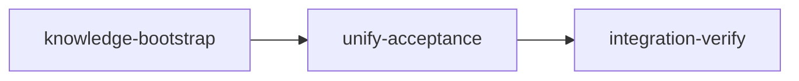

# Plan: Unify truths/truth_checks into acceptance

## Context

Loom currently has **three redundant ways** to define shell-command-based verification in plans:

1. `acceptance: Vec<String>` — simple commands, run first (5min timeout)
2. `truths: Vec<String>` — simple commands, run as part of goal-backward (30s timeout)
3. `truth_checks: Vec<TruthCheck>` — enhanced commands with stdout/stderr checks (30s timeout)

All three are shell commands that must succeed. The semantic distinction ("is it done?" vs "does it work?") confuses plan authors and leads to duplicate checks. This plan unifies them into a single `acceptance` field that supports both simple strings and enhanced TruthCheck-style entries.

**Kept as-is:** `artifacts`, `wiring`, `wiring_tests`, `dead_code_check` (declarative, non-shell-command checks), `before_stage`/`after_stage` (different lifecycle — pre/post condition hooks).

## Design

### New type: `AcceptanceCriterion`

```rust
#[derive(Debug, Clone, PartialEq, Serialize, Deserialize)]
#[serde(untagged)]
pub enum AcceptanceCriterion {
    Simple(String),
    Extended(TruthCheck),
}
```

YAML backward-compatible:

```yaml
acceptance:
  - "cargo test"                     # Simple — parsed as string
  - command: "curl localhost:3000"    # Extended — parsed as TruthCheck
    stdout_contains: ["ok"]
```

### Fields removed

- `truths: Vec<String>` from StageDefinition and Stage
- `truth_checks: Vec<TruthCheck>` from StageDefinition and Stage

### Verification flow change

**Before:** acceptance (Vec\<String\>, 5min) → goal-backward (truths 30s + truth_checks 30s + artifacts + wiring + ...)

**After:** acceptance (Vec\<AcceptanceCriterion\>, simple=5min extended=30s) → goal-backward (artifacts + wiring + wiring_tests + dead_code_check + regression_test)

### Validation change

`has_any_goal_checks()` no longer includes truths/truth_checks. Checks: artifacts, wiring, wiring_tests, dead_code_check.

Standard stages must have non-empty `acceptance` OR at least one artifact/wiring/wiring_test/dead_code_check.

## Execution Diagram



---

## Stages

### 1. Knowledge Bootstrap

**Purpose:** Verify existing knowledge coverage (knowledge already populated for this project).

**Tasks:**

- Run `loom knowledge check` to confirm coverage
- Review mistakes.md for relevant past issues

**Files:** `doc/loom/knowledge/**`

---

### 2. Unify Acceptance (implementation)

**Purpose:** Replace `truths`/`truth_checks` with unified `acceptance` field supporting both simple strings and extended TruthCheck entries.

**Dependencies:** knowledge-bootstrap

**Parallel subagents with exclusive file ownership:**

#### Subagent 1 — Core Types & Plumbing

Defines the new `AcceptanceCriterion` enum, removes `truths`/`truth_checks` fields, updates validation.

| Files Owned (write) | Purpose |
|---|---|
| `src/plan/schema/types.rs` | Add AcceptanceCriterion enum, remove truths/truth_checks from StageDefinition, update has_any_goal_checks() |
| `src/models/stage/types.rs` | Remove truths/truth_checks, change acceptance to Vec\<AcceptanceCriterion\>, update Default |
| `src/models/stage/methods.rs` | Remove truths/truth_checks from Stage::new() |
| `src/commands/init/plan_setup.rs` | Remove truths/truth_checks copy in create_stage_from_definition() |
| `src/plan/schema/validation.rs` | Remove truths validation, update acceptance validation for both variants, update goal-backward requirement to accept non-empty acceptance |

**Key changes:**

- `AcceptanceCriterion` enum with `#[serde(untagged)]` — `Simple(String)` | `Extended(TruthCheck)`
- Add `PartialEq` derive to `TruthCheck` (needed by criteria_runner.rs comparison)
- Add helper methods: `AcceptanceCriterion::command() -> &str`, `is_extended() -> bool`
- `has_any_goal_checks()`: remove truths/truth_checks checks, keep artifacts/wiring/wiring_tests/dead_code_check
- Validation: standard stages require `!acceptance.is_empty() || has_any_goal_checks()`

#### Subagent 2 — Verification Logic & Commands

Updates the acceptance runner to handle extended criteria, removes truths from goal-backward.

| Files Owned (write) | Purpose |
|---|---|
| `src/verify/criteria/runner.rs` | Handle AcceptanceCriterion enum — simple gets 5min timeout, extended gets 30s with stdout/stderr checks |
| `src/verify/goal_backward/mod.rs` | Remove truths/truth_checks verification steps (1 and 2) |
| `src/verify/goal_backward/truths.rs` | Remove verify_truths(), keep verify_truth_checks() for before_after use, update tests |
| `src/verify/mod.rs` | Remove verify_truths from exports |
| `src/commands/verify.rs` | Update display messages ("truths" → "checks"), update module doc |
| `src/commands/stage/verify.rs` | Adjust flow — goal-backward no longer has truths, update tests |
| `src/commands/stage/criteria_runner.rs` | Update reload_acceptance_from_plan for Vec\<AcceptanceCriterion\> |
| `src/commands/stage/acceptance_runner.rs` | Update display to show extended check details (description, stdout_contains) |
| `src/orchestrator/signals/generate.rs` | Update skill matching — extract command strings from AcceptanceCriterion |

**Key changes in runner.rs:**

- Iterate over `stage.acceptance` as `Vec<AcceptanceCriterion>`
- For `Simple(cmd)`: existing logic (5min timeout, exit 0 = pass)
- For `Extended(check)`: use verify_truth_checks logic (30s timeout, check exit_code, stdout_contains, stdout_not_contains, stderr_empty)
- Display: show description if available for extended checks

#### Subagent 3 — Mechanical Updates

Remove `truths: Vec::new()`, `truth_checks: Vec::new()` from all Stage/StageDefinition constructors across the codebase.

| Files Owned (write) | Purpose |
|---|---|
| `src/commands/stage/recover.rs` | Remove truths/truth_checks from Stage construction |
| `src/orchestrator/core/mod.rs` | Remove from test Stage construction |
| `src/orchestrator/core/event_handler.rs` | Remove from test Stage construction |
| `src/fs/stage_loading.rs` | Remove from Stage construction |
| `src/git/merge/status.rs` | Remove from Stage construction |
| `src/git/worktree/base.rs` | Remove from Stage construction |
| `src/commands/status/data/collector.rs` | Remove from Stage construction |
| `src/commands/status/ui/tui/renderer.rs` | Remove from Stage construction |
| `src/commands/status/ui/tree_widget_tests.rs` | Remove from test Stage construction |
| `src/plan/schema/tests/mod.rs` | Remove from test StageDefinition construction |
| `src/plan/graph/tests.rs` | Remove from test StageDefinition construction |
| `src/commands/init/tests.rs` | Remove from test StageDefinition/Stage construction |
| `src/commands/run/tests.rs` | Remove from test StageDefinition construction |

**NO FILE OVERLAP between subagents confirmed.**

**Acceptance:**

- `cargo test` (all tests pass with unified type)
- `cargo clippy -- -D warnings`
- `cargo build`

---

### 3. Integration Verification

**Purpose:** Verify everything compiles, tests pass, and the unified acceptance system works end-to-end.

**Dependencies:** unify-acceptance

**Tasks:**

- Full test suite + clippy + build
- Code review (architecture, security)
- Functional verification: `loom init` with a plan using the new acceptance format
- Knowledge curation from implementation stage memories
- Update documentation (CLAUDE.md references to truths in knowledge files)

**Acceptance:**

- `cargo test`
- `cargo clippy -- -D warnings`
- `cargo build`

---

<!-- loom METADATA -->

```yaml
loom:
  version: 1
  sandbox:
    enabled: true
    auto_allow: true
    excluded_commands:
      - "loom"
    filesystem:
      deny_read:
        - "~/.ssh/**"
        - "~/.aws/**"
      deny_write:
        - ".work/stages/**"
        - "doc/loom/knowledge/**"
      allow_write:
        - "loom/src/**"
        - "loom/tests/**"
    network:
      allowed_domains:
        - "crates.io"
        - "index.crates.io"
        - "static.crates.io"
      allow_local_binding: false
      allow_unix_sockets: []
  stages:
    - id: knowledge-bootstrap
      name: "Bootstrap Knowledge Base"
      stage_type: knowledge
      description: |
        Verify existing knowledge coverage for loom codebase.
        Knowledge files already exist and are populated.

        Use parallel subagents and skills to maximize performance.

        Tasks:
        1. Run loom knowledge check to verify coverage >= 50%
        2. Review doc/loom/knowledge/mistakes.md for relevant past issues
        3. Briefly scan architecture.md and patterns.md for verification system context

        MEMORY RECORDING:
        - Record any gaps found: loom memory note "gap: description"
        - Record relevant mistakes: loom memory note "relevant mistake: description"
      dependencies: []
      acceptance:
        - 'test -f doc/loom/knowledge/architecture.md'
        - 'test -f doc/loom/knowledge/patterns.md'
        - 'rg -q "Goal-Backward" doc/loom/knowledge/patterns.md'
      files:
        - "doc/loom/knowledge/**"
      working_dir: "."
      artifacts:
        - "doc/loom/knowledge/architecture.md"
        - "doc/loom/knowledge/entry-points.md"

    - id: unify-acceptance
      name: "Unify truths/truth_checks into acceptance"
      stage_type: standard
      description: |
        Replace truths and truth_checks fields with a unified acceptance field that
        supports both simple string commands and enhanced TruthCheck-style entries.

        Use parallel subagents and skills to maximize performance.

        DESIGN SUMMARY:
        - New AcceptanceCriterion enum (untagged serde): Simple(String) | Extended(TruthCheck)
        - Remove truths and truth_checks fields from StageDefinition and Stage
        - Keep before_stage, after_stage (different lifecycle purpose)
        - Keep artifacts, wiring, wiring_tests, dead_code_check (non-shell-command)
        - Acceptance runner handles both variants (simple=5min, extended=30s timeout)
        - Goal-backward verification no longer handles shell commands
        - has_any_goal_checks() checks only artifacts/wiring/wiring_tests/dead_code_check
        - Validation: standard stages need non-empty acceptance OR goal-backward checks

        SUBAGENT FILE ASSIGNMENTS:

        Subagent 1 - Core Types & Plumbing:
          Files Owned: src/plan/schema/types.rs, src/models/stage/types.rs,
                       src/models/stage/methods.rs, src/commands/init/plan_setup.rs,
                       src/plan/schema/validation.rs
          Files Read-Only: src/verify/ (for understanding current usage)
          Task: Define AcceptanceCriterion enum, remove truths/truth_checks fields,
                add PartialEq to TruthCheck, update has_any_goal_checks(),
                update validation rules. Add helper methods command() and is_extended()
                on AcceptanceCriterion.

        Subagent 2 - Verification Logic & Commands:
          Files Owned: src/verify/criteria/runner.rs, src/verify/goal_backward/mod.rs,
                       src/verify/goal_backward/truths.rs, src/verify/mod.rs,
                       src/commands/verify.rs, src/commands/stage/verify.rs,
                       src/commands/stage/criteria_runner.rs,
                       src/commands/stage/acceptance_runner.rs,
                       src/orchestrator/signals/generate.rs
          Files Read-Only: src/plan/schema/types.rs (for new types),
                           src/verify/before_after.rs (keep as-is, uses TruthCheck)
          Task: Update acceptance runner to handle AcceptanceCriterion enum.
                For Simple: existing logic (5min timeout, exit 0).
                For Extended: 30s timeout, check exit_code, stdout_contains,
                stdout_not_contains, stderr_empty (reuse verify_truth_checks logic).
                Remove truths/truth_checks from goal-backward mod.rs.
                Remove verify_truths() from truths.rs (keep verify_truth_checks for before_after).
                Update display messages in commands/verify.rs.
                Update skill matching in signals/generate.rs.

        Subagent 3 - Mechanical Updates:
          Files Owned: src/commands/stage/recover.rs, src/orchestrator/core/mod.rs,
                       src/orchestrator/core/event_handler.rs, src/fs/stage_loading.rs,
                       src/git/merge/status.rs, src/git/worktree/base.rs,
                       src/commands/status/data/collector.rs,
                       src/commands/status/ui/tui/renderer.rs,
                       src/commands/status/ui/tree_widget_tests.rs,
                       src/plan/schema/tests/mod.rs, src/plan/graph/tests.rs,
                       src/commands/init/tests.rs, src/commands/run/tests.rs
          Files Read-Only: src/models/stage/types.rs (for new field shape)
          Task: Remove truths: Vec::new() and truth_checks: Vec::new() lines from
                all Stage and StageDefinition constructors. These fields no longer exist.
                Also update any test assertions that reference these fields.

        NO FILE OVERLAP between subagents confirmed.

        MEMORY RECORDING (use memory ONLY — never knowledge):
        Record IMMEDIATELY when these happen — not at stage end:
        - MISTAKE: tried X, failed -> loom memory note "mistake: ..."
        - DECISION: chose X over Y -> loom memory decision "chose X" --context "why"
        - SURPRISE: unexpected behavior -> loom memory note "found: ..."
      dependencies: ["knowledge-bootstrap"]
      acceptance:
        - "cargo test"
        - "cargo clippy -- -D warnings"
        - "cargo build"
      files:
        - "loom/src/**/*.rs"
        - "loom/tests/**/*.rs"
      working_dir: "loom"
      artifacts:
        - "src/plan/schema/types.rs"
        - "src/verify/criteria/runner.rs"
      wiring:
        - source: "src/plan/schema/types.rs"
          pattern: "AcceptanceCriterion"
          description: "New AcceptanceCriterion enum is defined"
        - source: "src/plan/schema/types.rs"
          pattern: "pub acceptance: Vec<AcceptanceCriterion>"
          description: "StageDefinition uses unified acceptance type"
        - source: "src/models/stage/types.rs"
          pattern: "pub acceptance: Vec"
          description: "Stage model uses unified acceptance type"
        - source: "src/verify/criteria/runner.rs"
          pattern: "AcceptanceCriterion"
          description: "Acceptance runner handles the new enum"

    - id: integration-verify
      name: "Integration Verification"
      stage_type: integration-verify
      description: |
        Final integration verification after unification merge.

        Use parallel subagents and skills to maximize performance.

        CRITICAL: Verify FUNCTIONAL INTEGRATION, not just tests passing.

        Build/Test Tasks:
        - Full test suite (cargo test)
        - Linting (cargo clippy -- -D warnings)
        - Build verification (cargo build)

        CODE REVIEW (MANDATORY):
        - Spawn parallel review subagents:
          - security-engineer: check for injection in shell command handling
          - senior-software-engineer: verify clean enum design, no dead code from removed fields
          - /loom-testing skill: coverage of AcceptanceCriterion variants

        FUNCTIONAL VERIFICATION (CRITICAL):
        - Create a test plan YAML with both simple and extended acceptance criteria
        - Run loom init on it to verify parsing works
        - Verify old plans with truths: field don't crash (serde ignores unknown fields)
        - Verify goal-backward still runs artifacts/wiring checks correctly

        KNOWLEDGE CURATION (MANDATORY):
        - Read all stage memory: loom memory show --all
        - Curate mistakes to: loom knowledge update mistakes "..."
        - Update patterns.md: loom knowledge update patterns "..." (Goal-Backward section)

        DOCUMENTATION UPDATE (MANDATORY):
        - Update doc/loom/knowledge/architecture.md (Goal-Backward section)
        - Update doc/loom/knowledge/patterns.md (Goal-Backward section)
        - Update doc/loom/knowledge/conventions.md (Plan YAML Schema section)
      dependencies: ["unify-acceptance"]
      acceptance:
        - "cargo test"
        - "cargo clippy -- -D warnings"
        - "cargo build"
      files:
        - "loom/src/**/*.rs"
        - "doc/loom/knowledge/**"
      working_dir: "loom"
      wiring:
        - source: "src/plan/schema/types.rs"
          pattern: "AcceptanceCriterion"
          description: "AcceptanceCriterion enum exists after merge"
        - source: "src/verify/criteria/runner.rs"
          pattern: "AcceptanceCriterion"
          description: "Runner handles unified type after merge"
```

<!-- END loom METADATA -->
