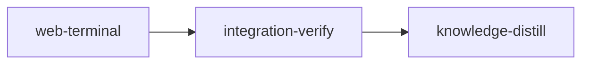

# Plan: Stage terminals in the web dashboard

## Overview

`loom status --web --terminals` lets the dashboard open a live terminal on any stage whose
session runs under the tmux backend. The server spawns a `tmux attach-session` client inside a
PTY it owns and bridges that PTY to the browser over a dedicated WebSocket; the page renders it
with xterm.js inside the existing stage dialog, view-only first, with an explicit "take control"
step. The agent, the spawn path, liveness, and the overview reconciler are untouched: a browser
terminal is one more tmux client on the session's own server, exactly what `loom attach` is.

Design discussion and the approved mock: `doc/plans/briefs/web-terminal/web-terminal/mockup.html`
(the "window cut into the ledger" direction: a dark well in both themes, the glass sheen as the
mode indicator, the `>_` glyph as the entry point).

## Goals

- `loom status --web --terminals` prints a tokenized URL; without the flag the dashboard is
  byte-for-byte the read-only server it is today (the snapshot only gains `terminals: false`).
- A terminal upgrade at `/ws/terminal/<stage-id>/<view|control>` passes five gates and a
  shutdown re-check before any WebSocket accept (1 enabled; 2 `Origin` present, `http(s)`, and its
  authority byte-equal to the request's `Host`; 3 cookie token; 4 path shape; 5 terminal slot;
  6 `running` re-read WHILE HOLDING that slot, so a connection accepted microseconds before Ctrl-C
  cannot start a tmux client behind the shutdown drain), then resolves the stage's live tmux
  session and bridges a PTY-hosted tmux client to the socket. Refusals after accept are close codes the page switches
  on, in THREE classes because the page's reaction differs by class: 4004 no such stage
  (permanent), 4008 never attachable — native backend, unrenderable identifier (permanent), 4009
  not attachable YET — no live session, still spawning, endpoint not ready (retried every 2 s).
  Plus 1000 ended and 1001 server stopping. Browser-worded reasons are spelled in the S2 brief;
  attach's `describe_failure` is private and ends in "re-run `loom attach`". Pre-accept refusals
  (404/403/401) reach the browser as a bare `error` event with no status: the page then reads
  `snapshot.terminals` and shows either "start the dashboard with `--terminals`" or "dashboard
  cookie missing — open the tokenized URL printed at startup"; no new wire field is added for
  this.
- View mode attaches `-f read-only`; control attaches as a normal client. The browser sizes the
  window like any tmux client (the daemon spawns detached at 220×50 and `loom attach` and the
  overview already resize; `ignore-size` would force 220 columns into the well, so it is not used).
  Consequence, accepted: nothing in the tree sets `window-size`, so tmux's default `latest` lets
  a view-mode browser client at 120×36 reflow the live agent's window and fight a concurrent
  `loom attach`; `-f read-only` blocks input only.
- The stage dialog gains a terminal view at `?stage=<id>&view=terminal`, a `Terminal` header
  button, the `t` key, a `>_` glyph on graph cards and ledger rows, and a full page at
  `/terminal/<id>`. Esc returns to details in view mode and reaches the agent in control mode.
- xterm.js is loaded as a lazy chunk behind one `Emulator` interface so the emulator can be
  swapped by editing one file.

Non-goals: native-backend sessions (the UI says terminals need `loom run --backend tmux`),
binding to a non-loopback address, remembering control mode across reloads, multiplexing the
terminal over the snapshot socket, any change to the daemon protocol.

## Settled decisions

| Decision | Value | Why |
| --- | --- | --- |
| Enablement | `--terminals`, `requires = "web"`, default off | the dashboard is documented read-only; a write lane is opt-in |
| Auth on the terminal lane | 64-hex token minted at startup, delivered by `GET /?token=` → 302 + a cookie named `loom_dashboard_<bound port>` (`HttpOnly; SameSite=Strict; Path=/`) | WebSockets ignore same-origin policy; Origin blocks browsers, the cookie blocks other local processes; the daemon's `user.token` is a different trust boundary and its generator is private (`daemon/server/tokens.rs:36-47`). The name carries the port because **cookies have no port scope**: the CLI deliberately runs several dashboards at once (`bind_first_available_loopback_port`, `web/mod.rs:69-83`), and one fixed name means opening instance B's tokenized URL overwrites instance A's cookie — A's own same-origin page then presents B's token and loses its terminals for good. `serve` derives the name from `listener.local_addr()?.port()`; nothing else may hardcode `loom_dashboard`. |
| Origin on the terminal lane | required, `http(s)`, authority byte-equal to the request's `Host` header (which `host_allowed` has already checked is loopback) — NOT merely loopback like `/ws`'s `origin_allowed` (`http.rs:133-147`, absent passes, any loopback port passes) | `SameSite` is keyed on the registrable domain, and for an IP literal the port is not part of the site: a page served from `http://127.0.0.1:9999` (any other local dev server) is same-site to the dashboard, the browser attaches the `loom_dashboard_<port>` cookie to its WebSocket, and a loopback-only Origin check would let that page take control of the agents. Equality with `Host` closes it. |
| Route shape | path segments `/ws/terminal/<stage>/<view\|control>`; stage must be a plain identifier | `RequestHead.path` already strips the query; no decoding needed |
| Mode semantics | view = `-f read-only` (input blocked only; the client still resizes the window, see Goals), control = plain attach; both browser-sized | see Goals |
| Resolver precedence | `viewer::live_tmux_sessions(state_dir)` is the population, then `attach::matches_for_stage` + `attach::pick_newest` (both promoted from private to `pub(crate)` by S2 — a visibility-only edit — so ONE definition serves attach and the dashboard) | this is literally `attach`'s rule (`attach/mod.rs:57,73-85`), not a paraphrase of it. `live_tmux_sessions` (`viewer.rs:189-249`) drops non-tmux sessions, every status except `Running`/`Spawning` (so **`Paused` is NOT attachable** — the earlier `!status.is_terminal()` wording was wrong), sessions failing `TmuxBackend::is_session_alive`, and sessions with no derivable name. Reimplementing the predicate is how the two would drift apart |
| Liveness on the terminal lane | whatever `live_tmux_sessions` already applied: `TmuxBackend::is_session_alive` → `native::pid_only_is_alive` (PID-file identity + start time). NEVER `session.pid` | `pid_guard.rs:20-23` states outright that `session.pid` is informational and never an identity fallback; using it reintroduces PID reuse and missing-identity false positives. Accepted consequence: the glyph's gate is `StageSummary.session_alive`, which the collector DOES compute from the raw pid (`collector.rs:146`), so a stage can show a `>_` and then answer 4009 — the page renders that as `waiting`, which is the honest state |
| Identifier validation | `is_plain_identifier` (`viewer.rs:168`) applied to BOTH the derived socket name and the tmux session name, exactly as `attachable_panes` (`viewer.rs:118-132`) does | `tmux_session_name(..) == None` is not validation — it only means no name could be derived at all. A corrupt non-empty tracking key passes it and then breaks the attach command line |
| Unknown stage vs. sessionless stage | the resolver loads the stage inventory (`verify::transitions::load_stage(stage_id, state_dir).is_ok()`, `pub` at `transitions/mod.rs:17`): missing stage → 4004 permanent, known stage with no live session → 4009 retryable | without it "no matching session" is indistinguishable from "no such stage", and a known stage between two sessions would be refused permanently — the exact case the terminal is opened for |
| Close-code classes | 4004 no such stage; 4008 permanently not attachable (`NativeBackend`, `Unrenderable`); 4009 not attachable yet (`NoSession`, `NotReady`); 1000 ended; 1001 stopping. The page: 4004/4008 → `refused`, no retry; 4009 → `waiting`, retry every 2 s; 1001 → `dropped` | a two-code scheme forces one wrong answer in both directions — a native-backend session is permanent and would be polled forever, a stage between sessions is transient and would never be retried. The matrix is pinned by a table test on BOTH sides (`refusal_close_code_table` in Rust, a table test in `terminal.test.ts`) |
| Browser → server frames | keystrokes are BINARY frames (`new TextEncoder().encode(data)` before `WebSocket.send`); resize is a TEXT frame of JSON | `WebSocket.send` accepts a string and sends a TEXT frame, which `parse_client_frame` reads only as resize JSON and drops — every keystroke would vanish with no error anywhere. `TerminalConnection.send` encodes; a unit test asserts the exact bytes for an ASCII and a non-ASCII payload |
| Initial PTY size | 120×36, replaced by the browser's first resize frame | any size works; the page fits within 100 ms |
| Concurrency cap | `MAX_TERMINALS = 8` in `limits.rs`: `Lane::Terminal`, arms in `Lane::capacity`/`Lane::counter`, a third `AtomicUsize` on `Limits`; a terminal holds its accept-loop `Lane::Connection` slot plus a `Lane::Terminal` slot, never a `Lane::WebSocket` one; a full lane answers `fail(503, "Service Unavailable", "terminal limit reached")` | each holds a PTY, a tmux client and a thread; one per open tab is plenty; `reject_overloaded` belongs to the accept loop and is not reused |
| Shutdown admission | acquire the `Lane::Terminal` slot FIRST, then re-read `running`; if it is false, drop the slot and `fail(503, .., "server stopping")` | `Slot` releases in `Drop` (`limits.rs:88-95`), i.e. the instant the handler returns, so counting slots alone cannot tell a shutting-down server that a connection is about to become a terminal. Acquire-then-recheck is race-free in both directions: increment before the drain's read ⇒ the drain waits; increment after it ⇒ `running` is already false and the upgrade refuses. Without it, a connection accepted just before Ctrl-C can sit up to `HEAD_TIMEOUT` (5 s, `head.rs:10`) waiting for its request head, classify as a terminal AFTER `serve` returned, and spawn an orphan `tmux attach-session` |
| tmux socket dir | when `--terminals` is set, and only then: `adopt_recorded_tmux_tmpdir(work_dir.root())` once in `execute`, main thread, before `serve` — the argument is the STATE dir (`.loom/work`, the `WorkDir::new(".")` already bound in `execute`), never the repo root | it mutates the process env via `set_var`/`remove_var` (`fs/tmux_tmpdir.rs:155-159`), and the flagless dashboard is promised byte-for-byte unchanged. It reads `<arg>/tmux-tmpdir` and probes `<arg>/orchestrator.pid` (`:130`, `:148`), so `Path::new(".")` is a silent permanent no-op. Adoption happens ONLY while the daemon is live — deliberate crate-wide policy (`loom attach` does the same; `:139-146`): a daemon-less dashboard keeps the ambient `TMUX_TMPDIR`, and a daemon restarted with a different dir needs a dashboard restart. Documented in the module docstring. |
| Bridge | one thread per terminal: `nix::poll` over the PTY master and the TCP fd, 50 ms tick, tungstenite with 5 ms read / 250 ms write timeouts. The master is NON-BLOCKING: reads treat `EAGAIN` as "nothing yet", and browser input goes into a bounded pending queue (`MAX_PENDING_INPUT = 64 KiB`, oldest dropped when full) drained on `POLLOUT`, which is registered only while the queue is non-empty | no `mio` or second thread; the crate has no multiplexing precedent and this stays close to `ws.rs`. A BLOCKING master with a `write_all` is the one call in the loop with no bound: a tmux client that stops reading fills the PTY input queue and the bridge blocks forever — it stops observing `running`, never releases its terminal slot, and defeats the drain below. `connection.rs:17-34` and `ws.rs:32-39` already treat an unbounded blocked write as the shutdown hazard it is |
| Shutdown drain | after the accept loop exits, `serve` waits up to 3 s (50 ms polls) for the `Lane::Connection` counter to reach zero, not the terminal counter | `serve` today spawns detached connection threads and returns the moment `running` is false (`web/mod.rs:95-133`), so without the drain Ctrl-C strands one `tmux attach-session` client per open tab. The CONNECTION lane is the right counter: it is held for the whole life of a connection thread, including the up-to-5 s head read that has not yet decided whether it is a terminal. The 3 s bound can still expire under a stalled head; the acquire-then-recheck rule above, not the drain, is what makes that safe |
| tungstenite 0.30 spellings | `CloseFrame { code: CloseCode::Library(4004), reason: "no stage with that id".into() }`; `Message::binary(..)` / `Message::text(..)` constructors | `4000..=4999` maps to `Library` (`protocol/frame/coding.rs:255`); `Bad` fails `is_allowed()`; `reason` is `Utf8Bytes`; the tuple variants hold `Bytes`/`Utf8Bytes`, not `Vec<u8>`/`String` |
| nix features | `cargo add nix --features term,poll` from `loom/`; `nix::pty` is behind `term`, there is no `pty` feature | `nix` is already a dependency (`loom/Cargo.toml:26`, `["process","fs","signal"]`, `default-features = false`); naming a nonexistent feature makes `cargo add` abort without touching the manifest; the result stays one inline line, which the acceptance regexes anchor on |
| Frontend transport | a second WebSocket per open terminal, not a frame type on `/ws` | `ws.ts` is one shared socket; a byte stream does not belong in a JSON snapshot lane |
| Emulator | `@xterm/xterm 6.0.0`, addons fit 0.11.0, webgl 0.19.0, unicode11 0.9.0 (registry, 2026-09-08), lazy-imported behind `Emulator` | VS Code's terminal; ttyd/gotty/code-server use it for exactly this shape |
| Wire model | `WebSnapshot.terminals: bool`, fixture `snapshot.json` + zod `snapshotSchema` updated in the same stage | `snapshotSchema` is `.strict()`: a Rust-side field the schema lacks makes zod reject every frame |
| Control-mode keys | a BUBBLE-phase `onKeyDown` on the terminal well calling `stopPropagation()`; never `onKeyDownCapture` | Radix's focus trap is a bubble handler on the FocusScope div (`react-focus-scope/dist/index.mjs:107,131`) and xterm's listener is on its own helper textarea, i.e. the TARGET. Capture runs root→target, so a capture handler on an ancestor stops the key BEFORE xterm — suppressing exactly what it is meant to protect, while a focus-only test still passes. Bubble runs target→root: xterm first, then the well stops it short of the dialog. `DismissableLayer` listens on the document in CAPTURE (`react-dismissable-layer/dist/index.mjs:105`), so Esc reaches `onEscapeKeyDown` either way |
| Emulator lifecycle | every action after `await factory()` sits behind a `cancelled` guard; a late emulator is disposed, the 100 ms fit debounce is cancelled on unmount, a rejected factory becomes `refused`, and the sink is `bytes => emulator.write(bytes)` | the factory dynamically imports four packages, so unmount or a stage/mode change can easily win the race: without the guard the stale continuation mounts xterm into a detached node and opens a socket nothing will close. The bound sink is the same lesson `ws.ts:40-50` already records — an unbound host method throws "Illegal invocation" in a real browser and only in a real browser |
| Esc | view: back to details; control: goes to the agent, close with ✕ or back; outside-click cannot close in control | Claude Code uses Esc to interrupt |

## Baselines (observed at HEAD `5721f5a7`, 2026-09-08)

- `cargo test --lib status::web::` from `loom/`: `43 passed; 0 failed`.
- `cd web && bun install --frozen-lockfile && bun run check`: green; vitest `16 files, 188 tests`.
- `loom knowledge check --strict`: RED at baseline, 123 issues, 108 of them stale `source
  reference` entries in files this plan does not touch. The distill stage therefore checks only
  the files it writes (same shape as the web-dashboard plan) instead of `--strict`.
- PTY allocation works inside this sandbox (`python3 -c "import pty; pty.openpty()"` succeeded),
  so the PTY unit tests run in-stage. AF_UNIX bind was refused in the interactive sandbox this
  plan was written in, but the stage sandbox is loom's own and is configurable: the plan sets
  `allow_all_unix_sockets: true` (`models/stage/types.rs:353`, emitted as
  `allowAllUnixSockets` by `sandbox/settings/policy.rs:96`) so the tmux e2e runs FOR REAL
  in-stage (tmux is on this host and in CI, `.github/workflows/ci.yml:86-88`), and
  `LOOM_E2E_REQUIRE_TMUX=1` (`loom/tests/e2e/tmux_backend.rs:200-208`) turns its skip into a
  failure. If the stage sandbox still refuses the bind with that setting, that is a `Blocked`
  finding for the operator, not a skip: the plan ships no unproven e2e.
- The maintainability gate (`loom/tests/maintainability.rs`) fails on any NEW file over 400 lines
  or function over 50 lines; every brief carries the constraint. It also validates the current
  violations against `loom/maintainability-baseline.txt` and fails on a STALE entry as well as
  a new one (`tests/maintainability/baseline.rs:182-198`); line 67 of that file pins
  `function src/cli/dispatch.rs dispatch 128`, which S2 edits, so S2 owns that one line.
- The canonical push gate is `loom/.githooks/pre-push:115-145`: `cargo audit`, `env -u
  GIT_INDEX_FILE -u GIT_DIR -u GIT_WORK_TREE cargo test --all-targets --no-fail-fast`, and
  `scripts/flake-check.sh`. All three are on `integration-verify`. On `web-terminal` the
  UNFILTERED suite is deliberately absent: loom's own preflight warns that a standard stage must
  prove its code with filtered runs and leave the unfiltered suite to the integration-verify stage
  (`plan/schema/structural_checks.rs`, `is_full_suite_run`), and a full `--all-targets` run does
  not reliably fit the 300 s per-line cap either. `web-terminal` instead carries `cargo audit`,
  a flake check scoped to the module it writes, and filtered runs over every module it touches —
  `commands::status::`, `commands::status::web::`, `cli::`, `commands::attach::` — plus the e2e
  and web suites. `scripts/flake-check.sh` is invoked as `--runs 5 commands::status::web::` on
  both stages: its default is 20 runs over four unrelated filters and would blow the 300 s cap,
  while the new code (poll loops, a 3 s drain, PTY reaping, retry timers) is exactly the kind the
  script exists for.
- Each acceptance line runs as its own `sh -c` with cwd = the worktree root and a 300 s cap
  (`verify/criteria/config.rs:11`; `loom stage complete` does not override it). A `cd web &&`
  never leaks into the next line. Warm the tree (`cargo build --all-targets`, `cargo doc`) before
  `loom stage complete`; a line timing out at ~300 s is that cap, not a hang.

### Preflight: commit the working tree first

`loom run` bails on uncommitted tracked changes (`commands/run/checks.rs:343-362`). At authoring
time the tree carries an unplanned `--web` port-selection change (`execute(port: Option<u16>)`,
`bind_listener`, `bind_first_available_loopback_port` in `loom/src/commands/status/web/mod.rs`;
`web: Option<Option<u16>>` without `default_missing_value` in `loom/src/cli/types_status_web.rs`;
`#[path = "tests/ports.rs"] mod ports;` in `web/tests.rs`; the renamed test
`the_cli_preserves_omitted_and_explicit_dashboard_ports` in `web/tests/pure.rs:237`; the untracked
`web/tests/ports.rs`; two README lines). COMMIT it before `loom run` — stage worktrees branch from
HEAD (`git/worktree/operations.rs:62-65`), so an uncommitted change is invisible in-stage and
collides on merge-back. The S2 brief and the contracts below are written against the tree WITH
that change: `execute(port: Option<u16>, terminals: bool)`, and `bind_listener` already exists.

### Sandbox entries loom silently drops

`sandbox/settings/policy.rs:46,134,150` filter out every `deny_read`, `deny_write` and
`allow_write` entry containing `../`. The `../.loom/work/*.token`, `../../**` and
`../.worktrees/**` entries below therefore reach the sandbox as nothing, and `deny_write` is
empty in practice: do not treat the worktree as read-isolated from the parent repo. They stay
listed for parity with the web-dashboard plan; the two `.work/*.token` entries are the ones that
matter and are present.

## Execution Diagram



Knowledge bootstrap is skipped: `doc/loom/knowledge/` is hierarchical and populated (73 index
entries, tier-2 topics for the web dashboard and the tmux backend).

## Stages

### 1. `web-terminal` — server lane, page, tests (one stage)

Stage necessity: no other stage needs this code merged first (Q1 no), no other stage IN THIS PLAN
writes these files (Q2 no — the necessity test is intra-plan; see the cross-plan preconditions
below for the other question), no checkpoint separates the halves (Q3 no), and the orchestrator
holds six compact reports well under the ceiling (Q4 no). The Rust/fixture/zod lockstep is the
strongest reason to keep it one stage: `model_tests.rs`, `snapshot.json` and `schema.ts` must
change together.

**Cross-plan preconditions (check before `loom run`).** Loom's overlap check is intra-plan only
(`plan/schema/structural_checks.rs:98-120`), so nothing in the tool warns about a sibling plan.
Several unfinished plans in `doc/plans/` declare paths this stage writes, and merging one of them
between this plan's branch point and its merge-back is a hand-resolved conflict:

| Sibling plan | Shared surface |
| --- | --- |
| `IN_PROGRESS-PLAN-web-dashboard.md` | `loom/src/commands/status/web/**`, `cli/dispatch.rs`, `cli/types.rs`, `web/**`, `scripts/smoke-web-dashboard.sh` (`:1134-1146`) |
| `IN_PROGRESS-PLAN-fix-knowledge-bootstrap-macos.md` | `src/cli/dispatch.rs` (`working_dir: loom`) and `src/**/*.rs` in its integration stage (`:119-123,164-172`) |
| `IN_PROGRESS-PLAN-embed-assets-and-complete-self-update.md` | `cli/dispatch.rs`, `cli/types.rs`, `loom/src/**` in integration, `README.md` (`:879-896,1030-1035`) |
| `PLAN-model-router-hooks.md` | `cli/dispatch.rs`, `loom/src/**` in integration, `doc/loom/knowledge/**`, `README.md` (`:324-328,448-492`) |
| `PLAN-loom-config-command.md` | `doc/loom/knowledge/**` in a schedulable stage (`:170-175`) |

The one hard precondition is the web-dashboard base: this plan is written against
`loom/src/commands/status/web/` as it stands at HEAD (43 lib tests, `bind_listener`,
`Lane::{Connection,WebSocket}`, `RequestHead`), and against `web/src/api/schema.ts` already
carrying the quota block (`schema.ts:101-123`, committed — `PLAN-quota-meters`'s web half has
landed). Run this plan only while no sibling plan with a broad `loom/src/**` or `web/**` owner is
executing; if one merges first, re-read `web/mod.rs`, `connection.rs`, `limits.rs` and
`dispatch.rs` before spawning, because every line reference in the briefs is anchored to today's
tree.

Two waves of subagents. Wave 1 is four disjoint territories; wave 2 starts when wave 1 has
returned and `cargo build --all-targets` plus `bun run typecheck` pass on the combined tree.

| Worker | Role | Tier | Files owned | Shared context | Brief path |
| --- | --- | --- | --- | --- | --- |
| S1 | PTY child, bridge, protocol | codex `gpt-5.6-sol` | `loom/src/commands/status/web/terminal/{mod,pty,bridge,protocol,tests_pty,tests_bridge}.rs`, `loom/Cargo.toml` via `cargo add` only | `web/ws.rs`, `tests.rs` (read) | `doc/plans/briefs/web-terminal/web-terminal/s1-pty-bridge.md` |
| S2 | route, token, CLI, wire model, server tests | codex `gpt-5.6-terra` | `terminal/{upgrade,resolve,token,tests_route}.rs`, `web/{connection,http,limits,mod,broadcast,model,model_tests,tests}.rs`, `web/tests/{socket,pure,errors}.rs` (NOT `tests/ports.rs`, read-only, and its `#[path]` line in `tests.rs` stays), `cli/types_status_web.rs`, `cli/dispatch.rs`, `commands/attach/mod.rs` (VISIBILITY ONLY: `fn matches_for_stage`/`fn pick_newest` → `pub(crate) fn`; no other change), `web/src/api/fixtures/snapshot.json`, `scripts/smoke-web-dashboard.sh`, the one `dispatch` line of `loom/maintainability-baseline.txt` | S1's signatures (quoted in the brief) | `doc/plans/briefs/web-terminal/web-terminal/s2-route-token-cli.md` |
| F1 | terminal view, glyph, dialog, routes, CSS | fable (`loom-senior-software-engineer`, `model: fable`, `frontend-design` skill) | `web/src/components/terminal/{terminal-view.tsx,terminal-glyph.tsx,terminal.css}`, `stage-modal.tsx`, `graph/{stage-node,context,stage-graph}.tsx`, `ledger-row.tsx`, `routes/terminal.tsx`, `routes/stage.tsx` (only to export `NotFound`), `router.tsx`, `index.css` (two `@import` lines after line 15) | F2's interfaces (quoted), `mockup.html` | `doc/plans/briefs/web-terminal/web-terminal/f1-terminal-view-design.md` |
| F2 | transport, emulator adapter, hook, schema | codex `gpt-5.6-sol` | `web/package.json` + `bun.lock` via `bun add` only, `web/src/api/{terminal.ts,terminal.test.ts,schema.ts,schema.test.ts}`, `web/src/components/terminal/{emulator.ts,emulator.test.ts,use-terminal.ts}`, `web/README.md` | `ws.ts`, `ws.test.ts` (read) | `doc/plans/briefs/web-terminal/web-terminal/f2-transport-emulator.md` |
| S3 (wave 2) | tmux e2e, terminal smoke script, CI step | codex `gpt-5.6-terra` | `loom/tests/e2e/web_terminal.rs`, `loom/tests/e2e/mod.rs` (an alphabetised list of `pub mod X;`, `:6-19` — add `pub mod web_terminal;` after `pub mod uncommitted_changes;`), `scripts/smoke-web-terminal.sh`, `.github/workflows/ci.yml` | S1+S2 code | `doc/plans/briefs/web-terminal/web-terminal/s3-e2e.md` |
| F3 (wave 2) | component tests, integration glue | codex `gpt-5.6-terra` | `web/src/components/terminal/*.test.tsx`, `web/src/components/stage-modal.test.tsx`, `web/src/routes/terminal.test.tsx`, plus MINIMAL wiring-only edits to F1/F2 files under `web/src/` (never `aurora-ui/**` or `components/ui/**`): a prop, an export, a test id. Never restyle, re-lay-out or rewrite an F1 component to make a test pass — report the mismatch, quoting file and assertion | F1+F2 code | `doc/plans/briefs/web-terminal/web-terminal/f3-component-tests-glue.md` |

Contracts between workers, all quoted verbatim in the briefs:

- S1 → S2: `protocol::{Mode, WindowSize, CLOSE_*}`, `PtyChild::spawn(&mut Command, WindowSize)`,
  `bridge::run(WebSocket<TcpStream>, PtyChild, Mode, &AtomicBool)`.
- S2 → everyone: `ServeOptions { terminal_token: Option<String> }`,
  `execute(port: Option<u16>, terminals: bool)` (`None` = scan upward from `DEFAULT_PORT`; the
  printed URL uses `actual_port` from `listener.local_addr()`), `serve(listener, base, running,
  options)` — unchanged public signature, now three lines over a new `pub(super) serve_with(..,
  limits: Arc<Limits>)` so the server tests can hold the same `Arc<Limits>` and assert on
  `Limits::terminal_count()` — `pub(super) fn write_redirect(..)` in `http.rs` (new; it drains the
  peeked request head first, as `fail` does at `connection.rs:180-181`), the `terminals` field and
  its fixture value `false`.
- F2 → F1/F3: `Emulator`, `EmulatorFactory`, `EmulatorSize`, `TerminalConnection`,
  `TerminalState`, `TerminalMode`, `TerminalPhase`, `TerminalDeps`, and
  `useTerminal(stageId, mode, factory?, deps?)`; `use-terminal.ts` re-exports every one of those
  types (`export type { .. } from`) so F1 has one import site. F1 → F3/routes:
  `export interface TerminalViewProps { stage: StageSummary; frame: "dialog" | "page"; factory?:
  EmulatorFactory; deps?: TerminalDeps }`.
- The `tmux_session_name`/`endpoint_ready`/`live_tmux_sessions`/`is_plain_identifier` seams in
  `orchestrator/terminal/tmux/viewer.rs` are `pub(crate)`, `socket_name` (`tmux/mod.rs:163`) and
  `socket_path_for` (`tmux/socket.rs:33`) are `pub`, `verify::transitions::load_stage` is `pub`
  (`transitions/mod.rs:17`). The resolver's population is `live_tmux_sessions` and its selection
  is `attach::{matches_for_stage, pick_newest}`, which S2 promotes to `pub(crate)` — it does not
  reimplement either, and it is not `session_for_stage`'s rule. Sibling-plan note: that promotion
  touches `loom/src/commands/attach/mod.rs`, which no sibling plan in `doc/plans/` currently
  claims; if one starts to, this stage's edit is two `pub(crate)` keywords and moves.
- Refusal → close code is ONE table, defined in `resolve.rs` and mirrored in `terminal.ts`:
  `UnknownStage`→4004, `NativeBackend`→4008, `Unrenderable`→4008, `NoSession`→4009,
  `NotReady`→4009. Both sides pin it with a table test; F1 renders 4004/4008 as `refused` and
  4009 as `waiting`.
- The terminal cookie's name is `format!("loom_dashboard_{port}")` where `port` is
  `listener.local_addr()?.port()`. `token.rs` owns the one formatter; the smoke script and the
  e2e derive the same string from the port they already parse.
- The tmux e2e's fixture needs TWO things beyond a session file, or every test in it refuses: a
  STAGE file for `web-term-stage` (`verify::transitions::create_stage`, `pub`) so the resolver's
  inventory check does not answer 4004, and a PID-identity file at
  `<state>/pids/<tracking_key>-<session id>.pid` containing the pid, because liveness is
  `pid_only_is_alive` and not `session.pid`. Details in the S3 brief.
- The glyph's gate needs no new wire field: `session_alive` and `session_backend` are already on
  `StageSummary` (`status/data/mod.rs:128,153`; `web/src/api/schema.ts:79,86`). `terminals: bool`
  is the only field this plan adds.
- `daemon/server/tokens.rs:36-47 generate_token_hex` and `:101 ct_eq` are private: `token.rs`
  replicates their shape (`/dev/urandom` → `hex::encode`, `hex` is already a dependency; a
  length-and-XOR fold that never short-circuits).

Codex mechanics: the user chose codex for everything that is not visual design. Spawn each codex
worker as a `loom-codex-forwarder` in the FOREGROUND with `--model gpt-5.6-sol` (S1, F2) or
`--model gpt-5.6-terra` (S2, S3, F3), always `--effort xhigh`, an explicit Bash timeout of
600000 ms, and its brief path. `hooks/codex-forward.sh:17` accepts `gpt-5.6-sol` even though
loom's implementer constants name only terra and luna. Codex workers never run `git`; check
`git status --short` after each returns. F1 is the only Claude worker.

CODEX LIVENESS OVERRIDE (`mistakes/subagent-orchestration.md`, 2026-09-04): `hooks/codex-forward.sh`
blocks on `node <companion> task .. --write` (`:211`) and cannot pass the companion's own
`--background`; the 600000 ms Bash cap is a harness ceiling, and when it fires the call is
backgrounded under a task id, the forwarder's TURN ENDS, `loom subagents` reports `done`, and
codex is still in phase `editing`. So `loom subagents` state is NOT authoritative for a codex
worker. After every wave, before harvesting or spawning anything, poll
`node ~/.claude/plugins/cache/openai-codex/codex/1.0.6/scripts/codex-companion.mjs status --all`
until no job is `running`; the per-job log is
`~/.claude/plugins/data/codex-openai-codex/state/<worktree>-<hash>/jobs/<job>.log`. A job whose
`logFile` is missing from `status --all` is the known sidecar race at concurrency ≥2
(`architecture/codex-concurrency.md`), not a dead job — fall back to `phase`. ("Foreground-only"
in the codex doctrine forbids the companion's background job mode, not this harness cap.)

Orchestrator sequence:

1. Spawn S1, S2, F1, F2 in ONE message; one background `loom subagents watch --timeout 3600`;
   then the codex liveness poll above until every codex job has left `running`.
2. Harvest. `cargo build --all-targets --manifest-path loom/Cargo.toml`, then `cd web && bun
   install --frozen-lockfile && bun run typecheck`. Compile breaks between S1/S2 or F1/F2 go to a
   fresh `loom-software-engineer` (sonnet) with the two reports quoted; never fix them yourself.
3. Spawn S3 and F3 in ONE message; watch; codex liveness poll; harvest.
4. `cd web && bun run build`, then prove the bundle is DETERMINISTIC without consulting git —
   vite emits unhashed names (`web/vite.config.ts:20-22`), so a nondeterministic bundle is
   otherwise invisible until CI:

   ```bash
   cd web && bun run build && find dist -type f -exec sha256sum {} + | sort > "$TMPDIR/dist-a.txt"
   cd web && bun run build && find dist -type f -exec sha256sum {} + | sort > "$TMPDIR/dist-b.txt"
   diff "$TMPDIR/dist-a.txt" "$TMPDIR/dist-b.txt"
   ```

   A non-empty diff is a build defect, not a staging problem — fix it before going further.
5. `cargo build --all-targets --manifest-path loom/Cargo.toml` — AFTER step 4: `loom/build/assets.rs:14`
   embeds `web/dist` at compile time, so a binary built before the dist rebuild serves the OLD
   bundle and both smoke scripts would pass against it. Then `cargo doc`, then every acceptance
   line below in order.
6. Mini adversarial review per the signal, fixes to a fresh subagent, gate again, then commit —
   commits are the LAST act and there is exactly one round of them (Rule 4): `git add` the server,
   page and `web/dist` files by name and commit `feat(web): open stage terminals from the
   dashboard`, then a separate `test(e2e): browser terminal against a real tmux server` commit for
   S3's files. Then `loom stage complete web-terminal`.

   ONE acceptance line is red until that commit and only that one: `test -z "$(git status --short
   --untracked-files=all dist)"` compares the freshly built `web/dist` against HEAD, and `web/dist`
   is a committed build output. It is not a defect and must not be "fixed" by committing early.
   `loom stage complete` re-runs the whole acceptance list itself — `run_acceptance_phase` +
   `ensure_acceptance_passed` come FIRST in the completion pipeline, before verification and merge
   (`commands/stage/complete.rs:449-468`) — and by then the commit has landed, so the line is
   green there. (The earlier citation of `acceptance_runner.rs:179` was wrong: that line only
   builds `CriteriaConfig`.) Everything else in the list must be green BEFORE the commit; if a
   second line is red, that is a real failure, not this one.

MEMORY: record mistakes, decisions and surprises via `loom memory` immediately; NEVER `loom
knowledge` in this stage; NEVER Claude Code auto-memory.

### 2. `integration-verify`

Full gate on the merged tree with zero tolerance, three read-only reviewers (security on the
token/cookie/Origin gate and the PTY child, architecture on the bridge and resolver, test
coverage on the close-code state machine), fixes by an engineer subagent, then the functional
proof: both smoke scripts against the built binary, the tmux e2e (real run on a host with tmux;
a SKIP line is not a pass there), and a manual attach where a tmux session is available.

### 3. `knowledge-distill`

Apply stale-knowledge memories, write `architecture/web-terminal.md` (lane, gate order, the
three close-code classes written exactly as `4004/4008/4009` (a wiring grep checks that literal)
and which of them the page retries, the resolver's population and
selection, the non-blocking bridge loop, the port-scoped cookie name, why view mode is not
`ignore-size`), extend `architecture/web-dashboard.md`, `mistakes/web-dashboard-server.md` and
`concerns/web-dashboard-latent-issues.md` from memories — each of those three must gain a
terminal-lane section, which the stage's wiring greps check — add `--terminals` to README's
`loom status` usage, run `loom review`.

---

<!-- loom METADATA -->

```yaml
loom:
  version: 1
  auto_merge: null
  sandbox:
    enabled: true
    auto_allow: true
    allow_unsandboxed_escape: false
    excluded_commands: []
    filesystem:
      deny_read:
      - ~/.ssh/**
      - ~/.aws/**
      - ~/.config/gcloud/**
      - ~/.gnupg/**
      - .loom/work/admin.token
      - .loom/work/user.token
      - .work/admin.token
      - .work/user.token
      - ../.loom/work/admin.token
      - ../.loom/work/user.token
      - ../../**
      - ../.worktrees/**
      deny_write:
      - ../../**
      allow_write:
      - loom/**
      - web/**
      - scripts/**
      - .github/**
      - .gitignore
      - README.md
    network:
      allowed_domains:
      - crates.io
      - static.crates.io
      - index.crates.io
      - registry.npmjs.org
      - github.com
      additional_domains: []
      allow_local_binding: true
      allow_unix_sockets: []
      allow_all_unix_sockets: true
    linux:
      enable_weaker_nested: false
    command_confinement: confined
  stages:
  - id: web-terminal
    name: Stage terminals in the web dashboard
    description: |
      Ship `loom status --web --terminals`: a PTY-bridged tmux client per browser terminal on
      /ws/terminal/<stage>/<view|control>, gated by loopback Origin plus a startup-minted cookie
      token; and the terminal view in the React dashboard (stage dialog ?view=terminal, /terminal
      page, >_ glyph on cards and rows) rendered by xterm.js behind one Emulator interface.
      Read doc/plans/PLAN-web-terminal.md first: every decision is settled in its table, and the
      six briefs under doc/plans/briefs/web-terminal/web-terminal/ carry the exact paths,
      signatures, gate order, close codes and tests. The mock at mockup.html in that directory is
      the design.
      Use parallel subagents and skills to maximize performance.

      Territories are DISJOINT. Workers NEVER spawn subagents. Spawn every worker BY AGENT TYPE,
      each with a short fixed prompt plus "Your brief: <path>. Read it in full before anything
      else." Codex workers: loom-codex-forwarder in the FOREGROUND, --model gpt-5.6-sol (S1, F2)
      or --model gpt-5.6-terra (S2, S3, F3), --effort xhigh, Bash timeout 600000 ms, never git;
      run git status --short after each returns. F1: loom-senior-software-engineer with the
      model override fable and the frontend-design skill.

      WAVE 1 (one message): S1, S2, F1, F2.
      | Worker | Role | Tier | Files owned | Brief |
      | S1 | PTY child, bridge, protocol | codex sol | loom/src/commands/status/web/terminal/{mod,pty,bridge,protocol,tests_pty,tests_bridge}.rs; loom/Cargo.toml via cargo add only | doc/plans/briefs/web-terminal/web-terminal/s1-pty-bridge.md |
      | S2 | route, token, CLI, wire model, server tests | codex terra | terminal/{upgrade,resolve,token,tests_route}.rs; web/{connection,http,limits,mod,broadcast,model,model_tests,tests}.rs; web/tests/{socket,pure,errors}.rs (tests/ports.rs is read-only and its #[path] line in tests.rs stays); cli/types_status_web.rs; cli/dispatch.rs; commands/attach/mod.rs (VISIBILITY ONLY - matches_for_stage and pick_newest become pub(crate)); web/src/api/fixtures/snapshot.json; scripts/smoke-web-dashboard.sh; the one dispatch line of loom/maintainability-baseline.txt | doc/plans/briefs/web-terminal/web-terminal/s2-route-token-cli.md |
      | F1 | terminal view, glyph, dialog, routes, CSS | fable | web/src/components/terminal/{terminal-view.tsx,terminal-glyph.tsx,terminal.css}; stage-modal.tsx; graph/{stage-node,context,stage-graph}.tsx; ledger-row.tsx; routes/terminal.tsx; routes/stage.tsx (export NotFound only); router.tsx; index.css (two @import lines after line 15) | doc/plans/briefs/web-terminal/web-terminal/f1-terminal-view-design.md |
      | F2 | transport, emulator adapter, hook, schema | codex sol | web/package.json + bun.lock via bun add only; web/src/api/{terminal,terminal.test,schema,schema.test}.ts; web/src/components/terminal/{emulator,emulator.test,use-terminal}.ts; web/README.md | doc/plans/briefs/web-terminal/web-terminal/f2-transport-emulator.md |
      Then (after the codex liveness poll below): cargo build --all-targets --manifest-path
      loom/Cargo.toml and cd web && bun install --frozen-lockfile && bun run typecheck. Breaks
      between workers go to a FRESH loom-software-engineer (sonnet) with both reports quoted;
      the orchestrator never edits.

      WAVE 2 (one message, after wave 1 compiles): S3, F3.
      | S3 | tmux e2e, terminal smoke script, CI step | codex terra | loom/tests/e2e/web_terminal.rs; loom/tests/e2e/mod.rs (pub mod web_terminal; in the alphabetised list); scripts/smoke-web-terminal.sh; .github/workflows/ci.yml | doc/plans/briefs/web-terminal/web-terminal/s3-e2e.md |
      | F3 | component tests, integration glue | codex terra | web/src/components/terminal/*.test.tsx; web/src/components/stage-modal.test.tsx; web/src/routes/terminal.test.tsx; MINIMAL wiring-only edits (a prop, an export, a test id) to F1/F2 files under web/src/, never aurora-ui/** or components/ui/**, never a restyle or rewrite of an F1 component | doc/plans/briefs/web-terminal/web-terminal/f3-component-tests-glue.md |

      Checking on subagents: ONE background loom subagents watch --timeout 3600 per wave, then
      loom subagents harvest. Subagents are one-shot; a follow-up is a fresh spawn.
      CODEX LIVENESS OVERRIDE: loom subagents state=done is NOT authoritative for a
      loom-codex-forwarder - hooks/codex-forward.sh blocks on the companion task call, the
      600000 ms Bash cap backgrounds it and ends the forwarder's turn while codex is still in
      phase editing. After every wave, before harvesting or spawning anything, poll
      node ~/.claude/plugins/cache/openai-codex/codex/1.0.6/scripts/codex-companion.mjs status --all
      until no job is running (per-job log under
      ~/.claude/plugins/data/codex-openai-codex/state/<worktree>-<hash>/jobs/). A missing
      logFile field is the known sidecar race at concurrency >= 2, not a dead job; use phase.

      AFTER BOTH WAVES, in this order: (1) cd web && bun run build TWICE, hashing dist between
      the runs, and diff the hashes - find dist -type f -exec sha256sum {} + | sort - because
      vite emits unhashed names and a nondeterministic bundle is otherwise invisible; a
      non-empty diff is a build defect to fix, not a staging problem. Do NOT use git status for
      this check. (2) cargo build --all-targets --manifest-path loom/Cargo.toml - AFTER the dist
      build, because loom/build/assets.rs embeds web/dist at compile time and a binary built
      earlier serves the old bundle, which both smoke scripts would accept; (3) cargo doc; (4)
      every acceptance line below in order. Each acceptance line has a 300 s cap
      (verify/criteria/config.rs:11), so warm the build (cargo build --all-targets, cargo doc,
      bun install) first. The maintainability gate rejects any new file over 400 lines or
      function over 50 lines AND any stale entry in loom/maintainability-baseline.txt, so a
      violation goes back to its worker's tier as a fresh spawn. Then the mini adversarial
      review from the signal, fixes to a fresh subagent, gate again. ONLY THEN commit, in two
      groups, staging files BY NAME: feat(web): open stage terminals from the dashboard (server
      + page + dist), test(e2e): browser terminal against a real tmux server (S3's files). Then
      loom stage complete web-terminal.
      EXACTLY ONE acceptance line is red before that commit and it is expected: the line that
      rebuilds web/dist and asserts git status --short --untracked-files=all dist is empty.
      web/dist is a committed build output, so that line can only be green once the commit has
      landed. loom stage complete re-runs the whole acceptance list itself and runs it FIRST,
      before verification and merge (commands/stage/complete.rs:449-468 - run_acceptance_phase
      then ensure_acceptance_passed), which is after the commit, so it is green there. Any
      SECOND red line is a real failure. Never commit early to make a line go green.

      CONSTRAINTS the graph cannot show: never put a .loom/ or .work/ path in a codex prompt;
      the terminal lane's Origin gate requires the Origin authority to equal the request's Host
      header, not merely loopback (SameSite does not separate loopback ports); the terminal
      cookie is named loom_dashboard_<bound port>, never a fixed loom_dashboard, because
      cookies have no port scope and two dashboards would clobber each other's token; when
      --terminals is set, and only then, adopt_recorded_tmux_tmpdir(work_dir.root()) is called
      once in execute on the main thread with the STATE dir, never from a connection thread and
      never with "."; the terminal upgrade acquires its Lane::Terminal slot and THEN re-reads
      running, refusing 503 when it is false, and serve drains the Lane::Connection counter (3 s
      bound) after the accept loop exits, so Ctrl-C sends 1001 and reaps every tmux client and
      no late connection can start one behind the drain; the PTY master is NON-BLOCKING with a
      bounded pending-input queue drained on POLLOUT, because a blocking write_all to a wedged
      tmux client defeats every shutdown bound; the resolver's population is
      viewer::live_tmux_sessions and its selection is attach::matches_for_stage +
      attach::pick_newest (promoted to pub(crate)), so Paused is NOT attachable and liveness is
      verified PID identity, never session.pid, and it loads the stage inventory
      (verify::transitions::load_stage) to tell an unknown stage (4004) from a stage between
      sessions (4009); close codes are 4004 unknown / 4008 permanent / 4009 retryable, mirrored
      by a table test on both sides; the browser sends keystrokes as BINARY frames
      (TextEncoder), never as strings, or every keystroke is silently parsed as resize JSON and
      dropped; the control-mode key handler is a BUBBLE-phase onKeyDown on the well, never
      onKeyDownCapture, or it suppresses xterm itself before the key reaches it; nix pty lives
      behind the term feature (cargo add nix --features term,poll); tungstenite 0.30 spells
      close codes CloseCode::Library(4004) with a Utf8Bytes reason and messages via
      Message::binary/Message::text; the web tsconfig has erasableSyntaxOnly (no parameter
      properties, no enum), noUnusedLocals/Parameters, and no @types/node; view mode is -f
      read-only WITHOUT ignore-size (see the plan's decisions table); the zod snapshotSchema is
      strict, so the terminals field lands in model.rs, snapshot.json and schema.ts in this one
      stage or the page renders blank.

      MEMORY: record mistakes/decisions/surprises via loom memory immediately; subagents too.
      NEVER loom knowledge in this stage; NEVER Claude Code auto-memory.
    dependencies: []
    parallel_group: null
    acceptance:
    - cargo fmt --check --manifest-path loom/Cargo.toml
    - cd web && bun install --frozen-lockfile && bun run build >/dev/null 2>&1 && test -z "$(git status --short --untracked-files=all dist)"
    - cargo build --all-targets --manifest-path loom/Cargo.toml
    - cargo clippy --all-targets --manifest-path loom/Cargo.toml -- -D warnings
    - RUSTDOCFLAGS="-D warnings" cargo doc --workspace --all-features --no-deps --manifest-path loom/Cargo.toml
    - 'cargo test --manifest-path loom/Cargo.toml --lib commands::status:: 2>&1 | rg -q "test result: ok\. [1-9][0-9]* passed"'
    - 'cargo test --manifest-path loom/Cargo.toml --lib cli:: 2>&1 | rg -q "test result: ok\. [0-9]+ passed; 0 failed"'
    - 'cargo test --manifest-path loom/Cargo.toml --lib commands::status::web:: 2>&1 | rg -q "test result: ok\. (4[4-9]|[5-9][0-9]|[1-9][0-9]{2,}) passed"'
    - '! (cargo test --manifest-path loom/Cargo.toml --lib commands::status::web:: 2>&1 | rg -q "[1-9][0-9]* ignored")'
    - 'cargo test --manifest-path loom/Cargo.toml --lib commands::status::web:: -- --list 2>/dev/null | rg -q "pty_child_echoes_input"'
    - 'cargo test --manifest-path loom/Cargo.toml --lib commands::status::web:: -- --list 2>/dev/null | rg -q "pty_child_resize_delivers_sigwinch"'
    - 'cargo test --manifest-path loom/Cargo.toml --lib commands::status::web:: -- --list 2>/dev/null | rg -q "bridge_closes_1001_when_the_server_stops"'
    - 'cargo test --manifest-path loom/Cargo.toml --lib commands::status::web:: -- --list 2>/dev/null | rg -q "parse_client_frame_table"'
    - 'cargo test --manifest-path loom/Cargo.toml --lib commands::status::web:: -- --list 2>/dev/null | rg -q "terminal_upgrade_with_foreign_origin_is_403"'
    - 'cargo test --manifest-path loom/Cargo.toml --lib commands::status::web:: -- --list 2>/dev/null | rg -q "terminal_upgrade_with_same_site_other_port_origin_is_403"'
    - 'cargo test --manifest-path loom/Cargo.toml --lib commands::status::web:: -- --list 2>/dev/null | rg -q "terminal_upgrade_with_wrong_token_is_401"'
    - 'cargo test --manifest-path loom/Cargo.toml --lib commands::status::web:: -- --list 2>/dev/null | rg -q "plain_get_of_a_terminal_path_is_404"'
    - 'cargo test --manifest-path loom/Cargo.toml --lib commands::status::web:: -- --list 2>/dev/null | rg -q "terminal_slots_are_capped"'
    - 'cargo test --manifest-path loom/Cargo.toml --lib commands::status::web:: -- --list 2>/dev/null | rg -q "token_bootstrap_with_wrong_token_is_403"'
    - 'cargo test --manifest-path loom/Cargo.toml --lib commands::status::web:: -- --list 2>/dev/null | rg -q "terminals_parses_with_web"'
    - 'cargo test --manifest-path loom/Cargo.toml --lib commands::status::web:: -- --list 2>/dev/null | rg -q "attach_args_view_mode_is_read_only"'
    - 'cargo test --manifest-path loom/Cargo.toml --lib commands::status::web:: -- --list 2>/dev/null | rg -q "resolve_native_backend_refuses_4008"'
    - 'cargo test --manifest-path loom/Cargo.toml --lib commands::status::web:: -- --list 2>/dev/null | rg -q "resolve_newest_live_session_wins"'
    - 'cargo test --manifest-path loom/Cargo.toml --lib commands::status::web:: -- --list 2>/dev/null | rg -q "resolve_unknown_stage_refuses_4004"'
    - 'cargo test --manifest-path loom/Cargo.toml --lib commands::status::web:: -- --list 2>/dev/null | rg -q "resolve_known_stage_without_session_refuses_4009"'
    - 'cargo test --manifest-path loom/Cargo.toml --lib commands::status::web:: -- --list 2>/dev/null | rg -q "resolve_rejects_a_corrupt_identifier"'
    - 'cargo test --manifest-path loom/Cargo.toml --lib commands::status::web:: -- --list 2>/dev/null | rg -q "refusal_close_code_table"'
    - 'cargo test --manifest-path loom/Cargo.toml --lib commands::status::web:: -- --list 2>/dev/null | rg -q "terminal_upgrade_after_stop_is_503"'
    - 'cargo test --manifest-path loom/Cargo.toml --lib commands::status::web:: -- --list 2>/dev/null | rg -q "cookie_name_is_scoped_to_the_bound_port"'
    - 'cargo test --manifest-path loom/Cargo.toml --lib commands::status::web:: -- --list 2>/dev/null | rg -q "two_servers_do_not_share_a_cookie_name"'
    - 'cargo test --manifest-path loom/Cargo.toml --lib commands::status::web:: -- --list 2>/dev/null | rg -q "a_late_upgrade_after_shutdown_spawns_no_child"'
    - 'cargo test --manifest-path loom/Cargo.toml --lib commands::status::web:: -- --list 2>/dev/null | rg -q "pty_write_survives_a_child_that_stops_reading"'
    - 'cargo test --manifest-path loom/Cargo.toml --lib commands::status::web:: -- --list 2>/dev/null | rg -q "bridge_survives_a_flooded_child"'
    - 'cargo test --manifest-path loom/Cargo.toml --lib commands::status::web:: -- --list 2>/dev/null | rg -q "resolve_paused_session_is_not_attachable"'
    - 'cargo test --manifest-path loom/Cargo.toml --lib commands::status::web:: -- --list 2>/dev/null | rg -q "adopt_is_called_with_the_state_dir"'
    - 'cargo test --manifest-path loom/Cargo.toml --lib commands::status::web:: -- --list 2>/dev/null | rg -q "pty_child_resize_is_visible_to_stty"'
    - 'cargo test --manifest-path loom/Cargo.toml --lib commands::status::web:: -- --list 2>/dev/null | rg -q "pty_child_shutdown_reaps_the_child"'
    - 'cargo test --manifest-path loom/Cargo.toml --lib commands::status::web:: -- --list 2>/dev/null | rg -q "bridge_relays_bytes_both_ways"'
    - 'cargo test --manifest-path loom/Cargo.toml --lib commands::status::web:: -- --list 2>/dev/null | rg -q "bridge_drops_input_in_view_mode"'
    - 'cargo test --manifest-path loom/Cargo.toml --lib commands::status::web:: -- --list 2>/dev/null | rg -q "terminal_upgrade_when_disabled_is_404"'
    - 'cargo test --manifest-path loom/Cargo.toml --lib commands::status::web:: -- --list 2>/dev/null | rg -q "terminal_upgrade_without_origin_is_403"'
    - 'cargo test --manifest-path loom/Cargo.toml --lib commands::status::web:: -- --list 2>/dev/null | rg -q "terminal_upgrade_without_token_is_401"'
    - 'cargo test --manifest-path loom/Cargo.toml --lib commands::status::web:: -- --list 2>/dev/null | rg -q "terminal_unknown_stage_closes_4004"'
    - 'cargo test --manifest-path loom/Cargo.toml --lib commands::status::web:: -- --list 2>/dev/null | rg -q "token_bootstrap_sets_cookie_and_redirects"'
    - 'cargo test --manifest-path loom/Cargo.toml --lib commands::status::web:: -- --list 2>/dev/null | rg -q "snapshot_carries_terminals_flag"'
    - 'cargo test --manifest-path loom/Cargo.toml --lib commands::status::web:: -- --list 2>/dev/null | rg -q "terminals_requires_web"'
    - 'cargo test --manifest-path loom/Cargo.toml --lib commands::status::web:: -- --list 2>/dev/null | rg -q "fixture_matches_serde_output"'
    - cargo test --manifest-path loom/Cargo.toml --test e2e -- --list 2>/dev/null | rg -q "control_mode_round_trips_a_command"
    - cargo test --manifest-path loom/Cargo.toml --test e2e -- --list 2>/dev/null | rg -q "view_mode_receives_the_screen_but_never_types"
    - cargo test --manifest-path loom/Cargo.toml --test e2e -- --list 2>/dev/null | rg -q "detaching_reaps_the_tmux_client"
    - cargo test --manifest-path loom/Cargo.toml --test e2e -- --list 2>/dev/null | rg -q "server_stop_closes_with_1001_and_reaps"
    - 'LOOM_E2E_REQUIRE_TMUX=1 cargo test --manifest-path loom/Cargo.toml --test e2e web_terminal 2>&1 | rg -q "test result: ok\. [1-9][0-9]* passed"'
    - '! (cargo test --manifest-path loom/Cargo.toml --test e2e web_terminal 2>&1 | rg -q "^SKIP ")'
    - cargo test --manifest-path loom/Cargo.toml --test maintainability
    - 'cargo test --manifest-path loom/Cargo.toml --lib commands::attach:: 2>&1 | rg -q "test result: ok\. [0-9]+ passed; 0 failed"'
    - cargo audit -n -f loom/Cargo.lock
    - 'scripts/flake-check.sh --runs 5 commands::status::web::'
    - rg -q "^nix = .*\"term\"" loom/Cargo.toml
    - rg -q "^nix = .*\"poll\"" loom/Cargo.toml
    - rg -q "^nix = .*default-features = false" loom/Cargo.toml
    - loom/target/debug/loom status --help | rg -q -- "--terminals"
    - loom/target/debug/loom status --terminals 2>&1 | rg -qi "required"
    - rg -q "adopt_recorded_tmux_tmpdir\(work_dir\.root\(\)\)" loom/src/commands/status/web/mod.rs
    - 'rg -q "MAX_TERMINALS: usize = 8" loom/src/commands/status/web/limits.rs'
    - rg -qF -- "read-only" loom/src/commands/status/web/terminal/resolve.rs
    - rg -q "backend tmux" loom/src/commands/status/web/terminal/resolve.rs
    - rg -q "CloseCode::Library\(" loom/src/commands/status/web/terminal/upgrade.rs
    - '! rg -q "origin_allowed" loom/src/commands/status/web/terminal/upgrade.rs'
    - rg -qF "\"terminals\"" web/src/api/fixtures/snapshot.json
    - 'rg -q "terminals: z\.boolean\(\)" web/src/api/schema.ts'
    - rg -qF "\"@xterm/xterm\"" web/package.json
    - rg -qF "\"@xterm/addon-fit\"" web/package.json
    - rg -qF "\"@xterm/addon-webgl\"" web/package.json
    - rg -qF "\"@xterm/addon-unicode11\"" web/package.json
    - rg -q "@xterm/addon-unicode11" web/src/components/terminal/emulator.ts
    - rg -q "onInteractOutside" web/src/components/stage-modal.tsx
    - rg -q "STAGE_VIEW_PARAM" web/src/components/stage-modal.tsx
    - rg -q -- "--backend tmux" web/src/components/stage-modal.tsx
    - '! rg -q "onKeyDownCapture" web/src/components/terminal/terminal-view.tsx'
    - rg -q "onKeyDown=" web/src/components/terminal/terminal-view.tsx
    - rg -q "TerminalViewProps" web/src/components/terminal/terminal-view.tsx
    - cd web && bun install --frozen-lockfile && bun run check
    - cd web && NO_COLOR=1 bunx vitest run 2>&1 | rg -q "Tests +(2[0-9]{2}|[3-9][0-9]{2}|[1-9][0-9]{3,}) passed"
    - cd web && NO_COLOR=1 bunx vitest run src/api/terminal.test.ts 2>&1 | rg -q "Tests +[1-9][0-9]* passed"
    - cd web && NO_COLOR=1 bunx vitest run src/api/terminal.test.ts -t "encodes keystrokes as binary" 2>&1 | rg -q "Tests +[1-9][0-9]* passed"
    - cd web && NO_COLOR=1 bunx vitest run src/api/terminal.test.ts -t "close code table" 2>&1 | rg -q "Tests +[1-9][0-9]* passed"
    - rg -q "TextEncoder" web/src/api/terminal.ts
    - rg -q "loom_dashboard_" loom/src/commands/status/web/terminal/token.rs
    - cd web && NO_COLOR=1 bunx vitest run src/components/terminal/terminal-view.test.tsx 2>&1 | rg -q "Tests +[1-9][0-9]* passed"
    - cd web && NO_COLOR=1 bunx vitest run src/components/terminal/terminal-view.test.tsx -t "tab in control mode" 2>&1 | rg -q "Tests +[1-9][0-9]* passed"
    - cd web && NO_COLOR=1 bunx vitest run src/components/terminal/terminal-view.test.tsx -t "unmount before the emulator resolves" 2>&1 | rg -q "Tests +[1-9][0-9]* passed"
    - cd web && NO_COLOR=1 bunx vitest run src/components/terminal/terminal-glyph.test.tsx 2>&1 | rg -q "Tests +[1-9][0-9]* passed"
    - cd web && NO_COLOR=1 bunx vitest run src/components/stage-modal.test.tsx 2>&1 | rg -q "Tests +[1-9][0-9]* passed"
    - cd web && NO_COLOR=1 bunx vitest run src/routes/terminal.test.tsx 2>&1 | rg -q "Tests +[1-9][0-9]* passed"
    - test -s web/dist/index.html && test -s web/dist/assets/index.js && test -s web/dist/assets/index.css
    - rg -l "xterm-screen" web/dist/assets/*.js | rg -qv "assets/index\.js$"
    - rg -qF "xterm" web/dist/assets/index.css
    - test -x scripts/smoke-web-dashboard.sh && scripts/smoke-web-dashboard.sh loom/target/debug/loom
    - test -x scripts/smoke-web-terminal.sh && scripts/smoke-web-terminal.sh loom/target/debug/loom
    - rg -qF "smoke-web-terminal.sh" .github/workflows/ci.yml
    - rg -q "LOOM_E2E_REQUIRE_TMUX" .github/workflows/ci.yml
    - bunx markdownlint-cli2 web/README.md
    - bunx markdownlint-cli2 web/README.md 2>&1 | rg -q "markdownlint-cli2 v"
    - rg -q -- "--terminals" web/README.md
    - '! rg -q "TODO|FIXME" loom/src/commands/status/web/terminal/ web/src/components/terminal/ web/src/api/terminal.ts'
    setup: []
    files:
    - loom/Cargo.toml
    - loom/Cargo.lock
    - loom/maintainability-baseline.txt
    - loom/src/commands/status/web/**
    - loom/src/commands/attach/mod.rs
    - loom/src/cli/types_status_web.rs
    - loom/src/cli/dispatch.rs
    - loom/tests/e2e/mod.rs
    - loom/tests/e2e/web_terminal.rs
    - web/src/**
    - web/dist/**
    - web/package.json
    - web/bun.lock
    - web/README.md
    - scripts/smoke-web-dashboard.sh
    - scripts/smoke-web-terminal.sh
    - .github/workflows/ci.yml
    auto_merge: null
    working_dir: .
    stage_type: standard
    artifacts:
    - loom/src/commands/status/web/terminal/mod.rs
    - loom/src/commands/status/web/terminal/upgrade.rs
    - loom/src/commands/status/web/terminal/pty.rs
    - loom/src/commands/status/web/terminal/bridge.rs
    - loom/src/commands/status/web/terminal/protocol.rs
    - loom/src/commands/status/web/terminal/resolve.rs
    - loom/src/commands/status/web/terminal/token.rs
    - loom/tests/e2e/web_terminal.rs
    - scripts/smoke-web-terminal.sh
    - web/src/api/terminal.ts
    - web/src/components/terminal/emulator.ts
    - web/src/components/terminal/use-terminal.ts
    - web/src/components/terminal/terminal-view.tsx
    - web/src/components/terminal/terminal-glyph.tsx
    - web/src/components/terminal/terminal.css
    - web/src/routes/terminal.tsx
    - web/src/routes/stage.tsx
    - web/src/components/stage-modal.tsx
    - web/src/components/graph/stage-node.tsx
    - web/src/components/ledger-row.tsx
    - web/src/router.tsx
    - web/src/index.css
    - web/src/api/schema.ts
    - web/src/api/fixtures/snapshot.json
    - web/package.json
    - web/bun.lock
    - web/README.md
    - web/dist/index.html
    - loom/src/cli/types_status_web.rs
    - loom/src/commands/status/web/mod.rs
    - loom/src/commands/status/web/connection.rs
    - loom/src/commands/status/web/limits.rs
    - loom/src/commands/status/web/model.rs
    - loom/src/commands/status/web/broadcast.rs
    - loom/src/commands/status/web/http.rs
    - scripts/smoke-web-dashboard.sh
    - .github/workflows/ci.yml
    wiring:
    - source: loom/src/cli/dispatch.rs
      pattern: web::execute\(port, web_args\.terminals\)
      description: the --terminals flag reaches the server
    - source: loom/src/commands/status/web/connection.rs
      pattern: terminal::handle_upgrade
      description: the terminal upgrade is dispatched from the connection handler
    - source: loom/src/commands/status/web/terminal/upgrade.rs
      pattern: bridge::run\(
      description: an accepted terminal socket is handed to the PTY bridge
    - source: loom/src/commands/status/web/mod.rs
      pattern: adopt_recorded_tmux_tmpdir
      description: the dashboard resolves the daemon's tmux socket directory
    - source: loom/src/commands/status/web/model.rs
      pattern: 'pub terminals: bool'
      description: the snapshot carries the terminals flag
    - source: loom/tests/e2e/mod.rs
      pattern: mod web_terminal;
      description: the tmux e2e is part of the e2e binary
    - source: web/src/components/stage-modal.tsx
      pattern: TerminalView
      description: the stage dialog renders the terminal view
    - source: web/src/components/graph/stage-node.tsx
      pattern: TerminalGlyph
      description: graph cards carry the entry glyph
    - source: web/src/components/ledger-row.tsx
      pattern: TerminalGlyph
      description: ledger rows carry the entry glyph
    - source: web/src/router.tsx
      pattern: terminal/:stageId
      description: the full-page terminal route is registered
    - source: web/src/index.css
      pattern: xterm\.css
      description: xterm's stylesheet is in the main bundle
    - source: web/src/components/terminal/use-terminal.ts
      pattern: new TerminalConnection\(
      description: the hook drives the transport
    - source: loom/src/commands/status/web/terminal/token.rs
      pattern: loom_dashboard_
      description: the terminal cookie name is derived from the bound port
    - source: loom/src/commands/status/web/terminal/resolve.rs
      pattern: live_tmux_sessions
      description: the resolver's population is attach's live tmux discovery
    - source: loom/src/commands/status/web/terminal/resolve.rs
      pattern: pick_newest
      description: the resolver reuses attach's selection rule instead of restating it
    - source: loom/src/commands/status/web/terminal/resolve.rs
      pattern: load_stage
      description: the resolver reads the stage inventory so 4004 means an unknown stage
    - source: loom/src/commands/attach/mod.rs
      pattern: pub\(crate\) fn pick_newest
      description: attach's selection rule is the shared definition, not a copy
    - source: loom/src/commands/status/web/terminal/upgrade.rs
      pattern: server stopping
      description: terminal admission is closed against a shutting-down server
    - source: loom/src/commands/status/web/terminal/bridge.rs
      pattern: POLLOUT
      description: browser input is written under poll, never as a blocking write_all
    - source: web/src/api/terminal.ts
      pattern: TextEncoder
      description: keystrokes leave the browser as binary frames
    - source: web/src/components/terminal/terminal-view.tsx
      pattern: onKeyDown=
      description: the control-mode key handler runs in the bubble phase, after xterm
    before_stage:
    - command: rg -o -- '--terminals' loom/src/cli/types_status_web.rs || true
      stdout_not_contains:
      - --terminals
      description: No --terminals flag exists before this stage
    - command: rg -o 'mod terminal;' loom/src/commands/status/web/mod.rs || true
      stdout_not_contains:
      - mod terminal;
      description: No terminal module exists before this stage
    after_stage:
    - command: loom/target/debug/loom status --help
      stdout_contains:
      - --terminals
      exit_code: 0
      description: The --terminals flag is registered on the built binary
    - command: 'cargo test --manifest-path loom/Cargo.toml --lib commands::status::web::terminal:: -- --list'
      stdout_contains:
      - pty_child_echoes_input
      - terminal_unknown_stage_closes_4004
      exit_code: 0
      description: The terminal module's tests are compiled into the lib test binary
    context_ceiling_tokens: null
    sandbox: {}
    model: opus
    reasoning_effort: high
    ultracode: false
    implementers:
    - codex
    - claude
    subagent_timeout_secs: 1800
  - id: integration-verify
    name: Integration Verification
    description: |
      Final verification after web-terminal. Verify FUNCTIONAL INTEGRATION, not just tests
      passing. NEVER Claude Code auto-memory.
      CONTEXT: read doc/plans/PLAN-web-terminal.md, loom memory show --all, and the Knowledge
      Brief; pull doc/loom/knowledge only when the brief is silent.
      BUILD WARM FIRST, in this order: cd web && bun install --frozen-lockfile && bun run build
      (web/dist must be byte-identical to the committed tree), THEN cargo build --all-targets
      --manifest-path loom/Cargo.toml (loom/build/assets.rs embeds web/dist at compile time; a
      binary built before the dist build serves a stale bundle that both smoke scripts accept),
      then cargo doc. Each acceptance line has a 300 s cap. BUILD & TEST (zero tolerance,
      nothing is pre-existing): the full acceptance list; the tmux e2e MUST run for real here
      (allow_all_unix_sockets is on; LOOM_E2E_REQUIRE_TMUX=1 turns a skip into a failure).
      CODE REVIEW: three parallel loom-code-reviewer subagents - security (the Origin==Host
      gate order in terminal/upgrade.rs and why loopback-only is not enough, cookie attributes,
      token comparison in token.rs, the PTY child's pre_exec and environment, the smoke scripts),
      architecture (bridge loop termination, the non-blocking PTY master plus its bounded
      pending-input queue, the serve() drain on the Lane::Connection counter AND the
      acquire-then-recheck-running rule in the upgrade, resolver precedence versus attach's real
      rule - live_tmux_sessions + pick_newest - and collector.rs::session_for_stage,
      adopt_recorded_tmux_tmpdir placement and its state-dir argument, bubble-phase key handling
      against Radix's focus trap in control mode), test coverage (the 4004/4008/4009 close-code
      matrix pinned on BOTH sides - refusal_close_code_table in tests_route.rs and the close-code
      table test in terminal.test.ts - plus the binary-keystroke and Tab-reaches-the-transport
      tests). SECURITY REVIEWER, additionally: the cookie name must be derived from the bound
      port, so two dashboards cannot clobber each other's token; confirm no fixed loom_dashboard
      literal survives anywhere. Fix ALL findings with a loom-software-engineer subagent; the reviewer is
      read-only.
      FUNCTIONAL: loom status --help shows --terminals; both smoke scripts pass against the built
      binary (built AFTER the dist build); cargo test --test e2e web_terminal runs for real (the
      acceptance list asserts no SKIP line); where a live tmux stage session exists, open the
      dashboard with --terminals in a browser, attach in view, take control, type a harmless
      command, press Tab and confirm completion reaches the agent, Esc reaches the agent, close,
      confirm tmux list-clients is empty; then Ctrl-C the dashboard with a terminal open and
      confirm tmux list-clients is empty again (the serve() drain).
      Record discoveries to loom memory for knowledge-distill, including every knowledge file the
      tree contradicts: loom memory note "stale-knowledge: ...". Do NOT curate knowledge here.
    dependencies:
    - web-terminal
    parallel_group: null
    acceptance:
    - cargo fmt --check --manifest-path loom/Cargo.toml
    - cd web && bun install --frozen-lockfile && bun run build >/dev/null 2>&1 && test -z "$(git status --short --untracked-files=all dist)"
    - cargo build --all-targets --manifest-path loom/Cargo.toml
    - cargo clippy --all-targets --manifest-path loom/Cargo.toml -- -D warnings
    - RUSTDOCFLAGS="-D warnings" cargo doc --workspace --all-features --no-deps --manifest-path loom/Cargo.toml
    - env -u GIT_INDEX_FILE -u GIT_DIR -u GIT_WORK_TREE -u LOOM_STAGE_ID -u LOOM_SESSION_ID cargo test --all-targets --no-fail-fast --manifest-path loom/Cargo.toml
    - 'LOOM_E2E_REQUIRE_TMUX=1 cargo test --manifest-path loom/Cargo.toml --test e2e web_terminal 2>&1 | rg -q "test result: ok\. [1-9][0-9]* passed"'
    - '! (cargo test --manifest-path loom/Cargo.toml --test e2e web_terminal 2>&1 | rg -q "^SKIP ")'
    - '! (cargo test --manifest-path loom/Cargo.toml --lib commands::status::web:: 2>&1 | rg -q "[1-9][0-9]* ignored")'
    - cargo deny --manifest-path loom/Cargo.toml check licenses bans sources
    - GIT_CONFIG_GLOBAL=/dev/null cargo audit -f loom/Cargo.lock -d loom/target/advisory-db
    - 'scripts/flake-check.sh --runs 5 commands::status::web::'
    - bunx markdownlint-cli2 README.md loom/CONTRIBUTING.md web/README.md "doc/loom/knowledge/**/*.md"
    - bunx markdownlint-cli2 README.md 2>&1 | rg -q "markdownlint-cli2 v"
    - cd web && bun install --frozen-lockfile && bun run check
    - test -s web/dist/index.html && test -s web/dist/assets/index.js && test -s web/dist/assets/index.css
    - rg -l "xterm-screen" web/dist/assets/*.js | rg -qv "assets/index\.js$"
    - loom/target/debug/loom status --help | rg -q -- "--terminals"
    - loom/target/debug/loom status --web --verbose 2>&1 | rg -q "cannot be used with"
    - loom/target/debug/loom status --terminals 2>&1 | rg -qi "required"
    - '! rg -q "origin_allowed" loom/src/commands/status/web/terminal/upgrade.rs'
    - cd web && NO_COLOR=1 bunx vitest run 2>&1 | rg -q "Tests +(2[0-9]{2}|[3-9][0-9]{2}|[1-9][0-9]{3,}) passed"
    - scripts/smoke-web-dashboard.sh loom/target/debug/loom
    - scripts/smoke-web-terminal.sh loom/target/debug/loom
    setup: []
    files:
    - loom/**
    - web/**
    - scripts/**
    - .github/workflows/ci.yml
    auto_merge: null
    working_dir: .
    stage_type: integration-verify
    artifacts: []
    wiring:
    - source: loom/src/commands/status/web/connection.rs
      pattern: terminal::handle_upgrade
      description: terminal lane dispatched
    - source: web/src/components/stage-modal.tsx
      pattern: TerminalView
      description: terminal view rendered in the dialog
    wiring_tests:
    - name: the terminals flag is registered
      command: loom/target/debug/loom status --help
      success_criteria:
        exit_code: 0
        stdout_contains:
        - --terminals
    context_ceiling_tokens: null
    sandbox: {}
    model: opus
    reasoning_effort: high
    ultracode: false
    implementers:
    - claude
  - id: knowledge-distill
    name: Knowledge Distillation
    description: |
      Curate all stage memories into permanent knowledge; update user docs.
      NEVER Claude Code auto-memory.
      SINGLE-AGENT: do NOT spawn subagents - memories are compact summaries; lean on them and
      keep code spot-reads narrow.
      Read doc/plans/PLAN-web-terminal.md, loom memory show --all, and doc/loom/knowledge/INDEX.md.
      CORRECTIONS FIRST: apply every stale-knowledge memory in place with loom knowledge
      replace-section <file> "<heading>" "<body>" - never with loom knowledge update, which
      appends the fix below the stale text.
      THEN WRITE: loom knowledge update architecture/web-terminal "..." - the terminal lane:
      the --terminals flag and the startup-minted cookie token, the five-gate order before
      accept, the close codes written exactly as 4004/4008/4009 plus 1000 and 1001, and which of
      them the page retries, the
      resolver's real population (live_tmux_sessions + attach's pick_newest, so Paused is not
      attachable and liveness is verified PID identity), the poll-based bridge loop with its
      non-blocking master and bounded pending-input queue, its timeouts and the shutdown drain, why view mode is -f read-only without ignore-size, the Emulator
      interface and the lazy xterm chunk, and the Esc rule. Add a 2-4 line summary plus link to
      architecture/web-dashboard.md (replace-section on its Server section, naming the new lane),
      extend mistakes/web-dashboard-server.md and concerns/web-dashboard-latent-issues.md from
      memories via loom knowledge update - each MUST gain at least one terminal-lane section
      (this stage's wiring greps and acceptance lines check exactly that, so a skeletal
      web-terminal.md alone does not pass). Record at minimum, from the pressure review that
      produced this plan: the cookie-name port scope, the acquire-then-recheck shutdown rule,
      the non-blocking PTY master, the binary-frame keystroke contract, the bubble-phase key
      handler, and the resolver's real population. TIER ROUTING: findings ~40 lines or fewer go inline in
      the tier-1 file; larger findings go via loom knowledge update <category>/<slug> with a 2-4
      line tier-1 summary + link. INDEX.md regenerates on each write; then loom review prunes
      stale entries.
      DOCS: README.md - add --terminals to the loom status usage line and a short paragraph on
      opening a stage terminal from the dashboard (tmux backend only, tokenized URL); no other
      README section. loom/CONTRIBUTING.md only if the build steps changed (they did not: the
      web bundle is still cd web && bun run build).
    dependencies:
    - integration-verify
    parallel_group: null
    acceptance:
    - rg -q "## " doc/loom/knowledge/architecture.md
    - rg -q "## " doc/loom/knowledge/patterns.md
    - test -f doc/loom/knowledge/architecture/web-terminal.md
    - rg -q "web-terminal" doc/loom/knowledge/INDEX.md
    - rg -q "4009" doc/loom/knowledge/architecture/web-terminal.md
    - rg -q "read-only" doc/loom/knowledge/architecture/web-terminal.md
    - rg -q "4004" doc/loom/knowledge/architecture/web-terminal.md
    - rg -q "4008" doc/loom/knowledge/architecture/web-terminal.md
    - rg -q "live_tmux_sessions" doc/loom/knowledge/architecture/web-terminal.md
    - rg -q "web-terminal" doc/loom/knowledge/architecture/web-dashboard.md
    - rg -qi "terminal" doc/loom/knowledge/mistakes/web-dashboard-server.md
    - rg -qi "terminal" doc/loom/knowledge/concerns/web-dashboard-latent-issues.md
    - test "$(loom knowledge check | rg -c "^! (architecture/web-terminal|architecture/web-dashboard|mistakes/web-dashboard-server|concerns/web-dashboard-latent-issues)\.md:" || echo 0)" -eq 0
    - test "$(rg -c -- "--terminals" README.md || echo 0)" -ge 2
    - bunx markdownlint-cli2 README.md loom/CONTRIBUTING.md "doc/loom/knowledge/**/*.md"
    - bunx markdownlint-cli2 README.md 2>&1 | rg -q "markdownlint-cli2 v"
    setup: []
    files:
    - doc/loom/knowledge/**
    - README.md
    - loom/CONTRIBUTING.md
    auto_merge: null
    working_dir: .
    stage_type: knowledge-distill
    artifacts:
    - doc/loom/knowledge/architecture/web-terminal.md
    - doc/loom/knowledge/architecture/web-dashboard.md
    - doc/loom/knowledge/mistakes/web-dashboard-server.md
    - doc/loom/knowledge/concerns/web-dashboard-latent-issues.md
    - doc/loom/knowledge/INDEX.md
    - README.md
    wiring:
    - source: doc/loom/knowledge/architecture/web-terminal.md
      pattern: 4004/4008/4009
      description: the new document carries the three-class close-code contract verbatim
    - source: doc/loom/knowledge/architecture/web-terminal.md
      pattern: live_tmux_sessions
      description: the new document records the resolver's real population
    - source: doc/loom/knowledge/architecture/web-dashboard.md
      pattern: web-terminal
      description: the dashboard document links the new terminal lane
    - source: doc/loom/knowledge/mistakes/web-dashboard-server.md
      pattern: terminal
      description: the terminal lane's mistakes are recorded, not only the snapshot lane's
    - source: doc/loom/knowledge/concerns/web-dashboard-latent-issues.md
      pattern: terminal
      description: the terminal lane's latent issues are recorded
    - source: doc/loom/knowledge/INDEX.md
      pattern: architecture/web-terminal.md
      description: the index points at the new document
    context_ceiling_tokens: null
    sandbox: {}
    model: sonnet
    reasoning_effort: high
    ultracode: false
    implementers:
    - claude
```

<!-- END loom METADATA -->
