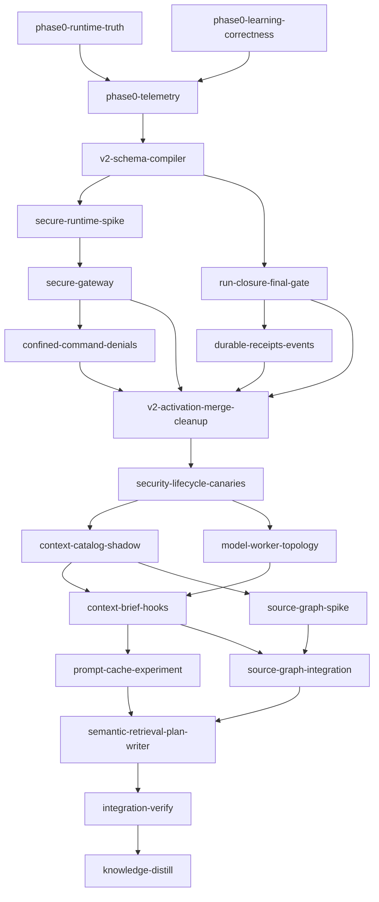

# Plan: Secure, Distilled Loom v2 and Selective Context Retrieval

## Overview

Implement the coordinated target described by
`doc/PROPOSAL-loom-overhead-reduction.md` and
`doc/REPORT-graft-inspired-loom-distillation.md`:

- compile closed, per-principal capabilities and enforce them through one secure execution
  gateway;
- make final verification and knowledge distillation run-level invariants backed by exact-tree
  evidence and an atomic receipt;
- keep Opus/`xhigh` as the normal stage orchestrator while delegating bounded implementation to
  GPT-5.6 Terra and mechanical work to GPT-6 Luna;
- retrieve bounded, task-specific knowledge before adding a Loom-owned source wiring graph;
- measure verified, confined, distilled outcomes with real provider/runtime counters; and
- experiment with prompt caching and semantic retrieval only after the correctness and security
  gates pass.

This is a program-sized migration, not a single refactor. The stages below preserve two vertical
tracks—secure execution and run closure/learning—then activate their v2 invariants together before
shipping overhead optimizations.

## Bootstrapping Constraint

This document is a conventional implementation plan, not an executable Loom plan. If the work is
later translated into Loom stages before v2 exists, that execution will necessarily be a visibly
legacy bootstrap run:

- its `knowledge-distill` stage is still an ordinary success-dependent worktree stage;
- its plan-authored commands still use the current string command runner;
- its current sandbox and hooks are defense in depth, not the target hard boundary; and
- its own completion cannot be cited as proof that v2 confinement or receipt semantics work.

The implementation must pin existing runs to their original runtime version. It may migrate a live
legacy run only at a safe boundary with explicit operator approval; otherwise the run closes as
legacy/unsafe, retains evidence, and distills without being relabeled secure.

## Decisions Resolved by This Plan

1. **Runtime backend:** begin with a bounded comparator spike. Select the smallest whole-process
   backend that passes every required canary on each supported host; do not make the schema depend
   on one container/VM implementation.
2. **Capability approval:** use an authenticated local operator CLI as the first approval authority.
   Keep the protocol open to a future external policy authority; no model, classifier, adjudicator,
   hook, worker, or retry loop may approve a widening.
3. **Receipt authority:** the Git-tracked
   `doc/loom/knowledge/.receipts/v<schema>/...` receipt is canonical durable provenance. Mutable
   WAL/attempt records and sealed retention artifacts live in an operator-owned store outside
   disposable `.work` and are referenced by digest.
4. **Writer isolation:** prefer per-worker private overlays imported by an authenticated broker.
   Use isolated clones only where the selected runtime cannot safely implement overlays.
5. **Legacy support:** v1 remains readable and runnable during a measured migration window, always
   labelled legacy/non-compliant. There is no fallback from a v2 run to ambient execution.
6. **Knowledge size:** the durable corpus remains unbounded. Budgets apply to individual deliveries
   and cumulative session retrieval, never to repository knowledge size.
7. **Graph scope:** ship H2 knowledge retrieval first. Run the Graft-versus-native spike before
   adding parsers; dogfood Rust, then add TypeScript, Python, and Go only as measured demand and
   packaging support justify them.
8. **Finalizer writes:** v2 classifies knowledge/documentation outputs separately from the delivered
   product snapshot. A finalizer mutation that affects the product snapshot invalidates the sealed
   final gate and forces remediation plus a gate rerun before the receipt can seal.

## Knowledge Readiness Decision

Decision: **ready; omit knowledge bootstrap**.

- Inspected source revision: `6158348d67a7e0fccd8ab5e9e0b3117fbedb228e`.
- Inspected knowledge-tree revision: `b14caeae5e2563498babb9fde22c7e4b445ab089`.
- Inspected `doc/loom/knowledge/INDEX.md`, the relevant tier-1 routing sections, and the tier-2
  topics for core abstractions, hooks, signal generation, knowledge hierarchy, Codex concurrency,
  Codex plugin behavior, doctrine pinning, subagent hierarchy, sandbox/settings, knowledge drift,
  memory/knowledge CLI invariants, completion credentials, merge ancestry, sessions/liveness,
  verification, testing, and refactor stragglers.
- The supplied proposal/report already perform the missing target-state synthesis. The plan needs
  implementation and controlled migration, not another semantic bootstrap.
- `phase0-learning-correctness` performs targeted reconciliation of known contradictions; that is
  ordinary implementation work, not an onboarding bootstrap stage.

Before initialization, re-evaluate this decision if either the source revision or knowledge-tree
digest changes. A changed digest does not automatically require bootstrap: inspect only the changed
topics and target seams, then record `ready` or a named `targeted-refresh` gap.

## Non-Negotiable Acceptance Contracts

### Confinement

- Every v2 plan, stage, principal, command, hook, plugin, MCP server, and worker has a compiled
  profile with a consumer and rationale for every grant.
- The full process tree is inside an attested outer policy; Claude settings form a separate inner
  policy. Missing or incompatible enforcement blocks launch.
- Filesystem, network, sockets, executables, credentials, Git, and Loom control state default deny.
- A runtime denial creates `CapabilityDenied` and `NeedsCapabilityApproval`; it never widens policy.
- Plan/policy/runtime/helper digests bind every launch and command.

### Verification

- One typed Opus/`xhigh` final-verification owner observes the complete canonical gate on an exact
  candidate-tree digest.
- Every outcome-affecting non-finalizer stage is an ancestor of that owner.
- Promotion delivers the same tree that passed; any later mutation invalidates the evidence.
- Specialist reviewers gather evidence only. The owner synthesizes and observes the gate.

### Learning

- Every v2 plan has exactly one typed run-scheduled `knowledge-distill` finalizer.
- Finalization runs after all other stages are terminal, including failed/abandoned/not-run stages.
- Cleanup is refused until evidence is sealed and a matching receipt exists, or an authenticated
  operator records an explicit discard that can never mean success.
- No-change is valid only with an observed finalizer attempt, rationale, audit, and sealed receipt.
- Receipt publication and per-stream watermark advancement are atomic and replay-safe.

### Orchestration and Cost

- Opus/`xhigh` is the normal/fallback orchestrator and always owns protected roles.
- Luna handles boilerplate, fixtures, scaffolding, schema plumbing, and simple unit tests.
- Terra handles ordinary implementation, adapters, integration tests, and bounded refactors.
- Security-sensitive policy, architecture, cross-cutting state machines, final verification, and
  distillation decisions use typed Opus workers/reviewers.
- All writes are attributed through worker overlays/imports; the orchestrator coordinates,
  reviews, gates, commits, and completes.
- Economic reporting is per verified, confined, distilled outcome and uses native provider units.

## Target Module Boundaries

```text
loom/src/capabilities/
  schema.rs         # typed resources, consumers, phases, principals
  requirements.rs   # derived/adapter/trace/operator requirement records
  adapters/         # cargo, bun/npm/pnpm, uv/pip, go, browser/local-service adapters
  closure.rs        # consumer/grant closure and narrowing checks
  manifest.rs       # canonical serialization, hashes, effective-policy report
  compiler.rs       # one entry point used by verify/init/spawn/runner
  denial.rs         # CapabilityDenied and amendment proposal types

loom/src/execution_gateway/
  capsule.rs        # deterministic environment and resolved executable inventory
  outer.rs          # whole-process runtime policy/backend contract
  inner.rs          # Claude settings/tools/agents/plugins/MCP policy
  broker/           # file/import, Git, Loom state, credential/provider operations
  command.rs        # typed command execution through compiled profiles
  attest.rs         # outer/inner/runtime/helper digest evidence

loom/src/lifecycle/
  schema.rs         # run states, terminal outcomes, exact-tree gate evidence
  controller.rs     # close/resume/finalize transitions and fencing
  retention.rs      # content-addressed evidence set outside disposable .work
  final_gate.rs     # candidate-tree assembly, gate, promotion, invalidation
  distill.rs        # finalizer attempt/WAL/receipt orchestration

loom/src/context/
  schema.rs store.rs fingerprint.rs ingest.rs
  rank.rs fuse.rs pack.rs refresh.rs
  extract/ resolve.rs

loom/src/fs/knowledge/
  chunker.rs catalog.rs lifecycle.rs receipt.rs semantic.rs
```

Keep `files` as stage output ownership. Do not reuse it as a read grant, scratch/output policy, or
Git authority. Keep Markdown as durable knowledge; derived graph/catalog indexes remain local and
regenerable.

## Stage Topology and Necessity



Each boundary is justified by at least one Stage Necessity Test fact:

- Phase 0 runtime and learning work have disjoint files and can run independently.
- The v2 schema/compiler is a shared contract needed before both vertical tracks.
- Secure execution and run closure have materially different trust boundaries and recovery tests.
- Command denial/amendment and knowledge receipt/event work require different authorities and can
  be tested independently before activation.
- Activation centralizes merge/recovery/cleanup ordering because splitting those mutations would
  recreate phantom-merge and early-cleanup bugs.
- Catalog retrieval and worker/topology policy are independent experiments with different outcomes.
- Prompt caching cannot start before secure deterministic launch and brief delivery exist.
- The source graph is a separate measured architecture spike with optional dependencies and
  coverage gates; it must not delay the useful catalog-only retrieval slice.
- Semantic enrichment and plan-writer modularization depend on measured gaps from both retrieval
  tracks and therefore form the last optimization stage.

## Worker Assignment Rules

Every Codex worker is spawned as `loom-codex-forwarder`, foreground-only, with the sentinel,
explicit model/effort, disjoint file territory, and verified completed-job evidence. Every stage
that licenses Codex also licenses Claude fallback. A missing Codex lane selects the declared Sonnet
fallback before work begins; it never causes a late improvisation.

| Work shape                                                                             | Default worker                          | Fallback / review           |
| -------------------------------------------------------------------------------------- | --------------------------------------- | --------------------------- |
| Boilerplate, fixtures, compatibility YAML, generated tables, simple tests              | GPT-6 Luna / `xhigh`                  | Claude Sonnet               |
| Ordinary Rust implementation, adapters, CLI wiring, integration tests                  | GPT-5.6 Terra / `xhigh`                 | Claude Sonnet               |
| Security policy, broker authority, lifecycle algorithms, WAL/CAS, cross-cutting design | `loom-senior-software-engineer` on Opus | Opus orchestrator review    |
| Routine read-only evidence and test-result collection                                  | Claude Sonnet reviewer                  | Opus for high-risk findings |
| Final gate and knowledge curation                                                      | Opus/`xhigh` main only                  | No downgrade                |

The detailed stage descriptions below name Luna/Terra assignments. Workers never share a writable
file. The main agent performs the stage-local authoritative check after imports; only the final
owner runs the full canonical gate.

## Implementation Stages

### 1. Phase 0 Runtime Truth and Urgent Containment

Correct false security claims and contain known exposures without claiming target confinement.
Explicitly emit false-valued sandbox settings, strict supported network mode, and conditional
Codex grants; fail required setup; remove ambient manual launch; update the wrapper toward a
deterministic environment where compatible. Keep hooks labelled defense in depth.

Workers:

- Opus senior worker: security semantics and fail-closed launch decisions.
- Terra worker: settings/capsule plumbing and focused Rust tests.
- Luna worker: settings fixtures, retired-phrase sweeps, and simple regression tests.

### 2. Phase 0 Learning Correctness

Fix locked memory append/full timestamp/summary round-trip, split handoff data from durable
candidates, make map/bootstrap idempotent, host-run index/audit reconciliation, and correct the
known doctrine contradictions (`memory promote`, append-only, IV-as-distiller, immediate cleanup,
false embedded-knowledge claims). Preserve legacy knowledge layout and lock ordering.

Workers:

- Terra: memory and bootstrap/map behavior.
- Luna: deterministic fixtures, hook prose corrections, doctrine parity tests.
- Opus main: reconciles cross-surface doctrine and verifies no knowledge loss.

### 3. Phase 0 Telemetry and Baseline

Add privacy-safe event schemas and production collection for resolved models, native usage/cache
counters when available, worker/fallback events, stage/command/merge/finalizer timing, read sizes,
denials, scheduler delays, and retrieval placeholders. Commit reproducible local/synthetic fixtures;
never persist prompts, responses, command output, source, credentials, absolute paths, or identity.

Workers:

- Terra: event store/launch instrumentation.
- Luna: serialization fixtures and baseline report tooling.

### 4. v2 Schema and Capability Compiler Foundation

Add versioned lifecycle/security schema, closed model profiles, typed principals/resources/commands,
requirement records, canonical manifests, closure checks, effective-policy reports, and a read-only
`loom plan migrate --check`. Add lifecycle/readiness/final-owner/output-classification fields and
fatal v2 structural validation without changing v1 semantics.

Workers:

- Opus senior: capability/lifecycle type boundaries and closure invariants.
- Terra: canonical serializer/compiler/report and tool-adapter interfaces.
- Luna: v1/v2 compatibility fixtures, negative validation matrix, CLI display tests.

### 5. Secure Runtime Comparator

Implement a backend-neutral outer runtime interface and compare supported native whole-process,
hardened container, and (where available) gVisor/VM-class backends. The spike uses the same policy
IR and canaries, measures portability/latency/resource isolation, writes an ADR, and selects a
backend per supported host. An unavailable required primitive fails closed.

Workers:

- Opus senior: threat-model mapping and backend selection.
- Terra: backend adapters and comparator harness.
- Luna: probe fixtures and platform matrix formatting.

### 6. Secure Gateway, Session Capsule, and Brokers

Route every normal/recovery/continuation/knowledge/merge/conflict/manual launch through a compiled
gateway. Emit and attest separate outer and inner policies; use an ephemeral home/private runtime,
pinned executable inventory, explicit setting sources/tools/agents/plugins/MCP, disabled auto
memory, strict network, and no ambient browser/Remote Control/teams. Add per-worker overlays and
brokered Git/Loom/file/import/provider operations. Make Codex conditional and run-scoped.

Workers:

- Opus senior: broker authorization, provider/credential boundary, policy attestation.
- Terra: launcher/capsule integration and per-principal overlay/import plumbing.
- Luna: settings fixtures, capability probes, and launcher compatibility tests.

### 7. Run Closure, Retention, and Exact-Tree Final Gate

Add the `Open -> Closing -> Finalizing -> *Distilled | Undistilled | OperatorDiscarded` controller,
session/command fencing, explicit terminal outcomes, sealed retention manifests, candidate-tree
assembly, one final owner, exact-tree canonical gate, promotion, and mutation invalidation. Replace
filename/all-merged success authority with lifecycle evidence, while keeping legacy runs pinned.

Workers:

- Opus senior: state machine, retention membership, exact-tree/promote algorithm.
- Terra: persistence/recovery integration and lifecycle tests.
- Luna: transition fixtures, status rendering, and compatibility cases.

### 8. Confined Typed Commands, Denials, and Human Amendments

Replace raw string command execution with typed `program/argv/cwd/env/profile/timeout` commands and
an explicit confined raw-shell form. Route setup, before/after, acceptance, wiring, dead-code,
impact, recovery, and final gate through one runner. Add `CapabilityDenied`,
`NeedsCapabilityApproval`, minimal amendments, authenticated local approval, expiry/revocation,
recompile, clean retry, and immutable audit evidence. Keep capability approval separate from
acceptance adjudication.

Workers:

- Opus senior: approval authority and no-self-widening rules.
- Terra: typed runner and route migration.
- Luna: command migration fixtures, denial serialization, CLI help/tests.

### 9. Structured Events, Knowledge Operations, and Receipts

Add locked per-session JSONL events plus generated Markdown views, stable IDs/fingerprints,
confidence/source fields, per-stream watermarks, and deterministic candidate selection. Implement
stable-ID upsert/replace/supersede/retire/delete plus two-phase WAL/CAS application, strict audit,
canonical Git receipt, no-change receipt, crash recovery, baseline-debt/delta handling, and typed
revision-bound bootstrap readiness. Knowledge and distill administrative paths cannot bypass host
finalization.

Workers:

- Opus senior: WAL/CAS, receipt authority, cursor and evidence semantics.
- Terra: event store, knowledge operations, host completion integration.
- Luna: crash/replay/idempotency fixtures and legacy receipt readers.

### 10. v2 Activation and Merge/Cleanup Unification

Centralize the host transition:

```text
overlay reconcile -> merge -> ancestry verification -> base publish/reconcile
-> persist/release -> cleanup
```

Remove cleanup from merge helpers, cover progressive/daemon/resolver/manual/already-merged/recovery
routes, bind policy/plan digests, enable v2 fatal rules only when both vertical tracks are present,
and add migration/pinning behavior. Cleanup requires retention import plus receipt/discard authority.

Workers:

- Opus senior: transition authority and legacy/v2 boundary.
- Terra: route convergence and merge/recovery implementation.
- Luna: exhaustive route fixtures and status/migration messages.

### 11. Security and Lifecycle Canary Gate

Build end-to-end canaries for every probe in proposal section 5.12 on every supported backend and
host. Add crash injection across close/gate/WAL/receipt/cleanup boundaries. Prove failed, abandoned,
and unsafe runs distill without becoming successful; prove no principal can exceed its grant; prove
digest drift and unavailable policy planes block launch.

Workers:

- Terra: canary harness and integration tests.
- Luna: malicious fixture generation and expected-result tables.
- Opus security reviewers: independently assess boundary and lifecycle evidence.

No later optimization stage may start until this stage passes.

### 12. H2 Knowledge Catalog and Retrieval Shadow Mode

Add compatibility H2 chunks, stable local IDs/hashes/token estimates, source references, lifecycle
state, exact/path/tag/BM25-style ranking, typed links, scope fusion, hard pack budgets, omission and
coverage reporting, `knowledge status/sync/context --explain`, and a versioned sharded JSON store.
Do not rewrite legacy Markdown or activate prompt injection yet; run privacy-safe shadow selection.

Workers:

- Terra: catalog/store/ranking/CLI implementation.
- Luna: Markdown chunker fixtures, legacy layouts, budget edge cases.
- Opus main: reviews false negatives and migration safety.

### 13. Model Profiles, Worker Ledger, Attribution, and Topology

Resolve symbolic orchestrator profiles to pinned exact models; enforce protected Opus roles,
structured Sonnet eligibility/upgrade, typed worker spawns, Codex fallback, Fable reasons,
outstanding-result checks, overlay attribution, and main-edit role exceptions. Add output
classification, final-owner ancestry, and Stage Necessity Test diagnostics. Persist the complete
execution ledger and native usage.

Workers:

- Terra: ledger/dispatcher/profile resolution and integration tests.
- Luna: validation matrices, doctrine generation fixtures, retired-phrase sweeps.
- Opus senior: protected-role and upgrade policy review.

### 14. Knowledge Briefs, Delivery State, and Deterministic Hooks

Add typed `ContextPack` to `EmbeddedContext`, build the initial stage/worker/recovery packs, persist
recipient/launch/epoch delivery before launch, enforce per-delivery/cumulative budgets, and activate
briefs only after shadow recall gates. Replace competing prompt hooks with one deterministic
dispatcher, add path-only edit recording, keep hooks model/network-free and fail-open, and make host
boundaries authoritative for reconciliation.

Workers:

- Terra: signal/retrieval/delivery integration and Rust hook dispatcher.
- Luna: hook JSON/timeout/dedupe/path fixtures and renderer snapshots.
- Opus main: verifies prompt-injection boundary and no duplicated delivery.

### 15. Prompt-Cache Experiment

After secure capsule and brief activation, implement content-addressed stable doctrine files and one
launch reconstruction manifest. Run the registered A/B/C cold/warm/TTL/parallel experiment with
actual provider counters. Ship the split only on material cache-read/latency gains with no security,
recovery, path-adherence, final-gate, or outcome regression; otherwise retain the secure
self-contained signal.

Workers:

- Terra: launcher reconstruction and experiment harness.
- Luna: hash/fixture matrices and report generation.
- Opus main: owns interpretation and ship/no-ship decision.

### 16. Source Graph Comparator and Rust Dogfood

Compare pinned Graft CLI/public API freshness behavior—without `graft init`—against a Loom-native
Rust prototype. Add `SourceGraphExtractor`, Rust tree-sitter extraction, content-hash cache,
coverage/provenance/confidence, conservative resolution, outline/impact/find-all, and cold versus
incremental canonical-equality fixtures. Production remains Loom-owned regardless of comparator.

Workers:

- Terra: Rust extractor/cache/query prototype and comparator harness.
- Luna: golden parser fixtures and coverage tables.
- Opus senior: architecture/dependency/license/packaging decision.

### 17. Source Graph Integration and Structural Hook Loop

Fuse source and knowledge retrieval, add immutable base revisions and isolated overlays, authoritative
pre/post merge reconciliation, safe Rust path recording, capped blast hints, and interactive-only
Stop sync. Add TypeScript/Python/Go extractors only if the spike and project corpus justify them.
Graph failures degrade visibly to exact search/direct inspection and never strand finalization.

Workers:

- Terra: refresh/overlay/fusion and additional extractor implementation.
- Luna: per-language golden fixtures, hook latency tests, degraded-mode cases.
- Opus main: reviews coverage claims and lifecycle ordering.

### 18. Semantic Retrieval and Plan-Writer Modularization

Implement changed-hash semantic job planning, target-centered summaries/cruxes, cluster cache keys,
global reconciliation, and explicit enrich/GC only where held-out retrieval shows a gap. Split the
plan writer into an invariant/router core plus triggered references while keeping capability closure,
readiness, final ownership, distillation, and pressure review in the core. Consolidate commands and
remove doctrine duplication only with semantic equality tests. Complete all product-facing
documentation, `README`, `CONTRIBUTING`, skill, and doctrine changes in this stage so they are part
of the candidate tree observed by the final gate.

Workers:

- Terra: semantic job/cache plumbing and triggered-reference loader.
- Luna: cache invalidation fixtures, skill router cases, doctrine parity sweeps.
- Opus senior: semantic admission/global reduce and plan-quality review.

### 19. Integration Verification — Final Owner

Assemble the complete candidate tree, seal its digest, and run the canonical repository gate exactly
once on that tree. Use independent read-only reviewers for security, lifecycle/recovery, knowledge
quality, retrieval correctness, worker attribution/model policy, performance methodology, and
documentation/doctrine. Fixes go back to typed workers; every mutation invalidates and reruns the
gate. Promote only the passing tree.

No Luna/Terra implementation is assigned directly to the final-owner main. Terra may gather
read-only test evidence through an explicitly declared verifier profile only after v2 supports it;
otherwise use Claude reviewers. Verification authority remains Opus/`xhigh`.

### 20. Knowledge Distillation — Run Finalizer

Consume the sealed run manifest and retention set, run deterministic normalization/retrieval, use
bounded read-only gatherers for disjoint evidence groups, and have one Opus curator emit typed
decisions or no-change. Loom applies them through WAL/CAS, validates/audits, seals the canonical
receipt, advances per-stream watermarks, and only then permits cleanup and distilled completion.

Finalizer writes are limited to `doc/loom/knowledge/**` and the associated receipt/retention records.
It must not modify runtime code, tests, skills, `README`, `CONTRIBUTING`, or other product-facing
documentation. If distillation identifies a required change outside that boundary, it records a
follow-up rather than applying it. Any exceptional product-tree mutation invalidates the sealed
digest and requires remediation plus a new exact-tree final gate before a receipt may seal.

No Luna/Terra writer is permitted. Cheap read-only gatherers may summarize sealed slices only when
their compiled profiles and evidence schema exist; the Opus finalizer is the sole synthesizer and
knowledge decision owner.

## Code-Surface and Exit-Gate Map

The paths below are the initial ownership map, not a license to create parallel implementations.
Each stage must update this map if repository discovery changes a boundary, and must search for all
callers before declaring the migration complete.

| Stage | Primary existing and new surfaces | Required exit evidence |
| ----- | --------------------------------- | ---------------------- |
| 1 | `plan/schema/sandbox_policy.rs`, `sandbox/{config,settings}.rs`, `sandbox/settings/policy.rs`, `orchestrator/terminal/native/{launch,wrapper}.rs`, `commands/run/checks.rs` | Unsupported or missing enforcement blocks required launch; emitted settings contain explicit false values; no normal route constructs an ambient manual launch. |
| 2 | `fs/memory/**`, `commands/memory/**`, `commands/knowledge/bootstrap.rs`, `fs/knowledge/{index,dir,types}.rs`, affected hooks and doctrine | Concurrent append, timestamp, round-trip, idempotent bootstrap/map, audit reconciliation, and doctrine-parity tests pass without changing legacy layout. |
| 3 | New telemetry module plus launch, command, merge, signal, worker, and finalizer call sites | A production-path fixture produces complete native-unit events; privacy tests reject forbidden payload fields; a reproducible baseline report is checked in. |
| 4 | `plan/schema/{types,validation}.rs`, `models/stage/types.rs`, `commands/plan/verify.rs`, `commands/init/plan_setup.rs`, new `capabilities/**` and `lifecycle/schema.rs` | v1 fixtures are unchanged; v2 negative cases fail for open grants, missing final owner/finalizer, invalid ancestry, and unclosed commands; canonical manifests hash reproducibly. |
| 5 | New `execution_gateway/outer.rs`, backend adapters, canary harness, and ADR | Every candidate runs the same denial/process-tree/resource canaries; the ADR records support, latency, failure mode, and selected backend per host. |
| 6 | `orchestrator/terminal/native/**`, `sandbox/**`, hooks setup, new `execution_gateway/{capsule,inner,broker,attest}.rs` | Every enumerated launch/recovery route passes through one gateway; principal-crossing, ambient-home, credential, Git, control-state, and digest-drift canaries fail closed. |
| 7 | `fs/plan_lifecycle.rs`, `plan/graph/{mod,scheduling}.rs`, `commands/stage/{complete,complete_verification,progressive_complete}.rs`, new `lifecycle/{controller,retention,final_gate}.rs` | Crash/restart at every transition converges; only the exact gated tree promotes; filename/all-merged state alone cannot close a run. |
| 8 | `models/stage/types.rs`, `verify/criteria/{runner,executor}.rs`, `orchestrator/core/stage_executor.rs`, `plan/amendment.rs`, adjudication routes, new `execution_gateway/command.rs` and `capabilities/denial.rs` | All plan-authored command classes use the typed runner; denial cannot mutate authority; authenticated minimal amendments recompile and retry cleanly with immutable audit. |
| 9 | `fs/knowledge/**`, `commands/knowledge/**`, `commands/stage/knowledge_complete.rs`, memory record handlers, new `lifecycle/distill.rs` | Kill-point tests prove WAL/CAS and watermark replay; no-change and changed receipts bind the same required evidence; administrative completion cannot bypass the host finalizer. |
| 10 | `orchestrator/auto_merge.rs`, `orchestrator/core/merge_handler.rs`, progressive/daemon/resolver/manual completion routes, lifecycle controller | Every route follows reconcile/merge/ancestry/publish/persist/cleanup order; cleanup before retained evidence and receipt/discard authority is impossible. |
| 11 | New `tests/capability_canaries/**` plus lifecycle crash/replay integration tests | The full proposal canary matrix passes on every supported host/backend, including failed, abandoned, unsafe, drifted, and unavailable-policy cases. |
| 12 | `fs/knowledge/{types,index,dir}.rs`, `commands/knowledge/**`, CLI dispatch/completions, new `fs/knowledge/{chunker,catalog,lifecycle}.rs` | Shadow-mode held-out recall and budget reports meet registered thresholds; legacy Markdown is byte-stable; index rebuilds are deterministic. |
| 13 | `models/stage/**`, schema validation, terminal launch, signal model sections, worker dispatch and new durable ledger | Protected roles reject downgrade; exact model/fallback/overlay attribution survives restart; outstanding workers prevent completion; usage totals reconcile with provider counters. |
| 14 | `orchestrator/signals/{types,generate,sections,knowledge}.rs`, `loom-hooks/**`, permissions hook config, new `context/{pack,store,fingerprint}.rs` | Delivery is persisted before launch and deduplicated by recipient/epoch; hard budgets and omissions are visible; competing prompt hooks are removed. |
| 15 | Signal cache/launch reconstruction and experiment fixtures | Registered A/B/C runs use provider-observed cache counters and preserve all security/recovery/outcome gates; otherwise the feature remains disabled. |
| 16 | `language.rs`, Cargo dependencies, new `context/extract/**` and graph query/cache modules | Rust cold and incremental results are canonically equal; coverage/provenance are explicit; comparator ADR chooses dependencies without requiring Graft-owned production state. |
| 17 | Hooks edit recording, merge reconciliation, context fusion/refresh/resolve, optional language extractors | Parallel overlays remain isolated; pre/post merge refresh is authoritative; graph failure visibly falls back to exact search and never blocks finalization. |
| 18 | Context semantic modules, plan-writer skill/references, command/doctrine surfaces, product documentation | Semantic work is admitted only by held-out improvement; cache invalidation and global reconciliation pass; doctrine equality and complete documentation are in the gated tree. |
| 19 | Final-gate controller, repository verification commands, read-only reviewer evidence | One Opus owner observes the complete canonical gate on a sealed digest; any fix invalidates evidence; promotion digest equals the passing digest. |
| 20 | `doc/loom/knowledge/**`, new knowledge receipt/WAL application, retention references | The finalizer attempts exactly once logically, emits typed decisions or audited no-change, seals atomically, and cannot write outside its declared knowledge/receipt boundary. |

## Verification Matrix

The final owner must run the repository's real gate from `loom/` against the sealed candidate tree:

1. `cargo fmt --check`
2. `cargo clippy --all-targets -- -D warnings`
3. `RUSTDOCFLAGS="-D warnings" cargo doc --workspace --all-features --no-deps`
4. `cargo test --test maintainability`
5. `cargo test --all-targets --no-fail-fast`
6. `cargo audit`
7. Markdown lint over tracked Markdown.
8. The v2 capability canary matrix on every supported host/runtime.
9. Crash/replay matrix for close, merge, gate, WAL, receipt, cursor, and cleanup.
10. Retrieval held-out suite: orientation, localization, exhaustive search, blast radius, stale
    knowledge, prompt injection, denied-path non-disclosure, and budget/omission reporting.
11. Cold/incremental canonical equality and parallel-overlay isolation for graph/catalog state.
12. Provider-observed model/cache/usage telemetry completeness and privacy export checks.

Final verification must also mutation-test representative negative assertions: remove the guarded
production line and prove the test fails. JSON policy snapshots alone do not count as confinement
evidence.

## Rollout and Rollback

- Phase 0 fixes may ship independently, but do not advertise target confinement.
- v2 stays feature-gated until both vertical-track gates and all canaries pass.
- Rollback may disable catalog briefs, source graph, semantic enrichment, or prompt splitting while
  retaining exact-search/progressive-read fallback.
- Security invariants, exact-tree verification, and mandatory receipts never roll back to ambient
  execution or ordinary skip semantics.
- Unknown/corrupt derived indexes are rebuilt. Unknown/corrupt policy, lifecycle, WAL, retention, or
  receipt state fails closed and preserves evidence.
- Active v1 runs stay pinned. A migration creates a reviewable diff and new policy hash; it never
  infers broad external roots, network wildcards, credentials, sockets, or integrations.

---
