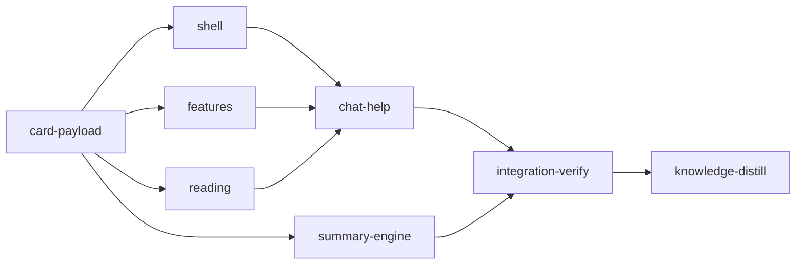

# Plan: Repair the planner web app to the agreed design

Implements: section_01, section_04, section_05, section_06, section_08, section_09, section_11

## Overview

The planner redesign (`archive/DONE-PLAN-planner-ui-redesign.md`) shipped a UI that looks
nothing like its locked mockup and misbehaves in places. Its executors could not open the
claude.ai artifact the plan linked, and no gate ever rendered a page
([the mistake](../../loom/knowledge/mistakes/plan-server-delivery.md)). This plan rebuilds every
screen to that mockup. The mockup is transcribed into the brief bundle at
`doc/plans/feat-planner/briefs/feat-planner-12-ui-repair/`, as structure, CSS values and copy,
because stage sessions cannot open claude.ai either.

The plan also changes summary generation:
- haiku at effort high by default;
- an opening prompt that is typed but never submitted gets submitted;
- the user chooses Claude Code or Codex, with model and effort, for summaries.

Mockup, for people: [Loom Plan Redesign](https://claude.ai/artifact/2T7SurQrDQJhCX4yyKi9iu).

## Before `loom init`

1. Commit the rename of this feature's directories (`doc/product/planner-ui/` →
   `doc/product/feat-planner/`, `doc/plans/planner-ui/` → `doc/plans/feat-planner/`), together
   with this plan and its brief bundle. Stage worktrees branch from the committed tree, and
   `loom run` refuses uncommitted plan inputs.
2. The summaries under `doc/loom/summaries/planner-ui/` and `overview/planner-ui/` belong to the
   old feature name. The app rebuilds `feat-planner`'s summaries under its own ids. Delete the
   old trees when convenient; no stage touches them.

## Goals

- Every screen matches the mockup: shell, step rail, home and feature cards, kickoff, feature
  screen, reading column, document headers, chat, pressure test, settings and help.
- The functional defects the browser tour found are fixed:
  - Enter does not open the focused sentence;
  - Shift+Esc does nothing on a cap;
  - every source mark is grey;
  - the permission card is duplicated;
  - a session shows under every feature;
  - a stray confirm fires with no chat open;
  - rail cells cannot be clicked;
  - help pins are misplaced.
- The user can switch between a feature's steps: rail cells and the feature screen's step
  navigation both select a step.
- Summaries default to haiku/high, opening prompts are submitted reliably, and summaries can run
  on Codex.
- Every web stage renders its screens in a real browser before its final review.

Non-goals: no change to the summary engine's hashing or sealing, the session sandbox, or the
access model.

## Decisions

`common.md` in the brief bundle lists the twelve decisions every stage follows. The ones a
reviewer should know:
- **Header and dock:** no chat on the home screen; one app bar, with the run strip, changed-since
  and summary status moved into the activity popover.
- **Steps and titles:**
  - rail cells are counters that link to `?step=n`;
  - `/f/<feature>` is the step flow;
  - feature titles come from the vision or metaplan H1.
- **Kept conventions:**
  - document hues stay `--doc-1..8`;
  - help type stays at 13px or more;
  - the pressure dialog states no minutes;
  - add-to-chat stays on `a`.
- **Visual work:** every implementer doing it loads `frontend-design:frontend-design` first. The
  briefs' values and copy win; the skill governs what they leave open.
- **Implementation lanes:** the visual stages run on Claude only (haiku, sonnet, opus). In the
  two non-visual stages, the Rust payload (P1), the configuration keys (E1) and the Codex summary
  spawner (E3) run on Codex gpt-6.1-sol at effort high, in file-sized units through
  `loom-codex-forwarder`, by the user's choice. The rest stays on Claude: the opening-submission
  fix (opus, hard timing debugging), the screenshot script (it needs running and adjusting), and
  the mechanical web and path edits (sonnet and haiku are cheaper there). Contract tests always
  come from loom's Claude contract session.
- **Summary engine:**
  - summary defaults are haiku/high for document summaries, overviews and the summary session;
  - the Codex summary defaults are `gpt-6.1-terra`/high.

## Baseline (observed at `fcd5c7b1`, 2026-10-30)

- `web/`: `bun run typecheck`, `bun run lint`, `bun run format:check` exit 0.
- `node_modules/.bin/vitest run src/plan`: 237 files, 2922 tests passed.
- The installed `loom plan` (built from `fcd5c7b1`) was toured in Chromium at 1440x900 and
  390x844. The defects listed in each stage brief come from that tour.

## Execution Diagram



`card-payload` first. Then `shell` & `features` & `reading` & `summary-engine` concurrently,
then `chat-help`, `integration-verify` and `knowledge-distill`.

There is no knowledge-bootstrap stage: the tier-1 files describe this codebase, and
`loom knowledge sync` runs clean.

## Stages

### card-payload

Adds `title`, `has_product`, `sections`, plan counts and `untested` to each feature's checklist,
plus a counter and label per step. The pitch skips a `Status:` line and falls back to the
metaplan. The stage mirrors all of it in the web schema and fixtures, and rewrites the tests and
docs that still read `planner-ui` paths. It also writes `scripts/plan-screens.sh`, the
real-browser screenshot script every web stage uses.

It exists because shell, features and reading all render these fields and need them merged
(Q1). Its Rust half and web half share one wire, so they stay together.

Risk checklist:
- **External data correctness:** the title and pitch come from user documents. Covered by
  `title-strips-vision-suffix`, `title-falls-back-to-metaplan-heading` and
  `pitch-skips-status-paragraph`.
- **Configuration propagation:** none.
- **Reachability:** the fields reach the browser through the existing checklist message.
  Covered by `step-counts-follow-documents` on the `From<&Project>` path.

### summary-engine

Covers:
- haiku/high defaults;
- three new `[plan]` keys (`summary_backend`, `summary_codex_model`, `summary_codex_effort`);
- the opening-submission fix (a 150 ms pause, then up to two Enter re-presses for openings,
  then failing a Summary session so its ids requeue);
- a Codex `SessionSpawner` for summaries.

It exists because it shares `doc/product/feat-planner/section_04.md` with card-payload (Q2), and
because its Rust work would push a combined stage past one session (Q4).

Risk checklist:
- **Configuration propagation:** a non-default Codex model must reach the command line.
  Covered by `codex-summary-uses-configured-model`.
- **Lifecycle:** an unsubmitted opening must be re-pressed, then fail the session. Covered by
  `opening-enter-is-repressed` and `unsubmitted-opening-fails-summary-session`.
- **Defaults:** covered by `summary-models-default-to-haiku-high`.

### shell, features, reading

Three web stages over disjoint files, run concurrently.
- `shell`: the app bar, rail, next-step card, activity popover, presence, dock, DocMark,
  glyphs, pressure strip and settings.
- `features`: home, feature cards, shelf, doodle, the feature screen and the kickoff.
- `reading`: the reading column, keyboard and colours, fold caps, and document headers.

They exist because together they exceed one session's budget (Q4), and their files are disjoint.

Risk checklist:
- **Reachability:** each surface is driven through its route or root component. Covered by
  `home-route-renders-no-chat-panel`, `feature-screen-selects-step-from-query` and
  `enter-opens-focused-sentence`.
- **Untrusted input:** titles, pitches and slugs stay inside `Untrusted`. Covered by the
  card-title contract and by the existing `feature-card.test.tsx` assertions the brief keeps.

### chat-help

Covers:
- the chat panel (defects and restyle, on opus);
- the pressure dialog, run and done views;
- help, re-targeted to the new DOM.

It exists because help scenes mount components from all three earlier web stages (Q1).

Risk checklist:
- **Lifecycle:** a session belongs to its feature. Covered by `foreign-feature-session-not-shown`.
- **Reachability:** covered by `permission-card-renders-once`,
  `pressure-dialog-offers-quick-pick-rounds-only` and `pressure-plan-card-shows-plan-title`.

### Integration Verification

Runs:
- the full Rust and web suites, clippy, fmt, the bundle check and the rebuilt-`dist` check;
- a real-browser review with `scripts/plan-screens.sh` of `/`, `/new`, `/f/feat-planner`,
  `/f/feat-planner?step=4`, `/f/feat-planner/product`, `/f/feat-planner/engineering`, a plan
  in file mode, a section in file mode and `/f/optim-token`, in all four themes. Each
  screenshot is compared against the stage briefs;
- parallel reviewers.

It rebuilds `web/dist` and commits it last.

### Knowledge Distillation

Covers:
- the `planner-ui` → `feat-planner` path corrections in knowledge;
- the new header, rail, reading and help rules;
- the summary defaults, backend and opening fix;
- a correction to the redesign mistake entry, which says the fix is pending.

---

<!-- loom METADATA -->

```yaml
loom:
  version: 2
  auto_merge: null
  sandbox:
    enabled: true
    auto_allow: true
    allow_unsandboxed_escape: false
    excluded_commands: []
    filesystem:
      deny_read:
      - ~/.ssh/**
      - ~/.aws/**
      - ~/.config/gcloud/**
      - ~/.gnupg/**
      deny_write:
      - ../../**
      allow_write: []
    network:
      allowed_domains:
      - crates.io
      - index.crates.io
      - static.crates.io
      - registry.npmjs.org
      additional_domains: []
      allow_local_binding: false
      allow_unix_sockets: []
      allow_all_unix_sockets: false
    linux:
      enable_weaker_nested: false
    command_confinement: confined
  ratchet_files:
  - loom/maintainability-baseline.txt
  - doc/loom/knowledge/check-baseline.txt
  provision:
  - working_dir: web
    command: >-
      test ! -e .npmrc && test ! -L .npmrc && bun install --frozen-lockfile
      --ignore-scripts --backend=copyfile --config=/dev/null
  stages:
  - id: card-payload
    name: Feature card payload, stale paths and the screenshot script
    summary: >-
      Gives every feature a title, a usable pitch, section and plan counts and a counter per
      step, fixes the paths left by the planner-ui to feat-planner rename, and adds the
      real-browser screenshot script the web stages use.
    stage_type: standard
    skills:
    - loom-rust
    - loom-typescript
    description: |
      Read doc/plans/feat-planner/briefs/feat-planner-12-ui-repair/common.md, then card-payload.md in the same directory, before dispatch.
      PATHS: working_dir is loom/; YAML and table paths are repository-relative.
      KNOWLEDGE: conventions/plan-web.md (New PlanMessage Variants Need Both Schema Arms), mistakes/plan-server-delivery.md (Green jsdom Tests Hid a Broken Browser, its procedure paragraph).
      PUBLIC SURFACE for the contract session (tests/plan_feature_card_contracts.rs, top-level #[test] fns named after the contract ids with underscores; build a temp doc tree with tempfile and std::fs, load it with loom::planning::project::Project::load(root), convert with loom::plan_server::wire::checklist::ProjectChecklistView::from(&project), and read checklists[i] by feature): ChecklistView gains title: String, has_product: bool, sections: Vec<SectionView { number: String, name: String, written: bool, open_questions: u32 }>, plans: PlanCountsView { listed, total, written, running, done: u32 }, untested: u32; StepView gains count: Option<String> and label: String. Title rule: the vision's first H1 minus a trailing "— Product Vision", "Product Vision" or "Vision"; else the first metaplan's H1 minus a trailing "Engineering Metaplan" or "Metaplan"; else the slug with dashes as spaces and words capitalised; backticks removed. Pitch: first prose paragraph after the vision H1 that does not start with "Status:"; without a vision, the same from the first metaplan. Step 2 count is "<written>/<listed>" when sections are listed. Read tests/planning_checklist_contracts.rs for how a vision lists sections and a metaplan lists plans.
      WORKERS (P1's first codex unit, P3 and P4 in one message; P2 after P1's last unit and your fixture regeneration):
      | Worker | Role | Tier | Files owned | Shared context | Brief path |
      | ------ | ---- | ---- | ----------- | -------------- | ---------- |
      | P1 | Wire payload, title, pitch, counts, Rust fixtures | codex sol/high | loom/src/plan_server/wire/checklist.rs; loom/src/plan_server/wire/checklist_pitch.rs; loom/src/plan_server/wire/checklist_card.rs; loom/src/plan_server/wire/checklist_tests.rs; loom/src/plan_server/wire/fixtures/**; loom/src/plan_server/features.rs; loom/src/planning/checklist.rs; loom/src/planning/checklist/** | common.md | doc/plans/feat-planner/briefs/feat-planner-12-ui-repair/card-payload.md |
      | P2 | Web schema, fixtures and literals | sonnet | web/src/plan/api/**; web/src/plan/**/*.test.tsx; web/src/plan/**/*-kit.tsx | P1 field list | doc/plans/feat-planner/briefs/feat-planner-12-ui-repair/card-payload.md |
      | P3 | Stale planner-ui paths and the vision pitch line | haiku | loom/src/planning/guidance/tests.rs; loom/tests/planning_guidance_contracts.rs; loom/tests/plan_session_bridge_core_contracts/records.rs; doc/product/feat-planner/index.md; doc/product/feat-planner/section_04.md; doc/product/feat-planner/section_08.md; doc/plans/feat-planner/index.md | common.md | doc/plans/feat-planner/briefs/feat-planner-12-ui-repair/card-payload.md |
      | P4 | Screenshot script | sonnet | scripts/plan-screens.sh; web/scripts/plan-screens.mjs; web/package.json; web/bun.lock | procedure in the brief | doc/plans/feat-planner/briefs/feat-planner-12-ui-repair/card-payload.md |
      LANES: P1 runs on the codex lane (user-selected): loom-codex-forwarder with --model gpt-6.1-sol --effort high, a stable --unit-id per unit, in the FOREGROUND with an explicit Bash timeout of 600000 ms, at most six units at once over disjoint files. Split P1 into ordered file-sized units before dispatch, producers first: (1) loom/src/plan_server/wire/checklist.rs: the new ChecklistView and StepView fields, SectionView, PlanCountsView, the #[path] declaration of checklist_card and the card_facts call in From<&Project>; (2) loom/src/plan_server/wire/checklist_card.rs: card_facts, the title rule, sections, plan counts, untested and the step count and label table, with its unit tests in the same file; (3) loom/src/plan_server/wire/checklist_pitch.rs plus loom/src/plan_server/wire/checklist_tests.rs: the Status skip and the metaplan fallback. Units 2 and 3 run in one wave after unit 1. Then YOU regenerate loom/src/plan_server/wire/fixtures/*.json by running the Rust tests that write or compare them, update loom/src/plan_server/features.rs tests, and run P1's proof commands before spawning P2. forward from the worktree root, never from loom/ (mistakes/plan-server-delivery.md, Codex Forwards Ran From the Crate Directory); each unit brief pins the signatures from the stage brief, names the file's current line count (400-line cap, 50-line functions) and every test that pins the behaviour it changes, and says: compile-only checks (cargo check), no fixture-backed tests, no git, no writes under .loom/. After each wave run git status --short and confirm every unit's files changed (A Codex Forward Reported Success and Wrote No Files). A timed-out unit is re-split against its partial result, never re-forwarded unchanged; a failed unit's fix goes to a fresh loom-software-engineer (sonnet). Contract tests come from loom's contract session, never from a codex unit. Review-round fixes in a codex worker's files may go back to the codex lane with the same flags.
      Spawn P2 and P4 as loom-software-engineer; P3 as loom-software-engineer with model haiku. Each prompt says: Your brief: <path>. Read it in full before anything else, then its "<worker>" section.
      AFTER THE WORKERS: cargo fmt --all; in ../web node_modules/.bin/oxfmt. The gate is one loom check card-payload, beside the final loom-code-reviewer round.
      LEDGER: no file this stage edits may cross 400 lines; checklist.rs grows, so the new fields' construction lives in checklist_card.rs.
      Use parallel subagents and skills to maximize performance.
      MEMORY: record mistakes, decisions and surprises with loom memory immediately, subagents too; NEVER Claude Code auto-memory.
    dependencies: []
    acceptance:
    - cargo build
    - cargo clippy --all-targets -- -D warnings
    - cargo fmt --check
    - "cargo test --lib plan_server::"
    - cargo test --test planning_guidance_contracts --test planning_checklist_contracts
    - cd ../web && node_modules/.bin/tsc -b --noEmit && node_modules/.bin/oxlint --deny-warnings && node_modules/.bin/oxfmt --check
    - cd ../web && node_modules/.bin/vitest run src/plan
    - bash -n ../scripts/plan-screens.sh
    files:
    - loom/src/plan_server/wire/**
    - loom/src/plan_server/features.rs
    - loom/src/planning/checklist.rs
    - loom/src/planning/checklist/**
    - loom/src/planning/guidance/tests.rs
    - loom/tests/planning_guidance_contracts.rs
    - loom/tests/plan_session_bridge_core_contracts/records.rs
    - loom/tests/plan_feature_card_contracts.rs
    - web/src/plan/**
    - web/scripts/plan-screens.mjs
    - web/package.json
    - web/bun.lock
    - scripts/plan-screens.sh
    - doc/product/feat-planner/**
    - doc/plans/feat-planner/index.md
    working_dir: loom
    artifacts:
    - src/plan_server/wire/checklist_card.rs
    before_stage:
    - command: test ! -e src/plan_server/wire/checklist_card.rs
      description: the stage's new module does not exist yet
    after_stage:
    - command: test -s src/plan_server/wire/checklist_card.rs
      description: the card facts module exists
    wiring:
    - source: src/plan_server/wire/checklist.rs
      pattern: card_facts(
      literal: true
      description: the project checklist conversion fills the card facts
    contracts:
    - id: title-strips-vision-suffix
      file: tests/plan_feature_card_contracts.rs
      test: title_strips_vision_suffix
      scenario: writes doc/product/demo/index.md with "# Loom Plan — Product Vision" and a paragraph, loads the project and converts it
      rejects: a title that is the slug "demo" or the raw heading "Loom Plan — Product Vision" instead of "Loom Plan"
    - id: title-falls-back-to-metaplan-heading
      file: tests/plan_feature_card_contracts.rs
      test: title_falls_back_to_metaplan_heading
      scenario: writes only doc/plans/tokens/index.md whose H1 is "Token Optimization Metaplan" and no product directory
      rejects: a title that ignores the metaplan and returns the slug "Tokens" or "tokens" instead of "Token Optimization"
    - id: pitch-skips-status-paragraph
      file: tests/plan_feature_card_contracts.rs
      test: pitch_skips_status_paragraph
      scenario: 'a vision "# Demo\n\nStatus: agreed vision (2026-10-26).\n\nA browser app for plans.\n" loaded and converted'
      rejects: a pitch that returns the Status line instead of "A browser app for plans."
    - id: pitch-falls-back-to-metaplan
      file: tests/plan_feature_card_contracts.rs
      test: pitch_falls_back_to_metaplan
      scenario: no vision; doc/plans/tokens/index.md is "# Token Optimization Metaplan\n\nThis metaplan orders six plans.\n"
      rejects: a pitch that stays None when only a metaplan exists
    - id: step-counts-follow-documents
      file: tests/plan_feature_card_contracts.rs
      test: step_counts_follow_documents
      scenario: a vision listing three sections in its section table with two section_NN.md files written, loaded and converted
      rejects: a step 2 whose count is None or the step number instead of "2/3", or a sections list that is not three entries with written true, true, false
    harness:
    - tests/plan_feature_card_contracts/**
    sandbox: {}
    implementers:
    - codex
    - claude
  - id: summary-engine
    name: Summary defaults, opening submission and the Codex backend
    summary: >-
      Makes summaries run on haiku at high effort by default, makes sure a summary session's
      opening prompt is actually submitted, and lets the user run summaries on Codex with its
      own model and effort.
    stage_type: standard
    skills:
    - loom-rust
    description: |
      Read doc/plans/feat-planner/briefs/feat-planner-12-ui-repair/common.md, then summary-engine.md in the same directory, before dispatch.
      PATHS: working_dir is loom/; YAML and table paths are repository-relative.
      KNOWLEDGE: architecture/summary-store.md (Rebuild Scheduler), architecture/planning-session-bridge.md, conventions/model-and-effort-config.md ([plan] Keys and Defaults), mistakes/plan-server-delivery.md (Adding [plan] Keys Breaks Goldens and the Size Gate Outside the Owned Files).
      PUBLIC SURFACE for the contract session (tests/summary_engine_contracts.rs for the first and last; in-crate module src/plan_session/bridge/tests_opening.rs, test paths plan_session::bridge::tests_opening::<fn>, for the two opening contracts, using the crate's fake host in src/plan_session/bridge/fake_host.rs and the delivery-timeout pattern of src/plan_session/bridge/tests_queue.rs): loom::planning::summary::config::SummaryModels::resolve(&PlanConfig, &UserConfig) with fields document_model, document_effort, overview_model, overview_effort, backend, codex_model, codex_effort; loom::plan_server::summaries::codex_spawner::codex_summary_args(model: &str, effort: &str, root: &Path, runtime: &Path, prompt: &str) -> Vec<String>. The fake host records a press_enter (or press "Enter") call per Enter key and a paste per paste. Opening behaviour: after the paste and first Enter, with no UserPromptSubmit, Enter is pressed again every 2 s, at most twice more, never a second paste; at delivery_timeout a Summary session fails with reason "opening not submitted".
      WORKERS (E1's first codex wave and E2 in one message; E3 after E1's last wave and your codex probe):
      | Worker | Role | Tier | Files owned | Shared context | Brief path |
      | ------ | ---- | ---- | ----------- | -------------- | ---------- |
      | E1 | Defaults and the three new [plan] keys, docs and fixtures | codex sol/high | loom/src/user_config/keys.rs; loom/src/user_config/plan.rs; loom/src/user_config/plan/tests.rs; loom/src/user_config/tests.rs; loom/src/user_config/plan_keys_tests.rs; loom/src/fs/work_dir/config_sections/plan_config.rs; loom/src/planning/summary/config.rs; loom/src/planning/summary/config/tests.rs; loom/src/planning/guidance/models.rs; loom/src/planning/guidance/models/tests.rs; plan-plugin/agents/summary.md; plan-plugin/agents/overview.md; web/src/api/fixtures/config.json; web/src/components/settings-model.ts; web/src/components/settings-plan-section.test.ts; README.md; doc/product/feat-planner/section_04.md; doc/product/feat-planner/section_09.md | common.md | doc/plans/feat-planner/briefs/feat-planner-12-ui-repair/summary-engine.md |
      | E2 | Opening submission | opus/xhigh | loom/src/plan_session/tmux_io.rs; loom/src/plan_session/tmux_io_tests.rs; loom/src/plan_session/tmux_host.rs; loom/src/plan_session/bridge/flow.rs; loom/src/plan_session/bridge/fake_host.rs; loom/src/plan_session/bridge/tests_queue.rs | frozen tests_opening.rs | doc/plans/feat-planner/briefs/feat-planner-12-ui-repair/summary-engine.md |
      | E3 | Codex summary spawner | codex sol/high | loom/src/plan_server/summaries/codex_spawner.rs; loom/src/plan_server/summaries/codex_spawner_tests.rs; loom/src/plan_server/summaries/mod.rs; loom/src/plan_server/summaries/spawner.rs; loom/src/planning/guidance/text/summary_codex.md; loom/src/pressure/codex_run.rs | E1 getters | doc/plans/feat-planner/briefs/feat-planner-12-ui-repair/summary-engine.md |
      LANES: E1 and E3 run on the codex lane (user-selected): loom-codex-forwarder with --model gpt-6.1-sol --effort high, a stable --unit-id per unit, in the FOREGROUND with an explicit Bash timeout of 600000 ms, at most six units at once over disjoint files. E1 units, producers first: wave 1: (a) loom/src/user_config/keys.rs rows; (b) loom/src/user_config/plan.rs fields, parse lines, getters, defaults, plan_value_of arms and plan_toml; (c) loom/src/fs/work_dir/config_sections/plan_config.rs. Wave 2: (d) loom/src/planning/summary/config.rs plus loom/src/planning/summary/config/tests.rs; (e) loom/src/planning/guidance/models.rs plus loom/src/planning/guidance/models/tests.rs; (f) loom/src/user_config/plan/tests.rs (the plan_toml golden and default pins); (g) loom/src/user_config/tests.rs (in-place default arms only) plus the new loom/src/user_config/plan_keys_tests.rs; (h) web/src/components/settings-model.ts plus web/src/components/settings-plan-section.test.ts; (i) web/src/api/fixtures/config.json; (j) plan-plugin/agents/summary.md and plan-plugin/agents/overview.md; (k) README.md; (l) doc/product/feat-planner/section_04.md and section_09.md. E3 runs only after YOU have run codex exec --help on the host, settled how a directory outside -C is made writable, and recorded it with loom memory decision (block per BLOCK below if there is no documented way); pass that answer into every E3 unit. E3 units: (m) loom/src/pressure/codex_run.rs: make codex_args and spawn_codex_background reusable without changing pressure's arguments; (n) loom/src/planning/guidance/text/summary_codex.md; then (o) loom/src/plan_server/summaries/codex_spawner.rs plus loom/src/plan_server/summaries/codex_spawner_tests.rs; then (p) loom/src/plan_server/summaries/mod.rs selection and any helper sharing in spawner.rs. forward from the worktree root, never from loom/ (mistakes/plan-server-delivery.md, Codex Forwards Ran From the Crate Directory); each unit brief pins the signatures from the stage brief, names the file's current line count (400-line cap, 50-line functions) and every test that pins the behaviour it changes, and says: compile-only checks (cargo check), no fixture-backed tests, no git, no writes under .loom/. After each wave run git status --short and confirm every unit's files changed (A Codex Forward Reported Success and Wrote No Files). A timed-out unit is re-split against its partial result, never re-forwarded unchanged; a failed unit's fix goes to a fresh loom-software-engineer (sonnet). Contract tests come from loom's contract session, never from a codex unit. Review-round fixes in a codex worker's files may go back to the codex lane with the same flags.
      Spawn E2 as loom-senior-software-engineer with effort xhigh (hard debugging of a timing defect). Each prompt says: Your brief: <path>. Read it in full before anything else, then its "<worker>" section.
      AFTER THE WORKERS: cargo fmt --all; in ../web node_modules/.bin/oxfmt. The gate is one loom check summary-engine, beside the final loom-code-reviewer round.
      INTEGRITY: expected TI-edit events, all intended: the tests that pinned the old defaults (user_config/tests.rs, user_config/plan/tests.rs, planning/summary/config/tests.rs, planning/guidance/models/tests.rs, web settings-plan-section.test.ts) change to haiku/high and the new rows. File one loom stage dispute-integrity summary-engine with every such event id from loom stage review integrity summary-engine and the reason "summary defaults changed to haiku/high and three [plan] keys added, per the user". Any other event is a defect.
      BLOCK: if codex exec documents no way to grant the runtime directory, E3 reports it and you run loom stage block summary-engine with the evidence.
      Use parallel subagents and skills to maximize performance.
      MEMORY: record mistakes, decisions and surprises with loom memory immediately, subagents too; NEVER Claude Code auto-memory.
    dependencies:
    - card-payload
    acceptance:
    - cargo build
    - cargo clippy --all-targets -- -D warnings
    - cargo fmt --check
    - "cargo test --lib user_config::"
    - "cargo test --lib planning::summary::"
    - "cargo test --lib planning::guidance::"
    - "cargo test --lib plan_session::"
    - "cargo test --lib plan_server::summaries::"
    - cargo test --test maintainability
    - cd ../web && node_modules/.bin/vitest run src/components/settings-plan-section.test.ts
    files:
    - loom/src/user_config/**
    - loom/src/fs/work_dir/config_sections/plan_config.rs
    - loom/src/planning/summary/config.rs
    - loom/src/planning/summary/config/**
    - loom/src/planning/guidance/models.rs
    - loom/src/planning/guidance/models/**
    - loom/src/planning/guidance/text/summary_codex.md
    - loom/src/plan_session/**
    - loom/src/plan_server/summaries/**
    - loom/src/pressure/codex_run.rs
    - loom/tests/summary_engine_contracts.rs
    - plan-plugin/agents/summary.md
    - plan-plugin/agents/overview.md
    - web/src/api/fixtures/config.json
    - web/src/components/settings-model.ts
    - web/src/components/settings-plan-section.test.ts
    - README.md
    - doc/product/feat-planner/section_04.md
    - doc/product/feat-planner/section_09.md
    working_dir: loom
    artifacts:
    - src/plan_server/summaries/codex_spawner.rs
    before_stage:
    - command: test ! -e src/plan_server/summaries/codex_spawner.rs
      description: the stage's new module does not exist yet
    after_stage:
    - command: test -s src/plan_server/summaries/codex_spawner.rs
      description: the Codex summary spawner exists
    wiring:
    - source: src/plan_server/summaries/mod.rs
      pattern: CodexSummarySpawner
      description: the summary scheduler can be installed with the Codex spawner
    contracts:
    - id: summary-models-default-to-haiku-high
      file: tests/summary_engine_contracts.rs
      test: summary_models_default_to_haiku_high
      scenario: resolves SummaryModels from a default PlanConfig and a UserConfig parsed from an empty user config
      rejects: defaults that leave the overview and summary session on sonnet or the document effort on medium
    - id: codex-summary-uses-configured-model
      file: tests/summary_engine_contracts.rs
      test: codex_summary_uses_configured_model
      scenario: calls codex_summary_args("gpt-6-luna", "low", root, runtime, "prompt") with temp paths
      rejects: an argument list that does not carry "exec", "-m" followed by "gpt-6-luna", and "model_reasoning_effort=low", for example one that hardcodes the pressure defaults
    - id: opening-enter-is-repressed
      file: src/plan_session/bridge/tests_opening.rs
      test: plan_session::bridge::tests_opening::opening_enter_is_repressed
      scenario: starts a Summary session on the fake host, delivers SessionStart so the opening is pasted, withholds UserPromptSubmit and advances the clock 4.5 s
      rejects: a delivery that presses Enter only once, or that pastes the opening a second time
    - id: unsubmitted-opening-fails-summary-session
      file: src/plan_session/bridge/tests_opening.rs
      test: plan_session::bridge::tests_opening::unsubmitted_opening_fails_summary_session
      scenario: same setup, advancing past delivery_timeout with no UserPromptSubmit
      rejects: a Summary session left Idle and paused instead of ended as failed with reason "opening not submitted"
    sandbox: {}
    implementers:
    - codex
    - claude
  - id: shell
    name: App bar, step rail, activity, presence and settings
    summary: >-
      Rebuilds the planner header to the agreed design: one app bar with logo, identity and a
      labelled right cluster, the step rail as clickable counters with the next action beside
      it, an activity popover that also holds the run, review and summary controls, avatars,
      and the settings dialog. The home screen loses its chat panel.
    stage_type: standard
    model: opus
    skills:
    - loom-react
    - loom-typescript
    description: |
      MODEL: opus for this stage's main agent (deliberate override): it judges screenshots against a transcribed design, which is the step the last redesign skipped.
      Read doc/plans/feat-planner/briefs/feat-planner-12-ui-repair/common.md, then shell.md in the same directory, before dispatch. Pass both paths to every worker and every reviewer.
      PATHS: working_dir is web/; YAML and table paths are repository-relative.
      KNOWLEDGE: conventions/plan-web.md, conventions/web-dashboard-typography.md, architecture/web-dashboard.md.
      FRONTEND-DESIGN: every worker here does visual work and invokes the frontend-design:frontend-design skill before writing code (common.md, Rules for every worker).
      PUBLIC SURFACE for the contract session (src/plan/header/shell.contracts.test.tsx, describe "planner shell"; read src/plan/shell.test.tsx and src/plan/header/header.test.tsx for the store, router and matchMedia harness): Dock from src/plan/dock.tsx; PlanHeader from src/plan/header/header.tsx; StepTracker from src/plan/header/step-tracker.tsx; checklist and step fields per the card-payload stage (step.count, step.label). Chat panel = the complementary region the panel renders today at desktop width. Rail cells become links to /f/<feature>?step=<n>.
      WORKERS (one message):
      | Worker | Role | Tier | Files owned | Shared context | Brief path |
      | ------ | ---- | ---- | ----------- | -------------- | ---------- |
      | H1 | App bar, identity, right cluster, presence, dock | sonnet | web/src/plan/header/header.tsx; web/src/plan/header/header.css; web/src/plan/header/feature-switcher.tsx; web/src/plan/header/presence.tsx; web/src/plan/header/tabs.tsx; web/src/plan/header-extras.tsx; web/src/plan/dock.tsx; web/src/plan/header/header.test.tsx; web/src/plan/header/feature-switcher.test.tsx; web/src/plan/header/presence.test.tsx; web/src/plan/header/tabs.test.tsx; web/src/plan/shell.test.tsx | PressureStrip signature | doc/plans/feat-planner/briefs/feat-planner-12-ui-repair/shell.md |
      | H2 | Step rail and next-step card | sonnet | web/src/plan/header/step-tracker.tsx; web/src/plan/header/step-rail.css; web/src/plan/header/next-step.tsx; web/src/plan/header/rail-popover.tsx; web/src/plan/header/step-tracker.test.tsx; web/src/plan/header/next-step.test.tsx | common.md | doc/plans/feat-planner/briefs/feat-planner-12-ui-repair/shell.md |
      | H3 | Activity popover, glyphs, DocMark, pressure strip | sonnet | web/src/plan/header/activity.tsx; web/src/plan/header/use-activities.ts; web/src/plan/header/popover.tsx; web/src/plan/header/pressure-strip.tsx; web/src/plan/header/activity.test.tsx; web/src/plan/header/use-activities.test.tsx; web/src/plan/ui/activity-glyphs.tsx; web/src/plan/ui/activity-glyphs.css; web/src/plan/ui/activity-glyphs.test.tsx; web/src/plan/ui/doc-mark.tsx; web/src/plan/ui/doc-mark.test.tsx; web/src/plan/run/run-strip.tsx; web/src/plan/run/run-strip.test.tsx; web/src/plan/review/changed-since*.tsx; web/src/plan/summaries/summary-status*.tsx | common.md | doc/plans/feat-planner/briefs/feat-planner-12-ui-repair/shell.md |
      | H4 | Settings dialog and planner swatch | sonnet | web/src/plan/settings/** | common.md | doc/plans/feat-planner/briefs/feat-planner-12-ui-repair/shell.md |
      Spawn every worker as loom-software-engineer. Each prompt says: Your brief: <path>. Read it and common.md in full before anything else, then your "<worker>" section; invoke frontend-design:frontend-design before writing code.
      AFTER THE WORKERS: node_modules/.bin/oxfmt; the VISUAL CHECK in common.md for routes / /f/feat-planner /f/feat-planner/product and the Settings dialog (open it with ?settings=1 if the route supports it, else note it), fix every deviation through a fresh worker for the owning territory, then the gate: one loom check shell beside the final loom-code-reviewer round, whose brief carries shell.md, common.md and the screenshot paths.
      Use parallel subagents and skills to maximize performance.
      MEMORY: record mistakes, decisions and surprises with loom memory immediately, subagents too; NEVER Claude Code auto-memory.
    dependencies:
    - card-payload
    acceptance:
    - bun run typecheck
    - bun run lint
    - bun run format:check
    - >-
      node_modules/.bin/vitest run src/plan/header src/plan/ui src/plan/settings
      src/plan/run src/plan/review src/plan/summaries src/plan/shell.test.tsx
    files:
    - web/src/plan/header/**
    - web/src/plan/header-extras.tsx
    - web/src/plan/dock.tsx
    - web/src/plan/shell.test.tsx
    - web/src/plan/ui/activity-glyphs.tsx
    - web/src/plan/ui/activity-glyphs.css
    - web/src/plan/ui/activity-glyphs.test.tsx
    - web/src/plan/ui/doc-mark.tsx
    - web/src/plan/ui/doc-mark.test.tsx
    - web/src/plan/run/run-strip.tsx
    - web/src/plan/run/run-strip.test.tsx
    - web/src/plan/review/changed-since*.tsx
    - web/src/plan/summaries/summary-status*.tsx
    - web/src/plan/settings/**
    working_dir: web
    artifacts:
    - src/plan/header/pressure-strip.tsx
    before_stage:
    - command: test ! -e src/plan/header/pressure-strip.tsx
      description: the stage's new module does not exist yet
    after_stage:
    - command: test -s src/plan/header/pressure-strip.tsx
      description: the pressure strip exists
    wiring:
    - source: src/plan/header/header.tsx
      pattern: <PressureStrip
      literal: true
      description: the header renders the pressure run strip
    - source: src/plan/header/activity.tsx
      pattern: <RunStrip
      literal: true
      description: the loom run row lives in the activity popover
    contracts:
    - id: home-route-renders-no-chat-panel
      file: src/plan/header/shell.contracts.test.tsx
      test: planner shell home route renders no chat panel
      scenario: renders Dock in a memory router at "/" and at "/f/demo/product" on the default store with desktop matchMedia
      rejects: a dock that still mounts the chat panel on "/" (the panel must exist on the feature route and not on home)
    - id: header-shows-no-run-marquee
      file: src/plan/header/shell.contracts.test.tsx
      test: planner shell header shows no run marquee
      scenario: renders PlanHeader at "/f/demo" with the run strip atom set to plan DONE-PLAN-x.md, daemon stopped, 0 of 10 merged
      rejects: a header that still renders the run strip text "daemon stopped" in the banner
    - id: rail-cell-shows-count-and-links-to-step
      file: src/plan/header/shell.contracts.test.tsx
      test: planner shell rail cell shows the server count and links to its step
      scenario: renders StepTracker for feature demo whose step 2 has count "12/12" and label "Product spec"
      rejects: a rail that shows the ordinal 2, or a cell that is not a link to /f/demo?step=2
    harness:
    - src/plan/header/shell-contracts-kit.tsx
    sandbox: {}
    implementers:
    - claude
  - id: features
    name: Home, feature cards, the feature screen and the kickoff
    summary: >-
      Rebuilds the home screen (Features heading, the invitation card with its animated
      doodle, feature cards with title, pitch, progress bar and facts, a collapsed shelf of
      standalone plans), the feature screen as a step navigation with a step body, and the
      kickoff conversation.
    stage_type: standard
    model: opus
    skills:
    - loom-react
    - loom-typescript
    description: |
      MODEL: opus for this stage's main agent (deliberate override): it judges screenshots against a transcribed design.
      Read doc/plans/feat-planner/briefs/feat-planner-12-ui-repair/common.md, then features.md in the same directory, before dispatch. Pass both paths to every worker and every reviewer.
      PATHS: working_dir is web/; YAML and table paths are repository-relative.
      KNOWLEDGE: conventions/plan-web.md (Chat Panel and Review UI Rules), conventions/web-dashboard-typography.md.
      FRONTEND-DESIGN: every worker here does visual work and invokes the frontend-design:frontend-design skill before writing code.
      PUBLIC SURFACE for the contract session (src/plan/home/features.contracts.test.tsx, describe "features repair"; read src/plan/home/home.test.tsx, src/plan/home/feature-card.test.tsx and src/plan/feature/feature-route.test.tsx for the store and router harness): FeatureCards from src/plan/home/feature-card.tsx (reads projectAtom checklists); StandaloneShelf from src/plan/home/standalone-shelf.tsx; FeatureRoute from src/plan/feature/feature-route.tsx at /f/<feature> with ?step=<n>; checklist fields per card-payload (title, has_product, sections, plans, untested, step count and label). The step navigation is nav "Steps" whose selected link has aria-current="step"; the step body's h1 is the step's action title ("Write the plans" for step 4).
      WORKERS (one message):
      | Worker | Role | Tier | Files owned | Shared context | Brief path |
      | ------ | ---- | ---- | ----------- | -------------- | ---------- |
      | F1 | Home, cards, shelf, doodle | sonnet | web/src/plan/home/**; web/src/plan/ui/doodle.tsx; web/src/plan/ui/doodle.css; web/src/plan/ui/doodle.test.tsx | common.md | doc/plans/feat-planner/briefs/feat-planner-12-ui-repair/features.md |
      | F2 | Feature screen | sonnet | web/src/plan/feature/** | common.md | doc/plans/feat-planner/briefs/feat-planner-12-ui-repair/features.md |
      | F3 | Kickoff | sonnet | web/src/plan/new/** | common.md | doc/plans/feat-planner/briefs/feat-planner-12-ui-repair/features.md |
      Spawn every worker as loom-software-engineer. Each prompt says: Your brief: <path>. Read it and common.md in full before anything else, then your "<worker>" section; invoke frontend-design:frontend-design before writing code.
      AFTER THE WORKERS: node_modules/.bin/oxfmt; the VISUAL CHECK in common.md for routes / /new /f/feat-planner "/f/feat-planner?step=2" /f/optim-token, fix every deviation through a fresh worker for the owning territory, then one loom check features beside the final loom-code-reviewer round, whose brief carries features.md, common.md and the screenshot paths.
      Use parallel subagents and skills to maximize performance.
      MEMORY: record mistakes, decisions and surprises with loom memory immediately, subagents too; NEVER Claude Code auto-memory.
    dependencies:
    - card-payload
    acceptance:
    - bun run typecheck
    - bun run lint
    - bun run format:check
    - node_modules/.bin/vitest run src/plan/home src/plan/feature src/plan/new src/plan/ui/doodle.test.tsx
    files:
    - web/src/plan/home/**
    - web/src/plan/feature/**
    - web/src/plan/new/**
    - web/src/plan/ui/doodle.tsx
    - web/src/plan/ui/doodle.css
    - web/src/plan/ui/doodle.test.tsx
    working_dir: web
    artifacts:
    - src/plan/home/feature-mark.tsx
    before_stage:
    - command: test ! -e src/plan/home/feature-mark.tsx
      description: the stage's new module does not exist yet
    after_stage:
    - command: test -s src/plan/home/feature-mark.tsx
      description: the feature mark exists
    wiring:
    - source: src/plan/home/feature-card.tsx
      pattern: <FeatureMark
      literal: true
      description: feature cards render the feature mark
    - source: src/plan/feature/feature-route.tsx
      pattern: useSearchParams
      description: the feature screen selects its step from the query
    contracts:
    - id: feature-card-shows-title
      file: src/plan/home/features.contracts.test.tsx
      test: features repair feature card shows the title instead of the slug
      scenario: renders FeatureCards with one checklist whose feature is "planner-ui" and title "Planner UI", 12 sections and 11 plans
      rejects: a card whose heading is the slug "planner-ui", or that omits the "12 sections" fact
    - id: standalone-shelf-starts-collapsed
      file: src/plan/home/features.contracts.test.tsx
      test: features repair standalone shelf starts collapsed with its count
      scenario: renders StandaloneShelf with 30 standalone plans in the project atom
      rejects: a shelf that renders every plan row visible on load, instead of a closed details element whose summary reads "30 standalone plans"
    - id: feature-screen-selects-step-from-query
      file: src/plan/home/features.contracts.test.tsx
      test: features repair feature screen selects the step from the query
      scenario: renders FeatureRoute at /f/demo?step=4 for a feature whose current step is 2
      rejects: a screen that ignores the query and selects step 2, or that has no nav "Steps" link "Plans" with aria-current="step" and no h1 "Write the plans"
    harness:
    - src/plan/home/features-contracts-kit.tsx
    sandbox: {}
    implementers:
    - claude
  - id: reading
    name: Reading column, fold caps, keyboard and document headers
    summary: >-
      Puts the reading column on the agreed measure with the ink-wash hover, coloured marks,
      inline fold caps and a key hint row; fixes Enter, Shift+Esc and mark colours; trims the
      document key; and rebuilds every document header with the feature-title breadcrumb, one
      chip row and the quiet path line.
    stage_type: standard
    model: opus
    skills:
    - loom-react
    - loom-typescript
    description: |
      MODEL: opus for this stage's main agent (deliberate override): it judges screenshots against a transcribed design and coordinates a debugging worker.
      Read doc/plans/feat-planner/briefs/feat-planner-12-ui-repair/common.md, then reading.md in the same directory, before dispatch. Pass both paths to every worker and every reviewer.
      PATHS: working_dir is web/; YAML and table paths are repository-relative.
      KNOWLEDGE: conventions/plan-web.md (Markdown renderer rules; Concept Mode Test Rules: FoldCap's accessible name stays exactly Fold), conventions/web-dashboard-typography.md.
      FRONTEND-DESIGN: R1 and R3 invoke the frontend-design:frontend-design skill before writing code; R2 invokes it before the caps and passage layout (item 4 and 5 of its brief).
      PUBLIC SURFACE for the contract session (src/plan/concept/reading.contracts.test.tsx, describe "reading repair"; use src/plan/concept/reading-column-harness.tsx, which serves placed pages, and src/plan/concept/document-key.test.tsx for DocumentKey fixtures; read src/plan/concept/page-heading.test.tsx for PageHeading): keys j, Enter, Escape with shiftKey; a run is the group whose aria-label starts "Detail of"; caps are buttons named exactly "Fold"; DocumentKey from src/plan/concept/document-key.tsx renders at most four chip links plus a button "… <n> more"; the summary-page header's first breadcrumb is the feature title.
      WORKERS (one message; R2 runs its proof only after R1 returns):
      | Worker | Role | Tier | Files owned | Shared context | Brief path |
      | ------ | ---- | ---- | ----------- | -------------- | ---------- |
      | R1 | Reading surface, key, hover, marks, hint row | sonnet | web/src/plan/concept/concept.css; web/src/plan/concept/sentence.tsx; web/src/plan/concept/marks.tsx; web/src/plan/concept/document-key.tsx; web/src/plan/concept/concept-route.tsx; web/src/plan/markdown/markdown.css; web/src/plan/concept/document-key.test.tsx; web/src/plan/concept/marks.test.tsx; web/src/plan/concept/source-marks.test.tsx | common.md | doc/plans/feat-planner/briefs/feat-planner-12-ui-repair/reading.md |
      | R2 | Runs, caps, keyboard, colours, open-all | opus | web/src/plan/concept/run.tsx; web/src/plan/concept/fold-handle.tsx; web/src/plan/concept/column-keys.ts; web/src/plan/concept/reading-column*.tsx; web/src/plan/concept/reading-column*.ts; web/src/plan/concept/open-all.ts; web/src/plan/concept/fold-caps.test.tsx; web/src/plan/concept/chain.test.tsx | frozen reading.contracts.test.tsx | doc/plans/feat-planner/briefs/feat-planner-12-ui-repair/reading.md |
      | R3 | Document headers, lock notice, done plans, file tree | sonnet | web/src/plan/ui/doc-heading.tsx; web/src/plan/ui/doc-heading.test.tsx; web/src/plan/files/doc-heading-view.tsx; web/src/plan/files/doc-heading-view.test.tsx; web/src/plan/files/lock-notice.tsx; web/src/plan/files/plan/**; web/src/plan/files/tree*.tsx; web/src/plan/concept/page-heading.tsx; web/src/plan/concept/page-heading.test.tsx; web/src/plan/concept/page-header-extras*.tsx; web/src/plan/concept/concept-route-headers.test.tsx | useOpenAll signature | doc/plans/feat-planner/briefs/feat-planner-12-ui-repair/reading.md |
      Spawn R1 and R3 as loom-software-engineer, R2 as loom-senior-software-engineer. Each prompt says: Your brief: <path>. Read it and common.md in full before anything else, then your "<worker>" section.
      AFTER THE WORKERS: node_modules/.bin/oxfmt; the VISUAL CHECK in common.md for routes /f/feat-planner/product /f/feat-planner/engineering /f/feat-planner/product/section_05 and a plan and a section in file mode (pick their /files/ routes from the tree), with one run opened two levels deep in a scripted step if the script allows it (otherwise open it in a jsdom test and record that), fix every deviation through a fresh worker for the owning territory, then one loom check reading beside the final loom-code-reviewer round, whose brief carries reading.md, common.md and the screenshot paths.
      Use parallel subagents and skills to maximize performance.
      MEMORY: record mistakes, decisions and surprises with loom memory immediately, subagents too; NEVER Claude Code auto-memory.
    dependencies:
    - card-payload
    acceptance:
    - bun run typecheck
    - bun run lint
    - bun run format:check
    - node_modules/.bin/vitest run src/plan/concept src/plan/markdown src/plan/files src/plan/ui/doc-heading.test.tsx
    files:
    - web/src/plan/concept/**
    - web/src/plan/markdown/markdown.css
    - web/src/plan/ui/doc-heading.tsx
    - web/src/plan/ui/doc-heading.test.tsx
    - web/src/plan/files/doc-heading-view.tsx
    - web/src/plan/files/doc-heading-view.test.tsx
    - web/src/plan/files/lock-notice.tsx
    - web/src/plan/files/plan/**
    - web/src/plan/files/tree*.tsx
    working_dir: web
    artifacts:
    - src/plan/concept/open-all.ts
    before_stage:
    - command: test ! -e src/plan/concept/open-all.ts
      description: the stage's new module does not exist yet
    after_stage:
    - command: test -s src/plan/concept/open-all.ts
      description: the open-all hook exists
    wiring:
    - source: src/plan/concept/page-heading.tsx
      pattern: useOpenAll
      description: summary-page headers offer Open all
    contracts:
    - id: enter-opens-focused-sentence
      file: src/plan/concept/reading.contracts.test.tsx
      test: reading repair enter opens the focused sentence
      scenario: mounts the reading column harness with one openable sentence citing a placed section page, focuses the column, presses j then Enter
      rejects: a key handler that ignores Enter on a focused sentence, leaving no group whose aria-label starts "Detail of"
    - id: shift-escape-on-cap-folds-all
      file: src/plan/concept/reading.contracts.test.tsx
      test: reading repair shift escape on a cap folds every run
      scenario: opens two runs, focuses a button named Fold, presses Escape with shiftKey
      rejects: a handler that returns early for cap targets, leaving any "Detail of" group open
    - id: document-key-shows-four-chips
      file: src/plan/concept/reading.contracts.test.tsx
      test: reading repair document key shows four chips and a more chip
      scenario: renders DocumentKey for an overview page with twelve chips
      rejects: a key that renders all twelve chip links, or no button named "… 8 more"
    harness:
    - src/plan/concept/reading-contracts-kit.tsx
    sandbox: {}
    implementers:
    - claude
  - id: chat-help
    name: Chat panel, pressure test and help
    summary: >-
      Fixes the chat panel's duplicate permission card, cross-feature sessions and stray
      confirm, restyles it to the agreed design, rebuilds the pressure dialog, run and done
      views, and re-targets help to the new screens with corrected pin placement.
    stage_type: standard
    model: opus
    skills:
    - loom-react
    - loom-typescript
    description: |
      MODEL: opus for this stage's main agent (deliberate override): it coordinates a debugging worker and judges screenshots.
      Read doc/plans/feat-planner/briefs/feat-planner-12-ui-repair/common.md, then chat-help.md in the same directory, before dispatch. Read loom memory show --all for selector changes the shell, features and reading stages recorded, and pass them to C3.
      PATHS: working_dir is web/; YAML and table paths are repository-relative.
      KNOWLEDGE: conventions/plan-web.md (Chat Panel and Review UI Rules; the pressure dialog states no minute figures), conventions/web-dashboard-typography.md (Help uses operational illustrations; Help illustrations use real components; type at least 13px).
      FRONTEND-DESIGN: every worker here does visual work and invokes the frontend-design:frontend-design skill before writing code.
      PUBLIC SURFACE for the contract session (src/plan/chat/repair.contracts.test.tsx, describe "chat repair"; read src/plan/chat/panel-test-kit.tsx and the contract conventions in conventions/plan-web.md: stub matchMedia for desktop, seed frames through the FakeSocket seam in planSocketAtom; for the dialog read src/plan/chat/pressure/pressure-dialog.test.tsx): ChatPanel from src/plan/chat/panel.tsx; PressureDialog from src/plan/chat/pressure/pressure-dialog.tsx; a session belongs to the feature named in its start record; the dialog's plan card heading is the plan's document title.
      WORKERS (C1 and C2 in one message; C3 after both return):
      | Worker | Role | Tier | Files owned | Shared context | Brief path |
      | ------ | ---- | ---- | ----------- | -------------- | ---------- |
      | C1 | Chat panel defects and restyle | opus | web/src/plan/chat/panel.tsx; web/src/plan/chat/prefs.ts; web/src/plan/chat/transcript*.tsx; web/src/plan/chat/composer*.tsx; web/src/plan/chat/permission*.tsx; web/src/plan/chat/state*.tsx; web/src/plan/chat/panel*.test.tsx | frozen repair.contracts.test.tsx | doc/plans/feat-planner/briefs/feat-planner-12-ui-repair/chat-help.md |
      | C2 | Pressure dialog, run and done | sonnet | web/src/plan/chat/pressure/** | common.md | doc/plans/feat-planner/briefs/feat-planner-12-ui-repair/chat-help.md |
      | C3 | Help | sonnet | web/src/plan/help/** | memory notes from earlier stages | doc/plans/feat-planner/briefs/feat-planner-12-ui-repair/chat-help.md |
      C1 owns every file under src/plan/chat/ outside chat/pressure/; the globs above name its main files, and it may edit any other non-pressure chat file it must. Spawn C1 as loom-senior-software-engineer, C2 and C3 as loom-software-engineer. Each prompt says: Your brief: <path>. Read it and common.md in full before anything else, then your "<worker>" section; invoke frontend-design:frontend-design before writing code.
      AFTER THE WORKERS: node_modules/.bin/oxfmt; the VISUAL CHECK in common.md for /f/feat-planner/product (chat panel) and a written standalone plan in file mode with the pressure dialog opened if the script can click "Pressure-test" (otherwise record it), and the help dialog on each topic if the script can press "?"; fix every deviation through a fresh worker for the owning territory, then one loom check chat-help beside the final loom-code-reviewer round, whose brief carries chat-help.md, common.md and the screenshot paths.
      Use parallel subagents and skills to maximize performance.
      MEMORY: record mistakes, decisions and surprises with loom memory immediately, subagents too; NEVER Claude Code auto-memory.
    dependencies:
    - shell
    - features
    - reading
    acceptance:
    - bun run typecheck
    - bun run lint
    - bun run format:check
    - node_modules/.bin/vitest run src/plan/chat src/plan/help src/plan/shell.test.tsx
    files:
    - web/src/plan/chat/**
    - web/src/plan/help/**
    working_dir: web
    artifacts: []
    wiring:
    - source: src/plan/chat/pressure/*.tsx
      pattern: Then a record line goes at the end of the plan
      literal: true
      description: the pressure dialog explains the record line under the round frame
    contracts:
    - id: permission-card-renders-once
      file: src/plan/chat/repair.contracts.test.tsx
      test: chat repair permission card renders once
      scenario: seeds a session waiting on a Bash permission request and renders ChatPanel at desktop width
      rejects: a panel that renders the permission card both inside the transcript and below it
    - id: foreign-feature-session-not-shown
      file: src/plan/chat/repair.contracts.test.tsx
      test: chat repair a session from another feature is not shown
      scenario: seeds a session started for feature alpha (title "Alpha") and renders ChatPanel at /f/beta/product
      rejects: a panel that shows alpha's transcript on beta, instead of the empty state with a link reading "A session in Alpha needs you"
    - id: pressure-dialog-offers-quick-pick-rounds-only
      file: src/plan/chat/repair.contracts.test.tsx
      test: chat repair pressure dialog offers quick pick rounds only
      scenario: opens PressureDialog for a written plan
      rejects: a dialog that still renders a spinbutton for rounds, or lacks the three round buttons 1, 2 and 3
    - id: pressure-plan-card-shows-plan-title
      file: src/plan/chat/repair.contracts.test.tsx
      test: chat repair pressure plan card shows the plan title
      scenario: 'opens PressureDialog for doc/plans/PLAN-adopt-ecc-best-practices.md whose title is "Plan: Adopt Best Practices from Everything Claude Code"'
      rejects: a plan card that shows the slug-derived "adopt ecc best practices"
    harness:
    - src/plan/chat/repair-contracts-kit.tsx
    sandbox: {}
    implementers:
    - claude
  - id: integration-verify
    name: Integration Verification
    summary: >-
      Runs the full suites, reviews every repaired screen in a real browser in all four themes
      against the stage briefs, and rebuilds the embedded web bundle.
    stage_type: integration-verify
    skills:
    - loom-rust
    - loom-react
    - loom-typescript
    description: |
      Final verification of doc/plans/feat-planner/PLAN-feat-planner-12-ui-repair.md. Verify FUNCTIONAL INTEGRATION, not just tests passing. NEVER Claude Code auto-memory.
      CONTEXT: read the plan, the brief bundle (doc/plans/feat-planner/briefs/feat-planner-12-ui-repair/), loom memory show --all, doc/loom/knowledge/INDEX.md and only the relevant sections.
      BUILD & TEST (zero tolerance): loom check integration-verify once.
      BROWSER REVIEW: cd web && bun run build; cd ../loom && cargo build; then scripts/plan-screens.sh loom/target/debug/loom "$LOOM_SCRATCH_DIR/screens" with routes / /new /f/feat-planner "/f/feat-planner?step=4" /f/feat-planner/product /f/feat-planner/engineering /f/optim-token and one plan and one section in file mode, in Ledger, Aubergine, Pacific and Graphite (extend the script's theme list by argument if it lacks one; record it). Read every screenshot against the matching brief section and list each deviation; no sideways scroll at 390px; the header at most 160px tall on a phone feature route.
      CODE REVIEW: parallel loom-code-reviewer subagents: (1) web security (Untrusted on every server string, no dangerouslySetInnerHTML, storage keys through storageKey); (2) the summary engine (opening re-press limited to openings, Summary failure path, Codex sandbox grant and config guard, new [plan] keys in every surface); (3) visual fidelity: the screenshots against common.md, shell.md, features.md, reading.md and chat-help.md, with the screenshot paths in the brief. Fix every finding through an engineer agent (frontend-design:frontend-design for visual fixes) or dispute it; never defer one.
      WEB DIST: after the final review round, rebuild web/dist and commit it last as chore(web).
      Record discoveries to loom memory, including stale knowledge: loom memory note "stale-knowledge: ...".
    dependencies:
    - chat-help
    - summary-engine
    acceptance:
    - command: cargo test --all-targets --no-fail-fast
      timeout_secs: 3600
    - cargo clippy --all-targets -- -D warnings
    - cargo fmt --check
    - cargo build
    - >-
      cd ../web && node_modules/.bin/tsc -b --noEmit && node_modules/.bin/oxlint
      --deny-warnings && node_modules/.bin/oxfmt --check && node_modules/.bin/vitest run
    - cd ../web && node scripts/bundle-check.mjs
    - >-
      cd ../web && d=$(mktemp -d "${TMPDIR:-/tmp}/dist.XXXXXX") &&
      node_modules/.bin/vite build --outDir "$d" --emptyOutDir --logLevel error && diff -r "$d" dist
    - cd ../web && git diff --quiet -- dist
    files: []
    working_dir: loom
    artifacts: []
    wiring: []
    sandbox: {}
    implementers:
    - claude
  - id: knowledge-distill
    name: Knowledge Distillation
    summary: >-
      Records the repaired planner's header, rail, reading and help rules, the summary
      defaults, backend and opening fix, and the feat-planner paths in the knowledge base.
    stage_type: knowledge-distill
    description: |
      Curate all stage memories into permanent knowledge. NEVER Claude Code auto-memory. SINGLE-AGENT: do NOT spawn subagents.
      START with loom memory pending --group; read the plan and the knowledge sections it touches (conventions/plan-web.md, conventions/web-dashboard-typography.md, conventions/model-and-effort-config.md, architecture/summary-store.md, architecture/planning-session-bridge.md, architecture/plan-server.md, mistakes/plan-server-delivery.md).
      CORRECTIONS FIRST: apply every stale-knowledge memory with loom knowledge replace-section. Known stale claims: knowledge pages that name doc/product/planner-ui/ or doc/plans/planner-ui/ (rg -l "planner-ui" doc/loom/knowledge, excluding mistakes) now read feat-planner; the [plan] defaults (overview sonnet, document effort medium) are now haiku/high; the document key's "Fold all" is gone; the header no longer holds the run strip, changed-since or summary status; FoldCap tests still query the name Fold. In mistakes/plan-server-delivery.md, replace the "Fix: pending" line of "The Redesign Shipped Without Its Executors Ever Seeing the Mockup (2026-10-30)" with what this plan did.
      TIER ROUTING: about 40 lines or fewer inline in the tier-1 file; larger via loom knowledge update <category>/<slug> with a 2-4 line tier-1 summary and link.
      RECEIPTS: every taken memory gets loom memory resolve right after the write; finish with loom memory pending --strict.
      INDEX BUDGET: doc/loom/knowledge/INDEX.md stays at most 15,000 bytes; shorten blurbs, never delete topics.
    dependencies:
    - integration-verify
    acceptance:
    - loom knowledge check --strict --baseline doc/loom/knowledge/check-baseline.txt
    - loom memory pending --strict
    - test "$(wc -c < doc/loom/knowledge/INDEX.md)" -le 15000
    files:
    - doc/loom/knowledge/**
    working_dir: '.'
    artifacts: []
    wiring: []
    sandbox: {}
    implementers:
    - claude
```

<!-- END loom METADATA -->
