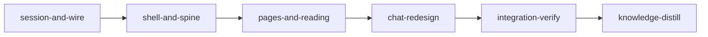

# Plan: Redesign the planner around reading and contextual chat

Implements: section_01, section_05, section_07, section_08, section_12

## Overview

Plan 12 delivered a planner that passed every gate and that the operator found ugly and unusable. The feature screen is a status page about the pipeline, concept mode is hard to reach, offers repeat up to five times, and the chat knows nothing about what the user is reading. This plan makes the feature screen a step spine that opens real content, opens finished features on the product overview, gives the app one visual system by a designer's hand, makes chat contextual and restyled, names features by their slug and runs authoring in auto mode. It also stops planning sessions outliving their server and stops the test suite starting real Claude sessions in the operator's home.

The briefs in `doc/plans/feat-planner/briefs/feat-planner-13-planner-redesign/` are authoritative for detail. YAML is authoritative for gates and ownership. The operator will give concrete feedback on the built result, so nothing here is a locked mockup: visual values come from the design worker's `web/src/plan/ui/DESIGN.md`.

## Goals

- Every sidebar row opens real content; no page is blank and no screen draws one offer twice.
- A finished feature opens on the product overview, in concept mode, one click from source, Edit and Discuss.
- The chat names what the user is viewing, offers prompts for it, and attaches it to the next message.
- `feat-planner` reads `feat-planner` everywhere.
- Authoring chats stop prompting for innocuous actions, and a block by the classifier shows in the chat.
- No planning session or tmux server outlives its server by more than a 15-minute grace, and `cargo test` leaves nothing running and nothing under `~/.loom`.
- Non-goal: per-stage run progress on the Run page, multi-user changes, a new theme system.

## Evidence behind the decisions

- **Auto mode.** A real interactive session (Claude Code 2.1.312) under `--permission-mode auto --settings <file>` showed "auto mode on". An `allow` rule ran, an `ask` rule fired `PermissionRequest`, and `PreToolUse` fired on every call. The classifier block path was not exercised. Kickoff's "asks the holder" rests on absent allow rules (`plan_session/sandbox/permissions.rs:83-111`), so auto mode would silently hand those commands to the classifier; the plan adds explicit `ask` rules. `PermissionDenied`'s payload is taken from `code.claude.com/docs/en/hooks`.
- **Session leak.** With a fake `claude` under a scratch home: SIGTERM tears the session and tmux down within seconds, SIGKILL leaves both running, and a new server on the same project keeps the survivor (`bridge/recovery.rs:143` resumes it). Eight real sessions reached 5 to 49 hours on the operator's machine. All eight had temp-dir project roots or the e2e display name, so no later server could ever recover them, and `~/.loom/plan` holds 322 `.tmp*` directories. In-crate tests reach the real home because `PlanContext::new` resolves `server_runtime_paths` (`plan_server/context.rs:96`) and only `chat/tests.rs` calls `with_runtime`. Which test started the five summary sessions is inferred from `summaries/routes/tests.rs:44`; W3 confirms it.
- **Baselines at 56a71845, in the main checkout.** `tsc -b --noEmit`, `oxlint --deny-warnings` and `oxfmt --check` exit 0, and `vitest run src/plan` gives 252 files and 3172 tests passing. Rust gates were not re-run for this plan, because `cargo test --lib plan_server::` at HEAD is what starts real sessions in the operator's home; plan 12's integration-verify passed them at that commit.
- **Criteria are not run in a stage's real browser.** The journey script needs tmux, a scratch `HOME` and the browser cache, which the completion runner does not grant, so stages run it as a named step and reviewers read its output (`journeys.md`). Behaviour the gate must enforce lives in frozen contracts.

## Execution Diagram



## Stages

No knowledge-bootstrap: the tier-1 files describe this codebase and `doc/loom/knowledge/architecture/planner-web-shell.md` covers the area.

### 1. session-and-wire

Exists by Q1: the shell needs the six-step wire, `plan_rows` and short labels merged. It carries auto mode and the `PermissionDenied` notice, the owner watch, test isolation, slug names, removal of step 6, the labels, and the spec rewrite.

Lanes, by the operator's instruction: all Rust implementation runs on `gpt-6.1-sol` at effort `high` through `loom-codex-forwarder`, in 24 single-file units across four waves (`session-and-wire.md`, Lanes and units). Claude runs the web consumers (W5), the spec (W6), every fix, every check and every review, and loom's contract session writes the contract tests. This is the only stage with backend work. If codex is unavailable at run time the stage blocks and asks; it does not reroute to Claude.

Risk walk:

- Configuration propagation: `authoring-launches-in-auto`, `summary-stays-manual`.
- Lifecycle: `owner-watch-tears-down-after-grace`, `owner-return-keeps-session`, `holder-read-takes-no-lock`.
- Untrusted input: `denied-action-spools-silently`.
- External data: the same contract uses the documented payload.
- Reachability: `kickoff-writers-ask-the-holder` drives the real settings builder.
- Live-state pollution: `in-crate-context-stays-out-of-home`.

Test-integrity events are expected on `plan_feature_card_contracts.rs` and files pinning seven steps or titles; the main agent files one `dispute-integrity`.

### 2. shell-and-spine

Exists by Q1: both later stages need `DESIGN.md`, the layout route and the header merged. It holds the visual system (a fable worker with frontend-design), the slim header, spine, landing, source pages, offer dedupe and the journey script. Risk walk: reachability is covered by `finished-feature-opens-product-overview` and `spine-row-opens-vision`, which render through the real `routes`; the wrong design it guards against is `no-offer-drawn-twice`.

### 3. pages-and-reading

Exists by Q4: the Pressure and Run pages plus the restyle of every reading surface, home and kickoff would pass 500,000 tokens with the chat work. Risk walk: reachability via `pressure-page-lists-every-plan`, `finished-feature-run-page-holds-compare`.

### 4. chat-redesign

Exists by Q2 and Q4: it writes `files/doc-heading-view.tsx` after stage 3 restyles it, and the combined work would pass 500,000 tokens. Risk walk: reachability via `context-line-follows-route`; configuration or state via `send-attaches-viewed-document`, `dismissed-context-not-attached`, `prompt-click-sends-nothing`.

### Integration Verification

The full Rust and web suites, the journey script with `--strict`, a browser review in all four themes, reviewers, and the embedded bundle commit.

### Knowledge Distillation

Rewrites `architecture/planner-web-shell.md` to the new screen, and curates the rest.

## Environment inventory

| Need | State |
| --- | --- |
| crates.io, npm | `allowed_domains` |
| `web/node_modules`, `playwright-core` | provisioned by `loom.provision` |
| Chromium for screenshots and journeys | `~/.cache/ms-playwright` on the host, as plan 12 used; a stage that cannot launch it records that and the operator is told in the review |
| tmux in a stage session | not granted in the session sandbox; a journey step that cannot start a session records `PENDING`, and integration-verify reports which views stayed synthetic |
| Claude login in a stage | none, so the fake `claude` in `journeys.md` stands in; a real authoring chat in auto mode is the operator's check after the run |

## After the run

The operator checks by hand what no stage can:

- A real authoring chat prompts less and still asks for `loom knowledge` in a kickoff.
- A real classifier block shows as a notice.
- The design holds up.

---

<!-- loom METADATA -->

```yaml
loom:
  version: 2
  auto_merge: null
  sandbox:
    enabled: true
    auto_allow: true
    allow_unsandboxed_escape: false
    excluded_commands: []
    filesystem:
      deny_read:
      - ~/.ssh/**
      - ~/.aws/**
      - ~/.config/gcloud/**
      - ~/.gnupg/**
      deny_write:
      - ../../**
      allow_write: []
    network:
      allowed_domains:
      - crates.io
      - index.crates.io
      - static.crates.io
      - registry.npmjs.org
      additional_domains: []
      allow_local_binding: false
      allow_unix_sockets: []
      allow_all_unix_sockets: false
    linux:
      enable_weaker_nested: false
    command_confinement: confined
  ratchet_files:
  - loom/maintainability-baseline.txt
  - doc/loom/knowledge/check-baseline.txt
  provision:
  - working_dir: web
    command: >-
      test ! -e .npmrc && test ! -L .npmrc && bun install --frozen-lockfile
      --ignore-scripts --backend=copyfile --config=/dev/null
  stages:
  - id: session-and-wire
    name: Auto mode, session lifetime, test isolation, slug names, six steps, the spec
    summary: >-
      Runs authoring in auto mode with blocks shown in chat, ends sessions whose server is gone,
      keeps tests away from the real home and the real claude, names features by slug, removes the
      Review step, shortens offer labels, and rewrites the spec to the new screen.
    description: |
      Read doc/plans/feat-planner/briefs/feat-planner-13-planner-redesign/common.md, then session-and-wire.md in the same directory, before dispatch. Pass both paths to every worker.
      PATHS: working_dir is loom/; YAML and table paths are repository-relative.
      KNOWLEDGE: conventions/plan-web.md (New PlanMessage Variants Need Both Schema Arms), architecture/planning-session-sandbox.md, architecture/planning-session-bridge.md, mistakes/live-state-pollution.md.
      PUBLIC SURFACE for the contract session:
      - loom/src/plan_session/sandbox/permissions.rs gains pub fn permission_mode(kind: &SessionKind) -> &'static str, re-exported from plan_session::sandbox. launch_script (plan_session::launch::script, pub) reads spec.kind. loom/src/plan_session/launch_tests.rs shows how to build a LaunchSpec; put launch contracts in the in-crate file loom/src/plan_session/launch/mode_contract_tests.rs (test path plan_session::launch::mode_contract_tests::<fn>).
      - Settings contracts go in tests/plan_redesign_contracts.rs, using write_session_sandbox as tests/plan_session_sandbox_contracts.rs does, reading the written settings.json. Rule strings: Bash(loom knowledge *), Bash(loom plan summary seal*), Bash(loom plan summary brief*), Bash(loom plan summary release*), Bash(loom plan summary status*).
      - plan_session::hook_cli::run(event, session_dir, stdin, stdout, ...) as existing tests in hook_cli.rs call it; loom/src/plan_session/spool.rs reads the spool.
      - plan_session::owner_watch::{run(probe: &mut dyn OwnerProbe, grace: Duration, poll: Duration), OwnerProbe, OWNER_GRACE, OWNER_POLL}; OwnerProbe methods owner_alive, session_alive, teardown, sleep, now, per the brief. A contract's fake advances its own clock in sleep.
      - plan_session::owner_watch::read_holder_pid(path: &Path) -> Option<u32> reads the lock file's JSON pid without taking the flock (plan_session never imports plan_server, so it does not reuse lock.rs); plan_server::lock::acquire(path) writes that file.
      - In-crate: loom/src/plan_server/context_contract_tests.rs (test path plan_server::context_contract_tests::<fn>) calls PlanContext::new(root, ReadOnly::from_problems(Vec::new()), BindInfo::new(addr, "test"), OwnWrites::default()), as summaries/rebuilds/panel/tests.rs:13-25 does, with LOOM_HOME unset and asserts the context's runtime dir is not under the real home's .loom.
      - Wire: loom::plan_server::wire::checklist::{ChecklistView, ProjectChecklistView}, as tests/plan_feature_card_contracts.rs builds them. ChecklistView loses title and gains metaplans: Vec<MetaplanRowView { path, title }> and plan_rows: Vec<PlanRowView { slug, path, title, state, pressure_date: Option<String>, listed }>. steps has six entries, the last named Run, number 6. primary is None for a finished feature.
      LANES (operator's instruction): ALL backend implementation runs on gpt-6.1-sol at effort high through loom-codex-forwarder. Fixes and verification do not. W1 to W4 are the backend, cut into the 24 file-sized units of the "Lanes and units" table in session-and-wire.md. Spawn each unit as a loom-codex-forwarder in the FOREGROUND with --model gpt-6.1-sol --effort high, a stable --unit-id, an explicit Bash timeout of 600000 ms, forwarded from the worktree root, never from loom/, at most six at once over disjoint files. Do not let the signal reroute this work: if the codex lane is unavailable, file loom stage block session-and-wire naming what is missing. Do not change the model or effort, and do not move a unit to Claude because it looks hard.
      A unit that timed out is re-split against its partial result and forwarded again, never unchanged. A unit that came back wrong, a failing test, a failed gate or a review finding goes to a fresh loom-software-engineer (sonnet) with the evidence, then a loom-senior-software-engineer (opus) if that attempt fails, and never back to codex. Contract tests come from loom's contract session, never from a codex unit. You run the compile checks after each wave, regenerate wire fixtures by running the tests that write them, and own the gate and reviews.
      WAVES: 1 (A1-A6) with W6 beside it; 2 (B1-B6); 3 (C1-C6); 4 (D1-D6); then W5. After each wave run git status --short and confirm every unit's files changed. Each unit's own proof is cargo check; it runs no fixture-backed test, no git, and writes nothing under .loom/.
      | Worker | Role | Tier | Files owned | Shared context | Brief path |
      | ------ | ---- | ---- | ----------- | -------------- | ---------- |
      | W1 | Auto mode, ask rules, PermissionDenied notice, wiring the owner watch | codex sol/high | loom/src/plan_session/launch/script.rs; loom/src/plan_session/launch_tests.rs; loom/src/plan_session/sandbox/permissions.rs; loom/src/plan_session/sandbox/mod.rs; loom/src/plan_session/sandbox/assert.rs; loom/src/plan_session/sandbox/tests.rs; loom/src/plan_session/sandbox/tests_kinds_fixture.rs; loom/src/plan_session/sandbox/tests_assert.rs; loom/src/plan_session/spool.rs; loom/src/plan_session/spool_tests.rs; loom/src/plan_session/hook_cli.rs; loom/src/plan_session/bridge/driver.rs; loom/src/plan_session/bridge/denied.rs; loom/src/plan_session/bridge/mod.rs; loom/tests/plan_session_bridge_core_contracts/support.rs; loom/tests/plan_session_sandbox_contracts.rs | common.md | doc/plans/feat-planner/briefs/feat-planner-13-planner-redesign/session-and-wire.md |
      | W2 | Owner watch and lock read | codex sol/high | loom/src/plan_session/owner_watch.rs; loom/src/plan_session/mod.rs | common.md | doc/plans/feat-planner/briefs/feat-planner-13-planner-redesign/session-and-wire.md |
      | W3 | Test isolation and fixture teardown | codex sol/high | loom/src/planning/runtime.rs; loom/src/plan_server/chat/mod.rs; loom/src/plan_server/summaries/spawner.rs; loom/tests/plan_session_bridge_e2e.rs; loom/tests/plan_session_bridge_e2e/**; loom/tests/plan_chat_operator.rs; loom/tests/plan_handoff_operator/common.rs | common.md | doc/plans/feat-planner/briefs/feat-planner-13-planner-redesign/session-and-wire.md |
      | W4 | Wire: no title, six steps, labels, plan rows | codex sol/high | loom/src/plan_server/wire/**; loom/src/planning/checklist.rs; loom/src/planning/checklist/**; loom/src/planning/guidance/**; loom/src/commands/plan/check.rs; loom/src/commands/plan/check/tests.rs; loom/src/plan_server/features.rs; loom/tests/planning_checklist_contracts.rs; loom/tests/plan_feature_card_contracts.rs; loom/tests/planning_guidance_contracts.rs | common.md | doc/plans/feat-planner/briefs/feat-planner-13-planner-redesign/session-and-wire.md |
      | W5 | Web consumers of the wire | sonnet | web/src/plan/** | W4 field list | doc/plans/feat-planner/briefs/feat-planner-13-planner-redesign/session-and-wire.md |
      | W6 | Spec and metaplan | sonnet | doc/product/feat-planner/**; doc/plans/feat-planner/index.md | common.md | doc/plans/feat-planner/briefs/feat-planner-13-planner-redesign/session-and-wire.md |
      Spawn W5 and W6 as loom-software-engineer. Each prompt says: Your brief: <path>. Read it and common.md in full before anything else, then your "<worker>" section.
      AFTER THE WORKERS: cargo fmt --all; in ../web node_modules/.bin/oxfmt. The gate is one loom check session-and-wire, beside the final loom-code-reviewer round. After the commit, file one dispute-integrity naming each file whose guards the wire change removed.
      LEDGER: no file this stage edits may cross 400 lines; a function over 50 lines is split.
      Use parallel subagents and skills to maximize performance.
      MEMORY: record mistakes, decisions and surprises with loom memory immediately, subagents too; NEVER Claude Code auto-memory.
    dependencies: []
    parallel_group: null
    acceptance:
    - cargo build
    - cargo clippy --all-targets -- -D warnings
    - cargo fmt --check
    - 'cargo test --lib plan_session::'
    - 'cargo test --lib plan_server::'
    - 'cargo test --lib planning::'
    - >-
      cargo test --test plan_redesign_contracts --test planning_checklist_contracts --test
      plan_session_sandbox_contracts --test plan_feature_card_contracts --test
      planning_guidance_contracts
    - >-
      cd ../web && node_modules/.bin/tsc -b --noEmit && node_modules/.bin/oxlint
      --deny-warnings && node_modules/.bin/oxfmt --check
    - cd ../web && node_modules/.bin/vitest run src/plan
    setup: []
    files:
    - loom/src/plan_session/**
    - loom/src/plan_server/**
    - loom/src/planning/**
    - loom/src/commands/plan/check.rs
    - loom/src/commands/plan/check/tests.rs
    - loom/tests/plan_handoff_operator/common.rs
    - loom/tests/plan_redesign_contracts.rs
    - loom/tests/plan_feature_card_contracts.rs
    - loom/tests/planning_checklist_contracts.rs
    - loom/tests/planning_guidance_contracts.rs
    - loom/tests/plan_session_sandbox_contracts.rs
    - loom/tests/plan_session_bridge_core_contracts/**
    - loom/tests/plan_session_bridge_e2e.rs
    - loom/tests/plan_session_bridge_e2e/**
    - loom/tests/plan_chat_operator.rs
    - web/src/plan/**
    - doc/product/feat-planner/**
    - doc/plans/feat-planner/index.md
    auto_merge: null
    working_dir: loom
    stage_type: standard
    artifacts:
    - src/plan_session/owner_watch.rs
    wiring:
    - source: src/plan_session/launch/script.rs
      pattern: permission_mode(&spec.kind)
      description: the launch line reads the mode from the session's kind
      literal: true
    - source: src/plan_session/launch/script.rs
      pattern: OwnerWatch
      description: the launch script starts the owner watch
      literal: true
    - source: src/plan_session/bridge/driver.rs
      pattern: PermissionDenied
      description: the driver turns a block into a chat notice
      literal: true
    before_stage:
    - command: test ! -e src/plan_session/owner_watch.rs
      description: the owner watch does not exist yet
    after_stage:
    - command: test -s src/plan_session/owner_watch.rs
      description: the owner watch exists
    context_ceiling_tokens: null
    subagent_timeout_secs: 900
    sandbox: {}
    ultracode: false
    implementers:
    - codex
    - claude
    skills:
    - loom-rust
    - loom-typescript
    contracts:
    - id: authoring-launches-in-auto
      file: src/plan_session/launch/mode_contract_tests.rs
      test: plan_session::launch::mode_contract_tests::authoring_launches_in_auto
      scenario: builds a LaunchSpec of SessionKind::Authoring and reads launch_script's output
      rejects: a launch line that still passes --permission-mode default for authoring
    - id: summary-stays-manual
      file: src/plan_session/launch/mode_contract_tests.rs
      test: plan_session::launch::mode_contract_tests::summary_stays_manual
      scenario: builds a LaunchSpec of SessionKind::Summary and reads launch_script's output
      rejects: a launch line that passes auto for every kind, so a summary session's unlisted tools go to the classifier
    - id: kickoff-writers-ask-the-holder
      file: tests/plan_redesign_contracts.rs
      test: kickoff_writers_ask_the_holder
      scenario: >-
        writes settings for an authoring session in Kickoff scope and reads permissions.ask and
        permissions.allow
      rejects: >-
        settings that leave loom knowledge and the summary writers unlisted, or that ask on
        Bash(loom plan summary *) and so stop the pre-allowed status command
    - id: denied-action-spools-silently
      file: tests/plan_redesign_contracts.rs
      test: denied_action_spools_silently
      scenario: >-
        calls hook_cli::run with event PermissionDenied and the documented payload (tool_name Bash,
        reason [Irreversible Local Destruction]), then reads the spool
      rejects: a hook that drops an event it does not list, or prints retry and invites the model to try again
    - id: owner-watch-tears-down-after-grace
      file: tests/plan_redesign_contracts.rs
      test: owner_watch_tears_down_after_grace
      scenario: runs owner_watch::run with a fake whose owner is gone and session alive, grace 60 s, poll 15 s
      rejects: a watch that tears down on the first missed poll, or never
    - id: owner-return-keeps-session
      file: tests/plan_redesign_contracts.rs
      test: owner_return_keeps_session
      scenario: >-
        a fake whose owner is gone for 45 s, back for one poll, gone for 45 s, then whose session
        ends, with grace 60 s
      rejects: a watch that accumulates absence across a restart and kills a session a new server has resumed
    - id: holder-read-takes-no-lock
      file: tests/plan_redesign_contracts.rs
      test: holder_read_takes_no_lock
      scenario: >-
        calls plan_server::lock::acquire on a temp path and keeps the lock, then read_holder_pid
        returns this process's id while the lock is held; a missing file returns None
      rejects: a reader that takes the flock, which reads nothing while a server holds it and could make a starting server refuse
    - id: in-crate-context-stays-out-of-home
      file: src/plan_server/context_contract_tests.rs
      test: plan_server::context_contract_tests::in_crate_context_stays_out_of_home
      scenario: with LOOM_HOME unset, calls PlanContext::new on a temp root and reads its runtime directory
      rejects: a context that resolves to the operator's ~/.loom/plan, as 322 leftover directories show it does today
    - id: checklist-has-no-title-and-six-steps
      file: tests/plan_redesign_contracts.rs
      test: checklist_has_no_title_and_six_steps
      scenario: serializes the ChecklistView of a temp feature with a vision titled Atlas Vision
      rejects: a view that keeps a title field, or a step list that still holds Review
    - id: finished-feature-has-no-primary
      file: tests/plan_redesign_contracts.rs
      test: finished_feature_has_no_primary
      scenario: a temp feature whose sections and plans are all written and DONE-prefixed
      rejects: a primary offer on a finished feature, which is the large yellow button the operator asked about
    - id: plan-rows-carry-pressure-date
      file: tests/plan_redesign_contracts.rs
      test: plan_rows_carry_pressure_date
      scenario: >-
        a temp feature with one plan holding a dated ## Pressure tests record and one with none,
        both in a metaplan table
      rejects: rows that re-parse the record and disagree with files::plan_view::latest_pressure_date, or that omit an unlisted plan
  - id: shell-and-spine
    name: The visual system, header, spine and landing
    summary: >-
      Sets the app's visual system with a designer's pass, replaces the step rail and step pages
      with a sidebar that opens real content, opens finished features on the product overview, and
      adds the browser journeys this plan is judged by.
    description: |
      MODEL: opus for this stage's main agent (deliberate override): it judges screenshots against a design and no value is transcribed for it.
      Read doc/plans/feat-planner/briefs/feat-planner-13-planner-redesign/common.md, then shell-and-spine.md and journeys.md in the same directory, before dispatch. Pass them to every worker and every reviewer.
      PATHS: working_dir is web/; YAML and table paths are repository-relative.
      KNOWLEDGE: conventions/plan-web.md, conventions/web-dashboard-typography.md, architecture/planner-web-shell.md.
      FRONTEND-DESIGN: every worker invokes the frontend-design:frontend-design skill before writing code. This is the operator's instruction.
      PUBLIC SURFACE for the contract session (src/plan/feature/spine.contracts.test.tsx, top-level it() calls named exactly as each contract's test; render the real routes from src/plan/router.tsx through createMemoryRouter on a store seeded as src/plan/feature/feature-route.test.tsx seeds it): the checklist fixture comes from src/plan/api/fixtures. FeatureLayout in src/plan/feature/feature-layout.tsx renders nav aria-label "Feature documents", whose rows are links named Vision, Product spec, Metaplan, Plans, Pressure test, Run. The index route redirects by landingPath(checklist) from src/plan/feature/landing.ts. The header holds no link named Product or Engineering and no element with class plan-next-step.
      WORKERS. D1 first, alone. Then S1, S2, S3 in one message.
      | Worker | Role | Tier | Files owned | Shared context | Brief path |
      | ------ | ---- | ---- | ----------- | -------------- | ---------- |
      | D1 | The visual system | fable | web/src/plan/ui/**; web/src/plan/plan.css; web/src/plan/offers/** | common.md | doc/plans/feat-planner/briefs/feat-planner-13-planner-redesign/shell-and-spine.md |
      | S1 | Header | sonnet | web/src/plan/header/**; web/src/plan/tabs.ts; web/src/plan/tabs.test.ts; web/src/plan/help/** | DESIGN.md | doc/plans/feat-planner/briefs/feat-planner-13-planner-redesign/shell-and-spine.md |
      | S2 | Spine, layout, landing, source pages | sonnet | web/src/plan/feature/**; web/src/plan/router.tsx; web/src/plan/router.test.tsx; web/src/plan/concept/concept-route-support.tsx | DESIGN.md | doc/plans/feat-planner/briefs/feat-planner-13-planner-redesign/shell-and-spine.md |
      | S3 | Journey script | sonnet | scripts/plan-journeys.sh; web/scripts/plan-journeys.mjs | journeys.md | doc/plans/feat-planner/briefs/feat-planner-13-planner-redesign/journeys.md |
      Spawn D1 as loom-software-engineer with model fable (BLOCK-B: visual design). Spawn the rest as loom-software-engineer. Each prompt says: Your brief: <path>. Read it, common.md and web/src/plan/ui/DESIGN.md in full before anything else, then your "<worker>" section; invoke frontend-design:frontend-design before writing code.
      AFTER THE WORKERS: the Main agent section of shell-and-spine.md.
      Use parallel subagents and skills to maximize performance.
      MEMORY: record mistakes, decisions and surprises with loom memory immediately, subagents too; NEVER Claude Code auto-memory.
    dependencies:
    - session-and-wire
    parallel_group: null
    acceptance:
    - bun run typecheck
    - bun run lint
    - bun run format:check
    - >-
      node_modules/.bin/vitest run src/plan/feature src/plan/header src/plan/help src/plan/ui
      src/plan/router.test.tsx src/plan/tabs.test.ts src/plan/concept
    - bash -n ../scripts/plan-journeys.sh
    setup: []
    files:
    - web/src/plan/**
    - web/scripts/plan-journeys.mjs
    - scripts/plan-journeys.sh
    auto_merge: null
    working_dir: web
    stage_type: standard
    artifacts:
    - src/plan/ui/DESIGN.md
    - src/plan/ui/design.css
    - src/plan/feature/feature-layout.tsx
    - src/plan/feature/spine.tsx
    - src/plan/feature/landing.ts
    wiring:
    - source: src/plan/router.tsx
      pattern: <FeatureLayout
      description: the router mounts the feature layout
      literal: true
    - source: src/plan/feature/feature-layout.tsx
      pattern: <Spine
      description: the layout renders the spine
      literal: true
    before_stage:
    - command: test ! -e src/plan/feature/spine.tsx
      description: the spine does not exist yet
    after_stage:
    - command: test -s src/plan/feature/spine.tsx
      description: the spine exists
    context_ceiling_tokens: null
    sandbox: {}
    model: opus
    ultracode: false
    implementers:
    - claude
    skills:
    - loom-react
    - loom-typescript
    contracts:
    - id: finished-feature-opens-product-overview
      file: src/plan/feature/spine.contracts.test.tsx
      test: finished feature opens the product overview
      scenario: renders the routes at /f/atlas with a checklist whose sections are all written and plans all done
      rejects: an index route that shows a step page or lands on the Run page
    - id: spine-row-opens-vision
      file: src/plan/feature/spine.contracts.test.tsx
      test: the Vision row opens the vision document
      scenario: clicks the Vision link in nav "Feature documents" with /api/doc stubbed to return the vision
      rejects: a row that links to a query parameter, or a page showing only the document's path
    - id: no-offer-drawn-twice
      file: src/plan/feature/spine.contracts.test.tsx
      test: no screen draws one offer twice
      scenario: >-
        renders /f/atlas/product with primary write_section for section 02, a section queue and
        pace showing
      rejects: a button with the same label in the spine, a queue row and the pace card
    - id: header-has-no-rail-or-view-tabs
      file: src/plan/feature/spine.contracts.test.tsx
      test: the header has no rail or view tabs
      scenario: renders PlanHeader at /f/atlas/product
      rejects: a header still drawing the step rail, the next-step card or Product and Engineering links
  - id: pages-and-reading
    name: Pressure and Run pages, and every reading surface
    summary: >-
      Gives Pressure test and Run real pages, and applies the visual system to concept mode, rendered
      documents, home and kickoff.
    description: |
      MODEL: opus for this stage's main agent (deliberate override): it judges screenshots against DESIGN.md.
      Read doc/plans/feat-planner/briefs/feat-planner-13-planner-redesign/common.md, then pages-and-reading.md and journeys.md in the same directory, and web/src/plan/ui/DESIGN.md, before dispatch. Pass them to every worker and every reviewer.
      PATHS: working_dir is web/; YAML and table paths are repository-relative.
      KNOWLEDGE: conventions/plan-web.md, conventions/web-dashboard-typography.md.
      FRONTEND-DESIGN: every worker invokes the frontend-design:frontend-design skill before writing code. This is the operator's instruction.
      PUBLIC SURFACE for the contract session (src/plan/feature/pages.contracts.test.tsx, top-level it() calls named exactly as each contract's test; render the real routes as src/plan/feature/spine.contracts.test.tsx does): PressurePage at /f/:feature/pressure and RunPage at /f/:feature/run. Both read checklist.plan_rows. A row names the plan's slug; an untested row shows "Not tested", a tested row shows its pressure_date.
      WORKERS (one message):
      | Worker | Role | Tier | Files owned | Shared context | Brief path |
      | ------ | ---- | ---- | ----------- | -------------- | ---------- |
      | P1 | Pressure and Run pages, their routes | sonnet | web/src/plan/feature/pressure-page.tsx; web/src/plan/feature/pressure-page.test.tsx; web/src/plan/feature/run-page.tsx; web/src/plan/feature/run-page.test.tsx; web/src/plan/router.tsx; web/src/plan/run/** | DESIGN.md | doc/plans/feat-planner/briefs/feat-planner-13-planner-redesign/pages-and-reading.md |
      | P2 | Reading surface | sonnet | web/src/plan/concept/**; web/src/plan/markdown/**; web/src/plan/files/**; web/src/plan/editor/**; web/src/plan/ui/doc-heading.tsx | DESIGN.md | doc/plans/feat-planner/briefs/feat-planner-13-planner-redesign/pages-and-reading.md |
      | P3 | Home, kickoff, settings, help | sonnet | web/src/plan/home/**; web/src/plan/new/**; web/src/plan/settings/**; web/src/plan/help/**; web/src/plan/header/activity.css | DESIGN.md | doc/plans/feat-planner/briefs/feat-planner-13-planner-redesign/pages-and-reading.md |
      Spawn every worker as loom-software-engineer. Each prompt says: Your brief: <path>. Read it, common.md and web/src/plan/ui/DESIGN.md in full before anything else, then your "<worker>" section; invoke frontend-design:frontend-design before writing code.
      AFTER THE WORKERS: the Main agent section of pages-and-reading.md.
      Use parallel subagents and skills to maximize performance.
      MEMORY: record mistakes, decisions and surprises with loom memory immediately, subagents too; NEVER Claude Code auto-memory.
    dependencies:
    - shell-and-spine
    parallel_group: null
    acceptance:
    - bun run typecheck
    - bun run lint
    - bun run format:check
    - >-
      node_modules/.bin/vitest run src/plan/feature src/plan/concept src/plan/markdown
      src/plan/files src/plan/editor src/plan/home src/plan/new src/plan/settings src/plan/help
      src/plan/run src/plan/router.test.tsx
    setup: []
    files:
    - web/src/plan/feature/pressure-page.tsx
    - web/src/plan/feature/pressure-page.test.tsx
    - web/src/plan/feature/run-page.tsx
    - web/src/plan/feature/run-page.test.tsx
    - web/src/plan/feature/pages.contracts.test.tsx
    - web/src/plan/router.tsx
    - web/src/plan/run/**
    - web/src/plan/concept/**
    - web/src/plan/markdown/**
    - web/src/plan/files/**
    - web/src/plan/editor/**
    - web/src/plan/ui/doc-heading.tsx
    - web/src/plan/home/**
    - web/src/plan/new/**
    - web/src/plan/settings/**
    - web/src/plan/help/**
    - web/src/plan/header/activity.css
    auto_merge: null
    working_dir: web
    stage_type: standard
    artifacts:
    - src/plan/feature/pressure-page.tsx
    - src/plan/feature/run-page.tsx
    wiring:
    - source: src/plan/router.tsx
      pattern: <PressurePage
      description: the router mounts the Pressure page
      literal: true
    - source: src/plan/router.tsx
      pattern: <RunPage
      description: the router mounts the Run page
      literal: true
    before_stage:
    - command: test ! -e src/plan/feature/pressure-page.tsx
      description: the Pressure page does not exist yet
    after_stage:
    - command: test -s src/plan/feature/pressure-page.tsx
      description: the Pressure page exists
    context_ceiling_tokens: null
    sandbox: {}
    model: opus
    ultracode: false
    implementers:
    - claude
    skills:
    - loom-react
    - loom-typescript
    contracts:
    - id: pressure-page-lists-every-plan
      file: src/plan/feature/pages.contracts.test.tsx
      test: the Pressure page lists every plan with its record state
      scenario: >-
        renders /f/atlas/pressure with plan_rows of one plan dated 2026-10-20 and one with
        pressure_date null
      rejects: a blank page, or a page listing only plans with a record
    - id: finished-feature-run-page-holds-compare
      file: src/plan/feature/pages.contracts.test.tsx
      test: a finished feature's Run page holds the compare offer once
      scenario: renders /f/atlas/run with every plan done and refine_spec among the secondaries
      rejects: a page with no way to start the retro, or one that also draws it in the spine
  - id: chat-redesign
    name: A contextual, restyled chat panel
    summary: >-
      Redesigns the chat as one continuous surface without nested boxes, and makes it follow what the
      user is viewing: it names the document, offers prompts for it, and attaches it to the next
      message.
    description: |
      MODEL: opus for this stage's main agent (deliberate override): it judges screenshots against DESIGN.md.
      Read doc/plans/feat-planner/briefs/feat-planner-13-planner-redesign/common.md, then chat-redesign.md and journeys.md in the same directory, and web/src/plan/ui/DESIGN.md, before dispatch. Pass them to every worker and every reviewer.
      PATHS: working_dir is web/; YAML and table paths are repository-relative.
      KNOWLEDGE: conventions/plan-web.md (Chat Panel and Review UI Rules), architecture/planner-web-shell.md (Chat home and the chat panel).
      FRONTEND-DESIGN: every worker invokes the frontend-design:frontend-design skill before writing code. This is the operator's instruction.
      PUBLIC SURFACE for the contract session (src/plan/chat/context.contracts.test.tsx, top-level it() calls named exactly as each contract's test; seed frames through the FakeSocket seam in planSocketAtom and stub matchMedia per conventions/plan-web.md): viewedOfPath(pathname, checklist) and viewedDocumentAtom from src/plan/chat/viewed-document.ts. The panel's context line has the accessible name "Viewing <name>" with a button named "Dismiss context". Prompts are buttons inside a list named "Suggested prompts". The composer textarea's placeholder names the document.
      WORKERS. C1 first, alone. Then C2.
      | Worker | Role | Tier | Files owned | Shared context | Brief path |
      | ------ | ---- | ---- | ----------- | -------------- | ---------- |
      | C1 | The panel's look | fable | web/src/plan/chat/chat-surface.css; web/src/plan/chat/chat.css; web/src/plan/chat/panel.tsx; web/src/plan/chat/panel-head.tsx; web/src/plan/chat/transcript.tsx; web/src/plan/chat/items.tsx; web/src/plan/chat/tool-row.tsx; web/src/plan/chat/patch-view.tsx; web/src/plan/chat/turn-footer.tsx; web/src/plan/chat/permission-card.tsx; web/src/plan/chat/chips.tsx | DESIGN.md | doc/plans/feat-planner/briefs/feat-planner-13-planner-redesign/chat-redesign.md |
      | C2 | Context, prompts, attachment, offers out | sonnet | web/src/plan/chat/viewed-document.ts; web/src/plan/chat/viewed-document.test.ts; web/src/plan/chat/context-line.tsx; web/src/plan/chat/context-line.test.tsx; web/src/plan/chat/context-prompts.tsx; web/src/plan/chat/context-prompts.test.tsx; web/src/plan/chat/composer.tsx; web/src/plan/chat/composer-hooks.ts; web/src/plan/chat/screen-sync.tsx; web/src/plan/chat/state-line.tsx; web/src/plan/chat/new-chat-offers.tsx; web/src/plan/attachments/**; web/src/plan/files/doc-heading-view.tsx | DESIGN.md | doc/plans/feat-planner/briefs/feat-planner-13-planner-redesign/chat-redesign.md |
      Spawn C1 as loom-software-engineer with model fable (BLOCK-B: visual design), C2 as loom-software-engineer. Each prompt says: Your brief: <path>. Read it, common.md and web/src/plan/ui/DESIGN.md in full before anything else, then your "<worker>" section; invoke frontend-design:frontend-design before writing code.
      C2 touches panel-head.tsx only through the slot C1 leaves for the context line; C1's report names it.
      AFTER THE WORKERS: the Main agent section of chat-redesign.md.
      Use parallel subagents and skills to maximize performance.
      MEMORY: record mistakes, decisions and surprises with loom memory immediately, subagents too; NEVER Claude Code auto-memory.
    dependencies:
    - pages-and-reading
    parallel_group: null
    acceptance:
    - bun run typecheck
    - bun run lint
    - bun run format:check
    - node_modules/.bin/vitest run src/plan/chat src/plan/attachments
    setup: []
    files:
    - web/src/plan/chat/**
    - web/src/plan/attachments/**
    - web/src/plan/files/doc-heading-view.tsx
    auto_merge: null
    working_dir: web
    stage_type: standard
    artifacts:
    - src/plan/chat/viewed-document.ts
    # chat-redesign depends on pages-and-reading because both write doc-heading-view.tsx.
    - src/plan/chat/context-line.tsx
    - src/plan/chat/context-prompts.tsx
    wiring:
    - source: src/plan/chat/screen-sync.tsx
      pattern: viewedOfPath(
      description: the screen sync keeps the viewed document current
      literal: true
    - source: src/plan/chat/composer-hooks.ts
      pattern: docAttachment(
      description: sending attaches the viewed document
      literal: true
    before_stage:
    - command: test ! -e src/plan/chat/viewed-document.ts
      description: the viewed document module does not exist yet
    after_stage:
    - command: test -s src/plan/chat/viewed-document.ts
      description: the viewed document module exists
    context_ceiling_tokens: null
    sandbox: {}
    model: opus
    ultracode: false
    implementers:
    - claude
    skills:
    - loom-react
    - loom-typescript
    contracts:
    - id: context-line-follows-route
      file: src/plan/chat/context.contracts.test.tsx
      test: the context line follows the route
      scenario: mounts the panel at /f/atlas/product/section_05, then navigates to /f/atlas/metaplan
      rejects: a context set once at chat start, or a line that needs a Discuss click
    - id: send-attaches-viewed-document
      file: src/plan/chat/context.contracts.test.tsx
      test: sending attaches the viewed document
      scenario: >-
        at /f/atlas/product/section_05 with /api/doc stubbed, types a message and sends, then reads
        the start command frame
      rejects: a message that names the document in prose only, or attaches it on every message of a chat
    - id: dismissed-context-not-attached
      file: src/plan/chat/context.contracts.test.tsx
      test: a dismissed context is not attached
      scenario: at /f/atlas/product/section_05 clicks Dismiss context, types and sends
      rejects: a dismiss that hides the line and still sends the attachment
    - id: prompt-click-sends-nothing
      file: src/plan/chat/context.contracts.test.tsx
      test: clicking a prompt fills the composer and sends nothing
      scenario: at /f/atlas/product/section_05 with no session, clicks the first suggested prompt
      rejects: a prompt that starts a session on click and spends tokens unasked
    - id: chat-panel-draws-no-offer
      file: src/plan/chat/context.contracts.test.tsx
      test: the chat panel draws no workflow offer
      scenario: mounts the panel with no session and a checklist whose primary is write_section
      rejects: the primary offer still drawn in the panel beside the spine's
  - id: integration-verify
    name: Integration Verification
    summary: >-
      Runs the full suites, walks every user journey in a real browser, reviews every screen in all
      four themes, and rebuilds the embedded web bundle.
    description: |
      Final verification of doc/plans/feat-planner/PLAN-feat-planner-13-planner-redesign.md. Verify FUNCTIONAL INTEGRATION, not just tests passing. NEVER Claude Code auto-memory.
      CONTEXT: read the plan, the brief bundle (doc/plans/feat-planner/briefs/feat-planner-13-planner-redesign/), web/src/plan/ui/DESIGN.md, loom memory show --all, doc/loom/knowledge/INDEX.md and only the relevant sections.
      BUILD & TEST (zero tolerance): loom check integration-verify once. Afterward run pgrep -f 'sleep 98765' and tmux ls-style socket checks to confirm the suite left no session running; a survivor is a defect to fix.
      JOURNEYS: cd web && bun run build; cd ../loom && cargo build; then scripts/plan-journeys.sh --strict loom/target/debug/loom "$LOOM_SCRATCH_DIR/journeys". Every journey J1 to J8 passes, or the review names the environment reason a journey could not run. A journey that could not run is reported to the operator, never passed.
      BROWSER REVIEW: scripts/plan-screens.sh --worktree-doc in ledger, aubergine, pacific and graphite over / /new /f/feat-planner/product /f/feat-planner/product/section_05 /f/feat-planner/vision /f/feat-planner/metaplan /f/feat-planner/engineering /f/feat-planner/pressure /f/feat-planner/run /f/optim-token/engineering. A fable loom-advisor reads the shots against DESIGN.md and the operator's complaints in common.md and returns defects; fix each through a fresh engineer invoking frontend-design:frontend-design.
      CODE REVIEW: parallel loom-code-reviewer subagents: (1) web security (Untrusted on every server string, no dangerouslySetInnerHTML, storage keys through storageKey, attachments carrying the viewed document stay within the existing path rules); (2) session safety (auto mode's ask rules per scope, the guard unchanged, the owner watch reading no lock, the launch line's quoting); (3) dead code from the removed rail, step pages and title.
      SUGGESTIONS: weigh every pending reviewer suggestion; resolve each one implemented with loom memory resolve <id> --outcome implemented --reason <what changed>.
      WEB DIST: after the final review round, rebuild web/dist and commit it last as chore(web).
      Record discoveries to loom memory, including stale knowledge: loom memory note "stale-knowledge: ...".
    dependencies:
    - chat-redesign
    parallel_group: null
    acceptance:
    - command: cargo test --all-targets --no-fail-fast
      timeout_secs: 3600
    - cargo clippy --all-targets -- -D warnings
    - cargo fmt --check
    - cargo build
    - >-
      cd ../web && node_modules/.bin/tsc -b --noEmit && node_modules/.bin/oxlint
      --deny-warnings && node_modules/.bin/oxfmt --check && node_modules/.bin/vitest run
    - cd ../web && node scripts/bundle-check.mjs
    - >-
      cd ../web && d=$(mktemp -d "${TMPDIR:-/tmp}/dist.XXXXXX") &&
      node_modules/.bin/vite build --outDir "$d" --emptyOutDir --logLevel error && diff -r "$d" dist
    - cd ../web && git diff --quiet -- dist
    setup: []
    files: []
    auto_merge: null
    working_dir: loom
    stage_type: integration-verify
    artifacts: []
    wiring: []
    context_ceiling_tokens: null
    sandbox: {}
    ultracode: false
    implementers:
    - claude
    skills:
    - loom-rust
    - loom-react
    - loom-typescript
  - id: knowledge-distill
    name: Knowledge Distillation
    summary: >-
      Records the new screen, the visual system, auto mode and the owner watch in the knowledge base.
    description: |
      Curate all stage memories into permanent knowledge. NEVER Claude Code auto-memory. SINGLE-AGENT: do NOT spawn subagents.
      START with loom memory pending --group; read the plan and the knowledge sections it touches (architecture/planner-web-shell.md, architecture/planning-session-sandbox.md, architecture/planning-session-bridge.md, conventions/plan-web.md, concerns/planner-ui-repair-followups.md, mistakes/planner-ui-repair.md).
      CORRECTIONS FIRST: apply every stale-knowledge memory with loom knowledge replace-section. Known stale claims: architecture/planner-web-shell.md describes the app bar's rail, the next-step card, the step flow and the title rule, all gone; architecture/planning-session-sandbox.md:39 states default mode; concerns/planner-ui-repair-followups.md's "Feature names and permission mode: operator decisions not yet built" section and any item this plan closed go; in mistakes/planner-ui-repair.md, replace the "Fix: open" line of "The Repair Passed Every Gate While the Feature Screen Stayed Unusable" with what this plan did. Say that plan 12's locked-mockup procedure in conventions/plan-web.md (Visual Stages) is one option, and that a DESIGN.md set by a designer worker is what this plan used.
      TIER ROUTING: about 40 lines or fewer inline in the tier-1 file; larger via loom knowledge update <category>/<slug> with a 2-4 line tier-1 summary and link.
      SUGGESTIONS: record every unimplemented reviewer suggestion in concerns or the topic it belongs to, then resolve it.
      RECEIPTS: every taken memory gets loom memory resolve right after the write; finish with loom memory pending --strict.
    dependencies:
    - integration-verify
    parallel_group: null
    acceptance:
    - loom knowledge check --strict --baseline doc/loom/knowledge/check-baseline.txt
    - loom memory pending --strict
    setup: []
    files:
    - doc/loom/knowledge/**
    auto_merge: null
    working_dir: '.'
    stage_type: knowledge-distill
    artifacts: []
    wiring: []
    context_ceiling_tokens: null
    sandbox: {}
    ultracode: false
    implementers:
    - claude
```

<!-- END loom METADATA -->
