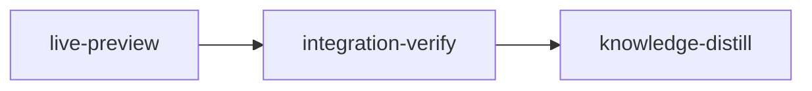

# Plan: Live preview in file mode's editor

Implements: section_06

## Overview

File mode's editor shows plain Markdown source. The operator asked for a proper Markdown editor
in which the user edits text that looks rendered and can switch back to the syntax. Section 06
("The editor" → "Live preview and source", agreed 2026-11-06) settles the design: a live preview
drawn over the source text inside the existing CodeMirror editor, with a "Live preview / Source"
toggle, a formatting toolbar and shortcuts. A save still writes exactly the text in the editor.
The plan implements only that part of section 06. The save path, drafts, the merge view, diffs and
plan validation are unchanged.

The briefs in `doc/plans/feat-planner/briefs/feat-planner-14-live-preview-editor/` are
authoritative for detail. The YAML is authoritative for gates and ownership.

## Goals

- A Markdown file opens in live preview. Markers hide off the cursor's lines, task boxes
  toggle, code blocks show their language label with fences hidden until the cursor enters,
  tables stay as source rows with dimmed pipes, and HTML comments always show dimmed.
- Plan validation markers show in both modes; line numbers show in Source only.
- The toggle switches modes without losing text, cursor or undo history, and the choice is
  remembered.
- Toolbar buttons and Mod-b, Mod-i, Mod-k insert or remove the syntax, one undo step each.
- Opening, toggling and saving without an edit writes identical bytes, including a file with
  CRLF, CR or mixed line endings (the editor rewrites them to LF today, so the plan fixes that).
- Add to chat from the editor carries the source text with its markers.
- Non-goal: drawing tables as grids or rendering diagrams in the editor; any change to diffs or
  the merge view.

## Execution



### 1. live-preview

The only implementation stage. Two Claude workers run in parallel against the interface frozen
in `common.md`: W1 owns the CodeMirror chunk (`codemirror.ts` and four new modules:
`live-preview.ts`, `md-commands.ts`, `marks-gutter.ts`, which takes the validation gutter out so
`codemirror.ts` stays under 400 lines, and the pure `line-break.ts`, which keeps CRLF, CR and mixed
line endings byte-exact), W2 the React side (toolbar, edit body, mode storage, the whole Add to
chat chain, and first of all the migration of the two lazy-boundary scans to a four-file chunk
allow-list). The stage's gate is the canonical `bun run check` (typecheck, lint, format check and
the whole vitest suite), because moving `lineNumbers()` and switching the Markdown base change the
diff views and a widened handle reaches `diff-view.tsx`; a line-count gate is added, because no
other gate counts TypeScript lines. No second stage is needed: no
merge-order dependency, no shared file and no checkpoint (Q1 to Q3 all no), and the work is far
under 500,000 tokens (Q4 no). Risk walk: data integrity is covered by
`toggling-preserves-bytes`, `line-endings-survive` and `save-writes-untouched-bytes` (the last
through the React surface and the posted body); regression of the comment markers by
`comments-stay-visible`; user state by `mode-switch-keeps-history` and `mode-is-remembered`;
reachability through the real `EditBody` by `toolbar-toggle-reaches-editor`,
`toolbar-format-reaches-editor`, `link-follow-routes-safely` and `add-to-chat-keeps-markers`;
live preview behaviour by `markers-hide-off-cursor-line`, `titled-link-reads-as-label`,
`task-box-toggles`, `fences-hide-and-reveal`, `table-pipes-dimmed`,
`decorations-follow-parse` and `gutters-by-mode`; keyboard and pointer paths by
`shortcuts-in-both-modes` and `mod-click-follows-link`; read-only by `read-only-refuses-edits`.

### Integration Verification

In this order: build `web/dist` and the binary from the candidate source, run the bundle check
(CodeMirror stays out of the entry bundle), run one diagnostic `loom check` (the typecheck, lint,
format check and full vitest run that `bun run check` runs, the bundle check, the fresh-build comparison and `cargo build`), walk the built
app in a browser, fix with a rebuild after every fix, run the final `loom check` against the
rebuilt bytes, review (the review gate fingerprints the tree, so the bundle is final before the
review), and commit the code fixes and then `web/dist` last. The stage owns `web/dist` through its
`files`; the first check is diagnostic because a bundle built from new source cannot match the
committed one until it is rebuilt and committed.

### Knowledge Distillation

Records the live preview design in the planner web knowledge, and curates the stage memories.

## Sibling plans

`doc/plans/PLAN-planning-trace.md` owns `web/src/plan/**` in its trace-web stages and commits
`web/dist` in its integration-verify, and says never to run beside another plan that writes
`web/src/plan/**`. This plan writes `web/src/plan/editor/**` and commits `web/dist`, so the two run
one after the other, never at the same time. No other plan under `doc/plans/` writes these paths.

## Before `loom run`

Commit this plan, both briefs and `doc/product/feat-planner/section_06.md` (its "Live preview and
source" subsection is the requirement the workers read). `loom run` refuses uncommitted plan
inputs, but does not check the spec; the live-preview stage's `before_stage` check fails fast when
the subsection is missing from `HEAD`.

## Environment inventory

| Need | State |
| --- | --- |
| npm registry, crates.io | `allowed_domains` |
| `web/node_modules`, `playwright-core` | provisioned by `loom.provision` |
| Chromium for the browser check | `~/.cache/ms-playwright` on the host, as plans 12 and 13 used; a stage that cannot launch it records that, and the operator is told in the review |
| new packages | none: `@codemirror/lang-markdown` already exports `markdownLanguage`, and `lucide-react` is a dependency |

## After the run

The operator edits a real document in both modes and confirms it feels right.

---

<!-- loom METADATA -->

```yaml
loom:
  version: 2
  auto_merge: null
  sandbox:
    enabled: true
    auto_allow: true
    allow_unsandboxed_escape: false
    excluded_commands: []
    filesystem:
      deny_read:
      - ~/.ssh/**
      - ~/.aws/**
      - ~/.config/gcloud/**
      - ~/.gnupg/**
      deny_write:
      - ../../**
      allow_write: []
    network:
      allowed_domains:
      - crates.io
      - index.crates.io
      - static.crates.io
      - registry.npmjs.org
      additional_domains: []
      allow_local_binding: false
      allow_unix_sockets: []
      allow_all_unix_sockets: false
    linux:
      enable_weaker_nested: false
    command_confinement: confined
  ratchet_files:
  - loom/maintainability-baseline.txt
  - doc/loom/knowledge/check-baseline.txt
  provision:
  - working_dir: web
    command: >-
      test ! -e .npmrc && test ! -L .npmrc && bun install --frozen-lockfile
      --ignore-scripts --backend=copyfile --config=/dev/null
  stages:
  - id: live-preview
    name: Live preview, the mode toggle and the formatting toolbar
    summary: >-
      Draws Markdown styled while the user edits its source in file mode, adds a Live preview /
      Source toggle and a formatting toolbar, and keeps every save byte-exact.
    description: |
      Read doc/plans/feat-planner/briefs/feat-planner-14-live-preview-editor/common.md, then live-preview.md in the same directory, before dispatch. Pass both paths to every worker and the reviewer.
      PATHS: working_dir is web/. Every YAML path and every Files owned cell below is relative to web/ (files:, artifacts:, wiring:, contracts, acceptance); only Brief path cells and prose are repository-relative.
      SIBLING PLANS: never run this plan beside doc/plans/PLAN-planning-trace.md, whose trace-web stages own web/src/plan/** and whose integration-verify also commits web/dist. Run one after the other.
      SPEC: doc/product/feat-planner/section_06.md, "The editor" and its "Live preview and source" subsection.
      KNOWLEDGE: conventions/plan-web.md, architecture/planner-web-shell.md; pull anything else with loom knowledge context --query.
      FRONTEND-DESIGN: both workers do visual design (W1 the live preview styling in theme.ts and the widgets, W2 the toolbar), so each invokes the frontend-design:frontend-design skill before writing code, and so does every fix worker this stage spawns for a visual defect. This is the operator's instruction.
      PUBLIC SURFACE for the contract session (both files below; top-level it() calls named exactly as each contract's test):
        src/plan/editor/live-preview.contracts.test.ts uses createSourceEditor from src/plan/editor/codemirror.ts with the jsdom Range patches from src/plan/editor/codemirror.test.ts, and reads and drives state through EditorView.findFromDOM on the .cm-editor element. The handle has getText(), mode(), setMode("preview" | "source"), format(command) with command one of bold italic code link heading bulletList orderedList taskList quote codeBlock table, and rangeText(range). Live preview is the default mode. A task box is an input[type=checkbox] inside .cm-content.
        src/plan/editor/editor-mode.contracts.test.tsx mocks ./load as src/plan/editor/edit-mode.test.tsx does, with a fake createSourceEditor that records each call's options (including mode and onFollowLink) and returns a handle recording setMode and format calls, with rangeLines and rangeText answers the test sets; it renders EditBody as edit-mode.test.tsx does. The toolbar has buttons named "Live preview" and "Source" with aria-pressed, and formatting buttons named Bold, Italic, Code, Link, Heading, Bulleted list, Numbered list, Task list, Quote, Code block, Table. The remembered mode is localStorage key loom-plan:<project_key>:editor-mode with value "preview" or "source".
        src/plan/editor/editor-bytes.contracts.test.tsx does NOT mock ./load: it renders EditMode as edit-mode.test.tsx does against the real CodeMirror chunk (with the jsdom Range patches), stubs fetch to capture the save request body, drives the toolbar toggle and Ctrl-S on .cm-content, and compares the saved text with the document bytes.
        DOM names the contracts read: .cm-lp-fence-label (language label), .cm-lp-dim (dimmed table delimiter), .cm-lineNumbers, .cm-line-mark (validation dot). Keyboard: a keydown with key "b", "i" or "k" and ctrlKey true on view.contentDOM (jsdom is not a Mac). Pointer: a mousedown with ctrlKey true on the link label element, found with view.domAtPos or by its text.
      WORKERS. W1 and W2 in one message.
      | Worker | Role | Tier | Files owned | Shared context | Brief path |
      | ------ | ---- | ---- | ----------- | -------------- | ---------- |
      | W1 | CodeMirror chunk: live preview, commands, mode, rangeText, line endings, gutter move | sonnet | src/plan/editor/codemirror.ts; src/plan/editor/live-preview.ts; src/plan/editor/md-commands.ts; src/plan/editor/marks-gutter.ts; src/plan/editor/line-break.ts; src/plan/editor/line-break.test.ts; src/plan/editor/theme.ts; src/plan/editor/codemirror.test.ts; src/plan/editor/live-preview.test.ts; src/plan/editor/md-commands.test.ts; src/plan/editor/theme.test.ts | common.md | doc/plans/feat-planner/briefs/feat-planner-14-live-preview-editor/live-preview.md |
      | W2 | React side: toolbar, edit body, mode storage, the Add to chat chain, fakes, lazy-boundary scan migration | sonnet | src/plan/editor/source-editor.tsx; src/plan/editor/edit-panels.tsx; src/plan/editor/edit-body.tsx; src/plan/editor/editor-mode.ts; src/plan/editor/editor-mode.test.ts; src/plan/editor/selection-attachment.ts; src/plan/editor/editor-provenance.ts; src/plan/editor/editor-provenance.test.ts; src/plan/editor/source-editor.test.tsx; src/plan/editor/edit-mode.test.tsx; src/plan/editor/editor.contracts.test.tsx; src/plan/editor/merge-panel.test.tsx; src/plan/editor/merge-panel.readonly.test.tsx; src/plan/editor/load.test.ts; src/plan/editor/load.retry.test.ts | common.md | doc/plans/feat-planner/briefs/feat-planner-14-live-preview-editor/live-preview.md |
      Spawn both as loom-software-engineer. Each prompt says: Your brief: <path>. Read it and common.md in full before anything else, then your "<worker>" section; invoke frontend-design:frontend-design before writing code.
      AFTER THE WORKERS: the "Main agent, after the workers" section of live-preview.md.
      Use parallel subagents and skills to maximize performance.
      MEMORY: record mistakes, decisions and surprises with loom memory immediately, subagents too; NEVER Claude Code auto-memory.
    dependencies: []
    parallel_group: null
    acceptance:
    - bun run check
    - >-
      for f in src/plan/editor/*.ts src/plan/editor/*.tsx; do test "$(wc -l < "$f")" -le 400 ||
      { echo "over 400 lines: $f"; exit 1; }; done
    setup: []
    files:
    - src/plan/editor/**
    auto_merge: null
    working_dir: web
    stage_type: standard
    artifacts:
    - src/plan/editor/live-preview.ts
    - src/plan/editor/md-commands.ts
    - src/plan/editor/editor-mode.ts
    - src/plan/editor/marks-gutter.ts
    - src/plan/editor/line-break.ts
    wiring:
    - source: src/plan/editor/codemirror.ts
      pattern: livePreview(
      description: the source editor installs the live preview extension
      literal: true
    - source: src/plan/editor/edit-body.tsx
      pattern: readEditorMode()
      description: the edit body opens in the remembered mode
      literal: true
    - source: src/plan/editor/selection-attachment.ts
      pattern: rangeText
      description: Add to chat takes the source slice, markers included
      literal: true
    - source: src/plan/editor/codemirror.ts
      pattern: formatKeymap(
      description: the source editor installs the Mod-b, Mod-i, Mod-k keymap from md-commands.ts
      literal: true
    - source: src/plan/editor/edit-body.tsx
      pattern: resolveLink(
      description: Mod-click on a link in live preview resolves through the reading view's resolver
      literal: true
    - source: src/plan/editor/edit-body.tsx
      pattern: provenance(selection, lines, text)
      description: the Add to chat callback forwards the source slice to the provenance
      literal: true
    - source: src/plan/editor/edit-body.tsx
      pattern: onFormat
      description: the edit body routes toolbar formatting to the editor handle
      literal: true
    - source: src/plan/editor/edit-panels.tsx
      pattern: aria-pressed
      description: the toolbar draws the Live preview / Source segmented control
      literal: true
    - source: src/plan/editor/codemirror.ts
      pattern: lineSeparator
      description: the source editor keeps the document's own line breaks
      literal: true
    - source: src/plan/editor/codemirror.ts
      pattern: sliceDoc(
      description: the text the editor returns joins lines with that line break
      literal: true
    before_stage:
    - command: test ! -e src/plan/editor/live-preview.ts
      description: live preview does not exist yet
    - command: >-
        git show HEAD:doc/product/feat-planner/section_06.md | grep -q 'Live preview and source'
      description: the spec subsection the workers read is committed, so the worktree has it
    after_stage:
    - command: test -s src/plan/editor/live-preview.ts
      description: live preview exists
    context_ceiling_tokens: null
    sandbox: {}
    ultracode: false
    implementers:
    - claude
    skills:
    - loom-react
    - loom-typescript
    contracts:
    - id: toggling-preserves-bytes
      file: src/plan/editor/live-preview.contracts.test.ts
      test: toggling modes and saving unedited returns identical bytes
      scenario: >-
        creates a source editor on a document with a heading, bold, a task list, a table, a
        fenced yaml block, a loom METADATA comment and trailing spaces, moves the cursor through
        every line, switches to source and back to preview, then reads getText() and asserts it
        equals the input and that the onChange option was never called
      rejects: a live preview that normalises or rewrites any part of the document when drawing it
    - id: markers-hide-off-cursor-line
      file: src/plan/editor/live-preview.contracts.test.ts
      test: markers hide off the cursor line and show on it
      scenario: >-
        document "# Title\n\nsome **bold** text" with the cursor on line 1; reads the third line's
        text in the DOM, then moves the cursor onto line 3 and reads it again
      rejects: a preview that hides markers on every line, or on none
    - id: comments-stay-visible
      file: src/plan/editor/live-preview.contracts.test.ts
      test: html comments stay visible in live preview
      scenario: >-
        document with a "<!-- loom METADATA -->" line and the cursor on another line, in preview
        mode
      rejects: a preview that hides or replaces HTML comments
    - id: task-box-toggles
      file: src/plan/editor/live-preview.contracts.test.ts
      test: clicking a task box toggles it and undo restores it
      scenario: >-
        document "- [ ] item\n\nother" with the cursor placed on line 3 (the parser makes a Task
        only for "[ ]" followed by a space inside a list item, and the default cursor at 0 would
        touch line 1); reads line 1's DOM text and expects it to contain "item" with a box drawn, clicks the
        input[type=checkbox], expects getText() "- [x] item\n\nother" and line 1's DOM text still
        containing "item", runs undo, expects the original text
      rejects: a checkbox drawn without a click handler, a toggle that rewrites the whole line, or a box that replaces the whole Task (the item body) and hides its label
    - id: bold-toggles
      file: src/plan/editor/live-preview.contracts.test.ts
      test: bold toggles around the selection and undoes in one step
      scenario: >-
        selects "word" in "a word here", runs format("bold"), reads getText(), runs
        format("bold") again, then undo once
      rejects: a command that inserts markers in two transactions or cannot unwrap
    - id: mode-switch-keeps-history
      file: src/plan/editor/live-preview.contracts.test.ts
      test: switching mode keeps the cursor and undo history
      scenario: >-
        types a word, records the selection head, calls setMode("source"), checks the head, runs
        undo, reads getText()
      rejects: a setMode that rebuilds the editor state, losing history or cursor
    - id: range-text-keeps-markers
      file: src/plan/editor/live-preview.contracts.test.ts
      test: range text includes hidden markers
      scenario: >-
        document "x\n\nsome **bold** text" in preview with the cursor on line 1; builds a DOM
        Range over the whole third line and calls rangeText
      rejects: an attachment text taken from the DOM, which lacks the hidden markers
    - id: mode-is-remembered
      file: src/plan/editor/editor-mode.contracts.test.tsx
      test: editor reopens in the last chosen mode
      scenario: >-
        in beforeEach clears localStorage and seeds serverInfoAtom with a project_key on the
        store, as edit-mode.test.tsx does; renders the editor through EditMode as
        edit-mode.test.tsx does, clicks "Source", expects localStorage
        loom-plan:<project_key>:editor-mode to be "source", unmounts, renders again and expects
        the mode option of the second createSourceEditor call to be "source"
      rejects: a mode kept only in component state, or never written to storage
    - id: toolbar-toggle-reaches-editor
      file: src/plan/editor/editor-mode.contracts.test.tsx
      test: toolbar toggle switches the live editor without rebuilding it
      scenario: >-
        in beforeEach clears localStorage and seeds serverInfoAtom as above; renders the editor
        through EditMode, expects the first createSourceEditor call's mode to be "preview", clicks
        "Source", then "Live preview"; expects exactly one createSourceEditor call, recorded
        setMode calls exactly ["source", "preview"] (none on mount), and aria-pressed following
        the clicks
      rejects: a toggle that remounts the editor, or a toolbar not wired to the handle
    - id: line-endings-survive
      file: src/plan/editor/live-preview.contracts.test.ts
      test: line endings survive untouched and a one word edit changes only that word
      scenario: >-
        for the documents "# title\r\n\r\nbody  \r\n" (CRLF), "a\rb\r" (CR) and "a\r\nb\nc\r"
        (mixed), creates a source editor with an onChange spy, switches to source and back and
        moves the cursor through every line, expects getText() to equal the input and onChange
        never called; then dispatches a change that replaces one word and expects getText() to
        equal the input with only that word changed and the onChange argument to equal getText()
      rejects: an editor that converts CRLF, CR or mixed line breaks to LF when it opens, reads or reports the text
    - id: shortcuts-in-both-modes
      file: src/plan/editor/live-preview.contracts.test.ts
      test: Mod-b, Mod-i and Mod-k run in both modes
      scenario: >-
        selects "word" in "a word here" and dispatches a ctrlKey keydown for b on the content
        element in preview, expects "a **word** here"; undoes and repeats in source; does the
        same for i ("a *word* here", the selection not widened by selectParentSyntax) and for k
        (a Markdown link whose text is "word"); the keydown must report defaultPrevented
      rejects: a shortcut that works in one mode only, falls through to the default keymap, or leaves the browser default running
    - id: fences-hide-and-reveal
      file: src/plan/editor/live-preview.contracts.test.ts
      test: fences hide off the block, show inside it and label the language
      scenario: >-
        document "intro\n\n~~~yaml\na: 1\n~~~\n\nafter" (tilde fences, because a backtick fence cannot appear in this plan's YAML block) with the cursor on line 1; expects the
        DOM text to lack "~~~" and to contain "a: 1", and a .cm-lp-fence-label with text "yaml";
        moves the cursor onto the "a: 1" line and expects "~~~" in the DOM text; getText()
        equals the input throughout
      rejects: a fence that never hides, never reveals, hides its body, or drops the language label
    - id: table-pipes-dimmed
      file: src/plan/editor/live-preview.contracts.test.ts
      test: table pipes are dimmed and stay in the text
      scenario: >-
        document "| a | b |\n| - | - |\n| 1 | 2 |" with the cursor outside the table (a first
        line "intro" and a blank line before it); expects .cm-lp-dim elements, every "|" still in
        the DOM text, and getText() equal to the input
      rejects: a table drawn as a grid, with hidden pipes, or with no dimming
    - id: titled-link-reads-as-label
      file: src/plan/editor/live-preview.contracts.test.ts
      test: a titled link reads as its label off the cursor line
      scenario: >-
        document "intro\n\nsee [label](https://example.com/x "title") now" with the cursor on
        line 1; expects the third line's DOM text to be "see label now"; moves the cursor onto
        it and expects the full source text including the URL and the title
      rejects: a preview that leaves the link title, the URL or the brackets visible, or hides them on the cursor line
    - id: decorations-follow-parse
      file: src/plan/editor/live-preview.contracts.test.ts
      test: decorations follow a finished background parse
      scenario: >-
        document of 400 lines of plain text followed by "some **bold** text" and a yaml fence,
        cursor on line 1; calls forceParsing from @codemirror/language over the whole document
        without changing the document or selection and expects the bold line's DOM text to lack
        "**" and the fence lines to be hidden; getText() equals the input
      rejects: decoration providers that rebuild only on document, selection and viewport changes, so text below the first parsed chunk stays undecorated
    - id: gutters-by-mode
      file: src/plan/editor/live-preview.contracts.test.ts
      test: line numbers show in source only and validation marks in both modes
      scenario: >-
        creates an editor on three lines, calls setGutterMarks([2]); expects .cm-line-mark and no
        .cm-lineNumbers in preview, then both after setMode("source"), and .cm-line-mark again
        after returning to preview
      rejects: line numbers left on in live preview, or validation marks that disappear with a mode
    - id: read-only-refuses-edits
      file: src/plan/editor/live-preview.contracts.test.ts
      test: read-only editors refuse formatting and task toggles
      scenario: >-
        creates an editor with readOnly true on "- [ ] item\n\nother" (cursor on line 3); runs
        format("bold"), dispatches the Mod-b keydown and clicks the checkbox; expects getText()
        unchanged each time and the keydown still defaultPrevented; setMode("source") still
        works and mode() reports it
      rejects: a read-only editor that formats or toggles, or a mode toggle that stops working with it
    - id: mod-click-follows-link
      file: src/plan/editor/live-preview.contracts.test.ts
      test: mod-click follows a link and a plain click does not
      scenario: >-
        document "intro\n\nsee [label](notes.md) now" in preview with an onFollowLink spy and the
        cursor on line 1; dispatches a plain mousedown on the label element, expects no call; a
        mousedown with ctrlKey true, expects one call with "notes.md" and getText() unchanged
      rejects: a link followed by a plain click, or a Mod-click that never reaches the callback
    - id: toolbar-format-reaches-editor
      file: src/plan/editor/editor-mode.contracts.test.tsx
      test: toolbar formatting buttons reach the editor and disable when read-only
      scenario: >-
        in beforeEach as above; renders the editor through EditMode with authoring; clicks Bold,
        Italic, Code, Link, Heading, Bulleted list, Numbered list, Task list, Quote, Code block
        and Table in that order and expects the handle's recorded format calls to be bold,
        italic, code, link, heading, bulletList, orderedList, taskList, quote, codeBlock, table;
        then makes the editor read-only (authoring held by another user) and expects every
        formatting button disabled while "Source" and "Live preview" stay enabled
      rejects: a toolbar with only the mode toggle, formatting buttons not wired to the handle, or buttons that stay live while read-only
    - id: link-follow-routes-safely
      file: src/plan/editor/editor-mode.contracts.test.tsx
      test: following a link routes through the resolver and the leave guard
      scenario: >-
        renders EditMode inside a memory router; takes onFollowLink from the first
        createSourceEditor call's options; calls it with a relative document href and expects the
        router location to become that file's address; with unsaved text and a window.confirm spy
        returning false, expects the location unchanged and confirm called; calls it with
        "#anchor" and expects the same file with that hash; with "https://example.org/x" expects
        window.open called with the href, "_blank" and "noopener,noreferrer" and the location
        unchanged; with a bare word or an outside path expects neither
      rejects: a link followed without the reading view's resolver, a document link that skips the unsaved-text guard, or an external link opened without noopener
    - id: add-to-chat-keeps-markers
      file: src/plan/editor/editor-mode.contracts.test.tsx
      test: add to chat carries the source markers
      scenario: >-
        renders EditMode; the fake handle answers rangeLines with lines 1 to 1 and rangeText with
        "some **bold** text" while the fake surface shows "some bold text"; selects that DOM text,
        fires selectionchange as add-to-chat.test.tsx does, clicks Add to chat and expects the
        pending attachment's text to be "some **bold** text" with lines 1 to 1
      rejects: an attachment taken from the DOM text, or an intermediate callback that drops the source slice
    - id: save-writes-untouched-bytes
      file: src/plan/editor/editor-bytes.contracts.test.tsx
      test: saving an unedited document writes identical bytes
      scenario: >-
        against the real editor, opens a document "# title\r\n\r\nbody  \r\n\r\n- [ ] item\r\n" through
        EditMode, clicks "Source", then "Live preview", presses Ctrl-S on .cm-content, and
        expects the one captured save request to carry text exactly equal to the document; repeats
        for "a\r\nb\nc\r"
      rejects: any rewrite of untouched bytes between opening the file and the save request, including line endings
  - id: integration-verify
    name: Integration Verification
    summary: >-
      Builds the web bundle and the binary, runs the full web suite and the bundle check, walks the
      built app, rebuilds after every fix, reviews the editor change and commits the bundle last.
    description: |
      Final verification of doc/plans/feat-planner/PLAN-feat-planner-14-live-preview-editor.md. Verify FUNCTIONAL INTEGRATION, not just tests passing. NEVER Claude Code auto-memory.
      CONTEXT: read the plan, the brief bundle (doc/plans/feat-planner/briefs/feat-planner-14-live-preview-editor/), loom memory show --all, doc/loom/knowledge/INDEX.md and only the relevant sections.
      PATHS: the session starts in loom/ (working_dir); acceptance commands reach the web app with cd ../web, and the stage owns ../web/dist/** through files.
      ORDER (binding): (1) build web/dist and the binary from the merged source; (2) bundle check; (3) one diagnostic loom check integration-verify, a fix round re-checks only the failed criteria with --criterion <n>; (4) browser walk; (5) fixes, each followed by a dist and binary rebuild; (6) after the last fix and its rebuild, the full loom check integration-verify once more, which is the acceptance against the rebuilt bytes; (7) review rounds; (8) commits. The review gate fingerprints the tree and only *.md prose is exempt (loom/src/verify/review/gate.rs covers_review), so web/dist is final BEFORE the final review round; any fix after that round means another rebuild, another check and another round (doc/loom/knowledge/mistakes/plan-authoring.md, "A plan rebuilt its bundle after the final review round").
      BUILD & TEST (zero tolerance): the first check is diagnostic because new source cannot match the committed bundle until it is rebuilt: the fresh-build comparison compares against the working tree, so it passes right after the rebuild in step 1.
      WEB DIST: from loom/, cd ../web && bun run build, then node scripts/bundle-check.mjs (it reads dist/.vite/manifest.json as it stands and never builds, so it proves nothing before a build), then cargo build in loom/ (the binary embeds web/dist, so a stale binary shows old code in the browser). After the final review round commit the code fixes, then web/dist last as chore(web) with loom stage commit, and confirm git status --short ../web/dist prints nothing.
      BROWSER: repeat the live-preview stage's browser walk (live-preview.md, "Main agent, after the workers", step 2) against the step 1 or step 5 build, skipping that step's final restore of web/dist (here the rebuilt dist is kept and committed); a step that could not run (the stage sandbox has no Claude login, so the server may answer read-only) is reported, never passed. A visual defect goes to a fresh engineer that invokes frontend-design:frontend-design before writing code (the operator's instruction), then web/dist and the binary are rebuilt again and the affected steps repeated.
      CODE REVIEW: parallel loom-code-reviewer subagents: (1) data integrity (no dispatch outside user edits, save bytes including CRLF, CR and mixed line endings, no doc.toString() left in the chunk, drafts unchanged); (2) web security and accessibility (link following through resolveLink, window.open with noopener, no innerHTML in widgets, toolbar labels and aria-pressed, keyboard reach); (3) dead code and the lazy chunk boundary (bundle-rules.json still keeps @codemirror out of the entry; live-preview.ts, md-commands.ts and marks-gutter.ts are imported only by codemirror.ts, and line-break.ts imports nothing from CodeMirror; the Add to chat chain forwards the source slice end to end; W2 files import codemirror.ts types with import type only).
      SUGGESTIONS: weigh every pending reviewer suggestion; resolve each one implemented with loom memory resolve <id> --outcome implemented --reason <what changed>.
      Record discoveries to loom memory, including stale knowledge: loom memory note "stale-knowledge: ...".
    dependencies:
    - live-preview
    parallel_group: null
    acceptance:
    - >-
      cd ../web && node_modules/.bin/tsc -b --noEmit && node_modules/.bin/oxlint
      --deny-warnings && node_modules/.bin/oxfmt --check && node_modules/.bin/vitest run
    - cd ../web && node scripts/bundle-check.mjs
    - >-
      cd ../web && d=$(mktemp -d "${TMPDIR:-/tmp}/dist.XXXXXX") &&
      node_modules/.bin/vite build --outDir "$d" --emptyOutDir --logLevel error && diff -r "$d" dist
    - cargo build
    setup: []
    files:
    - ../web/dist/**
    auto_merge: null
    working_dir: loom
    stage_type: integration-verify
    artifacts: []
    wiring: []
    context_ceiling_tokens: null
    sandbox: {}
    ultracode: false
    implementers:
    - claude
    skills:
    - loom-react
    - loom-typescript
  - id: knowledge-distill
    name: Knowledge Distillation
    summary: >-
      Records how the editor's live preview works and why it never rewrites untouched text.
    description: |
      Curate all stage memories into permanent knowledge. NEVER Claude Code auto-memory. SINGLE-AGENT: do NOT spawn subagents.
      START with loom memory pending --group; read the plan and the knowledge sections it touches (architecture/planner-web-shell.md, conventions/plan-web.md, and any section on the file-mode editor that loom knowledge context --query "file mode editor CodeMirror" returns).
      CORRECTIONS FIRST: apply every stale-knowledge memory with loom knowledge replace-section. Any section describing the editor as source-only or naming lineNumbers in a shared base is now stale.
      TIER ROUTING: about 40 lines or fewer inline in the tier-1 file; larger via loom knowledge update <category>/<slug> with a 2-4 line tier-1 summary and link.
      SUGGESTIONS: record every unimplemented reviewer suggestion in concerns or the topic it belongs to, then resolve it.
      RECEIPTS: every taken memory gets loom memory resolve right after the write; finish with loom memory pending --strict.
    dependencies:
    - integration-verify
    parallel_group: null
    acceptance:
    - loom knowledge check --strict --baseline doc/loom/knowledge/check-baseline.txt
    - loom memory pending --strict
    setup: []
    files:
    - doc/loom/knowledge/**
    auto_merge: null
    working_dir: '.'
    stage_type: knowledge-distill
    artifacts: []
    wiring: []
    context_ceiling_tokens: null
    sandbox: {}
    ultracode: false
    implementers:
    - claude
```

<!-- END loom METADATA -->

## Pressure tests

- 2026-11-06: Claude opus, Codex gpt-6-astra; 1 round, review addressed
