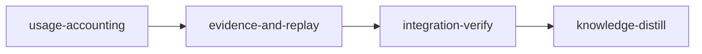

# Plan: Usage Evidence

## Overview

Plans 4 and 5 of the token-optimization programme are judged on a deterministic replay, and plan 4 also on frozen single-stage replays compared with `loom usage --compare`. `loom usage` and `--compare` exist, but the evidence they produce today is wrong or missing: removed stage worktrees are not read, Codex rows are not scoped to a project, forward receipts never form, the token verdict knows only dominance, a candidate 1 ms slower in one pair is rejected, nothing writes the `RunEvidence` the comparison reads, quota continuity reads the 1 s `resets_at` jitter as a reset, and several sections count requests without tokens. This plan fixes the accounting, adds a declared net-total and latency rule, writes `RunEvidence`, and builds the replay harness. It is plan 2 of the metaplan (`doc/plans/optim-token-metaplan.md`, section 2) and targets the evidence later plans are judged on; it claims no saving itself.

- **Run order and dependencies.** Canonical order: 3 (`PLAN-01-doctrine-truth-and-plan-guards`), 1 (`PLAN-02-delivery-truth`), then this plan, then 4 (`PLAN-04-dependency-findings`), 5 (`PLAN-05-guidance-and-gate-output`) and 7 (`PLAN-06-sandbox-route-closure`). One checkout runs one plan. This plan depends on plans 3 and 1 having merged: both edit `loom-hooks/post-tool-use.sh`, plan 1 edits `src/cli/types_ops.rs` and `src/cli/dispatch.rs`, and the replay reads plan 1's worker-brief delegate. The first stage's `before_stage` checks fail fast when either has not merged. Plans 4 and 5 depend on this plan's replay; plan 5 checks for it with `rg -qF 'signal_with_metrics' tests` from `loom/`.
- **Accepted `loom plan verify --strict` warning:** no knowledge-bootstrap stage; the knowledge base already describes this codebase, and plan 3 fixes the bootstrap heuristic (`plan/schema/validation.rs:1109-1137`). No other warning is accepted.
- **Where the pre-push gate runs.** The metaplan requires every code stage to run the full pre-push gate (`loom/.githooks/pre-push:28,97,107,126`), plus the hook steps when it edits `loom-hooks/`. `loom plan verify` warns on an unfiltered `cargo test` in a standard stage's acceptance (`warn_full_suite_outside_integration_verify`, `plan/schema/validation_suite.rs`), so each code stage runs the whole gate, unfiltered suite included, in its `loom-verifier` round, and its acceptance keeps every other pre-push step (and the hook steps in `usage-accounting`) plus filters that select the stage's own tests. Integration-verify's acceptance runs the unfiltered suite. Plans 1, 3, 4, 5 and 7 resolve it the same way.
- **Lanes (operator decision 2026-10-19: Claude plus Codex where it fits).** `usage-accounting`: `["claude", "codex"]`. The discovery, completeness and Codex-scope work crosses the usage pipeline and converges on fixture-backed tests (Claude); the forward-receipt change edits a hook and converges on hook tests (Claude); the sections work iterates on tests (Claude); `spawn_join.rs` and the Bash-output part of `tools.rs` are single files with their tests and pinned interfaces (codex). `evidence-and-replay`: `["claude", "codex"]`. The verdict wiring and the producer cross several files (Claude); the replay converges only by running fixture tests (Claude); `comparison_net.rs` and `comparison_latency.rs` are single files with pinned interfaces and mechanical acceptance (codex). Licensing codex adds the Codex hosts to the stage sandbox (`sandbox/settings/policy.rs:78-86`, `CODEX_SANDBOX_DOMAINS`).
- **Before `loom run` (operator).** Commit this plan and every file under `doc/plans/token-optim/briefs/usage-evidence/`, and confirm plan 1's `briefs/delivery-truth/delivery-fixes/replay-payload.json` and plan 4's `briefs/dependency-findings/dependency-findings/fixtures/token-core.md` are committed: the replay copies both when present. `extract_brief_paths` (`loom/src/plan/schema/structural_checks.rs:78`) and the committed-input bundle (`loom/src/commands/run/plan_inputs/discovery.rs:22`) recognise only `doc/plans/briefs/`, so neither `loom plan verify` nor `loom run` notices an uncommitted file under `doc/plans/token-optim/`, and a stage worktree is cut from HEAD.
- **Evidence class.** None of this changes what agents are given; the plan builds the instruments. The replay spends no provider tokens.
- **Operator steps.** The live paired-trial protocol below is operator procedure; no stage runs it. After merge, run `./dev-install.sh`: the installed `post-tool-use.sh` must be the one that pipes the payload, because the installed binary no longer accepts `hook forward-receipt --transcript`. This plan's `usage-accounting` run is also where plan 1's post-merge operator check is made (`PLAN-02-delivery-truth.md`, overview, "Operator check after merge": a worker transcript carrying the brief marker and the first pack item verbatim, and a bound `worker-<hex>.json` record); the operator records the result with `loom memory note`.

## Goals

- `loom usage --project <dir>` and the default selection read every `<slug>--worktrees-*` transcript directory, live or removed; `--since` accepts RFC3339 instants; each provider reads `measured` or `partial` with reasons.
- Forward receipts form from the PostToolUse payload; a project's Codex totals hold only the threads its receipts name; a receipt whose thread has no rollout in the window reads `partial`.
- `--compare` keeps every current verdict when an artifact declares nothing, and supports a declared per-provider net-total rule with sample variance and a declared latency tolerance judged across pairs.
- `loom usage --run-evidence <declaration.json>` writes `RunEvidence` that `--compare` reads back.
- `tools`, `polling`, `lifecycle` and `agents` report Bash output bytes by command, tokens on observation-only requests, orientation for main sessions and subagents, and requested models.
- Quota continuity and the comparison's quota checks tolerate 300 s of `resets_at` jitter and one poll interval (180 s) of interval length.
- A test-only replay prints per-section signal bytes, worker-brief bytes and asset sizes for a frozen fixture.
- Non-goals: everything in metaplan section 6; the dropped items listed under "Coverage"; a subscription verdict in any acceptance; widening `exact_forward_argv` for `loom subagents` (recorded for knowledge-distill).

## Execution Diagram



## Stages

### 1. usage-accounting (`working_dir: loom`)

Steps 1, 2 and 5 of the metaplan, and the plan's first implementation stage; stage 2 splits from it by Q2 and Q4 (below). The main agent re-reads the files plans 3 and 1 changed, spawns three Claude workers in the background and forwards two codex units in the foreground, runs the gate through a `loom-verifier`, runs the review rounds and commits.

| Worker              | Lane and tier  | Territory                                                                                                                                                                                                                                 |
| ------------------- | -------------- | ----------------------------------------------------------------------------------------------------------------------------------------------------------------------------------------------------------------------------------------- |
| W1 accounting       | Claude, sonnet | `UsageArgs` moved to `args.rs` first; worktree slugs in discovery; `--since` instants; `completeness.rs`; `codex_scope.rs`; `forward_join.rs` thread accessors; `provider.rs`, `provider_types.rs`, `provider_report.rs`; `mod.rs` wiring |
| W2 forward receipts | Claude, sonnet | `models/forward_receipt/payload.rs`; `hook/forward_receipt.rs` reads stdin; the CLI variant; `post-tool-use.sh` pipes the payload; unit and hook tests                                                                                    |
| W3 sections         | Claude, sonnet | Observation tokens in `polling.rs`; `lifecycle_orientation.rs`; requested model in `agents.rs`; the `Transcript.requested_model` field and its literals                                                                                   |
| W4 spawn join       | codex terra    | `spawn_join.rs` and its test                                                                                                                                                                                                              |
| W5 Bash output      | codex terra    | `tools.rs` Bash output by command and its test                                                                                                                                                                                            |

Risk-checklist walk (v2):

| Area                     | Applies                                                                                                                                                                        | Covered by                                                                                                                                                                                                                                                                       |
| ------------------------ | ------------------------------------------------------------------------------------------------------------------------------------------------------------------------------ | -------------------------------------------------------------------------------------------------------------------------------------------------------------------------------------------------------------------------------------------------------------------------------- |
| Untrusted input          | The PostToolUse payload and its command string; session records; receipts files                                                                                                | `forward-receipt-forms-from-the-posttooluse-payload`; W2 payload tests for every rejected argv form                                                                                                                                                                              |
| Filesystem paths         | The receipts append keeps its `O_NOFOLLOW` writer; discovery lists directories under an explicit root                                                                          | unchanged writer; `removed-worktree-transcripts-are-counted` rejects the sibling-prefix slug                                                                                                                                                                                     |
| Process I/O and scale    | The hook pipes the payload into a bounded delegate; stdin read capped at 4 MiB                                                                                                 | W2 hook test                                                                                                                                                                                                                                                                     |
| Configuration            | `--since` gains a form; no new setting                                                                                                                                         | `since-accepts-an-rfc3339-instant`                                                                                                                                                                                                                                               |
| Lifecycle                | Receipts now form, which makes `loom subagents wait --receipt`, `resolve_wait_codex_execution` (`commands/subagents/wait/codex_binding.rs:57-75`) and poll-guard guidance live | integration-verify review dimension; existing wait tests                                                                                                                                                                                                                         |
| Reachability             | Everything is reached through `loom usage` or `loom hook forward-receipt`                                                                                                      | every contract drives the built binary                                                                                                                                                                                                                                           |
| External data            | Claude transcripts, Codex rollouts, Claude Code's PostToolUse payload, the companion job record                                                                                | fixtures follow the in-tree shapes captured from real data (`tests/token_flow_contracts/support.rs:65-88`, `src/commands/usage/codex_provider_tests.rs:31-63`, `src/commands/hook/tests_forward_receipt.rs:83-114`) and the payload fields `codex-forward-result.sh:31-46` reads |
| Behaviour the stage adds | Codex membership, completeness                                                                                                                                                 | `codex-totals-hold-only-the-project-threads`, `unread-session-transcript-reads-partial`, `receipt-without-a-rollout-reads-partial`                                                                                                                                               |

### 2. evidence-and-replay (`working_dir: loom`)

Steps 3, 4, 6 and 7. Separate from stage 1 by Q4 and Q2: one stage would hold ten workers' reports, two waves and two review rounds over a diff of about 4,000 lines, past the 500,000-token budget; and both stages edit `src/commands/usage/mod.rs` and `args.rs`, which stage 1 creates. The producer reads stage 1's completeness and Codex scope, so this stage needs stage 1 merged.

| Worker               | Lane and tier  | Territory                                                                                                                                                                                                  |
| -------------------- | -------------- | ---------------------------------------------------------------------------------------------------------------------------------------------------------------------------------------------------------- |
| W1 verdict and quota | Claude, sonnet | Declared rules in `comparison_schema.rs` and `comparison_eval.rs`; `Serialize` on `RunEvidence`; quota tolerance in `quota/history.rs`, `comparison_quota.rs`, `tokens/quota_points.rs`, `quota/poller.rs` |
| W2 net total         | codex terra    | `comparison_net.rs` and its test                                                                                                                                                                           |
| W3 latency           | codex terra    | `comparison_latency.rs` and its test                                                                                                                                                                       |
| W4 producer          | Claude, sonnet | `run_evidence.rs`, `run_evidence_stages.rs`, the `--run-evidence` flag, `mod.rs` wiring, README                                                                                                            |
| W5 replay            | Claude, sonnet | `tests/signal_replay.rs`, its helpers under `tests/signal_replay/`, and the frozen fixture under `tests/fixtures/signal_replay/`                                                                           |

Risk-checklist walk (v2):

| Area                     | Applies                                                       | Covered by                                                                                                                                                           |
| ------------------------ | ------------------------------------------------------------- | -------------------------------------------------------------------------------------------------------------------------------------------------------------------- |
| Untrusted input          | The declaration file; artifacts with new optional fields      | `deny_unknown_fields` on the declaration; `run-evidence-carries-the-measured-run`                                                                                    |
| Configuration            | `token_rule` and `latency_tolerance_ms` are declared settings | `declared-latency-tolerance-judges-the-mean` sets a non-default tolerance; the three net-total contracts set the non-default rule                                    |
| Lifecycle                | none                                                          | none needed                                                                                                                                                          |
| Reachability             | `--run-evidence`, `--compare`                                 | the contracts drive the binary                                                                                                                                       |
| External data            | Quota history rows                                            | `quota-jitter-reads-as-one-interval` uses the six real rows observed in `.loom/work/quota/history/claude.jsonl` at `6fee4ecd`                                        |
| Behaviour the stage adds | Net-total verdict, producer round trip                        | `net-total-supports-a-known-reduction`, `net-total-reads-an-aa-set-inconclusive`, `single-pair-reads-insufficient-pairs`, `run-evidence-round-trips-through-compare` |

### 3. integration-verify (`working_dir: .`)

The full gate on the merged tree with the hook steps and the replay, parallel reviews, and the functional checks in the YAML.

### 4. knowledge-distill (`working_dir: .`)

Rewrites the knowledge sections that describe the old accounting, receipts and verdict, records the replay harness and the live protocol, and applies the stale-knowledge corrections this plan found.

## Replay harness contract (for plans 4 and 5)

- **Path and test.** `loom/tests/signal_replay.rs`, test `signal_replay`, marked `#[ignore]`. Its module doc names `format_signal_with_metrics`, so `rg -l format_signal_with_metrics tests` from `loom/` finds it.
- **Invocation.** From `loom/`: `cargo test --test signal_replay -- --ignored --nocapture`. With `SIGNAL_REPLAY_OUT=<file>` set, the report is also written to that file.
- **Input.** Frozen copies under `loom/tests/fixtures/signal_replay/` (markdownlint skips `loom/tests/fixtures/`, so the pre-commit `--fix` pass never rewrites them): PLAN-token-flow's archived plan (stage records come from it through `parse_plan` and `Stage::from_definition`), the seven tier-1 knowledge files, token-core's archived journal, one recorded worker spawn, and recorded request counts. Signals render through `generate_signal_with_metrics` (the production context build, then `format_signal_with_metrics`) and `generate_signal_with_skills` with no skill index; worker queries run through `loom hook worker-brief`.
- **Output.** Between `=== signal-replay v1 ===` and `=== end signal-replay ===`, tab-separated records: `signal` (stable prefix, semi-stable, dynamic, recitation, total and file bytes per stage), `worker` (query, brief and envelope bytes per query), `asset` (template, preamble, agents and skills file sizes), and `total`. `resident_estimate` multiplies bytes by the recorded requests after the admission point and is labelled an estimate. The full format is in `doc/plans/token-optim/briefs/usage-evidence/evidence-and-replay/w5-replay.md`.
- **Use.** Run it at the base and candidate revisions on the same host and diff the two reports. Skill recommendations are left out of the signals, so a skill-catalog change does not show; the asset lines report skill files by size.

## Live protocol (operator procedure; no stage runs it)

For a change that needs live evidence (plan 4's frozen replays, and a section 6 question that qualifies). Live trials consume subscription quota, so each needs operator scheduling and authority, and runs from an ordinary shell with no other Claude or Codex session open: a stage session cannot run `loom run`, and its own consumption would be concurrent use (`comparison_quota.rs:130-131`).

1. Each run gets a new clone at `<experiment-root>/<intervention>-<arm>-<run>`, outside this repository, so no two runs share a `~/.claude/projects` slug. Reset the clone's checked-out branch to the pinned revision and use it as the plan's base branch; no branch is created. Write the arm's `.loom/config.toml` into the clone (`.loom/` is gitignored, `.gitignore:61`).
2. A clone isolates only `.loom/work` and `.loom/config.toml`. The `loom` binary, the hooks under `~/.claude/hooks/loom/`, the agents, the skills and `~/.claude/CLAUDE.md` are shared, so arms run one at a time, and before each arm `./dev-install.sh` installs that arm's revision from its clone. Record the installed binary's revision and digests of the installed assets and of `~/.loom/config.toml` as the environment identity.
3. Freeze the workload fixtures, the source-input revision and digest, the acceptance contract, the required commands, the review dimensions, and the providers, models and effort. Name the one intervention; the manifest lists one changed dimension, because an empty `changed_dimensions` is invalid.
4. Include successful work, expected failures and review-heavy work, with the same checks and independent review in both arms. A clone at a new path starts cold; a warm start is a second run in the same clone inside the first run's cache TTL.
5. Interleave baseline and candidate order across repetitions, and keep every outcome, including failures, retries, fixes and incomplete runs. A missing measurement is unknown, never zero.
6. Only `measured-canonical` rows of `loom usage --provider all --since <start> --until <end> --json` are measurements. `duplicate-exact`, `ambiguous-conflict`, `fallback-coverage`, `synthetic` and `unknown-usage` rows, and every absent dimension, go into the artifact as missing. A clone isolates Claude slugs only; Codex rollouts share `~/.codex/sessions`, so copy each run's rollouts out at the end of the run (they are not retained), and rely on forward-receipt scoping to keep another arm's threads out. Stage ledgers written before 2026-09-13 (`.loom/work/subagents/<stage>/codex.jsonl`) contain fake forward records that hook tests appended, and are never provenance.
7. Produce each run's evidence with `loom usage --run-evidence <declaration.json> --project <clone> --since <start> --until <end>`; the independent reviewer replaces the local finding ids (`<stage>:F-<round>-<k>`) with cross-arm ids and keeps the README's severity mapping. Assemble the pairs into an artifact that declares `"token_rule": "net-total"` and a `"latency_tolerance_ms"`, fix the pair count and the stopping rule before the first pair, and run every retained artifact through `loom usage --compare <artifact> --json`. Any new defect, omitted requirement, weakened check or review, failed semantic completion, or latency regression beyond the tolerance rejects the candidate, whatever the average. A rejected candidate is reverted through the operator's ordinary deployment procedure, and its evidence is kept.

## Coverage of metaplan section 2

| Metaplan item                                                                                                                                                                                                                                                                      | Where                                                                                                                                                                                                                                                                                                                                                                               |
| ---------------------------------------------------------------------------------------------------------------------------------------------------------------------------------------------------------------------------------------------------------------------------------- | ----------------------------------------------------------------------------------------------------------------------------------------------------------------------------------------------------------------------------------------------------------------------------------------------------------------------------------------------------------------------------------- |
| Bullet: `--project` reads only its own slug; 38 slugs, 0 live worktrees                                                                                                                                                                                                            | usage-accounting W1; contract `removed-worktree-transcripts-are-counted`                                                                                                                                                                                                                                                                                                            |
| Bullet: Codex rows not scoped; forward receipts never form                                                                                                                                                                                                                         | usage-accounting W1 (scope), W2 (receipts); contracts `codex-totals-hold-only-the-project-threads`, `forward-receipt-forms-from-the-posttooluse-payload`                                                                                                                                                                                                                            |
| Bullet: `--since`/`--until` take no instant                                                                                                                                                                                                                                        | usage-accounting W1 (`--since`); `--until` already takes only RFC3339 (deviation 2); contract `since-accepts-an-rfc3339-instant`                                                                                                                                                                                                                                                    |
| Bullet: dominance verdict, worst-pair aggregation, 1 ms latency rejection, no notification producer                                                                                                                                                                                | evidence-and-replay W1, W2, W3; contracts `net-total-*`, `single-pair-reads-insufficient-pairs`, `declared-latency-tolerance-judges-the-mean`                                                                                                                                                                                                                                       |
| Bullet: nothing writes `RunEvidence`                                                                                                                                                                                                                                               | evidence-and-replay W4; contracts `run-evidence-carries-the-measured-run`, `run-evidence-round-trips-through-compare`                                                                                                                                                                                                                                                               |
| Bullet: quota jitter and exact `resets_at`/interval comparison                                                                                                                                                                                                                     | evidence-and-replay W1; contract `quota-jitter-reads-as-one-interval`                                                                                                                                                                                                                                                                                                               |
| Bullet: no Bash output by command; observation requests carry no tokens; orientation subagent-only in requests; `agent_type: unknown`                                                                                                                                              | usage-accounting W5, W3, W4; the `unknown` rows come from discovery (deviation 4), fixed by W1                                                                                                                                                                                                                                                                                      |
| Step 1 Discovery                                                                                                                                                                                                                                                                   | usage-accounting W1                                                                                                                                                                                                                                                                                                                                                                 |
| Step 2 Forward receipts                                                                                                                                                                                                                                                            | usage-accounting W2 (payload), W1 (membership filter); Codex rollout copying is protocol step 6                                                                                                                                                                                                                                                                                     |
| Step 3 Verdict                                                                                                                                                                                                                                                                     | evidence-and-replay W1, W2, W3                                                                                                                                                                                                                                                                                                                                                      |
| Step 4 Producer, with `UsageArgs`/`ProviderSelection` moved to `args.rs` first                                                                                                                                                                                                     | usage-accounting W1 (the move), evidence-and-replay W4 (the producer)                                                                                                                                                                                                                                                                                                               |
| Step 5 Sections                                                                                                                                                                                                                                                                    | usage-accounting W3, W4, W5                                                                                                                                                                                                                                                                                                                                                         |
| Step 6 Quota                                                                                                                                                                                                                                                                       | evidence-and-replay W1                                                                                                                                                                                                                                                                                                                                                              |
| Step 7 Replay                                                                                                                                                                                                                                                                      | evidence-and-replay W5; "Replay harness contract" above                                                                                                                                                                                                                                                                                                                             |
| Live protocol steps 1-7                                                                                                                                                                                                                                                            | "Live protocol" above; knowledge-distill records it in knowledge                                                                                                                                                                                                                                                                                                                    |
| Acceptance: checked-in fixture corpus (transcripts incl. a removed worktree, a stage directory, review rounds, quota excerpt with jitter, a forward call with its PostToolUse payload)                                                                                             | the contract harnesses `tests/usage_accounting_contracts/**` and `tests/usage_evidence_contracts/**`, written by the contract sessions (deviation 6)                                                                                                                                                                                                                                |
| Acceptance: removed worktree counted; missed transcript `Partial`; jitter one interval; receipt from payload; arm A/B/unrelated Codex isolation; missing thread `Partial`; producer round trip                                                                                     | the contracts named above                                                                                                                                                                                                                                                                                                                                                           |
| Acceptance: three synthetic artifacts (known reduction supported, A/A inconclusive, one pair `insufficient-pairs`)                                                                                                                                                                 | `net-total-supports-a-known-reduction`, `net-total-reads-an-aa-set-inconclusive`, `single-pair-reads-insufficient-pairs`                                                                                                                                                                                                                                                            |
| Acceptance: replay runs on the fixture and prints per-section bytes                                                                                                                                                                                                                | `cargo test --test signal_replay -- --ignored --nocapture` in evidence-and-replay and integration-verify acceptance                                                                                                                                                                                                                                                                 |
| Acceptance: the gate with the hook steps; files near limits (`forward_join.rs` 351, `sections/agents.rs` 335, `comparison_validation.rs` 313, `config_sections.rs` 358, `models/stage/types.rs` 696 in the ledger)                                                                 | both code stages' verifier rounds (whole gate) and acceptance (every other gate step, the hook steps in `usage-accounting`, filtered tests); integration-verify acceptance (unfiltered suite and hook steps); briefs cap `forward_join.rs` at 380 and `agents.rs` at 360; `comparison_validation.rs` and `fs/work_dir/config_sections.rs` are not edited; no `Stage` field is added |
| Dropped: `[experiment]` table and `[plan] base_revision`; `Admitted` telemetry; run-metrics sidecar and `run_metrics.rs`; policy `InterventionDimension`; `exp/<id>/<arm>` branches; main-agent stage attribution and the `--stage` slug match; the tracker's defects in `tokens/` | Not built, for the metaplan's reasons (artifact fields carry the ids and the tooling records `git rev-parse HEAD`; transcripts and the replay hold admitted bytes; existing sections are extended; `comparable` compares no configuration; the clone's own branch serves; both sit outside the evidence path; `loom usage` does not read the tracker)                               |

Disposition rows naming plan 2:

| Source row                                                                                                                            | Where                                                                                                                        |
| ------------------------------------------------------------------------------------------------------------------------------------- | ---------------------------------------------------------------------------------------------------------------------------- |
| Evaluation document retired; "the paired canary protocol to plan 2"                                                                   | "Live protocol" above; knowledge-distill                                                                                     |
| 2026-09-12 #1 accounting repair residual: quota jitter, no record producers, dominance-only verdict, forward receipts that never form | evidence-and-replay W1, W4, W2/W3; usage-accounting W2                                                                       |
| 2026-09-12 §7 subscription weights, wake-up reliability, successor rereads                                                            | subscription claims stay out of every acceptance here; idle-turn tokens: usage-accounting W3; successor rereads are plan 4's |
| 2026-09-18 2g by-command Bash volume                                                                                                  | usage-accounting W5                                                                                                          |
| 2026-09-18 9c before/after artifact per token change                                                                                  | evidence-and-replay W5 (replay), W4 (producer)                                                                               |
| Review P0 subscription interpretation and intervention attribution                                                                    | net-total rule with per-provider columns and `cross-provider-transfer`; no subscription acceptance                           |
| Review P3 measured effect of typed delegation                                                                                         | usage-accounting W4 and W3 (requested model per agent type)                                                                  |
| Review P5 size caps are ceilings, not measurements                                                                                    | evidence-and-replay W5 (bytes per section)                                                                                   |
| Review P9 lifecycle proxies and deferred TTL                                                                                          | usage-accounting W3 (orientation); the TTL half is section 6 (E4)                                                            |
| Review P11 idle turns under owned waits                                                                                               | usage-accounting W3 (`polling.rs` tokens)                                                                                    |
| Review "what the existing measurements establish"                                                                                     | no percentage target is set; the instruments above                                                                           |
| Review "evaluation and order of work; subscription-claim conditions"                                                                  | "Live protocol" above; evidence-and-replay W1 (quota tolerance)                                                              |

## Deviations from the metaplan

1. **Forward receipts need a wider argv parser too.** `exact_forward_argv` (`models/forward_receipt/transcript.rs:266-285`) accepts only the 8-word wrapper argv, while forwarders write `--unit-id` (10 words; 8 of 8 recent recorded forwards) and `codex-forward-guard.sh` rewrites the command to 12 words (`emit_authorized_input`, `:305-312`). The payload path gets its own parser for the 8, 10 and 12-word forms the guard authorizes (`is_exact_forward_command`, `:106-132`). `exact_forward_argv` is left alone because `commands/subagents/forward_jobs_transcript.rs` reads transcripts through it and widening it changes `loom subagents` classification; the gap is recorded for knowledge-distill.
2. **`--until` already takes an instant.** `time_range.rs::parse_until` (`:37-42`) accepts only RFC3339; only `--since` gains the instant form.
3. **No provider `Measured` state existed.** The metaplan says the totals "still read `Measured`"; no such field exists in `ProviderReport` (`provider_types.rs:284-297`); the render heading says "measured tokens". The plan adds `completeness` with `measured`/`partial` and reasons.
4. **`agent_type: unknown` comes from discovery.** `starts.jsonl` already joins by parent session and agent id (`provider_data/ledger.rs:120-127`); with token-core's removed-worktree transcripts discovered, 14 of 14 subagents matched (probe on 2026-10-19). The default selection reads only live worktrees, so PLAN-token-flow's subagents were never read. Step 1 fixes the cause; the spawns-to-starts join still adds the requested model per agent.
5. **The default selection reads removed worktree slugs too,** the same fix at the shared owner, since it misses them for the same reason (`discovery.rs:108-119`).
6. **No transcript or rollout content is copied into the repository.** Copying recorded transcripts, Codex rollouts, plugin job records and `.loom/work` state into committed fixtures was refused by this session's permission classifier as sensitive-source provenance. The contract fixtures are synthesized in the shapes the tree's own tests already pin from real data, the quota excerpt carries only the observed numbers, and the replay fixture is built at run time from committed files (the archived plan, tier-1 knowledge, plan 4's captured journal, plan 1's captured spawn payload). The replay's worker queries are therefore one recorded spawn plus one query per worker-table row of the frozen plan; the metaplan asked for every recorded spawn.
7. **`format_signal_with_metrics` is at `orchestrator/signals/format/mod.rs:68`;** `:97-98` is where it builds `SignalMetrics`.
8. **Review rounds and disputes reach `RunEvidence` through `unresolved_findings`:** `verify::review::store::open_findings` (`:206-211`) folds rounds, dispute rulings and carried findings. `RunEvidence` gains no field.
9. **Main-session orientation also ends at the first spawn.** A stage main session delegates everything beyond a small change, so without that end event its whole run before the commit reads as orientation. Read-only roles (`loom-code-reviewer`, `loom-verifier`, `loom-advisor`, `Explore`) are skipped: their recorded round or verdict is their last act.
10. **The declared rules are opt-in fields of the intervention manifest** (`token_rule`, `latency_tolerance_ms`), so every existing artifact, the fixture matrix and the knowledge page's "no averaging" rule keep their meaning when nothing is declared. Under the net-total rule an inconclusive subscription verdict does not block support; a subscription rejection still rejects.
11. **The metaplan's "existing open plans" section is superseded** by operator decision: the other open plans in `doc/plans/` are not sequenced around.

## Shared files and sibling plans

| File                                                                                                                                                                            | Other plan                     | What this plan assumes, and the anchor                                                                                                                                                                                                                                                                                                                                                                                                     |
| ------------------------------------------------------------------------------------------------------------------------------------------------------------------------------- | ------------------------------ | ------------------------------------------------------------------------------------------------------------------------------------------------------------------------------------------------------------------------------------------------------------------------------------------------------------------------------------------------------------------------------------------------------------------------------------------ |
| `loom-hooks/post-tool-use.sh`                                                                                                                                                   | 3 and 1 (before), 5 (after)    | Plan 3 renamed `remind_knowledge_update` to `remind_memory_capture` and trimmed its box, nothing else; plan 1 deleted the `READ_FILE_PATH` lines and the `read-receipt --complete` block and kept the `forward-receipt` block. Anchor: the comment `# Rust revalidates this bounded, best-effort forward lifecycle notification.` and the `hook forward-receipt --transcript` call under it. Plan 5 expects this block to pipe the payload |
| `loom-hooks/tests/run-all.sh`                                                                                                                                                   | 3 (before)                     | Not edited; the forward-receipt test keeps its `run_test` line                                                                                                                                                                                                                                                                                                                                                                             |
| `loom/src/cli/types_ops.rs`, `loom/src/cli/dispatch.rs`                                                                                                                         | 1 (before)                     | Plan 1 deleted `ReadReceipt` and the `WorkerBrief` bind flags. Anchor: the `ForwardReceipt {` variant and the `HookCommands::ForwardReceipt { transcript } =>` arm                                                                                                                                                                                                                                                                         |
| `loom/src/commands/hook/worker_brief.rs`                                                                                                                                        | 1 (before), 4 (after)          | Read only, through `loom hook worker-brief` in the replay; plan 1's query cap and records apply                                                                                                                                                                                                                                                                                                                                            |
| `README.md`                                                                                                                                                                     | 3 (before); 4, 5 and 7 (after) | Only the `loom usage` lines under `### Other Commands` and one paragraph after that block                                                                                                                                                                                                                                                                                                                                                  |
| `doc/plans/token-optim/briefs/delivery-truth/delivery-fixes/replay-payload.json`, `doc/plans/token-optim/briefs/dependency-findings/dependency-findings/fixtures/token-core.md` | 1, 4                           | Copied once into the replay fixture when present; never edited                                                                                                                                                                                                                                                                                                                                                                             |
| `loom/maintainability-baseline.txt`                                                                                                                                             | every code plan                | Not changed by this plan (a ratchet file)                                                                                                                                                                                                                                                                                                                                                                                                  |

## Environment inventory

| Need                                                       | State                                                                                                  |
| ---------------------------------------------------------- | ------------------------------------------------------------------------------------------------------ |
| crates registry for a cold build                           | allowed (`crates.io`, `index.crates.io`, `static.crates.io`)                                           |
| `bunx markdownlint-cli2` in the repository pre-commit hook | allowed (`registry.npmjs.org`)                                                                         |
| `web/` dependencies (v2 provision lint)                    | provisioned (hardened `bun install`)                                                                   |
| localhost binding by the full suite                        | allowed (`allow_local_binding: true`)                                                                  |
| Codex hosts for the codex lane                             | added by the sandbox when a stage licenses codex (`CODEX_SANDBOX_DOMAINS`)                             |
| tmux e2e sockets                                           | not granted; those tests self-skip under a session sandbox                                             |
| `rg`, `jq`, `bash` for the hook tests                      | host tools, checked by `before_stage`                                                                  |
| `HOME` for fixtures                                        | each contract and the replay set `HOME` and `LOOM_HOME` to a scratch dir with `[update] check = false` |

## Baselines and measurements (2026-10-19, host shell, `6fee4ecd`)

- `~/.claude/projects` holds 38 `-home-dkaponis-src-loom--worktrees-*` directories; `.worktrees/` holds none.
- `loom usage --since 2026-10-14 --until 2026-10-15T06:00:00Z --json`: 54 subagent transcripts, 0 ledger matches; `by_agent_model` held `unknown` rows for sonnet (1,456 requests) and opus (1,053) and one prompt-inferred `loom-codex-forwarder` row (105); only the main slug was read. The same window with `--claude-root` pointing the repository slug at token-core's worktree directory: 14 of 14 matched.
- `.loom/work/quota/history/claude.jsonl`, first six rows: five-hour `resets_at` alternates 1792013399/1792013400 and seven-day 1792349999/1792350000 between polls 180-181 s apart.
- Recorded main-session requests of PLAN-token-flow (unique assistant message ids): token-core 83, tui-tokens 95, web-tokens 45, integration-verify 139, knowledge-distill 105, knowledge-bootstrap 14. token-core's 14 worker transcripts: 2, 2, 2, 2, 2, 2, 8, 11, 12, 14, 16, 20, 22, 67 requests (median 9.5).
- `loom plan verify doc/plans/archive/DONE-PLAN-token-flow.md`: 0 errors, 19 warnings (the replay's frozen plan parses).
- The cargo gate and the hook suites were not run while authoring (the authoring session does not build). Plan 1 recorded `./scripts/check-hook-syntax.sh` clean over 160 scripts and 102 of 102 hook tests passing on both runs at `6fee4ecd`. Each stage's first verifier round establishes its own base; a failure at the stage's base is reported before any edit is blamed.

## Briefs

- `doc/plans/token-optim/briefs/usage-evidence/usage-accounting/common.md`
- `doc/plans/token-optim/briefs/usage-evidence/usage-accounting/w1-accounting.md`
- `doc/plans/token-optim/briefs/usage-evidence/usage-accounting/w2-forward-receipts.md`
- `doc/plans/token-optim/briefs/usage-evidence/usage-accounting/w3-sections.md`
- `doc/plans/token-optim/briefs/usage-evidence/usage-accounting/w4-spawn-join.md`
- `doc/plans/token-optim/briefs/usage-evidence/usage-accounting/w5-bash-output.md`
- `doc/plans/token-optim/briefs/usage-evidence/evidence-and-replay/common.md`
- `doc/plans/token-optim/briefs/usage-evidence/evidence-and-replay/w1-verdict-and-quota.md`
- `doc/plans/token-optim/briefs/usage-evidence/evidence-and-replay/w2-net-total.md`
- `doc/plans/token-optim/briefs/usage-evidence/evidence-and-replay/w3-latency.md`
- `doc/plans/token-optim/briefs/usage-evidence/evidence-and-replay/w4-producer.md`
- `doc/plans/token-optim/briefs/usage-evidence/evidence-and-replay/w5-replay.md`

YAML is authoritative where it and this prose differ.

---

<!-- loom METADATA -->

```yaml
loom:
  version: 2
  ratchet_files:
    - loom/maintainability-baseline.txt
    - doc/loom/knowledge/check-baseline.txt
  provision:
    - working_dir: "web"
      command: "test ! -e .npmrc && test ! -L .npmrc && bun install --frozen-lockfile --ignore-scripts --backend=copyfile --config=/dev/null"
  sandbox:
    enabled: true
    auto_allow: true
    filesystem:
      deny_read:
        ["~/.ssh/**", "~/.aws/**", "~/.config/gcloud/**", "~/.gnupg/**"]
    network:
      allowed_domains:
        [
          "crates.io",
          "index.crates.io",
          "static.crates.io",
          "registry.npmjs.org",
        ]
      allow_local_binding: true
      allow_unix_sockets: []
  stages:
    - id: usage-accounting
      name: "Usage accounting: removed worktrees, completeness, forward receipts, Codex scope, sections"
      summary: "Makes loom usage read removed stage worktrees, report each provider as measured or partial, form forward receipts from the hook payload, count only a project's own Codex threads, and report Bash output, observation tokens, orientation and requested models."
      stage_type: standard
      skills: ["loom-rust"]
      implementers: ["claude", "codex"]
      subagent_timeout_secs: 900
      working_dir: "loom"
      dependencies: []
      description: |
        Implement stage 1 of doc/plans/token-optim/PLAN-03-usage-evidence.md (renamed IN_PROGRESS-PLAN-03-usage-evidence.md once loom run starts): metaplan plan 2, steps 1, 2 and 5.
        Use parallel subagents and skills to maximize performance.
        PATHS: working_dir is loom/ because loom runs each contract as `cargo test <name> -- --exact` from it. YAML paths and the worker table are package-relative (../ for files outside the crate); brief paths are repo-relative from the worktree root.
        Every worker reads doc/plans/token-optim/briefs/usage-evidence/usage-accounting/common.md first, then its own brief. common.md section 2 lists what plans 3 and 1 changed in the shared files; section 3 pins the interfaces workers share; section 4 pins the JSON the contracts read.

        MAIN AGENT, IN ORDER:
        1. RE-READ the shared files plans 3 and 1 changed before this plan: ../loom-hooks/post-tool-use.sh (the forward-receipt block), src/cli/types_ops.rs and src/cli/dispatch.rs (the ForwardReceipt variant and arm). If a block a brief names is gone or moved, tell the owning worker in its spawn prompt.
        2. SPAWN W1, W2 and W3 in ONE message, background, BY AGENT TYPE (loom-software-engineer), each with a short fixed prompt plus "Your brief: <path>. Read it in full before anything else." In the same message forward W4 and W5 as loom-codex-forwarder subagents in the FOREGROUND, each told to run --model gpt-5.6-terra --effort xhigh with an explicit Bash timeout of 600000 ms, task text "Your brief: <path>. Read it in full before anything else." Codex units run no git; after each codex run check git status --short and confirm only that unit's two files changed. If codex is unavailable or a unit times out (exit 124), give the unit's brief to a loom-software-engineer instead; never re-forward it unchanged. Wait for the Claude workers with one background loom subagents watch. Territories are DISJOINT; workers never spawn subagents and never run git.
        3. AFTER ALL FIVE RETURN: rustfmt --check --edition 2021 tests/usage_accounting_contracts.rs tests/usage_accounting_contracts/*.rs (a frozen file the formatter would rewrite fails completion; a failure is a dispute-contract, never an edit); cargo fmt --all; then cargo test --lib commands::usage:: and cargo test --lib forward_receipt; route any failure to a fresh worker for the owning territory, quoting the failed report. Then one loom-verifier round briefed with the repository's full pre-push gate verbatim (loom/.githooks/pre-push:28,97,107,126), run from loom/: cargo build; cargo test --all-targets --no-fail-fast; cargo test --doc --workspace --all-features -- --test-threads=1; cargo clippy --all-targets -- -D warnings; cargo fmt --check; RUSTDOCFLAGS='-D warnings' cargo doc --workspace --all-features --no-deps; the hook steps this stage needs because it edits loom-hooks/ (../scripts/check-hook-syntax.sh; bash ../loom-hooks/tests/run-all.sh; LOOM_HOOK_TEST_BSD=1 bash ../loom-hooks/tests/run-all.sh); every acceptance and after_stage command below verbatim; `wc -l src/commands/usage/*.rs src/commands/usage/sections/*.rs src/models/forward_receipt/*.rs src/commands/hook/forward_receipt.rs src/commands/hook/tests_forward_receipt.rs` (each at most 400) and `git diff --quiet -- maintainability-baseline.txt`. The unfiltered suite lives in that round and in integration-verify, not in this stage's acceptance, because loom plan verify warns on an unfiltered suite outside integration-verify. Each FAIL becomes a fix brief to a fresh worker of the owning territory; then a FRESH verifier.
        4. TEST INTEGRITY: W2's conversion of src/commands/hook/tests_forward_receipt.rs from transcript fixtures to payload fixtures changes the text of one assertion line (`assert!(process(...).is_err())` in symlinked_receipts_file_is_refused), which raises TI-edit-src/commands/hook/tests_forward_receipt.rs. Expect it; dispute it once with loom stage dispute-integrity and the reason "the hook input moved from a transcript path to the PostToolUse payload; every scenario and assertion is kept". Any other integrity event is a defect to fix.
        5. REVIEW rounds per the signal; fix every finding through a fresh worker; then commit.

          | Worker | Role | Tier | Files owned | Shared context | Brief path |
          | W1 | Accounting | sonnet | src/commands/usage/args.rs; src/commands/usage/mod.rs; src/commands/usage/time_range.rs; src/commands/usage/time_range_tests.rs; src/commands/usage/discovery.rs; src/commands/usage/discovery_tests.rs; src/commands/usage/completeness.rs; src/commands/usage/completeness_tests.rs; src/commands/usage/codex_scope.rs; src/commands/usage/codex_scope_tests.rs; src/commands/usage/provider.rs; src/commands/usage/provider_types.rs; src/commands/usage/provider_report.rs; src/commands/usage/provider_report_tests.rs; src/commands/usage/forward_join.rs; src/commands/usage/usage_tests.rs; src/commands/usage/quota_history_tests.rs | common.md | doc/plans/token-optim/briefs/usage-evidence/usage-accounting/w1-accounting.md |
          | W2 | Forward receipts | sonnet | src/models/forward_receipt/payload.rs; src/models/forward_receipt/payload_tests.rs; src/models/forward_receipt.rs; src/models/forward_receipt/transcript.rs; src/commands/hook/forward_receipt.rs; src/commands/hook/tests_forward_receipt.rs; src/cli/types_ops.rs; src/cli/dispatch.rs; ../loom-hooks/post-tool-use.sh; ../loom-hooks/tests/post-tool-use-forward-receipt.sh | common.md | doc/plans/token-optim/briefs/usage-evidence/usage-accounting/w2-forward-receipts.md |
          | W3 | Sections | sonnet | src/commands/usage/sections/polling.rs; src/commands/usage/sections/polling_tests.rs; src/commands/usage/sections/lifecycle.rs; src/commands/usage/sections/lifecycle_orientation.rs; src/commands/usage/sections/lifecycle_tests.rs; src/commands/usage/sections/agents.rs; src/commands/usage/sections/agents_tests.rs; src/commands/usage/sections/mod.rs; src/commands/usage/transcript_types.rs; src/commands/usage/transcript.rs; src/commands/usage/forward_join_tests.rs; src/commands/usage/sections/rewrites_tests.rs; src/commands/usage/sections/totals_tests.rs; src/commands/usage/sections/by_model_tests.rs; src/commands/usage/sections/windows_tests.rs; src/commands/usage/sections/peaks_tests.rs | common.md | doc/plans/token-optim/briefs/usage-evidence/usage-accounting/w3-sections.md |
          | W4 | Spawn join | codex terra | src/commands/usage/spawn_join.rs; src/commands/usage/spawn_join_tests.rs | common.md | doc/plans/token-optim/briefs/usage-evidence/usage-accounting/w4-spawn-join.md |
          | W5 | Bash output | codex terra | src/commands/usage/sections/tools.rs; src/commands/usage/sections/tools_tests.rs | common.md | doc/plans/token-optim/briefs/usage-evidence/usage-accounting/w5-bash-output.md |

        CONTRACT SURFACE (the contract session writes tests/usage_accounting_contracts.rs and tests/usage_accounting_contracts/support.rs from this text before any code). Each contract is a top-level #[test] fn named after its id with underscores. Every fn under 50 lines, every file under 400 lines and rustfmt-clean. The file declares `#[path = "integration/helpers.rs"] #[allow(dead_code)] mod helpers;` and `#[path = "usage_accounting_contracts/support.rs"] mod support;`, spawns the loom binary only through helpers::loom_cmd() (tests/integration/binary_spawn_guard.rs fails any other spawn) after helpers::clear_relay_env, with HOME and LOOM_HOME set to a TempDir holding config.toml "[update]\ncheck = false\n" and that TempDir as current_dir, as tests/token_optimization_comparison.rs:155-182 does.
        - Usage runs: `usage --json --claude-root <C> [--codex-root <X>] --project <P> --since <..> --until <..> [--provider codex]`; parse stdout as JSON; read `.provider_ledger.providers[]` by `.provider` ("claude"/"codex"): `.totals.output.value`, `.coverage.measured_responses`, `.completeness.state` ("measured"/"partial"), `.completeness.reasons` (reason codes in common.md section 4).
        - Projects: P is a TempDir subdirectory holding `.loom/work/`. The project slug is fs::canonicalize(P) with every '/' and '.' replaced by '-'; stage transcripts live in `<C>/<slug>--worktrees-<stage>/`. Claude rows follow claude_line and subagent_line in tests/token_flow_contracts/support.rs:65-88 (type, sessionId, timestamp, message.id, message.model, message.usage with input_tokens, cache_creation_input_tokens, cache_read_input_tokens, output_tokens); every JSONL file ends with a newline.
        - Session records: `<P>/.loom/work/sessions/<id>.md` = "---\nid: <id>\nstage_id: <stage>\nstatus: completed\ncontext_tokens: 0\ntranscript_path: <path>\ncreated_at: \"2026-10-14T06:00:00Z\"\nlast_active: \"2026-10-14T07:00:00Z\"\nsession_type: stage\n---\n\n# Session: <id>\n".
        - Codex rollouts: `<X>/sessions/2026/10/14/rollout-<name>.jsonl` with a session_meta row {"timestamp":..,"type":"session_meta","payload":{"id":<thread>,"cwd":"/clones/<name>"}} then token_usage_record rows shaped like src/commands/usage/codex_provider_tests.rs:31-47.
        - Forward receipts for a project: built with loom::models::forward_receipt::{ForwardIdentity, ForwardObservation, ForwardBackend, ForwardState, FORWARD_RECEIPT_SCHEMA, receipts_path}: ForwardIdentity::new(parent, agent, tool_use, stage, loom_session) then two ForwardObservation lines (state Running, then Succeeded with exit_code Some(0)) with backend Direct, backend_id = codex_thread_id = the thread, observed_at inside the window, model Some("gpt-5.6-terra"), effort Some("xhigh"), each written with encode_line() to receipts_path(<P>/.loom/work, stage).
        - Hook run: helpers::loom_cmd() with args `hook forward-receipt`, env LOOM_WORK_DIR=<W> (an existing dir), LOOM_STAGE_ID=stage-a, LOOM_SESSION_ID=session-a, LOOM_HOOK_CONTEXT=1, HOME=<H>, CLAUDE_PLUGIN_DATA removed, the payload on stdin. A companion job record at <H>/.claude/plugins/data/codex-openai-codex/state/ws-replay/jobs/task-replay-1.json = {"id":"task-replay-1","status":"completed","phase":"done","threadId":"thread-replay-1"} (the write_job shape at src/commands/hook/tests_forward_receipt.rs:83-94).
        - The contracts at freeze: all six fail at runtime against 6fee4ecd behaviour (an unparsed --since instant, an unread worktree slug, no completeness field, a missing --transcript argument, unscoped Codex totals).

        MEMORY: record mistakes, decisions and surprises via loom memory immediately (subagents too; codex units report theirs in the final message and you record them), including any knowledge file the tree contradicts as loom memory note "stale-knowledge: <file>#<heading> claims X; the tree does Y (file:line). Correction: <text>", and W2's report that exact_forward_argv still rejects the 10-word forward. NEVER loom knowledge (implementation stage); NEVER Claude Code auto-memory.
      files:
        - "src/commands/usage/args.rs"
        - "src/commands/usage/mod.rs"
        - "src/commands/usage/time_range.rs"
        - "src/commands/usage/time_range_tests.rs"
        - "src/commands/usage/discovery.rs"
        - "src/commands/usage/discovery_tests.rs"
        - "src/commands/usage/completeness.rs"
        - "src/commands/usage/completeness_tests.rs"
        - "src/commands/usage/codex_scope.rs"
        - "src/commands/usage/codex_scope_tests.rs"
        - "src/commands/usage/provider.rs"
        - "src/commands/usage/provider_types.rs"
        - "src/commands/usage/provider_report.rs"
        - "src/commands/usage/provider_report_tests.rs"
        - "src/commands/usage/forward_join.rs"
        - "src/commands/usage/forward_join_tests.rs"
        - "src/commands/usage/usage_tests.rs"
        - "src/commands/usage/quota_history_tests.rs"
        - "src/commands/usage/spawn_join.rs"
        - "src/commands/usage/spawn_join_tests.rs"
        - "src/commands/usage/transcript_types.rs"
        - "src/commands/usage/transcript.rs"
        - "src/commands/usage/sections/**"
        - "src/models/forward_receipt.rs"
        - "src/models/forward_receipt/payload.rs"
        - "src/models/forward_receipt/payload_tests.rs"
        - "src/models/forward_receipt/transcript.rs"
        - "src/commands/hook/forward_receipt.rs"
        - "src/commands/hook/tests_forward_receipt.rs"
        - "src/cli/types_ops.rs"
        - "src/cli/dispatch.rs"
        - "tests/usage_accounting_contracts.rs"
        - "tests/usage_accounting_contracts/**"
        - "../loom-hooks/post-tool-use.sh"
        - "../loom-hooks/tests/post-tool-use-forward-receipt.sh"
      before_stage:
        - command: "cargo --version"
          description: "cargo on PATH"
        - command: "jq --version"
          description: "jq on PATH for the hook tests"
        - command: "rg --version"
          description: "rg on PATH for the hook tests"
        - command: "test ! -e src/context/read_receipts.rs"
          description: "plan 1 (delivery truth) has merged: the read-receipt module is gone"
        - command: "rg -qF 'memory list --stage' ../loom-hooks/session-start.sh"
          description: "plan 3 (doctrine truth) has merged: the re-anchor names the stage journal"
      after_stage:
        - command: "! rg -q 'pub struct UsageArgs' src/commands/usage/mod.rs"
          description: "UsageArgs moved out of usage/mod.rs"
        - command: "! rg -qF -- '--transcript' ../loom-hooks/post-tool-use.sh"
          description: "post-tool-use.sh no longer hands the receipt writer a transcript path"
      acceptance:
        - "cargo build"
        - "cargo test --test usage_accounting_contracts"
        - "cargo test --lib commands::usage::"
        - "cargo test --lib models::forward_receipt::"
        - "cargo test --lib commands::hook::"
        - "cargo test --lib cli::"
        - "cargo test --test maintainability"
        - "cargo test --doc --workspace --all-features -- --test-threads=1"
        - "cargo clippy --all-targets -- -D warnings"
        - "cargo fmt --check"
        - "RUSTDOCFLAGS='-D warnings' cargo doc --workspace --all-features --no-deps"
        - "cd .. && ./scripts/check-hook-syntax.sh"
        - "cd .. && bash loom-hooks/tests/run-all.sh"
        - "cd .. && LOOM_HOOK_TEST_BSD=1 bash loom-hooks/tests/run-all.sh"
        - "! rg -qF -- '--transcript' ../loom-hooks/post-tool-use.sh"
        - 'rg -qF ''"${LOOM_BIN:-loom}" hook forward-receipt >/dev/null'' ../loom-hooks/post-tool-use.sh'
      artifacts:
        - "src/commands/usage/args.rs"
        - "src/commands/usage/completeness.rs"
        - "src/commands/usage/codex_scope.rs"
        - "src/commands/usage/spawn_join.rs"
        - "src/commands/usage/sections/lifecycle_orientation.rs"
        - "src/models/forward_receipt/payload.rs"
      wiring:
        - source: "src/commands/usage/provider.rs"
          pattern: "codex_scope::apply("
          literal: true
          description: "Codex rows are filtered to the project's receipt threads before the reports are built"
        - source: "src/commands/usage/mod.rs"
          pattern: "completeness::missed_claude_transcripts("
          literal: true
          description: "the usage pipeline checks session records for unread transcripts"
        - source: "src/commands/usage/mod.rs"
          pattern: "RequestedModels::load("
          literal: true
          description: "parse_all joins spawns to starts for the requested model"
        - source: "src/commands/usage/sections/lifecycle.rs"
          pattern: "lifecycle_orientation::build("
          literal: true
          description: "the lifecycle section builds orientation for main sessions and subagents"
      contracts:
        - id: since-accepts-an-rfc3339-instant
          file: tests/usage_accounting_contracts.rs
          test: since_accepts_an_rfc3339_instant
          scenario: "writes <C>/<slug(P)>/s1.jsonl with two assistant rows at 2026-10-14T06:00:00Z (output 5) and 2026-10-14T07:00:00Z (output 7); runs usage --project P --claude-root C --since 2026-10-14T06:30:00Z --until 2026-10-14T23:00:00Z --json; asserts exit 0 and claude totals.output.value == 7"
          rejects: "a --since parser that accepts only a date or a duration (6fee4ecd exits 1 with Invalid --since value), or one that keeps only the date of an instant and counts 12"
        - id: removed-worktree-transcripts-are-counted
          file: tests/usage_accounting_contracts.rs
          test: removed_worktree_transcripts_are_counted
          scenario: "P has no .worktrees directory; writes <C>/<slug>/s1.jsonl (one row, output 5), <C>/<slug>--worktrees-stage-a/s2.jsonl (one row, output 7), <C>/<slug>--worktrees-stage-a/s2/subagents/agent-a1.jsonl (one subagent row, output 11) and <C>/<slug>-other/s3.jsonl (one row, output 100), all on 2026-10-14; runs usage --project P --claude-root C --since 2026-10-14 --until 2026-10-15T00:00:00Z --json; asserts claude totals.output.value == 23 and coverage.measured_responses == 3"
          rejects: "discovery that reads only the project's own slug (6fee4ecd: 5), or a prefix match without the --worktrees- separator that also reads the sibling project (123)"
        - id: unread-session-transcript-reads-partial
          file: tests/usage_accounting_contracts.rs
          test: unread_session_transcript_reads_partial
          scenario: 'the removed-worktree layout above plus <P>/.loom/work/sessions/session-a-1.md naming s2.jsonl; a first run asserts claude completeness.state == "measured"; then writes session-b-1.md naming <C>/<slug>--worktrees-stage-b/s4.jsonl (absent) with activity inside the window; a second run asserts completeness.state == "partial" and completeness.reasons contains "missed-session-transcripts"'
          rejects: "a completeness judged from the parsed rows alone, which reads measured because every discovered file parsed, or a provider ledger with no completeness at all (6fee4ecd)"
        - id: forward-receipt-forms-from-the-posttooluse-payload
          file: tests/usage_accounting_contracts.rs
          test: forward_receipt_forms_from_the_posttooluse_payload
          scenario: 'writes the companion job record task-replay-1 (threadId thread-replay-1) under <H>; pipes to hook forward-receipt the payload {"session_id":"parent-1","agent_id":"fwd-1","tool_use_id":"toolu_replay_1","cwd":"/w","hook_event_name":"PostToolUse","tool_name":"Bash","tool_input":{"command":"~/.claude/hooks/loom/codex-forward.sh task ''work'' --model gpt-5.6-terra --effort xhigh --write --unit-id unit-a --invocation-id inv-0123456789abcdef0123456789abcdef"},"tool_response":{"stdout":<the START and END companion markers for task-replay-1 with outcome succeeded and exit_code 0, the --- LOOM-FORWARD-OUTPUT --- separator and a line done>,"stderr":"","interrupted":false,"isImage":false}} with no transcript file anywhere; asserts exit 0 and that <W>/subagents/stage-a/forward-receipts.jsonl holds a line with state running and a line with state succeeded, codex_thread_id thread-replay-1 and tool_use_id toolu_replay_1'
          rejects: "a writer that still reads the transcript at PostToolUse (6fee4ecd requires --transcript and the result row does not exist yet), or one that parses only the 8-word wrapper argv and drops the guard's 12-word command"
        - id: codex-totals-hold-only-the-project-threads
          file: tests/usage_accounting_contracts.rs
          test: codex_totals_hold_only_the_project_threads
          scenario: "one rollout store <X> with three rollouts, threads thread-a, thread-b and thread-x, one token_usage_record each at 2026-10-14T10:00:00Z, 10:00:30Z and 10:01:00Z with output_tokens 11, 13 and 17; project A's receipts name thread-a, project B's name thread-b; runs usage --project A --provider codex --codex-root X --claude-root <empty> --since 2026-10-14 --until 2026-10-15T00:00:00Z --json, then the same for B; asserts codex totals.output.value == 11 for A and 13 for B, and codex diagnostics.foreign_codex_rows == 2 for each"
          rejects: "Codex totals that admit every rollout in the window (6fee4ecd: 41 for both projects), or a filter applied after the reports were built, which labels rows but leaves the totals at 41"
        - id: receipt-without-a-rollout-reads-partial
          file: tests/usage_accounting_contracts.rs
          test: receipt_without_a_rollout_reads_partial
          scenario: 'project A with receipts naming thread-a and thread-missing; the store holds only thread-a''s rollout; runs usage --project A --provider codex --codex-root X --since 2026-10-14 --until 2026-10-15T00:00:00Z --json; asserts codex totals.output.value == 11, completeness.state == "partial" and completeness.reasons contains "forward-thread-missing"'
          rejects: "a scope that silently reports a smaller measured total when a named thread has no rollout in the window"
      harness:
        - "tests/usage_accounting_contracts/**"

    - id: evidence-and-replay
      name: "Net-total and latency verdicts, RunEvidence producer, quota tolerance, signal replay"
      summary: "Adds the declared net-total and latency rules to usage --compare, tolerates quota reset jitter, writes RunEvidence from a measured run, and builds the replay that later plans are judged on."
      stage_type: standard
      skills: ["loom-rust"]
      implementers: ["claude", "codex"]
      subagent_timeout_secs: 900
      working_dir: "loom"
      dependencies: ["usage-accounting"]
      description: |
        Implement stage 2 of doc/plans/token-optim/PLAN-03-usage-evidence.md (renamed IN_PROGRESS-PLAN-03-usage-evidence.md once loom run starts): metaplan plan 2, steps 3, 4, 6 and 7.
        Use parallel subagents and skills to maximize performance.
        PATHS: working_dir is loom/. YAML paths and the worker table are package-relative (../ for files outside the crate); brief paths are repo-relative from the worktree root.
        Every worker reads doc/plans/token-optim/briefs/usage-evidence/evidence-and-replay/common.md first, then its own brief. common.md section 2 pins the shared interfaces; section 3 pins the JSON the contracts read. The usage-accounting stage moved UsageArgs to src/commands/usage/args.rs; anchor by symbol.

        MAIN AGENT, IN ORDER:
        1. SPAWN W1, W4 and W5 in ONE message, background, BY AGENT TYPE (loom-software-engineer), each with a short fixed prompt plus "Your brief: <path>. Read it in full before anything else." In the same message forward W2 and W3 as loom-codex-forwarder subagents in the FOREGROUND, each told to run --model gpt-5.6-terra --effort xhigh with an explicit Bash timeout of 600000 ms, task text "Your brief: <path>. Read it in full before anything else." Codex units run no git; after each codex run check git status --short and confirm only that unit's two files changed. If codex is unavailable or a unit times out (exit 124), give the unit's brief to a loom-software-engineer; never re-forward it unchanged. Wait for the Claude workers with one background loom subagents watch. Territories are DISJOINT; workers never spawn subagents and never run git.
        2. AFTER ALL FIVE RETURN: rustfmt --check --edition 2021 tests/usage_evidence_contracts.rs tests/usage_evidence_contracts/*.rs (a frozen file the formatter would rewrite fails completion; a failure is a dispute-contract, never an edit); cargo fmt --all; then cargo test --lib commands::usage:: , cargo test --lib quota:: and cargo test --test token_optimization_comparison (the existing matrix must pass with no edit); route any failure to a fresh worker for the owning territory, quoting the failed report. Then one loom-verifier round briefed with the repository's full pre-push gate verbatim (loom/.githooks/pre-push:28,97,107,126), run from loom/: cargo build; cargo test --all-targets --no-fail-fast; cargo test --doc --workspace --all-features -- --test-threads=1; cargo clippy --all-targets -- -D warnings; cargo fmt --check; RUSTDOCFLAGS='-D warnings' cargo doc --workspace --all-features --no-deps; every acceptance and after_stage command below verbatim; `wc -l src/commands/usage/*.rs src/quota/*.rs tests/signal_replay.rs tests/signal_replay/*.rs` (each at most 400) and `git diff --quiet -- maintainability-baseline.txt`. No loom-hooks file changes, so the hook steps do not apply. The unfiltered suite lives in that round and in integration-verify, not in this stage's acceptance, because loom plan verify warns on an unfiltered suite outside integration-verify. Each FAIL becomes a fix brief to a fresh worker of the owning territory; then a FRESH verifier.
        3. EVIDENCE: run cargo test --test signal_replay -- --ignored --nocapture once and record its `total` line with loom memory note "evidence: signal-replay v1 at evidence-and-replay: <total line>".
        4. REVIEW rounds per the signal; fix every finding through a fresh worker; then commit.

          | Worker | Role | Tier | Files owned | Shared context | Brief path |
          | W1 | Verdict and quota | sonnet | src/commands/usage/comparison_schema.rs; src/commands/usage/comparison_eval.rs; src/commands/usage/comparison_rules_tests.rs; src/commands/usage/comparison_quota.rs; src/commands/usage/comparison_token.rs; src/quota/mod.rs; src/quota/history.rs; src/quota/poller.rs; src/quota/history_store_tests.rs; src/quota/history_tests.rs; src/tokens/quota_points.rs | common.md | doc/plans/token-optim/briefs/usage-evidence/evidence-and-replay/w1-verdict-and-quota.md |
          | W2 | Net total | codex terra | src/commands/usage/comparison_net.rs; src/commands/usage/comparison_net_tests.rs | common.md | doc/plans/token-optim/briefs/usage-evidence/evidence-and-replay/w2-net-total.md |
          | W3 | Latency | codex terra | src/commands/usage/comparison_latency.rs; src/commands/usage/comparison_latency_tests.rs | common.md | doc/plans/token-optim/briefs/usage-evidence/evidence-and-replay/w3-latency.md |
          | W4 | Producer | sonnet | src/commands/usage/run_evidence.rs; src/commands/usage/run_evidence_stages.rs; src/commands/usage/run_evidence_tests.rs; src/commands/usage/args.rs; src/commands/usage/mod.rs; ../README.md | common.md | doc/plans/token-optim/briefs/usage-evidence/evidence-and-replay/w4-producer.md |
          | W5 | Replay | sonnet | tests/signal_replay.rs; tests/signal_replay/**; tests/fixtures/signal_replay/** | common.md | doc/plans/token-optim/briefs/usage-evidence/evidence-and-replay/w5-replay.md |

        CONTRACT SURFACE (the contract session writes tests/usage_evidence_contracts.rs and tests/usage_evidence_contracts/support.rs from this text before any code). Each contract is a top-level #[test] fn named after its id with underscores; every fn under 50 lines, every file under 400 lines and rustfmt-clean; the file declares `#[path = "integration/helpers.rs"] #[allow(dead_code)] mod helpers;` and `#[path = "usage_evidence_contracts/support.rs"] mod support;`, spawns the binary only through helpers::loom_cmd() after helpers::clear_relay_env, with HOME and LOOM_HOME set to a TempDir holding config.toml "[update]\ncheck = false\n" and that TempDir as current_dir (tests/token_optimization_comparison.rs:155-182).
        - Artifacts: start from tests/fixtures/token_optimization/comparison/valid_improvement.json (one pair; baseline claude resident 150, output 40; candidate resident 130, output 35; critical_path_ms 1000 and 900; notification_latency_ms 100 and 90), clone its pair with distinct work_unit_id and run_id values per pair, set intervention fields `"token_rule": "net-total"` or `"latency_tolerance_ms": <n>` as a scenario says, write the artifact to the TempDir and run `usage --compare <file> --json`; read `.verdict`, `.reason_codes`, `.net_total.verdict`, `.net_total.reason_codes`, `.net_total.providers[]`, `.latency.verdict`, `.latency.critical_path.mean_increase_ms`.
        - Producer runs: `usage --run-evidence <decl> --project <P> --since 2026-10-14T00:00:00Z --until 2026-10-15T00:00:00Z --claude-root <C> --codex-root <X>`; stdout is one RunEvidence JSON object. The declaration holds run_id, workload_id, fixture_id, source_input_revision, source_input_digest, environment_id, acceptance_contract_digest, implementation_revision, assignments [{"provider":"claude","model":"claude-sonnet-5-5","effort":"medium"}], accepted true, required_checks [{"command_id":"gate","contract_id":"c1","verdict":"passed"}], reviewed_dimensions [{"dimension":"correctness","independent":true,"verdict":"passed"}], omitted_requirements [], semantic_completion "passed", quota_observations null.
        - Producer fixture P: stage records written with loom::verify::transitions::create_stage into <P>/.loom/work: stage-a (Completed, started_at 2026-10-14T06:00:00Z, completed_at 06:10:00Z, retry_count 1, fix_attempts 2, no dependencies) and stage-b (Completed, depends on stage-a, 06:12:00Z to 06:20:00Z, retry_count 0, fix_attempts 1), each built from loom::models::stage::Stage::default() with id, name, status and fields set; one review round written with loom::verify::review::store::write_round(&work_dir, "stage-a", &ReviewRound { version: 1, round: 1, agent_id, harvested_at, fingerprint "sha256:" + 64 hex, files empty, malformed None, findings [RecordedFinding { id "F-1-1", finding: Finding { severity "major", file "src/lib.rs", line 3, claim, scenario Some(..), rule None } }], resolved, unresolved and suggestion_memory_ids empty }); one Claude row in <C>/<slug(P)>--worktrees-stage-a/s1.jsonl at 06:05:00Z with output 7 (row shape: tests/token_flow_contracts/support.rs:65-75).
        - Quota fixture: <P>/.loom/work/quota/history/claude.jsonl with six rows {"schema_version":1,"observed_at":T,"windows":[{"kind":"five-hour","used_percent":U,"resets_at":R5},{"kind":"seven-day","used_percent":83.0,"resets_at":R7}],"plan":null}, T = 1792001698, 1792001878, 1792002059, 1792002240, 1792002420, 1792002601; U = 16, 16, 17, 17, 17, 17; R5 alternating 1792013399 and 1792013400; R7 alternating 1792349999 and 1792350000 (the values .loom/work/quota/history/claude.jsonl held at 6fee4ecd).
        - The contracts at freeze: all seven fail at runtime (an unknown artifact field reads malformed-input, --run-evidence is an unknown flag, continuity alternates reset).

        MEMORY: record mistakes, decisions and surprises via loom memory immediately (subagents too; codex units report theirs and you record them), including any knowledge file the tree contradicts as loom memory note "stale-knowledge: <file>#<heading> claims X; the tree does Y (file:line). Correction: <text>". NEVER loom knowledge (implementation stage); NEVER Claude Code auto-memory.
      files:
        - "src/commands/usage/comparison_schema.rs"
        - "src/commands/usage/comparison_eval.rs"
        - "src/commands/usage/comparison_rules_tests.rs"
        - "src/commands/usage/comparison_quota.rs"
        - "src/commands/usage/comparison_token.rs"
        - "src/commands/usage/comparison_net.rs"
        - "src/commands/usage/comparison_net_tests.rs"
        - "src/commands/usage/comparison_latency.rs"
        - "src/commands/usage/comparison_latency_tests.rs"
        - "src/commands/usage/run_evidence.rs"
        - "src/commands/usage/run_evidence_stages.rs"
        - "src/commands/usage/run_evidence_tests.rs"
        - "src/commands/usage/args.rs"
        - "src/commands/usage/mod.rs"
        - "src/quota/mod.rs"
        - "src/quota/history.rs"
        - "src/quota/poller.rs"
        - "src/quota/history_store_tests.rs"
        - "src/quota/history_tests.rs"
        - "src/tokens/quota_points.rs"
        - "tests/signal_replay.rs"
        - "tests/signal_replay/**"
        - "tests/fixtures/signal_replay/**"
        - "tests/usage_evidence_contracts.rs"
        - "tests/usage_evidence_contracts/**"
        - "../README.md"
      before_stage:
        - command: "test -f src/commands/usage/args.rs"
          description: "the usage-accounting stage has merged: UsageArgs lives in usage/args.rs"
      after_stage:
        - command: "! rg -qF 'RESET_SLACK_SECS' src/tokens/quota_points.rs"
          description: "the tracker uses the shared RESET_TOLERANCE_SECS"
        - command: "test -f tests/fixtures/signal_replay/plan.md"
          description: "the replay's frozen plan is committed"
      acceptance:
        - "cargo build"
        - "cargo test --test usage_evidence_contracts"
        - "cargo test --lib commands::usage::"
        - "cargo test --lib quota::"
        - "cargo test --lib tokens::"
        - "cargo test --test token_optimization_comparison"
        - "cargo test --test maintainability"
        - "cargo test --doc --workspace --all-features -- --test-threads=1"
        - "cargo clippy --all-targets -- -D warnings"
        - "cargo fmt --check"
        - "RUSTDOCFLAGS='-D warnings' cargo doc --workspace --all-features --no-deps"
        - "cargo test --test signal_replay -- --ignored --nocapture"
      artifacts:
        - "src/commands/usage/comparison_net.rs"
        - "src/commands/usage/comparison_latency.rs"
        - "src/commands/usage/run_evidence.rs"
        - "src/commands/usage/run_evidence_stages.rs"
        - "tests/signal_replay.rs"
      wiring:
        - source: "src/commands/usage/comparison_eval.rs"
          pattern: "comparison_net::evaluate("
          literal: true
          description: "the comparison applies the declared net-total rule"
        - source: "src/commands/usage/comparison_eval.rs"
          pattern: "comparison_latency::evaluate("
          literal: true
          description: "the comparison judges latency across pairs when a tolerance is declared"
        - source: "src/commands/usage/mod.rs"
          pattern: "run_evidence::produce("
          literal: true
          description: "loom usage dispatches --run-evidence to the producer"
        - source: "src/quota/history.rs"
          pattern: "RESET_TOLERANCE_SECS"
          literal: true
          description: "quota continuity tolerates resets_at jitter"
        - source: "tests/signal_replay.rs"
          pattern: "format_signal_with_metrics"
          literal: true
          description: "the replay harness names the formatter plan 5 looks for"
      contracts:
        - id: quota-jitter-reads-as-one-interval
          file: tests/usage_evidence_contracts.rs
          test: quota_jitter_reads_as_one_interval
          scenario: "writes the six quota rows of the quota fixture into <P>/.loom/work/quota/history/claude.jsonl; runs usage --project P --claude-root <empty dir> --since 2026-10-14 --until 2026-10-15T00:00:00Z --json; asserts the claude entry of .provider_ledger.quota_history.providers has six points, the first with continuity initial and the other five same-reset"
          rejects: "a continuity check that compares resets_at exactly (6fee4ecd: points two to six alternate reset and same-reset)"
        - id: net-total-supports-a-known-reduction
          file: tests/usage_evidence_contracts.rs
          test: net_total_supports_a_known_reduction
          scenario: "four pairs cloned from valid_improvement.json with candidate claude output_tokens 30, 28, 32 and 29 and the intervention declaring token_rule net-total; asserts .net_total.verdict == supported-candidate, .net_total.providers has one claude entry with pairs 4 and classification reduction"
          rejects: "an artifact reader that refuses the declared rule (6fee4ecd reads malformed-input), or a verdict that stays dominance-only and never reports net_total"
        - id: net-total-reads-an-aa-set-inconclusive
          file: tests/usage_evidence_contracts.rs
          test: net_total_reads_an_aa_set_inconclusive
          scenario: "four pairs whose candidate run equals the baseline run except run_id, with candidate_revision and every implementation_revision equal to the baseline revision, changed_dimensions [implementation-revision] and token_rule net-total; asserts .net_total.verdict == inconclusive and .net_total.reason_codes contains net-total-within-noise"
          rejects: "a net-total rule that supports any candidate whose total does not rise, so an unchanged candidate reads supported"
        - id: single-pair-reads-insufficient-pairs
          file: tests/usage_evidence_contracts.rs
          test: single_pair_reads_insufficient_pairs
          scenario: "valid_improvement.json with token_rule net-total and its one reducing pair; asserts .net_total.verdict == inconclusive and .net_total.reason_codes contains insufficient-pairs"
          rejects: "a variance rule that treats one pair as having zero standard error and supports the candidate"
        - id: declared-latency-tolerance-judges-the-mean
          file: tests/usage_evidence_contracts.rs
          test: declared_latency_tolerance_judges_the_mean
          scenario: "two pairs cloned from valid_improvement.json with candidate critical_path_ms 1001 and 997 against baseline 1000, intervention latency_tolerance_ms 0; asserts .latency.verdict == supported-candidate, .latency.critical_path.mean_increase_ms == -1.0 and .reason_codes does not contain critical-path-regression"
          rejects: "per-pair latency judgement that rejects the candidate for the pair 1 ms slower (6fee4ecd), or a tolerance field that is parsed and never read"
        - id: run-evidence-carries-the-measured-run
          file: tests/usage_evidence_contracts.rs
          test: run_evidence_carries_the_measured_run
          scenario: "the producer fixture P and a declaration with run_id run-a and implementation_revision base-rev; runs the producer; asserts exit 0 and the JSON has run_id run-a, retry_count 1, fix_count 3, critical_path_ms 1080000, notification_latency_ms null, unresolved_findings [{finding_id stage-a:F-1-1, severity high}], provider_tokens.claude.output_tokens 7, accounting_provenance measured and accounting_complete true"
          rejects: "a producer that counts stage wall time including the wait between stages (1,200,000 ms), copies review-local finding ids or the review severity word unchanged, or reports a run measured while an assigned provider has no measured row"
        - id: run-evidence-round-trips-through-compare
          file: tests/usage_evidence_contracts.rs
          test: run_evidence_round_trips_through_compare
          scenario: "produces A from P (run-a, base-rev) and B from a second fixture project whose Claude row has output 5 (run-b, cand-rev); writes {schema_version 1, intervention {intervention_id rt, baseline_revision base-rev, candidate_revision cand-rev, changed_dimensions [implementation-revision]}, pairs [{work_unit_id unit-1, baseline A, candidate B}]} and runs usage --compare on it; asserts .reason_codes does not contain malformed-input, .pairs has one entry, and its baseline_provider_tokens and candidate_provider_tokens equal the provider_tokens of A and B"
          rejects: "a producer whose output the comparison refuses under deny_unknown_fields (a renamed or extra field), or one that writes a ProviderLedger instead of RunEvidence"
      harness:
        - "tests/usage_evidence_contracts/**"

    - id: integration-verify
      name: "Integration Verification"
      summary: "Confirms on the merged tree that the full suite, the hook suites and the replay pass, that loom usage reports completeness and forms forward receipts from the payload, and that the removed --transcript flag is gone."
      stage_type: integration-verify
      skills: ["loom-rust", "loom-security-audit"]
      working_dir: "."
      dependencies: ["evidence-and-replay"]
      description: |
        Final verification of doc/plans/token-optim/IN_PROGRESS-PLAN-03-usage-evidence.md. Verify FUNCTIONAL INTEGRATION, not only tests passing. NEVER Claude Code auto-memory.
        Use parallel subagents and skills to maximize performance.
        CONTEXT: read the plan, both common.md files under doc/plans/token-optim/briefs/usage-evidence/, loom memory show --all, doc/loom/knowledge/INDEX.md and only the sections the plan cites.
        BUILD AND TEST (zero tolerance; nothing is pre-existing): every acceptance command below, through the canonical verifier the signal names.
        FUNCTIONAL (this session's own shell). Build first (cargo build --manifest-path loom/Cargo.toml) and use bin=$PWD/loom/target/debug/loom, NOT the loom on PATH: the installed binary predates this plan, the sanctioned exception to "loom from PATH" as in PLAN-token-flow's integration-verify.
        - "$bin" usage --project . --provider all --since 7d --json exits 0 and every entry of .provider_ledger.providers carries completeness.state.
        - "$bin" hook forward-receipt --transcript x < /dev/null exits 2 (clap rejects the removed flag).
        - cargo test --manifest-path loom/Cargo.toml --test signal_replay -- --ignored --nocapture prints the report; record the total line with loom memory note "evidence: signal-replay v1 at integration-verify: <total line>" (the base later plans diff against).
        CODE REVIEW: parallel loom-code-reviewer subagents. Security: the PostToolUse payload parsed from stdin in a hook (bounded read, argv check, no echo of payload text), the receipts append (O_NOFOLLOW, lock, regular-file checks), the declaration file read. Correctness: the net-total arithmetic (sample variance with n-1, standard error, the 2 SE rule), the declared-rule combination in comparison_eval.rs and the unchanged undeclared path, the 300 s and 180 s tolerances, the completeness reasons, the Codex scope (rows removed before the reports are built; Unavailable when receipts cannot be read), the spawns-to-starts order join. Integration: forward receipts now form, which makes loom subagents wait --receipt, resolve_wait_codex_execution (loom/src/commands/subagents/wait/codex_binding.rs:57-75, exactly one match after dedupe), poll-guard's receipt guidance and the token tracker's legacy receipt threads live; confirm none double-counts or fails on a real receipt. Architecture: nothing orphaned; every Rust file at or under 400 lines; maintainability-baseline.txt unchanged. Test coverage: each contract fails against the behaviour it rejects.
        SUGGESTIONS: weigh every pending reviewer suggestion the signal lists; resolve each one implemented with loom memory resolve <id> --outcome implemented --reason <what changed>.
        Record discoveries to loom memory for knowledge-distill, including any knowledge file the tree contradicts: loom memory note "stale-knowledge: ...".
      acceptance:
        - "cargo build --manifest-path loom/Cargo.toml"
        - "cargo test --manifest-path loom/Cargo.toml --all-targets --no-fail-fast"
        - "cargo test --manifest-path loom/Cargo.toml --doc --workspace --all-features -- --test-threads=1"
        - "cargo clippy --manifest-path loom/Cargo.toml --all-targets -- -D warnings"
        - "cargo fmt --manifest-path loom/Cargo.toml --check"
        - "RUSTDOCFLAGS='-D warnings' cargo doc --manifest-path loom/Cargo.toml --workspace --all-features --no-deps"
        - "./scripts/check-hook-syntax.sh"
        - "bash loom-hooks/tests/run-all.sh"
        - "LOOM_HOOK_TEST_BSD=1 bash loom-hooks/tests/run-all.sh"
        - "cargo test --manifest-path loom/Cargo.toml --test signal_replay -- --ignored --nocapture"
      wiring:
        - source: "loom/src/cli/dispatch.rs"
          pattern: "HookCommands::ForwardReceipt => hook::forward_receipt::forward_receipt()"
          literal: true
          description: "the hook CLI dispatches the stdin-reading forward-receipt writer"

    - id: knowledge-distill
      name: "Knowledge Distillation"
      summary: "Rewrites the knowledge pages on loom usage, forward receipts, the comparison verdict and quota continuity to the new behaviour, and records the replay harness and the live paired-trial protocol."
      stage_type: knowledge-distill
      working_dir: "."
      dependencies: ["integration-verify"]
      description: |
        Curate all stage memories into permanent knowledge. NEVER Claude Code auto-memory.
        SINGLE-AGENT: do NOT spawn subagents; memories are compact summaries; keep code spot-reads narrow.
        START with loom memory pending --group (corrections, mistakes, decisions, other); read the plan and the knowledge sections it touches.
        CORRECTIONS FIRST: apply every stale-knowledge memory in place with loom knowledge replace-section <file> "<heading>" "<body>", never loom knowledge update; read each replace-section result line (a non-matching heading appends and says so). Known sections, each rewritten to current truth (history goes only to mistakes topics):
        - architecture/token-accounting-and-receipts.md: "Provider Ledger (`loom usage`)" (removed worktree slugs read; completeness measured or partial with its reason codes; Codex rows scoped to the threads a project's forward receipts name, Unavailable without readable receipts, --all unscoped; --since takes an instant; UsageArgs lives in usage/args.rs; --run-evidence and the severity mapping), "Offline Comparison (`loom usage --compare`)" (the declared token_rule net-total with sample variance and the 2 SE rule, cross-provider-transfer, insufficient-pairs; latency_tolerance_ms judged on the mean across pairs; notification latency reported unmeasured; the undeclared path unchanged, including "no averaging"; drop the "Known gaps" sentence the plan resolved), "Forward Receipt Lifecycle and Exact Wait Authority" (Writer: loom hook forward-receipt reads the PostToolUse payload on stdin and accepts the guard's 8, 10 and 12-word forms; the claim that its parser is the 8-word argv matching the guard exactly is wrong; drop the dated "owned-waits contract, 2026-09-13, supersedes" wording from "Who waits"), "Open Runtime Uncertainties" (the forward-receipt bullet).
        - concerns/token-accounting-and-proof-defects.md: "Delivery-Proof and Quota-Continuity Defects" (the forward-receipt and quota-continuity bullets are resolved and go; add the remaining gap that exact_forward_argv, which loom subagents reads transcripts through, still rejects the 10-word forward with --unit-id).
        - architecture/quota-poller.md: "History consumers" (continuity_from_windows tolerates RESET_TOLERANCE_SECS 300; the token tracker's own segmentation in tokens/quota_points.rs uses the same constant).
        - entry-points.md: the loom usage entry (args in usage/args.rs; completeness.rs, codex_scope.rs, spawn_join.rs, comparison_net.rs, comparison_latency.rs, run_evidence.rs).
        Then add: the replay harness (path loom/tests/signal_replay.rs, test signal_replay, invocation, output format signal-replay v1, frozen fixture and its provenance) to architecture/signal-generation.md, or a tier-2 topic linked from it if past about 40 lines; and the live paired-trial protocol from the plan's "Live protocol" section as a tier-2 topic (for example conventions/live-paired-trials.md, annotated with a blurb and linked from conventions.md), since the plan file is archived after the run. Curate every mistake the stages recorded. TIER ROUTING: findings about 40 lines or fewer go inline in the tier-1 file; larger ones via loom knowledge update <category>/<slug> with a 2-4 line tier-1 summary and link. INDEX.md regenerates on every knowledge write.
        README: the evidence-and-replay stage updated the loom usage lines and paragraph; confirm they match the merged behaviour and record that with loom memory note.
        SUGGESTIONS: record every unimplemented reviewer suggestion in concerns or the topic it belongs to, then resolve it promoted, merged or discarded.
        RECEIPTS: every memory taken into knowledge gets loom memory resolve <id> --outcome promoted|merged|discarded|deferred right after the write that used it; finish with loom memory pending --strict and resolve whatever it lists.
        LAST, if this stage removed structural issues, ratchet the baseline: loom knowledge check --write-baseline doc/loom/knowledge/check-baseline.txt
      acceptance:
        - "loom knowledge check --strict --baseline doc/loom/knowledge/check-baseline.txt"
        - "loom memory pending --strict"
      files: ["doc/loom/knowledge/**"]
```

<!-- END loom METADATA -->
