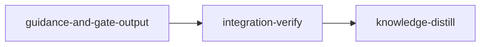

# Plan: Guidance and gate output

## Overview

Resident instructions and gate output are paid on every later turn of every session that receives them. This plan is plan 5 of the token-optimization programme (`doc/plans/optim-token-metaplan.md`, section 5). It makes byte changes only (evidence class 1, no paired runs): the `loom-verifier` writes each gate step to a log outside the tree and prints the exit code, the log path and the failure lines; the template's Rules 3 and 3b shrink to one line each because the hooks already print both procedures; the orchestration skill loses the paragraphs that `CLAUDE.md.template` or the stage signal's stable prefix already carry, and gets a size ceiling; the Go skill stops qualifying on Rust prompts; a stage main session that edits past BLOCK-B point 1 gets one advisory; the heredoc refusal says to quote the delimiter; the integration-verify fence in the subagent preamble names the single canonical verifier; and the rule-bending page gains an enforcement matrix for the six hard stops.

**Plan dependencies.** Canonical run order: 3, 1, 2, plan B (`doc/plans/PLAN-host-verification.md`), 4, then this plan (one checkout runs one plan).

Hard prerequisites:

- Plan 3 (`PLAN-01-doctrine-truth-and-plan-guards`), which edits `CLAUDE.md.template:75`, `loom-hooks/session-start.sh:153`, `loom-hooks/post-tool-use.sh` and `orchestrator/signals/tests_size.rs:36` first.
- Plan 2 (`PLAN-03-usage-evidence`), whose replay harness `loom/tests/signal_replay.rs` supplies the byte evidence.
- Plan B, merged and installed with `./dev-install.sh` before this plan's `loom run`. It makes this plan's sessions run on the host-job mechanism:
  - in a session, `loom check <stage-id>` and `loom stage complete <stage-id>` relay a request to the daemon, which runs the criteria as a host job;
  - exit 3 means "run the same command again in the next Bash call";
  - each failing criterion prints a `full log: <path>` line pointing at its whole output;
  - sessions can no longer nest bubblewrap;
  - the codex lane on Linux runs `codex exec --sandbox danger-full-access` when nesting is refused.

  Plan B also rewrites the completion and verifier doctrine this plan builds on: template Rules 4 and 13, `VERIFIER_GATE`, `append_settled_completion_rules`, the orchestration skill's completion and gate paragraphs, and the verifier definition. It does so under constraints that keep this plan's frozen lines, needles and anchors valid (its `w7-doctrine.md`, "What plan 5 builds on").

Other plans that edit this plan's files first:

- Plans 1 and 2 also edit `post-tool-use.sh`.
- Plan 1 trims `loom-hooks/_read_ledger.sh`; the ledger helpers the size advisory calls stay.
- Plan 4 edits `orchestrator/signals/format/sections.rs`, which can move the standard signal's byte floor, and declares `tests_dependency_harness` in `orchestrator/signals/mod.rs`.

Plan 7 (`PLAN-06-sandbox-route-closure`) edits no `agents/*.md` file. The stage's `before_stage` checks fail fast when plan 2, plan 3 or plan B has not merged. Every baseline, needle and frozen line is taken from this plan's own base, the tree after plan 4, never from 6fee4ecd.

**Lanes (operator decision of 2026-10-19: Claude plus codex where it fits).** `guidance-and-gate-output` lists `["claude", "codex"]`: most of its work is doctrine, template, skill and hook text, which stays on Claude, and two pieces are single-file test units with every interface pinned, which go to codex terra. C1 writes the relocation manifest (`tests_guidance_manifest.rs`, plus its three-line declaration in `signals/mod.rs`) from the 6fee4ecd lines and needles its brief pastes; C2 writes the real-index fixture method and the Go-on-Rust negative case. Both are forwarded first, in the foreground, so the orchestrator sees each unit's test red before the Claude wave turns it green. On Linux, after plan B, the forward runs codex in direct mode (`--sandbox danger-full-access`), and the stage sandbox is codex's only boundary; an exit 125 there is a network or credential fault, not a nested-sandbox one. W1 (verifier recipe, `VERIFIER_GATE`, Go triggers) is at sonnet: `VERIFIER_GATE` must keep the clauses plan B added while shrinking, which no exact replacement text can settle in advance. W2 (template, skill, ceilings measured after its own edits, BLOCK-F surfaces, hook-test pins) and W3 (the size advisory, which converges only by running its fixture-backed hook contract, the heredoc message and the preamble fence with its small pin test) stay at sonnet. The bookend stages carry no `implementers`. Codex availability was checked on 2026-10-19 (the CLI on PATH, plugin `codex@openai-codex`, `exclude_slash_tmp` set in `~/.codex/config.toml`); a codex-licensed stage receives the codex hosts in its sandbox automatically (`network_settings`, `loom/src/sandbox/settings/policy.rs`, from `CODEX_SANDBOX_DOMAINS` in `loom/src/codex.rs`). On a machine without codex, `loom run` warns and the signal reroutes terra-tier units to sonnet.

**Accepted warning.** The knowledge base already describes this tree, so the plan has no bootstrap stage. Until plan 3 merges, `loom plan verify --strict` fails on the bootstrap-recommendation heuristic (`plan/schema/validation.rs:1109-1137`); that one warning is accepted. Plan 3 runs first and makes the heuristic recognise a populated knowledge base, so once it has merged the warning no longer fires on this repository.

YAML is authoritative where this prose and the YAML differ.

## Goals

- The verifier's report always carries the step's real exit code, its log path and the failing lines, in a bounded excerpt, whatever the output size.
  - Gate steps it runs directly go through the recipe.
  - Criteria go through `loom check <stage-id>`, run bare (its relay line must stay in the output). Their full logs are the `full log:` paths that plan B's host job prints.
- `CLAUDE.md.template` and `skills/loom-orchestration/SKILL.md` fall in bytes against this plan's base. A test fails if either regrows, if a frozen template heading or rule bullet disappears without a recorded new home, or if a removed skill paragraph's instruction is missing from the surface its recipient reads.
- `loom-golang` no longer qualifies on a Rust prompt that says "struct" and "map".
- A stage main session that changes more than 20 lines or more than 2 files itself is told once, through `additionalContext`.
- Non-goals: no new command, flag, hook script, hook registration, config key or telemetry event; no change to effort, ceilings or the delegation rule itself; nothing from metaplan section 6.

## Shared files and what earlier plans change

| File                                               | Earlier plan | Expected change before this plan                                                                                         | How this plan anchors                                                                                   |
| -------------------------------------------------- | ------------ | ------------------------------------------------------------------------------------------------------------------------ | ------------------------------------------------------------------------------------------------------- |
| `CLAUDE.md.template`                               | 3, B         | 3: `:75` `loom memory list` becomes `loom memory list --stage <stage-id>`. B: Rules 4 and 13 rewritten in prose, no frozen line changed or added, no net growth | Rewrites Rule 3b's paragraph by heading `### 3b.`; the manifest freezes headings and bullets as they stand at this plan's base |
| `loom-hooks/session-start.sh`                      | 3            | `:153` re-anchor becomes `run 'loom memory list --stage ${LOOM_STAGE_ID}'` (plan 3's hooks brief)                        | Needle `loom memory list` survives either spelling                                                      |
| `loom-hooks/tests/session-start-compact.sh`        | 3            | Gains a check for `loom memory list --stage test-stage`                                                                  | Adds only the `/handoffs/` check                                                                        |
| `loom-hooks/post-tool-use.sh`                      | 3, 1, 2      | 3 renames `remind_knowledge_update` to `remind_memory_capture` and trims its box; 1 deletes the read-receipt branch; 2 pipes the payload to `loom hook forward-receipt` | New section placed after the `=== EDIT RECORDING ===` block; calls before the final `exit 0`            |
| `loom/src/orchestrator/signals/tests_size.rs`      | 3            | `:36` says about 19,900 bytes instead of "about 17,000"                                                                  | Rewrites that doc comment                                                                               |
| `loom/src/orchestrator/signals/mod.rs`             | 3, 4         | 3 adds `mod tests_doctrine_commands`; 4 adds `mod tests_dependency_harness` beside `tests_size`                          | C1 adds its declaration after the last `tests_doctrine*` one                                            |
| `loom-hooks/_read_ledger.sh`, `_read_discipline.sh` | 1           | Read-receipt functions and comments deleted; `_loom_ledger_append`, `_loom_polls_count` and `_loom_ledger_file` stay     | Not edited; W3 calls those three helpers by name                                                        |
| `loom/src/orchestrator/signals/format/sections.rs` | 3, 4, B      | Signal sections change; the standard floor may move; B rewords one completion sentence line-neutrally                    | Not edited; `VERIFIER_GATE` does not grow, so the floor cannot grow from this plan                      |
| `loom/src/orchestrator/signals/cache/blocks.rs`    | B            | `VERIFIER_GATE` keeps `**The gate runs in a`loom-verifier`**`, `` `loom check <stage-id>` `` and `RUNNER-ENV` and gains `SESSION-ENV`, no net growth | W1 shrinks it at run time, keeping every one of those substrings                                        |
| `loom/src/orchestrator/signals/helpers.rs`         | B            | `append_settled_completion_rules` and `STAGE_EXIT_RULES` describe host-job completion; the first keeps `is the LAST act of your session` and `LOST WORK`; BLOCK-F stays byte-identical across its copies | W2 edits only the `STAGE_EXIT_RULES` doc comment; C1 pins the kept phrases                              |
| `skills/loom-orchestration/SKILL.md`               | 1, B         | 1: the **Read receipts.** label becomes **Sibling-read ledger.** and "already read whole" becomes "already requested whole". B: the completion, gate and stage-exit paragraphs are rewritten under their unchanged bold labels | Removals are anchored by those bold labels; everything else is kept as found                            |
| `loom/src/orchestrator/signals/tests_doctrine_v2.rs`, `tests_doctrine_prefixes.rs` | B | B may re-point doctrine pins to its new text | W2 and W3 edit only the named test and tuple                                                            |
| `loom-hooks/loom-control-complete.sh`, `loom-hooks/tests/loom-control-complete-heredoc.sh` | B | B deletes the PostToolUse broker half (about 130 lines) and the heredoc test's broker stub and post phase; `heredoc_openers_are_plain`, `completion_rejection_reason` and the test's `expect_refused` cases stay | W3 anchors by function name and case label, never by line |
| `loom-hooks/_subagent-preamble.txt`                | B            | B edits only its NEVER-run lines (about 5-6); BLOCK-A and both EXCEPTION bullets stay                                    | W3 anchors by the exception's text                                                                      |
| `loom-hooks/codex-forward.sh`, `loom/src/codex.rs` | B            | Linux direct mode when a nested bubblewrap is refused                                                                    | Not edited; the codex lane paragraph above describes the effect                                         |
| `README.md`                                        | 3, 2, B, 4   | 3: `:557`, `:941`, `:948`, `:1054`, `:1115`; 2: the `loom usage` lines under "### Other Commands"; B: the "### Command Confinement" blockquote and the completion paragraphs; 4: the `:948` memory paragraph again | Distill edits only the verifier lines and the delegation paragraph, located by text                    |
| `agents/loom-verifier.md`                          | B            | B rewrites "What You Run" item 2 (criteria through `loom check`, exit codes, SESSION-ENV and RUNNER-ENV), the stage-control bullet and the RUNNER-ENV output line; it adds no fenced block | W1 edits only the `description:` sentence, the `**Writes no files**` bullet, the STEP block and inserts the recipe after the numbered list |

Every brief tells its worker to re-read these files at run time and anchor by symbol or text. Plan B's final text, not 6fee4ecd's, is the base for the frozen-line comparison, the needle checks and every byte measurement.

## Baselines: history (2026-10-18, 6fee4ecd), re-measured by the stage at its base

The stage's main agent re-measures every number below at its own base before spawning (stage description, BEFORE SPAWNING); the plan's checks never compare against these values. Measured on 2026-10-21, the tree had already moved: the template 20,320 bytes, the skill 25,019, `post-tool-use.sh` 323 lines, `VERIFIER_GATE` about 461 bytes. Measured from a scratch copy of the 6fee4ecd sources (`git archive`) with a temporary measuring test, outside any worktree sandbox:

- `CLAUDE.md.template` 19,916 bytes (`CLAUDE_MD_TEMPLATE_MAX_BYTES` 20,480); `skills/loom-orchestration/SKILL.md` 24,573 bytes, no ceiling.
- Standard stable prefix 8,091 bytes (ceiling 8,192); standard stable-plus-semi-stable floor 8,119 + 2,109 = 10,228 bytes (ceiling 10,240, 12 bytes of headroom); integration-verify prefix 10,135 bytes.
- The preamble's integration-verify exception is 197 bytes; the reworded one is 219.
- `cargo test --lib signals::`: 248 passed. `cargo test --test integration hooks_skill_trigger::`: 18 passed.
- Line counts: `post-tool-use.sh` 348, `loom-control-complete.sh` 399, `tests_doctrine_prefixes.rs` 277, `tests_size.rs` 249, `tests_doctrine_v2.rs` 150, `hooks_skill_trigger_fixture.rs` 270, `hooks_skill_trigger_evidence.rs` 172. None of the Rust files this plan edits has a row in `loom/maintainability-baseline.txt`.
- Simulated edits: the template falls to 19,832 bytes; the skill to about 19,860 bytes before the moved sentence and the new intro.
- Recipe dry run: a 3,503-line fixture exiting 101 gave `exit=101 log=<path>` plus the excerpt in 645 characters, with the full output in the log; the masked form `<fixture> | tail -50; echo "exit=$?"` printed `exit=0`.
- The two byte-falling IV criteria exit 1 at 6fee4ecd and exit 0 against a 19,800-byte copy of the template.

The full pre-push gate was not run at 6fee4ecd: four plans land before this one, so a HEAD baseline would not describe the tree this plan starts from. The stage records its own baseline before spawning.

## Before `loom run` (operator)

1. Plans 3, 1, 2, B and 4 have merged, and `./dev-install.sh` has installed them. Plan B's self-skip guards are in the tree: loom's own tests that need a nested bubblewrap print SKIP in a session, so the verifier's in-session suite does not report them as failures.
2. `loom knowledge check --strict --baseline doc/loom/knowledge/check-baseline.txt` exits 0. It exits 1 at 6fee4ecd; plan 3 owns that repair, and the distill stage's acceptance depends on it.
3. Commit this plan and every brief under `doc/plans/token-optim/briefs/guidance-and-gate-output/`. `extract_brief_paths` (`loom/src/plan/schema/structural_checks.rs:78`) and the committed-input bundle (`loom/src/commands/run/plan_inputs/discovery.rs:22`) recognise only `doc/plans/briefs/`, so neither `loom plan verify` nor `loom run` notices a missing or uncommitted brief under `doc/plans/token-optim/`; a stage worktree is cut from HEAD, so an uncommitted brief is absent there.
4. On the machine that runs the plan, the codex lane is ready: `command -v codex` finds the CLI and `claude plugin list --json` lists `codex@openai-codex`. Without them, `loom run` warns and the two codex units run on sonnet. On Linux `exclude_slash_tmp` in `~/.codex/config.toml` is harmless; after plan B the forwards run in direct mode, which does not read it.
5. After the plan merges, run `./dev-install.sh`: stage sessions read the installed template, skill, agents and hooks.

## Execution Diagram



## Stages

### 1. guidance-and-gate-output (standard)

The single implementation stage. Every change is a small edit to a disjoint file set, so five workers in one stage cover it; no Q1-Q4 condition splits it (no merge-order dependency inside the work, no file shared between workers, no checkpoint a later stage needs, and the expected context is well under 500,000 tokens). Bootstrap is skipped (see Overview). The work runs in two waves inside the stage: the two codex units first, in the foreground, then the three Claude workers in the background. The order is a test-first check, not a file dependency: C1's manifest and C2's negative case are each run red against the untouched template, verifier definition and Go triggers before the Claude wave changes them.

| Worker | Lane and tier | Work                                                                                                                  | Brief                                                                                                        |
| ------ | ------------- | --------------------------------------------------------------------------------------------------------------------- | ------------------------------------------------------------------------------------------------------------ |
| C1     | codex terra   | Relocation manifest `tests_guidance_manifest.rs` and its declaration in `signals/mod.rs`                              | `doc/plans/token-optim/briefs/guidance-and-gate-output/guidance-and-gate-output/c1-guidance-manifest.md`     |
| C2     | codex terra   | Real-index fixture method `FakeHome::index_real_skill`; Go-on-Rust negative case                                      | `doc/plans/token-optim/briefs/guidance-and-gate-output/guidance-and-gate-output/c2-go-negative-case.md`      |
| W1     | Claude sonnet | Verifier recipe in `agents/loom-verifier.md`; `VERIFIER_GATE`; Go triggers                                            | `doc/plans/token-optim/briefs/guidance-and-gate-output/guidance-and-gate-output/w1-verifier-and-triggers.md` |
| W2     | Claude sonnet | Template Rules 3, 3b and 14; orchestration skill slimming; BLOCK-F surfaces; size ceilings; two runtime hook pins     | `doc/plans/token-optim/briefs/guidance-and-gate-output/guidance-and-gate-output/w2-template-and-skill.md`    |
| W3     | Claude sonnet | Size advisory in `post-tool-use.sh`; heredoc refusal message; integration-verify fence in the preamble and its needle | `doc/plans/token-optim/briefs/guidance-and-gate-output/guidance-and-gate-output/w3-hooks-and-fence.md`       |

Two contracts, written and frozen before implementation in `loom/tests/guidance_gate_contracts.rs`:

- `verifier_recipe_reports_exit_log_and_excerpt` rejects a verifier definition whose recipe:
  - pipes the step through `tail` (it reports `tail`'s exit 0);
  - prints the whole output;
  - or bounds the excerpt by matches only, so one long failing line or many matches pass the 12,000-character cap.
- `main_session_edit_advisory_fires_once_past_the_limit` rejects an advisory that:
  - repeats after the first warning, including after the ledger's 300-row rotation;
  - counts subagent edits or files outside the worktree;
  - misreads the ledger's timestamp column as part of the line count;
  - or prints on stderr, where a PostToolUse exit 0 never reaches the model.

**Risk checklist walk.**

| Area | Applies | Covered by |
| --- | --- | --- |
| Untrusted input | the hook payload's paths and edit strings, the ledger rows | the advisory contract |
| Lifecycle | once per session, through the ledger's rotation | the advisory contract |
| Process I/O volume | gate output past the 12,000-character cap, including one 13,000-character failing line and many separated matches | the recipe contract |
| Configuration propagation, filesystem symlinks, reachability, external data | do not apply: nothing new is constructed or configured; the ledger helpers already refuse symlinks; the Go triggers are this repository's own file, tested through the real indexer | n/a |

The relocation manifest (`tests_guidance_manifest.rs`) is an ordinary unit test. It is declared from `signals/mod.rs`, a production file a contract session may not freeze, so it cannot be a contract. It covers the template relocations and the orchestration-skill removals. For each removed skill paragraph it pins the instruction in the surface its recipient reads: the template, or the standard stable prefix the main agent receives. A deletion test proves the coverage is not vacuous.

**Expected integrity events.** W2 deletes the orchestration-skill tuple from `block_f_agrees_across_every_surface` in `tests_doctrine_v2.rs`, which raises `TI-edit-loom/src/orchestrator/signals/tests_doctrine_v2.rs`. That is the only expected event. Dispute it once, after the final review round, with the reason "BLOCK-F leaves the orchestration skill; the three stable-prefix copies stay pinned". Any other event is a defect.

### 2. integration-verify

Runs the full gate with the hook steps (its unfiltered suite is an acceptance criterion, so it runs as plan B's host job), the review dimensions, and the evidence:

- plan 2's replay at the base and candidate revisions (per-section signal bytes);
- the template and skill byte counts against this plan's base, with 6fee4ecd reported as history;
- the verifier dry run.

Depends on the implementation stage.

### 3. knowledge-distill

Applies `stale-knowledge:` corrections first, records the enforcement matrix for the six hard stops in `concerns/agent-rule-bending-hardening.md`, rewrites the knowledge sections this plan made stale, and updates the README's verifier and delegation lines. Depends on integration-verify; it has no dependents and every other stage is among its ancestors.

## Coverage of metaplan section 5

| Metaplan item                                                                                                                    | Where                                                                        |
| -------------------------------------------------------------------------------------------------------------------------------- | ---------------------------------------------------------------------------- |
| Verifier gate output (recipe, scratch log, `VERIFIER_GATE`, Rule 14 points at the recipe, Rule 8 stays)                          | Stage 1, W1 and W2; contract `verifier_recipe_reports_exit_log_and_excerpt`  |
| IntegrationVerify fence wording (BLOCK-A untouched, new needle)                                                                  | Stage 1, W3                                                                  |
| Rules 3 and 3b (one line each, hard stop 4 stays, both pins, manifest, template ceiling lowered)                                 | Stage 1, W2 and C1                                                           |
| Orchestration skill slimming and size ceiling                                                                                    | Stage 1, W2                                                                  |
| Generic skill triggers (phrases, `STOPWORDS` untouched, one Go-on-Rust negative case)                                            | Stage 1, W1 and C2                                                           |
| Size advisory (stage main session, `.loom/work/hooks/`, once, `additionalContext`, no new hook or registration)                  | Stage 1, W3; contract `main_session_edit_advisory_fires_once_past_the_limit` |
| Heredoc block message and its test assertion                                                                                     | Stage 1, W3                                                                  |
| Enforcement matrix                                                                                                               | Stage 3                                                                      |
| Acceptance (replay bytes falling, manifest green, pins, hook tests, verifier dry run, masked status fails, gate with hook steps) | Stages 1 and 2                                                               |

Disposition rows that name plan 5 (metaplan, "Disposition of the retired source documents"):

| Source and item | Where |
| --- | --- |
| Census C, shrink the template: continued by relocation | Stage 1, W2 (Rules 3/3b), C1 (manifest) |
| Codex ledger #3, generic skill-trigger collisions: phrase fix and one negative case | Stage 1, W1 (triggers), C2 (negative case) |
| Codex ledger #5, one canonical verification owner: preamble wording | Stage 1, W3 |
| Audit 2a, bounded gate output: verifier recipe with a scratch log, no new command | Stage 1, W1 |
| Audit 2f, Rules 3/3b moved to the hooks: template bodies cut | Stage 1, W2, C1 |
| Audit 4a/4b, golang residue | Stage 1, W1, C2 |
| Audit 4e, slim oversized skills: the orchestration skill only | Stage 1, W2 |
| Audit 6a, advisory warning on a stage main's own edits | Stage 1, W3 |
| Audit 6e, heredoc blocks: clearer message for unquoted openers | Stage 1, W3 |
| Audit 6h, Rule 8 versus Rule 14: Rule 14 points at the recipe, Rule 8 stays | Stage 1, W2 |
| Proposal §9.3, fatal no-main-agent-edits dismissed; advisory kept | Stage 1, W3 (advisory only, never denies) |
| Graft guidance #4, enforcement matrix | Stage 3 |
| Review P2, template and orchestration skill size | Stage 1, W2; the §6 (E7) half is not built |

Dropped by the metaplan, with its reasons, and not built here: a bounded gate command and `.loom/work/gate-logs/` (the recipe covers it; the sandbox denies `.loom` and grants no read of `gate-logs`; testrun adapters expose counts only); residual poll classification (identical repeats already counted, `_progress-classification.sh:197-210`); the `@` worker-id check (already refused, `commands/subagents/wait/model.rs:44-48`); slimming other catalogued skills and adding "Not for" text (they load rarely; load counts unmeasured); a replay corpus of real prompts (one negative case covers the observed false positive); carrying recommended skills into spawns (per-spawn bytes); project-local skill resolution (verify and runtime would change together); explicit `maxTurns` and `effort` on every agent (pinning effort changes behaviour by stage type); a new `hard-stop-enforcement.md` page (the existing page carries it); a KNOWLEDGE-FIRST sentence on ranked retrieval (paid in every stable prefix); the `git show -s` false positive (already handled, `poll-guard.sh:231-246`).

## Deviations from the metaplan (the tree wins)

1. **Go triggers.** The metaplan lists eight bare words (`go`, `map`, `pointer`, `slice`, `channel`, `interface`, `struct`, `defer`). The trigger list (`skills/loom-golang/SKILL.md:5-31`) also holds `mutex` (Rust's `Mutex`) and `echo` (the shell builtin), the same class of collision; both become phrases too. `error` and `sync` are already in `STOPWORDS` and stay as they are.
2. **`VERIFIER_GATE` cannot grow.**
   - The standard floor and stable prefix sit near their ceilings (12 and 101 bytes of headroom at 6fee4ecd; re-measured at the base).
   - `VERIFIER_GATE` therefore names the scratch log in a text no longer than the base's. It keeps the four substrings plan B made binding: the gate needle, `` `loom check <stage-id>` ``, `RUNNER-ENV` and `SESSION-ENV`. These are the main agent's only rule for the verifier's environment reports, because R3 leaves the skill.
   - The delta is measured at the stage's base, not predicted.
   - The full recipe lives in the agent definition, which is the text the verifier itself reads.
3. **Hook string pins.** The metaplan says no test pins either hook string. `post-tool-use-ceiling-hard-block.sh` pins the `CONTEXT CEILING REACHED` prefix and `session-start-compact.sh` pins the signal path; neither pins the procedure (the handoff command, `loom memory list`, the handoffs directory). The manifest pins the procedure text statically and the two hook tests gain runtime assertions.
4. **Advisory channel and placement.** `post-tool-use.sh` prints its large-output notice (`_loom_bash_output_notice`) on stderr and exits 0; Claude Code passes a hook's stderr to the model only on exit 2, so that notice reaches only the transcript. The advisory uses stdout `additionalContext` as `loom-relay.sh` does, and runs at the end of the script, after the ceiling checks whose `exit 2` would drop stdout JSON. The tally is limited to `LOOM_SESSION_TYPE=stage` sessions and to paths inside `LOOM_WORKTREE_PATH`, so merge and contract sessions and scratch briefs are not counted.
5. **Advisory test.** The size-advisory hook test is the Rust contract that drives `loom-hooks/post-tool-use.sh` directly; no new shell test is added. The contract runs under `cargo test` on Linux and on the macOS CI job, and `run-all.sh` (edited by plans 3, 1 and 2) gains no line.
6. **Where the unfiltered suite runs, and which pre-push steps run where.**
   - The metaplan's rule says every code stage runs the pre-push gate. `loom plan verify` warns on `cargo test --all-targets --no-fail-fast` in a standard stage's acceptance, and `--strict` fails on that warning.
   - The stage's `loom-verifier` round runs the pre-push gate (`loom/.githooks/pre-push`) in its own shell:
     - cargo build;
     - the unfiltered suite with the hook's `env -u GIT_INDEX_FILE -u GIT_DIR -u GIT_WORK_TREE` cleanup;
     - doc tests, clippy, fmt, rustdoc;
     - the non-mutating markdownlint of tracked Markdown;
     - `./scripts/flake-check.sh`;
     - the three hook steps.
   - The one exception is `cargo audit`: no dependency changes, its advisory host is not in the stage sandbox, and the operator's push runs it.
   - Tests that need a nested bubblewrap self-skip in that shell after plan B; integration-verify's acceptance, a host job, runs them.
   - The acceptance keeps every other pre-push step, the three hook steps and the test filters that select this stage's own tests. Integration-verify's acceptance runs the unfiltered suite again on the merged tree.
   - This follows the precedent of `PLAN-token-flow` (`doc/plans/archive/DONE-PLAN-token-flow.md`, stage `token-core`).
7. **Orchestration skill and BLOCK-F.** BLOCK-F (`**When the stage cannot finish.**`) is in every stable prefix that loads the skill, so it leaves the skill and `block_f_agrees_across_every_surface` drops the skill surface. BLOCK-E stays: its other copy is in the v2 review section of the signal, not the stable prefix.
8. **Full criterion logs (pressure review, finding 1).** The metaplan's recipe logs every criterion. The confined runner prints only a 20-line tail per criterion (`commands/stage/criterion_output.rs`), and redirecting `loom check` would also hide plan B's relay line from the relay hook (`loom-hooks/loom-relay.sh`), so the request would never reach the daemon. Plan B's host job writes each criterion's whole output to a file and `loom check` prints its `full log:` path. The verifier therefore runs gate steps through the recipe, runs `loom check` bare, and reads each `full log:` path with the recipe's bounded excerpt command. No new log-export seam is built here.

---

<!-- loom METADATA -->

```yaml
loom:
  version: 2
  ratchet_files:
    - loom/maintainability-baseline.txt
    - doc/loom/knowledge/check-baseline.txt
  provision:
    - working_dir: "web"
      command: "test ! -e .npmrc && test ! -L .npmrc && bun install --frozen-lockfile --ignore-scripts --backend=copyfile --config=/dev/null"
  sandbox:
    enabled: true
    auto_allow: true
    filesystem:
      deny_read:
        ["~/.ssh/**", "~/.aws/**", "~/.config/gcloud/**", "~/.gnupg/**"]
    network:
      allowed_domains:
        [
          "crates.io",
          "index.crates.io",
          "static.crates.io",
          "registry.npmjs.org",
        ]
      allow_local_binding: false
      allow_unix_sockets: []
  stages:
    - id: guidance-and-gate-output
      name: "Verifier gate recipe, template and skill relocation, size advisory"
      summary: "Gives the loom-verifier a log-plus-excerpt recipe, cuts template Rules 3 and 3b and the duplicated orchestration-skill paragraphs behind a relocation manifest and size ceilings, stops the Go skill firing on Rust prompts, and adds a once-per-session size advisory for stage main sessions."
      stage_type: standard
      skills: ["loom-rust"]
      implementers: ["claude", "codex"]
      subagent_timeout_secs: 900
      working_dir: "loom"
      dependencies: []
      description: |
        Implement stage 1 of doc/plans/token-optim/PLAN-05-guidance-and-gate-output.md (renamed IN_PROGRESS-PLAN-05-guidance-and-gate-output.md in the same directory once loom run starts). Metaplan: doc/plans/optim-token-metaplan.md section 5.
        Use parallel subagents and skills to maximize performance.
        PATHS: working_dir is loom/ because contracts run as cargo test <name> -- --exact from it. YAML paths are package-relative (../ for files outside the crate); brief paths are repo-relative from the worktree root.

        BEFORE SPAWNING (you): plans 3, 1, 2, B (doc/plans/PLAN-host-verification.md) and 4 merged first and changed shared files.
        1. Re-read, by symbol or text, ../CLAUDE.md.template (plan 3 changed :75; plan B rewrote Rules 4 and 13), ../loom-hooks/session-start.sh (:153), ../loom-hooks/post-tool-use.sh (plans 3, 1, 2), src/orchestrator/signals/tests_size.rs (:36), src/orchestrator/signals/mod.rs (plan 3 added tests_doctrine_commands, plan 4 tests_dependency_harness), and the plan-B surfaces: VERIFIER_GATE (src/orchestrator/signals/cache/blocks.rs), append_settled_completion_rules and STAGE_EXIT_RULES (src/orchestrator/signals/helpers.rs), ../agents/loom-verifier.md, ../loom-hooks/loom-control-complete.sh and its heredoc test, ../loom-hooks/_subagent-preamble.txt, ../skills/loom-orchestration/SKILL.md.
        2. Run git diff 6fee4ecd -- ../CLAUDE.md.template ../skills/loom-orchestration/SKILL.md ../agents/loom-verifier.md ../loom-hooks/post-tool-use.sh ../loom-hooks/_subagent-preamble.txt ../loom-hooks/loom-control-complete.sh. Record in loom memory anything that contradicts a brief, with the brief's correction, and tell the owning worker in its spawn prompt.
        3. Confirm VERIFIER_GATE contains `loom check <stage-id>`, RUNNER-ENV and SESSION-ENV, and that append_settled_completion_rules contains `is the LAST act of your session` and `LOST WORK`. A missing one is a blocker for the relocation manifest's needles: record it and give C1 the text the tree has.
        4. Record the base with loom memory note "baseline: ...":
           - wc -c of ../CLAUDE.md.template, ../skills/loom-orchestration/SKILL.md and ../loom-hooks/_subagent-preamble.txt;
           - the byte length of VERIFIER_GATE's string;
           - the standard stable prefix and standard floor as cargo test --lib signals::tests_size measures them.

           That test must pass. If it already fails, block the stage: an earlier plan regrew the floor.
        5. Compare the 40 frozen template lines pasted in C1's brief with ../CLAUDE.md.template. Plans 3 and B are expected to change none of them. A changed one is noted for the wave 1 check.

        LANES: implementers lists claude and codex. Two waves, DISJOINT territories across both, and one ownership table for every worker. subagent_timeout_secs is 900 because each foreground forward is one Bash call of up to 540 s that posts no output. Workers NEVER spawn subagents. Every brief names the frozen contract file read-only.
        WAVE 1, CODEX (foreground, first): spawn two loom-codex-forwarder subagents BY AGENT TYPE in the FOREGROUND, ALL in ONE message, without name (never the plugin's codex:codex-rescue): C1 with unit id guidance-manifest and C2 with unit id skill-trigger-negative, each with --model gpt-5.6-terra --effort xhigh, an explicit Bash timeout of 600000 ms, and its own file set from the table. Each prompt is these five lines, with the unit id and the brief path filled in:
          LOOM-CODEX-FORWARD-ONLY
          --model gpt-5.6-terra --effort xhigh
          --unit-id <unit id>
          Bash timeout: 600000 ms
          Implement the unit in <brief path>. Read that file in full first and follow it exactly. Write only the files it assigns. Run no git.
        Keep the task line free of apostrophes, of the substring complete and of the phrase loom stage: the forward guards block them. Codex units run no git, write nothing in the stage's shared state directory, and run no build, test or formatter; loom's hooks never see their commands, so you are the backstop. Harvest each report once. A unit whose report is not a clean success (no LOOM-FORWARD-END, a LOOM-CODEX-FORWARD-ERROR, a non-zero exit such as 125, or timed_out with exit 124) is never re-forwarded as is: hand its remainder, with the brief and the report, to a loom-software-engineer (sonnet), which may run that unit's one test once. Knowledge mistakes/codex-worker-briefing.md, "The Codex Lane Fails Inside a Stage Sandbox With No Network", records forwards that failed with exit 125 in a stage sandbox; if this stage's signal says the sandbox has no network access, give both units to sonnet from the start. After plan B, on Linux the forward runs codex in direct mode (codex exec --sandbox danger-full-access): the stage sandbox is codex's only boundary, the evidence reads mode: direct and thread: instead of job: and record:, and an exit 125 is a network or credential fault. Record git status --short before the forwards; after them, only C1's and C2's files may be new or changed. A forward the harness backgrounded is waited on with one background loom subagents watch --worker codex:<unit id> --timeout 3600 before wave 2.
        CHECK WAVE 1 (you): git status --short shows changes only in C1's and C2's files. cargo fmt --all. Then two red checks, each recorded with loom memory note "red: <test>: <result>": cargo test --lib signals::tests_guidance_manifest fails in every_relocated_item_is_carried_by_its_home only, naming exactly the two Rule 14 verbose output entries (their needles land in wave 2); cargo test --test integration go_generic_words_do_not_qualify_golang_on_a_rust_prompt fails at its Rust-prompt assertion, because the Go triggers still list bare struct and map. Any other result is a fix brief to a fresh loom-software-engineer (sonnet) for that unit's files before wave 2. If the frozen-line comparison above found a changed line, replace that FROZEN_LINES entry with the current line yourself now (one line, BLOCK-B point 1).
        WAVE 2, CLAUDE (background): spawn W1, W2 and W3 (loom-software-engineer, sonnet) BY AGENT TYPE, without name, ALL in ONE message, each with a short fixed prompt plus "Your brief: <path>. Read it in full before anything else." Wait with one background loom subagents watch, one --worker claude:<agent id> per worker, --timeout 3600.

        | Worker | Role | Tier | Files owned | Shared context | Brief path |
        | ------ | ---- | ---- | ----------- | -------------- | ---------- |
        | C1 | Relocation manifest (wave 1) | codex terra | src/orchestrator/signals/tests_guidance_manifest.rs; src/orchestrator/signals/mod.rs | ../CLAUDE.md.template read-only, its 6fee4ecd lines pasted in the brief | doc/plans/token-optim/briefs/guidance-and-gate-output/guidance-and-gate-output/c1-guidance-manifest.md |
        | C2 | Real-index fixture and Go negative case (wave 1) | codex terra | tests/integration/hooks_skill_trigger_fixture.rs; tests/integration/hooks_skill_trigger_evidence.rs | ../skills/loom-golang/SKILL.md read-only, W1 changes it in wave 2 | doc/plans/token-optim/briefs/guidance-and-gate-output/guidance-and-gate-output/c2-go-negative-case.md |
        | W1 | Verifier recipe and Go triggers (wave 2) | sonnet | ../agents/loom-verifier.md; src/orchestrator/signals/cache/blocks.rs; ../skills/loom-golang/SKILL.md | tests/guidance_gate_contracts.rs read-only | doc/plans/token-optim/briefs/guidance-and-gate-output/guidance-and-gate-output/w1-verifier-and-triggers.md |
        | W2 | Template, skill, ceilings (wave 2) | sonnet | ../CLAUDE.md.template; ../skills/loom-orchestration/SKILL.md; src/orchestrator/signals/tests_size.rs; src/orchestrator/signals/tests_doctrine_v2.rs; src/orchestrator/signals/helpers.rs; ../loom-hooks/tests/post-tool-use-ceiling-hard-block.sh; ../loom-hooks/tests/session-start-compact.sh | src/orchestrator/signals/tests_guidance_manifest.rs read-only, C1 wrote it | doc/plans/token-optim/briefs/guidance-and-gate-output/guidance-and-gate-output/w2-template-and-skill.md |
        | W3 | Size advisory, heredoc message, IV fence (wave 2) | sonnet | ../loom-hooks/post-tool-use.sh; ../loom-hooks/loom-control-complete.sh; ../loom-hooks/tests/loom-control-complete-heredoc.sh; ../loom-hooks/_subagent-preamble.txt; src/orchestrator/signals/tests_doctrine_prefixes.rs | tests/guidance_gate_contracts.rs read-only | doc/plans/token-optim/briefs/guidance-and-gate-output/guidance-and-gate-output/w3-hooks-and-fence.md |

        AFTER THE WORKERS: cargo fmt --all; then W2's byte ceilings must equal the final file sizes (wc -c < ../CLAUDE.md.template and ../skills/loom-orchestration/SKILL.md); a mismatch after formatting or a late wording change goes to a fresh worker for W2's territory. Then one loom-verifier round, briefed with the repository's pre-push gate (loom/.githooks/pre-push), its gate steps run in its own shell through the recipe W1 adds to its definition, from loom/:
          - cargo build;
          - env -u GIT_INDEX_FILE -u GIT_DIR -u GIT_WORK_TREE cargo test --all-targets --no-fail-fast (as pre-push runs it);
          - cargo test --doc --workspace --all-features -- --test-threads=1;
          - cargo clippy --all-targets -- -D warnings;
          - cargo fmt --check;
          - RUSTDOCFLAGS='-D warnings' cargo doc --workspace --all-features --no-deps;
          - from the repository root, git ls-files '*.md' | rg -v '^doc/plans/|^loom/tests/fixtures/' | xargs web/node_modules/.bin/markdownlint-cli2 (non-mutating; a lint failure becomes a fix brief to the file's owning worker), and ./scripts/flake-check.sh;
          - the hook steps this stage needs because it edits loom-hooks/ (CI .github/workflows/ci.yml:280,290,295): ../scripts/check-hook-syntax.sh, bash ../loom-hooks/tests/run-all.sh, LOOM_HOOK_TEST_BSD=1 bash ../loom-hooks/tests/run-all.sh.
        Exceptions and runner rules:
          - cargo audit is the one pre-push step not run: no dependency changes, its advisory host is not in this sandbox, and the operator's push runs it. Do not call the round "the full pre-push gate".
          - The acceptance list below runs through loom check guidance-and-gate-output, BARE as its own Bash call with stdout unfiltered (it relays a request to plan B's host job). On exit 3 it runs the same command again; on exit 4 it runs it again. It reads each failing criterion's `full log:` path with the recipe's excerpt command.
          - A criterion that passes under loom check but fails in the verifier's shell is SESSION-ENV, not a FAIL. Tests that need a nested bubblewrap print SKIP in its shell after plan B; integration-verify's host run executes them.
        The unfiltered suite lives in that round and in integration-verify, not in this stage's acceptance, because loom plan verify warns on an unfiltered suite outside integration-verify; the acceptance keeps every other pre-push step and the filters that select this stage's tests. Plain cargo test and unit filters do not stand in for the verifier's full run. Each FAIL becomes a fix brief to a fresh worker of the owning territory (a fix in C1's or C2's files goes to a loom-software-engineer, sonnet, because it converges by running tests); then a FRESH verifier. The verifier's PASS on signals::tests_guidance_manifest and go_generic_words_do_not_qualify_golang_on_a_rust_prompt closes the two red checks of wave 1: record loom memory note "green: <test>" for each.
        MUTATION: before the final review round, for each contract mutate the REAL file the contract reads, under an explicit save and restore, never a scratch copy (the recipe contract embeds ../agents/loom-verifier.md with include_str!, so only the worktree file reaches it):
          1. cp the file to $LOOM_SCRATCH_DIR/<name>.orig.
          2. Apply the wrong implementation its rejects text names: in ../agents/loom-verifier.md, append | tail -50 to the recipe's first line; in ../loom-hooks/post-tool-use.sh, make the advisory print on every call.
          3. Run that one contract with cargo test --test guidance_gate_contracts <test>. It must fail, and its message must name the mutated behaviour: the exit=101 condition for the recipe, the repeated advisory for the hook. A failure for any other reason is not evidence.
          4. cp the .orig back, confirm with cmp, and run the contract again: it must pass.
          5. Record loom memory note "mutation: <contract id> red under <mutation> (<failing condition>), green after restore". Never git checkout.
        Also mutate the relocation manifest's home: remove `LOST WORK` from append_settled_completion_rules in src/orchestrator/signals/helpers.rs the same way, and confirm cargo test --lib signals::tests_guidance_manifest fails naming that relocation; restore and re-run green.
        No row of loom/maintainability-baseline.txt changes: none of the Rust files this stage edits is in the ledger, and the new files stay under 400 lines with functions under 50. The shell hooks follow the same limits by CLAUDE.md Rule 17: post-tool-use.sh and loom-control-complete.sh at or under 400 lines each (plan B shrank the second).

        CONTRACT SURFACE (the contract session writes tests/guidance_gate_contracts.rs only, from this text, before any implementation; no harness file; top-level #[test] fns named after the ids with underscores; every fn under 50 lines, the file under 400 lines and rustfmt-clean; bash, rg and jq must be on PATH, as in CI; no skip):
        - verifier_recipe_reports_exit_log_and_excerpt. const VERIFIER: &str = include_str!("../../agents/loom-verifier.md"). fn definition_recipe() -> String returns the body lines of the first fenced block whose opening line is exactly three backticks followed by bash and whose body contains gate-<step>.log; it panics with "agents/loom-verifier.md carries no gate recipe block" when there is none. fn dry_run(template: &str) -> Result<(), String>: in a tempfile::TempDir write an executable bash script fixture.sh that prints 3,000 lines "test noise::case_<i> ... ok", then "test guidance::fails ... FAILED" and "thread 'guidance::fails' panicked at src/lib.rs:7:9:", then 500 more ok lines, then one line "test guidance::long ... FAILED " followed by 13,000 x characters, then 40 groups of 20 ok lines each followed by a line "test guidance::case_<k> ... FAILED", then "test result: FAILED. 4300 passed; 42 failed", and exits 101; create <tmp>/scratch; in the template replace <command> with the fixture's absolute path in double quotes, <step> with test and <failure pattern> with FAILED|panicked at; run bash -c with the result and env LOOM_SCRATCH_DIR=<tmp>/scratch; return Err naming the first unmet condition among: stdout contains exit=101; stdout contains log=<tmp>/scratch/gate-test.log; stdout contains panicked at src/lib.rs:7:9; stdout is shorter than 12,000 bytes; <tmp>/scratch/gate-test.log exists and holds at least 4,300 lines. The test asserts dry_run(&definition_recipe()) is Ok, dry_run(MASKED) is Err for const MASKED: &str = "<command> | tail -50; echo \"exit=$?\"", and the definition recipe contains no "| tail". Red at freeze: agents/loom-verifier.md has no recipe block.
        - main_session_edit_advisory_fires_once_past_the_limit. Runs Command::new("bash") on Path::new(env!("CARGO_MANIFEST_DIR")).join("../loom-hooks/post-tool-use.sh") with env_clear() and then: PATH=<tmp>/bin:<the test's own PATH>; HOME=<tmp>/home; LOOM_STAGE_ID=advisory-stage; LOOM_SESSION_ID=<per scenario>; LOOM_WORK_DIR=<tmp>/work (created); LOOM_SESSION_TYPE=stage; LOOM_WORKTREE_PATH=<tmp>/wt (created); LOOM_BIN=<tmp>/bin/loom, an executable stub "#!/bin/sh" then "exit 0". The payload goes on stdin. A main payload is {"tool_name":"Edit","session_id":"main-1","transcript_path":"<tmp>/main-1.jsonl","tool_input":{"file_path":<path>,"old_string":"x","new_string":<n lines joined by \n>}} (the transcript basename equals <session_id>.jsonl, so loom_payload_agent_verdict in loom-hooks/_common.sh reads it as the main agent; the file need not exist); a Write payload uses "tool_name":"Write" and "content"; a subagent payload adds "agent_id":"a1","agent_type":"loom-software-engineer" and uses transcript_path <tmp>/main-1/subagents/agent-a1.jsonl. Scenario s-main: Edit <wt>/src/a.rs with 3 lines, then <wt>/src/b.rs with 3 lines: each exits 0 with empty stdout; then <wt>/src/c.rs with 1 line: exit 0 and stdout parses as JSON with .hookSpecificOutput.hookEventName == "PostToolUse" and .hookSpecificOutput.additionalContext containing LOOM_HOOK_WARN and "7 lines across 3 file(s)"; then <wt>/src/d.rs with 1 line: exit 0, empty stdout; then 305 more one-line Edits of <wt>/src/e.rs, past the ledger helper's 300-row cap (_LOOM_LEDGER_MAX_ROWS in loom-hooks/_read_ledger.sh): every one exits 0 with empty stdout (a single helper fn runs the loop; the scenario counts as one warning in total). Scenario s-lines: one Write of 25 lines to <wt>/src/big.rs: additionalContext contains "25 lines across 1 file(s)". Scenario s-sub: three subagent Edits on three worktree files: every stdout empty. Scenario s-out: one main Write of 100 lines to <tmp>/scratch/brief.md, outside the worktree: stdout empty. Red at freeze: post-tool-use.sh prints no advisory.

        After the gate is green and before completing: the review round per the signal, every finding fixed or disputed.
        MEMORY: record mistakes, decisions and surprises via loom memory immediately (subagents too), including every stale knowledge claim as loom memory note "stale-knowledge: <file>#<heading> claims X; the tree does Y (file:line). Correction: <text>"; NEVER loom knowledge (implementation stage); NEVER Claude Code auto-memory.
      before_stage:
        - command: "cargo --version"
          description: "cargo on PATH"
        - command: "jq --version"
          description: "jq on PATH (post-tool-use.sh and the advisory contract)"
        - command: "python3 --version"
          description: "python3 on PATH (the skill-trigger hook tests)"
        - command: "rg -qF 'memory list --stage' ../loom-hooks/session-start.sh"
          description: "plan 3 (doctrine truth) has merged: the re-anchor names the stage journal"
        - command: "test -f tests/signal_replay.rs"
          description: "plan 2 (usage evidence) has merged: its replay harness exists at the path plan 2 pins (a symbol grep matches doctrine_guard_contracts.rs and proves nothing)"
        - command: "test -f ../doc/plans/token-optim/DONE-PLAN-03-usage-evidence.md"
          description: "plan 2 completed, its integration-verify and knowledge-distill included"
        - command: "rg -qF 'pub mod host_verify;' src/lib.rs"
          description: "plan B (host verification) has merged: criteria run as daemon host jobs"
        - command: "test ! -e src/commands/stage/completion_evidence.rs"
          description: "plan B removed the session-evidence completion broker"
      files:
        - "../agents/loom-verifier.md"
        - "src/orchestrator/signals/cache/blocks.rs"
        - "../skills/loom-golang/SKILL.md"
        - "tests/integration/hooks_skill_trigger_fixture.rs"
        - "tests/integration/hooks_skill_trigger_evidence.rs"
        - "../CLAUDE.md.template"
        - "../skills/loom-orchestration/SKILL.md"
        - "src/orchestrator/signals/tests_guidance_manifest.rs"
        - "src/orchestrator/signals/mod.rs"
        - "src/orchestrator/signals/tests_size.rs"
        - "src/orchestrator/signals/tests_doctrine_v2.rs"
        - "src/orchestrator/signals/helpers.rs"
        - "../loom-hooks/tests/post-tool-use-ceiling-hard-block.sh"
        - "../loom-hooks/tests/session-start-compact.sh"
        - "../loom-hooks/post-tool-use.sh"
        - "../loom-hooks/loom-control-complete.sh"
        - "../loom-hooks/tests/loom-control-complete-heredoc.sh"
        - "../loom-hooks/_subagent-preamble.txt"
        - "src/orchestrator/signals/tests_doctrine_prefixes.rs"
        - "tests/guidance_gate_contracts.rs"
      contracts:
        - id: verifier-recipe-reports-exit-log-and-excerpt
          file: tests/guidance_gate_contracts.rs
          test: verifier_recipe_reports_exit_log_and_excerpt
          scenario: "extracts the gate recipe block from agents/loom-verifier.md, runs it with LOOM_SCRATCH_DIR in a TempDir on a fixture that prints about 4,300 lines, one failing line of 13,000 characters and 42 separated failures, and exits 101, and runs the masked form <command> | tail -50 the same way"
          rejects: "a verifier definition whose recipe pipes the step through tail and so reports tail's exit 0, prints the whole output, or bounds the excerpt by match count only so a long failing line or many matches overflow the 12,000-character tool cap"
        - id: main-session-edit-advisory-fires-once
          file: tests/guidance_gate_contracts.rs
          test: main_session_edit_advisory_fires_once_past_the_limit
          scenario: "drives loom-hooks/post-tool-use.sh with LOOM_SESSION_TYPE=stage and Edit and Write payloads: a main session editing three worktree files and then 306 more edits past the ledger's 300-row cap, a 25-line Write, three subagent edits, and a 100-line Write outside the worktree"
          rejects: "an advisory that repeats after the first warning (including once the ledger rotates its warned row away), reads the ledger's timestamp column into the line count, counts subagent edits or files outside the worktree, or prints on stderr, which a PostToolUse exit 0 never passes to the model"
      acceptance:
        - "cargo build"
        - "cargo test --test guidance_gate_contracts"
        - "cargo test --lib signals::"
        - "cargo test --lib fs::permissions::"
        - "cargo test --test integration hooks_"
        - "cargo test --test integration go_generic_words_do_not_qualify_golang_on_a_rust_prompt"
        - "cargo test --test maintainability"
        - "cargo test --doc --workspace --all-features -- --test-threads=1"
        - "cargo clippy --all-targets -- -D warnings"
        - "cargo fmt --check"
        - "RUSTDOCFLAGS='-D warnings' cargo doc --workspace --all-features --no-deps"
        - "../scripts/check-hook-syntax.sh"
        - "bash ../loom-hooks/tests/run-all.sh"
        - "LOOM_HOOK_TEST_BSD=1 bash ../loom-hooks/tests/run-all.sh"
      artifacts:
        # artifacts must lie inside working_dir (loom/); each deliverable outside it is proven instead by:
        # ../agents/loom-verifier.md - the recipe contract and after_stage; ../CLAUDE.md.template and the orchestration skill -
        # tests_size.rs ceilings, the manifest and the IV byte criteria; ../skills/loom-golang/SKILL.md -
        # go_generic_words_do_not_qualify_golang_on_a_rust_prompt; ../loom-hooks/post-tool-use.sh - the advisory contract and after_stage;
        # ../loom-hooks/loom-control-complete.sh - the heredoc hook test and after_stage; ../loom-hooks/_subagent-preamble.txt -
        # subagent_preamble_names_the_one_canonical_iv_verifier
        - "src/orchestrator/signals/tests_guidance_manifest.rs"
        - "tests/integration/hooks_skill_trigger_evidence.rs"
      wiring:
        - source: "src/orchestrator/signals/mod.rs"
          pattern: "mod tests_guidance_manifest;"
          literal: true
          description: "the relocation manifest is compiled into the signals test modules"
      after_stage:
        - command: 'rg -q "^\s*_loom_main_edit_advisory$" ../loom-hooks/post-tool-use.sh'
          description: "the size advisory is called at the end of the PostToolUse hook"
        - command: 'rg -qF "2>&1; echo \"exit=\$? log=" ../agents/loom-verifier.md'
          description: "the verifier definition carries the log recipe"
        - command: 'rg -qF "quote the delimiter" ../loom-hooks/loom-control-complete.sh'
          description: "the unquoted-heredoc refusal names the fix"

    - id: integration-verify
      name: "Integration verification"
      summary: "Runs the full gate with the hook suites, reviews the stage, and records the byte evidence: signal sections from plan 2's replay, and the template and orchestration-skill sizes against the programme base."
      stage_type: integration-verify
      working_dir: "loom"
      dependencies: ["guidance-and-gate-output"]
      description: |
        Final verification for doc/plans/token-optim/PLAN-05-guidance-and-gate-output.md (IN_PROGRESS-PLAN-05-guidance-and-gate-output.md once loom run starts). Verify functional integration, not only passing tests. NEVER Claude Code auto-memory.
        Use parallel subagents and skills to maximize performance.
        CONTEXT: read the plan, loom memory show --all, doc/loom/knowledge/INDEX.md and only the sections it points to.
        BUILD AND TEST (zero tolerance; nothing is pre-existing): every acceptance command below, from loom/. This plan edits loom-hooks/, so the hook syntax check and both hook suites (plain and LOOM_HOOK_TEST_BSD=1) run here; cargo test runs none of them.
        CODE REVIEW: parallel loom-code-reviewer subagents for security (the advisory parses hook payload paths and strings, and writes .loom/work/hooks/), shell portability (bash 3.2 and BSD tools, doc/loom/knowledge/mistakes/hooks-shell-portability.md), doctrine consistency (the template, the skill, the preamble, VERIFIER_GATE and agents/loom-verifier.md must agree; no removed skill paragraph lacks its surviving copy), and test coverage. Fix every finding through an engineer agent or dispute it; never defer.
        SUGGESTIONS: weigh every pending reviewer suggestion the signal lists; resolve each one implemented with loom memory resolve <id> --outcome implemented --reason <what changed>; leave the rest pending for knowledge-distill.
        EVIDENCE (byte changes, evidence class 1; no provider tokens):
        - Base revision: BASE=$(git log --merges --format=%H --grep '^Merge loom/guidance-and-gate-output into ' -n 1)^1, the target branch just before this plan's code merged.
        - Plan 2's replay: plan 2 pins it as loom/tests/signal_replay.rs, test signal_replay (#[ignore]), output between "=== signal-replay v1 ===" and "=== end signal-replay ===" (PLAN-03-usage-evidence.md, "Replay harness contract"). Run cargo test --test signal_replay -- --ignored --nocapture here with SIGNAL_REPLAY_OUT="$LOOM_SCRATCH_DIR/replay-head.tsv", and the same command at BASE (SIGNAL_REPLAY_OUT="$LOOM_SCRATCH_DIR/replay-base.tsv") from a git archive of BASE extracted under $LOOM_SCRATCH_DIR (the crate and every root its build and tests embed, which a 6fee4ecd build needed: loom, agents, commands, skills, codex, loom-hooks, web/dist, web/src/api, CLAUDE.md.template, AGENTS.md.template, install.sh, dev-install.sh, scripts, .cargo) with CARGO_TARGET_DIR under $LOOM_SCRATCH_DIR. Diff the per-section bytes. Expected: no section grows; the standard stable prefix changes by exactly VERIFIER_GATE's delta (the stage recorded the base length in its "baseline:" memory note); no other section changed by this plan. Record the diff with loom memory note "evidence: replay ...".
        - File sizes: wc -c of CLAUDE.md.template and skills/loom-orchestration/SKILL.md here and at BASE (git show BASE:<path> | wc -c), and agents/loom-verifier.md and loom-hooks/_subagent-preamble.txt (the preamble grows 22 bytes per typed spawn by design). Record them in loom memory, with the 6fee4ecd sizes (19,916 and 24,573) as programme-base history. The two acceptance criteria below compare against BASE, this plan's own base: earlier plans grew the template past its 6fee4ecd size, so a 6fee4ecd comparison could not pass.
        - Verifier dry run: cargo test --test guidance_gate_contracts -- --nocapture once more and confirm both contracts ran.
        FUNCTIONAL: the stage's wiring checks re-run on the merged tree; also run bash ../loom-hooks/tests/loom-control-complete-heredoc.sh and confirm the unquoted-heredoc case passes with the new message. From the repository root, run the two pre-push steps acceptance does not carry: git ls-files '*.md' | rg -v '^doc/plans/|^loom/tests/fixtures/' | xargs web/node_modules/.bin/markdownlint-cli2, and ./scripts/flake-check.sh; both exit 0. cargo audit is the operator's (no dependency changes; its advisory host is not allowed here).
        RUNNER: acceptance runs as plan B's host job. Run loom check bare and re-run it on exit 3; a criterion passing there and failing in a subagent's shell is SESSION-ENV, not a FAIL.
        Record discoveries to loom memory for knowledge-distill, including every knowledge file the tree contradicts: loom memory note "stale-knowledge: ...".
      acceptance:
        - "cargo build"
        - command: "env -u GIT_INDEX_FILE -u GIT_DIR -u GIT_WORK_TREE cargo test --all-targets --no-fail-fast"
          timeout_secs: 1800
        - "cargo test --doc --workspace --all-features -- --test-threads=1"
        - "cargo clippy --all-targets -- -D warnings"
        - "cargo fmt --check"
        - "RUSTDOCFLAGS='-D warnings' cargo doc --workspace --all-features --no-deps"
        - "../scripts/check-hook-syntax.sh"
        - "bash ../loom-hooks/tests/run-all.sh"
        - command: "LOOM_HOOK_TEST_BSD=1 bash ../loom-hooks/tests/run-all.sh"
          timeout_secs: 900
        - 'B=$(git log --merges --format=%H --grep "^Merge [^ ]*/guidance-and-gate-output into " -n 1) && test -n "$B" && test "$(git show "$B^1:CLAUDE.md.template" | wc -c)" -gt "$(wc -c < ../CLAUDE.md.template)"'
        - 'B=$(git log --merges --format=%H --grep "^Merge [^ ]*/guidance-and-gate-output into " -n 1) && test -n "$B" && test "$(git show "$B^1:skills/loom-orchestration/SKILL.md" | wc -c)" -gt "$(wc -c < ../skills/loom-orchestration/SKILL.md)"'

    - id: knowledge-distill
      name: "Knowledge distillation"
      summary: "Records the six hard stops' enforcement in the rule-bending page, corrects the knowledge this plan made stale, and updates the README's verifier and delegation lines."
      stage_type: knowledge-distill
      working_dir: "."
      dependencies: ["integration-verify"]
      description: |
        Curate this plan's memories into knowledge and update the user docs. NEVER Claude Code auto-memory.
        SINGLE-AGENT: do NOT spawn subagents; memories are compact summaries, keep code spot-reads narrow.
        START with loom memory pending --group; read doc/plans/token-optim/PLAN-05-guidance-and-gate-output.md (IN_PROGRESS-... during the run) and the knowledge sections named below.
        CORRECTIONS FIRST: apply every stale-knowledge: memory in place with loom knowledge replace-section <file> "<heading>" "<body>", never loom knowledge update; then confirm no heading got duplicated.
        THIS PLAN MADE THESE STALE (rewrite each to current truth with replace-section; read the section first):
        - patterns/doctrine-cross-surface.md "Doctrine Block Cross-Surface Pinning": it says loom carries four named blocks, but BLOCK-E and BLOCK-F live in loom/src/orchestrator/signals/tests_doctrine_v2.rs too; BLOCK-F no longer has the orchestration skill as a surface; the template ceiling is no longer 20,480; the skill has its own ceiling; name tests_guidance_manifest.rs as the relocation manifest.
        - architecture/token-accounting-and-receipts.md, the section that lists the tests_size.rs ceilings (CLAUDE_MD_TEMPLATE_MAX_BYTES at 20,480): the new template value and ORCHESTRATION_SKILL_MAX_BYTES.
        - conventions/guidance-channels-and-plugin-scope.md, the section describing VERIFIER_GATE: the verifier writes only its gate logs in $LOOM_SCRATCH_DIR, agents/loom-verifier.md holds the recipe, criteria run through loom check (bare, re-run on exit 3, full logs at the printed paths), and SESSION-ENV and RUNNER-ENV keep their plan-B meanings.
        - patterns/subagent-hierarchy.md, the section naming skills/loom-orchestration/SKILL.md as the home of Rule 5's preamble text: that text now lives only in CLAUDE.md.template Rule 5 and loom-hooks/_subagent-preamble.txt; the same section gives the template cap as 20,480, while CLAUDE_MD_TEMPLATE_MAX_BYTES now equals the template's measured size and the skill has its own ORCHESTRATION_SKILL_MAX_BYTES; it also says the template keeps only the hard stops, Rules 1-3 and one-line pointers, while the template carries a body for every rule (Rule 6's four bullets, Rule 12's four steps, Rule 14's bullets). Write the section as current truth, without the 2026-09-19 history or the 6b/6c merge narrative.
        - concerns/runtime-and-session-safety.md and architecture/memory-spool.md where they cite "CLAUDE.md Rule 3b" as the recovery procedure: the procedure is the SessionStart re-anchor in loom-hooks/session-start.sh; plan 4 also rewrites memory-spool.md, so re-read it first.
        - conventions/plan-yaml-and-hooks.md "Hook Output Contract": its example {"hookSpecificOutput": "LOOM_HOOK_WARN: ..."} is not what any hook emits; hooks emit {"hookSpecificOutput": {"hookEventName": ..., "additionalContext": ...}} (loom-hooks/loom-relay.sh:26-30, loom-hooks/_read_discipline.sh:208).
        - architecture/hook-system.md (or entry-points/hooks.md, whichever describes post-tool-use.sh's branches): add the main-session size advisory (LOOM_SESSION_TYPE=stage, paths inside LOOM_WORKTREE_PATH, ledger kind mainedits, once per session, stdout additionalContext, never denies).
        - concerns/code-quality-and-hook-debt.md: record, with no fix in this plan, that _loom_bash_output_notice in loom-hooks/post-tool-use.sh prints its large-output notice on stderr and exits 0, and Claude Code passes a hook's stderr to the model only on exit 2, so the notice reaches only the transcript; the fix shape is the stdout additionalContext channel the size advisory uses.
        ENFORCEMENT MATRIX: in doc/loom/knowledge/concerns/agent-rule-bending-hardening.md, replace the section "The Three Enforcement Classes" with its current body plus, after "The rule that falls out", a table whose header line is exactly
          | Hard stop | Enforced by | Class | Pinning test |
        and one row per hard stop of CLAUDE.md.template, each row starting with the hard stop's number and name as | 1 PLANS |, | 2 MEMORY |, | 3 GIT |, | 4 CONTEXT |, | 5 BRANCHES |, | 6 DELEGATION |. Verify every cell with rg before writing it; "none" where nothing enforces or pins it. Candidates found while planning (re-verify each): 1 PLANS, loom-hooks/plans-path-guard.sh, class 2, loom-hooks/tests/plans-path-guard-*.sh; 2 MEMORY, CLAUDE_CODE_DISABLE_AUTO_MEMORY=1 in the stage wrapper (loom/src/orchestrator/terminal/native/wrapper.rs:364) and the capsule's ~/.claude/projects deny (loom/src/sandbox/control_surfaces/session_denies.rs), class 3, no test found pinning the env line; 3 GIT, loom-hooks/commit-filter.sh and git-add-guard.sh (class 2), the PreToolUse pin in loom-hooks/loom-control-complete.sh (class 2), and completion authority held by the daemon, which completes a stage only from its own host job and refuses a complete request from a subagent (loom/src/relay/kind.rs is_control, loom/src/host_verify/apply.rs; class 3), tests loom/tests/integration/hooks_commit_filter.rs (blocks_git_commit_in_a_stage_session), loom-hooks/tests/git-add-guard-quoting.sh, loom-hooks/tests/loom-control-complete-heredoc.sh, loom/tests/daemon_completion_contracts.rs (subagents_cannot_relay_completion); 4 CONTEXT, loom-hooks/post-tool-use.sh ceiling (class 2) and the daemon backstop (class 3), loom-hooks/tests/post-tool-use-ceiling-*.sh; 5 BRANCHES, no hook matched git checkout -b, git switch -c or git branch while planning; 6 DELEGATION, this plan's advisory (class 2, advisory only), loom/tests/guidance_gate_contracts.rs main_session_edit_advisory_fires_once_past_the_limit. Then re-annotate the page with loom knowledge annotate concerns/agent-rule-bending-hardening --blurb "<80 chars>".
        README.md (relevant lines only, anchored by text; plans 3 and 4 edited README first): the two verifier descriptions (the "The gate runs in its own subagent" bullet and the loom-verifier row of the agent table) say it writes nothing; each becomes "writes only its gate logs under `$LOOM_SCRATCH_DIR`". The delegation paragraph that states the 20-line, 2-file rule gains one sentence: a stage main session past that limit gets a one-time advisory from the PostToolUse hook.
        Then curate the remaining mistakes, patterns, decisions and conventions with loom knowledge update; tier routing: about 40 lines or fewer inline in the tier-1 file, larger via loom knowledge update <category>/<slug> with a 2-4 line tier-1 summary and link. INDEX.md regenerates on every knowledge write.
        SUGGESTIONS: record every unimplemented reviewer suggestion (loom memory pending --group lists them) in concerns or the topic it belongs to, then resolve it promoted, merged or discarded.
        RECEIPTS: every entry taken into knowledge gets loom memory resolve <id> --outcome promoted|merged|discarded|deferred right after the write that used it; finish with loom memory pending --strict and resolve whatever it lists.
        LAST, if this stage removed structural issues: loom knowledge check --write-baseline doc/loom/knowledge/check-baseline.txt.
      acceptance:
        - "loom knowledge check --strict --baseline doc/loom/knowledge/check-baseline.txt"
        - "loom memory pending --strict"
        - "rg -qF '| Hard stop | Enforced by | Class | Pinning test |' doc/loom/knowledge/concerns/agent-rule-bending-hardening.md"
        - "rg -qF '| 6 DELEGATION |' doc/loom/knowledge/concerns/agent-rule-bending-hardening.md"
        - "rg -qF 'writes only its gate logs' README.md"
      files: ["doc/loom/knowledge/**", "README.md"]
```

<!-- END loom METADATA -->
