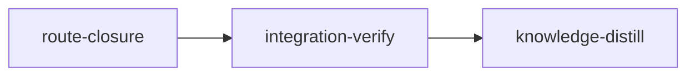

# Plan: Sandbox Route Closure

## Overview

A stage agent's Bash runs inside Claude Code's bubblewrap sandbox, built from loom's per-session capsule, but four routes stay open: tools that run in the Claude Code process outside that sandbox (LSP, RemoteTrigger, CronCreate, PushNotification, Workflow), credential files the read-deny list does not name (`~/.netrc`, `~/.npmrc`, the gh, docker, kube, PyPI and cargo tokens, and `~/.codex/auth.json` for sessions without the codex lane), the git administrative directories of sibling worktrees, which Claude Code's grant of the whole git common directory leaves writable, and manual mode, which prints a bare `claude` command with no word that the session it starts is unconfined. This plan closes them in the capsule, proves each deny on the emitted capsule and under bubblewrap, and writes the live, credentialed canary as a manual release checklist. It carries the security remainder of metaplan section 7 (`doc/plans/optim-token-metaplan.md`) and of the withdrawn `PLAN-sandbox-escape-hardening.md` (`git show e6f00616^:doc/plans/PLAN-sandbox-escape-hardening.md`: decision D4 narrowed to nine files plus its codex credential rule, D5 as the optional tail, and its `sandbox-canary` stage). It does not target tokens.

**Plan dependencies.** Canonical run order of the programme: 3 (`PLAN-01-doctrine-truth-and-plan-guards`), 1 (`PLAN-02-delivery-truth`), 2 (`PLAN-03-usage-evidence`), host verification (`doc/plans/PLAN-host-verification.md`), 4 (`PLAN-04-dependency-findings`), 5 (`PLAN-05-guidance-and-gate-output`), then this plan; one checkout runs one plan. Declared prerequisites: plan 3, whose bookend lints this plan already meets (one knowledge-distill stage with no dependents and every other stage among its ancestors; every standard stage an ancestor of integration-verify), plan 5, which runs first by order, and host verification, which must have merged and been installed (`./dev-install.sh`): the stage's `before_stage` probes its code, never its DONE file, which is git-ignored (`.gitignore:68`) and so never exists in a worktree. After host verification, `loom check`, `loom stage complete` and `loom stage contracts freeze` in a session relay to daemon-run host jobs: criteria, contracts and impact tests run on the host under loom's confinement, where bubblewrap nests, while the session itself can no longer create user namespaces. `loom stage complete` and `loom check` exit 3 while the job is requested or running (run the same command again in the next Bash call), 0 when done, 1 when it failed or the tree is not committed, 4 when cancelled or interrupted (run again). Shared files and what the earlier plans are expected to have changed:

| File | Earlier plan | Expected change | This plan |
| --- | --- | --- | --- |
| `README.md` | 3, 2, host verification, 4, 5 | 3: the memory-capture paragraph, the Fable sentence (about line 1054), the "What confinement adds" blockquote under "### Command Confinement" (about line 1099, inside "## Sandbox Configuration"), the `plan verify` and bookend-lint paragraphs, the `model` row; 2: the review-severity mapping for `--compare` evidence; host verification: the "### Command Confinement" blockquote and the completion and verifier paragraphs; 4: the memory-inheritance sentence (about line 948); 5: the two verifier descriptions and the delegation paragraph | W4 edits only the section's YAML example, its "Note:" paragraph and the first paragraph of "### Session State Confinement", anchored by text |
| `loom/src/orchestrator/terminal/native/session_settings/contents.rs` | host verification | removed the macOS daemon-socket block (8 lines) from `capsule_settings`: the function goes from 50 to 42 lines, the deny `extend_strings` line from `:105` to about `:97`, the file from 321 to about 313 | W1 replaces that deny line one for one; `capsule_settings` stays at most 50 lines |
| `loom/src/sandbox/settings/policy.rs` | host verification | removed the `allowNestedUserNamespaces` opt-out block from `sandbox_settings`; the file returns to 176 lines, and lines 13, 37-50 and 46 are unchanged | W2 replaces `MANDATORY_DENY_READ` and one `deny_read_patterns` line, anchored by symbol |
| `loom/src/sandbox/settings/policy/tests.rs` | host verification | replaced the file's last test with `enabled_sandbox_never_allows_nested_user_namespaces` | W2 rewrites `adds_mandatory_credentials_and_filters_parent_traversal` and adds its tests directly after it, never at the end of the file |
| `loom/src/orchestrator/core/mod.rs` | host verification | its host-jobs W1 edits the orchestrator core for the host-job lifecycle (`src/orchestrator/core/{mod.rs, run.rs, ...}`); its length at 6fee4ecd (347) no longer holds | W4 adds one `mod manual_start;` declaration, anchored by the neighbouring declarations; re-measure |
| `skills/loom-refactoring/SKILL.md`, `agents/*.md`, `skills/loom-plan-writer/*` | 3 (plan-writer), 5 (`agents/*.md`) | no LSP text expected | W1 re-runs `rg -n -w LSP` at run time and edits only the refactoring skill's line |

The metaplan expected a shared `agents/*.md` with plan 5 (tool-route text); the agent definitions name no LSP tool, so this plan edits none of them. No other file this plan edits is edited by plans 1-5 and host verification (the `files` lists of all five plan files, compared on 2026-10-19 after every plan was written, and host verification's, compared on 2026-10-21); host verification shares `README.md`, `contents.rs`, `policy.rs`, `policy/tests.rs` and `orchestrator/core/mod.rs` (rows above). Every brief tells its worker to re-read each file and re-measure its length at run time, and anchors every edit by symbol or text.

**Lanes (operator decision, 2026-10-19).** route-closure lists `["claude", "codex"]`. One codex unit, X1 (gpt-5.6-terra, effort xhigh): the new `orchestrator/core/manual_start.rs`, a single file with pinned signatures and pure unit tests. Every other piece stays on Claude: W1 threads one field through eleven files and converges on `TempDir` capsule tests; W2 changes five files whose lists must agree (haiku, every edit given exactly); W3 is security-sensitive capsule policy proven on real `git worktree add` fixtures (opus); W4 is call-site wiring plus release prose; W5 iterates on a bubblewrap probe. integration-verify and knowledge-distill omit the field.

**Accepted warning.** The knowledge base already describes this tree, so the plan has no bootstrap stage. Until plan 3 merges, `loom plan verify --strict` fails on the bootstrap-recommendation heuristic (`plan/schema/validation.rs:1109-1137`); that one warning is accepted. Plan 3 runs first, so at `loom init` time it no longer fires.

**Briefs live outside `doc/plans/briefs/`.** `extract_brief_paths` (`plan/schema/structural_checks.rs:78`) recognises only that prefix, so `loom plan verify` does not check the briefs under `doc/plans/token-optim/briefs/sandbox-route-closure/`, and `loom run`'s committed-input bundle (`commands/run/plan_inputs/discovery.rs:22`) does not include them. The author checked that every brief path the plan names exists and that every brief written is named; the operator commits the briefs with the plan.

## Goals

- Every capsule denies LSP, RemoteTrigger, CronCreate and PushNotification by bare tool name in `permissions.deny`, and Workflow everywhere except the Stage session of an `ultracode: true` stage. `--disallowedTools` is never used.
- Every capsule read-denies nine credential files as plain paths whatever the plan lists, and `~/.codex/auth.json` unless the stage licenses the codex lane. `CREDENTIAL_DENY_READ_PATHS` keeps its five entries.
- Every capsule write-denies, whole, the administrative directory of every worktree other than the session's own; the own directory, `refs/` and the object store stay writable, and no deny lies beneath another.
- Both manual-mode print sites add a line saying the session runs without the wrapper's confinement.
- Proof on the emitted capsule (unit tests, two frozen contracts), under bubblewrap (a probe the stage's acceptance host job and CI must run), and live (a manual release checklist).
- Non-goals: ref or common-dir denies, sibling worktree read denies, a `Read(` permission rule of any shape, changes to `loom-hooks/credential-guard.sh`, an outer runtime, per-session caches, a capability compiler (metaplan section 7, "Dismissed").

## What the tree shows (verified 2026-10-19 at 6fee4ecd)

| Claim | Evidence | Consequence |
| --- | --- | --- |
| The capsule's permission denies are written in one line of `capsule_settings`, and that function is at most 50 lines: 42 after host verification removed its macOS daemon-socket block | `orchestrator/terminal/native/session_settings/contents.rs:72-113`, `:97` (after host verification; `:72-121`, `:105` at 6fee4ecd) | The tool denies come from a helper the one line calls; the function does not grow |
| `--disallowedTools` is variadic, and the positional prompt follows the capsule flags | `claude --help` (measured on 2.1.302; re-check on the installed version (2.1.306 at the time of this edit) before W3 and W5 rely on it): `--disallowedTools, --disallowed-tools <tools...>`; `orchestrator/terminal/native/mod.rs:174` (`build_claude_command`); `tests_capsule.rs:83-103` checks order only | Tool denies go in `permissions.deny` |
| A blanket Workflow deny breaks ultracode stages | `launch.rs:133-139` (`initial_prompt` licenses Workflow by the prompt keyword when `stage.ultracode`); `orchestrator/signals/format/sections.rs:263` | Workflow is denied unless `kind == Stage && stage.ultracode`, one predicate shared with the prompt |
| `write_capsule` has seven parameters; the license needs the stage | `launch.rs:265-273`; precedent `#[allow(clippy::too_many_arguments)]` at `wrapper.rs:67` | An eighth parameter with the same allow |
| Agent teams and web tools must stay | `wrapper.rs:363` (`CLAUDE_CODE_EXPERIMENTAL_AGENT_TEAMS=1`); `agents/loom-software-engineer.md:4`, `agents/loom-senior-software-engineer.md:4` | SendMessage, ListAgents, WebFetch, WebSearch are never denied |
| No plan-writer or agent text names LSP; one skill does | `rg -n -w LSP`: `skills/loom-refactoring/SKILL.md:90` only (plus a code comment, `fs/knowledge/mod.rs:3`) | The skill line gains one sentence; no agent file changes |
| The credential read list is five entries, also used to strip old mirrors | `fs/permissions/state_root.rs:51-57`, `is_loom_written_read_deny` `:121-126` | A second list, `CREDENTIAL_FILE_DENY_READ_PATHS`, so operator-authored `Read(~/.netrc)` rules stay the operator's |
| The mandatory list is a const alias over the five entries, chained onto borrowed items | `sandbox/settings/policy.rs:13`, `deny_read_patterns` `:37-50` | It becomes `mandatory_deny_read(codex_licensed) -> Vec<&'static str>`: an `impl Iterator<Item = &'static str>` fails to chain there (E0521, measured with rustc on a ten-line program); `filesystem_settings` (ledgered at 52) is untouched |
| The mandatory list reaches capsules only | `build_settings` is called only from `contents.rs:75`; `generate_settings_json` (`sandbox/settings.rs:205`) feeds it | Interactive sessions outside loom are unaffected |
| Two tests pin the mandatory list exactly | `sandbox/settings/policy/tests.rs:33-36`; `sandbox/settings/tests.rs:415-441` (file ledgered at exactly 1565 lines; the const appears only at `:2` and `:436`) | Rewritten; `tests.rs` edited in place, line-neutral |
| Loom denies only each worktree's `config.worktree` in the registry | `sandbox/control_surfaces/session_denies.rs:86-90` | The loop becomes `deny_worktree_admin_dirs` over `partition_admin_dirs` |
| The own directory is the one whose `gitdir` names the worktree | `git/worktree/pinned.rs` `names_work_tree` (`:165-174`, compares a canonical path) and `registered_admin_dir` (`:130-161`, refuses zero or two claimants) | `partition_admin_dirs` canonicalizes the worktree and mirrors that refusal |
| bubblewrap 0.11.1 aborts on a mount point beneath a read-only bind | measured: `--ro-bind D D --ro-bind /dev/null D/absent` exits 1, `Can't create file ... Read-only file system`; the reverse order runs | A sibling denied whole gets no `config.worktree` entry inside it |
| Claude Code 2.1.302 creates `config.worktree` (exclusive create) in each `worktrees/<name>` before denying it and `commondir`, and pushes these denies before the settings' own | bundle strings, `~/.local/share/claude/versions/2.1.302` (measured on 2.1.302; re-check on the installed version (2.1.306 at the time of this edit) before W3 and W5 rely on it) | Its own nested binds name existing files and come first; the live mid-session case is a checklist row |
| The srt emulation appends its Claude Code git denies after the capsule's, and its fixture has no `commondir` | `tests_confinement_srt.rs` `srt_settings` `:146-150`, `claude_code_git_denies` `:189-213`; `tests_confinement_e2e.rs` `repo_with_worktree` `:168-174` | W3 reorders `srt_settings` to Claude Code's order; `tests_confinement_e2e.rs` (400 lines) is not edited. These tests skip without `srt` and `socat`; CI installs neither |
| Sessions start where the registry expects | Stage, Contract and Merge through `orchestrator/terminal/backend.rs` `spawn_worktree_session`; the resolver merges in its own worktree (`orchestrator/signals/merge.rs:205-223`, `format_merge_task`) | The Merge kind keeps its own directory writable |
| Two manual print sites print a bare `claude` | `orchestrator/core/stage_spawn.rs:377-398` (398-line file); `stage_knowledge.rs:57-66`; `rg 'claude \\"' src` finds no third | One pure builder per site, tested |
| Relative `deny_read` entries never reach the OS sandbox | `policy.rs:46` | The README example's two `../` entries are removed |
| Capsule internals are crate-private; the capsule's base document is public | `sandbox/mod.rs:15-17,29` (`merge_config`, `generate_settings_json` are `pub`); `tests/integration/capsule.rs` | Contracts cover the credential behaviour through the public API; the rest is unit-tested in-crate |
| `tests/*.rs` targets are discovered automatically | `loom/Cargo.toml` lists only `e2e`, `integration` and `adjudication_e2e` as `[[test]]` and sets no `autotests = false` | `tests/sandbox_route_contracts.rs` needs no manifest edit |
| Test files near the limit | `tests_session_settings.rs` 397, `tests_launch_capsule.rs` 357, `tests_session_denies.rs` 320, `tests_confinement_e2e.rs` 400 | Visibility edits in place, a split helper instead of a copied body, and a new `tests_admin_dir_denies.rs` for the session-level admin tests |
| The shared capsule fixture keeps three fields private | `tests_session_settings.rs:170-179` (`work_dir`, `scratch_root`, `tmp_root`) | W1 makes them `pub(super)` in place for its capsule-level Workflow test |

## Execution Diagram



## Stages

### 1. route-closure (standard)

One implementation stage. Stage Necessity Test: Q1 no (nothing merges between the pieces), Q2 no (the worker territories are disjoint), Q3 no (integration-verify is the checkpoint), Q4 no (35 files, most of them small, mechanical edits). The bubblewrap probe reads the capsule the other pieces produce, and W4 wires the module X1 writes: compile- and run-order dependencies inside the stage, handled by waves.

- **Foundation (main agent, before any spawn, BLOCK-B point 1: four lines in two files).** Create `src/orchestrator/terminal/native/tests_capsule_bwrap.rs` holding one `//!` line, and append to `tests_capsule_denies.rs` the three lines `#[cfg(target_os = "linux")]`, `#[path = "tests_capsule_bwrap.rs"]`, `mod bwrap;`, so wave 1 compiles with W5's module declared.
- **Wave 1A (background, one message).** W1 tool routes (sonnet), W2 credentials (haiku), W3 sibling administrative directories (opus, security-sensitive).
- **Wave 1B (foreground, next message).** X1, the manual-mode line builders, through one `loom-codex-forwarder` (codex terra, xhigh).
- **Wave 1C (background, after X1 returns).** W4 manual-mode call sites, module declaration and release docs (sonnet); its check runs X1's tests. One `loom subagents watch` waits on W1-W4.
- **Wave 2.** W5 bubblewrap probe (sonnet), after wave 1 builds.
- **Then.** `rustfmt --check` on the frozen contract file, `cargo fmt --all`, the maintainability test, one `loom-verifier` round with the full pre-push gate, mutation of each contract, review rounds, one `dispute-integrity` for the expected events, commit, complete.

Briefs: `doc/plans/token-optim/briefs/sandbox-route-closure/common.md` (shared facts, lanes and size limits) and one per worker under `doc/plans/token-optim/briefs/sandbox-route-closure/route-closure/`.

**Risk checklist walk.**

| Area | Applies | Covered by |
| --- | --- | --- |
| 1 Untrusted input | the worktree registry's `gitdir` files, which a session could rewrite before this plan, and its own directory's after it | `partition_admin_dirs` refuses zero or two claimants (`two_directories_claiming_one_worktree_are_refused`, `an_unregistered_worktree_beside_registered_ones_is_refused`); `literal` refuses glob characters (existing `a_path_no_rule_can_name_literally_refuses_the_spawn`) |
| 2 Filesystem paths and symlinks | the own directory reached through a symlinked path; symlinked registry entries; a credential reached through a symlink | `the_own_directory_is_found_through_a_symlinked_path`; existing `every_admin_directory_is_listed_and_symlinks_are_not`; checklist row 5 |
| 3 Process I/O volume and scale | one bounded `read_dir` of the registry per spawn; no new process at spawn | by design; no contract |
| 4 Configuration propagation | `implementers` decides the codex credential deny; `ultracode` decides Workflow; an explicit plan `deny_read` must not drop the credential files | contracts `credential-files-denied-whatever-the-plan-lists` and `codex-auth-denied-unless-codex-licensed`; `an_ultracode_stage_session_launches_with_the_workflow_tool_and_no_other_kind_does` (a constant `workflow_licensed` fails it) |
| 5 Lifecycle and concurrency | a sibling merges while this session lives, so its deny names a vanished path; a worktree added after spawn | `no_admin_dir_deny_lies_beneath_another_deny`; the bubblewrap probe (an absent-file bind beneath a denied directory aborts it); checklist row 8; existing `check_worktree_config` for later worktrees |
| 6 Reachability | the helpers must be reached from the launch path | `reachable` entries below; capsule tests through `write_session_capsule` and `prepare_session_launch_with` |
| 7 External data correctness | Claude Code tool names; git's registry layout | tool names from the installed claude's tool list and `concerns/sandbox-and-confinement-gaps.md`; fixtures made with real `git worktree add` |

**Expected integrity events.** The plan changes behaviour that four existing tests pin, so their assertion changes are the plan's: `src/sandbox/settings/policy/tests.rs` (`adds_mandatory_credentials_and_filters_parent_traversal`), `src/sandbox/control_surfaces/tests_session_denies.rs` (`every_worktrees_config_worktree_is_denied_to_every_session_kind`, deleted; its replacement is in the new `tests_admin_dir_denies.rs`), `src/orchestrator/terminal/native/tests_capsule_denies.rs` (`every_session_kind_denies_every_worktrees_config_worktree`, rewritten), and possibly `src/sandbox/settings/tests.rs` (one line inside an `assert_eq!`). No `maintainability-baseline.txt` row changes.

**Acceptance baseline at 6fee4ecd.** The build, lint, format and doc commands exit 0 at base. The new test filters (`orchestrator::core::manual_start::`, `tests_capsule_routes::`, `tests_capsule_denies::bwrap::`) select no test at base, and cargo exits 0 on an empty selection, so four `cargo test --lib -- --list | rg -qF` criteria prove each new test module is compiled into the test binary with its key test; they fail at base, as do the `reachable` checks and the contract target (`cargo test --test sandbox_route_contracts` names no target at base). After host verification the bubblewrap probe always prints SKIP in a session, whose shell cannot create user namespaces; the stage's acceptance runs it as a host job, where bubblewrap nests, with `LOOM_TEST_REQUIRE_BWRAP=1`, so a skip fails the criterion, and CI runs it the same way.

### 2. integration-verify

The full pre-push gate on the merged tree, review (security, architecture, test coverage), and a record of whether the bubblewrap probe and the srt e2e ran or skipped: in the session's shell the probe always skips after host verification; its acceptance run is a host job. It cannot observe the new denies live: every session of this plan runs under the capsule the pre-plan binary builds.

### 3. knowledge-distill

Curates the stage memories, applies every `stale-knowledge:` note first, and rewrites the sandbox knowledge sections this plan changes to current truth.

## Coverage of metaplan section 7

| Item | Where |
| --- | --- |
| Tool routes: `permissions.deny` entries for LSP, RemoteTrigger, CronCreate, PushNotification, Workflow | route-closure W1 (Workflow kept for ultracode Stage sessions: deviation 1) |
| No `--disallowedTools`; WebFetch, WebSearch, SendMessage, ListAgents stay; no `Read(` deny | W1 and common.md; `the_agent_team_web_and_core_tools_stay_allowed` |
| The brief greps the plan-writer and agents for LSP and changes the text | W1 step 8, re-run at run time (deviation 2) |
| Credentials: a second const consumed by the mandatory list and `default_deny_read`; `CREDENTIAL_DENY_READ_PATHS` unchanged; codex credential only without the lane; plain paths | W2; contracts (deviation 3) |
| Sibling worktree metadata: whole-directory denies through the `worktree_admin_dirs` loop; own entry, `refs/`, objects writable; every new `denyWrite` names a path that exists at spawn | W3; probe W5 (deviation 4) |
| Ref and common-dir denies out of scope | Non-goal (deviation 5) |
| Manual mode: one line at each print site | X1 (builders), W4 (call sites) |
| Optional tail: sibling worktree reads | Not built (deviation 6); checklist row 14 and the measurement paragraph |
| Acceptance: a unit test per new deny on the emitted capsule, tool names included | W1, W2, W3 tests |
| Acceptance: a bubblewrap-only probe in a new test file | W5 |
| Acceptance: a test for the manual-mode line | X1's tests, run by W4 and the acceptance |
| Acceptance: the gate | route-closure acceptance plus its verifier round; integration-verify (deviation 7) |
| A live, credentialed canary as a manual release checklist | W4, `doc/sandbox-release-checklist.md` |
| Dismissed: capability compiler, outer runtime, ephemeral HOME, disabling agent teams and Remote Control, a secure planning session, a `CapabilityDenied` flow, per-session package caches, knowledge stages in a worktree | Not built, per the metaplan |

Disposition rows that name this plan (metaplan, "Disposition of the retired source documents", overhead-reduction proposal):

| Row | Where |
| --- | --- |
| §5.8, 5.10 Tool routes outside the Bash sandbox | W1 |
| §5 Raw manual launch strings | X1, W4 |
| §3.4, 5.7 Read confinement beyond a denylist (credential denylist; sibling reads as optional tail) | W2; tail not built (deviation 6) |
| §5.9 Shared git control plane (sibling admin dirs; ref denies; broker dismissed) | W3; ref denies out (deviation 5); no broker |
| §5.12 Adversarial canary matrix (capsule unit tests, bubblewrap probe, manual checklist) | W1-W3 tests, W5, W4's checklist |
| §7.2 Knowledge stage in an isolated workspace (dismissed) | Not built |

## Deviations from the metaplan (the tree wins)

1. **Workflow.** The metaplan denies Workflow in every capsule. The tree licenses it for ultracode stages (`launch.rs:133-139`, `signals/format/sections.rs:263`), so a blanket deny would break a shipped feature. The capsule denies it everywhere except the Stage session of an `ultracode: true` stage, through the same predicate the prompt keyword uses.
2. **LSP text.** The metaplan expects LSP text in the plan-writer and the agent definitions. `rg -n -w LSP` finds none there; `skills/loom-refactoring/SKILL.md:90` recommends LSP renames and gains one sentence. No `agents/*.md` file changes, so plan 5 and this plan share no file.
3. **The mandatory list.** "A second const consumed by `MANDATORY_DENY_READ`": that name is a const alias over one array (`policy.rs:13`), which cannot also hold a conditional entry. It becomes `mandatory_deny_read(codex_licensed)`, chaining both lists and the codex credential into a `Vec`; the second const is `CREDENTIAL_FILE_DENY_READ_PATHS`.
4. **No nested denies.** Measured: bubblewrap aborts when a deny's mount point lies beneath a read-only bind. A sibling denied whole therefore loses its separate `config.worktree` deny, which the existing loop emitted, and two tests change. The own directory keeps it. A worktree-rooted capsule whose worktree no registry entry records, or that two entries claim, now refuses the spawn, mirroring `registered_admin_dir`. The srt emulation's order is corrected to Claude Code's for the same reason.
5. **Why ref denies stay out.** The metaplan's reason ("while stages commit in-session"; "they need the withdrawn D1") is out of date: commits are daemon-owned (`git/stage_commit.rs`, `orchestrator/core/inbox_drain/commit.rs`). Sessions still write the object store and their own index with `git add`, and nobody measured a `refs/` deny under the current grant, so the plan keeps ref denies out and records the question.
6. **The optional tail is not built.** Its gain is small: the main checkout, untracked operator files included, stays readable by design. A wrong re-allow would leave every worktree session unable to read its own tree, and no gate in this repository runs a live Claude Code sandbox to catch it. The release checklist records the measurement a later plan needs first.
7. **The gate in acceptance.** "Every code stage runs the pre-push gate": the stage's acceptance carries every gate command except the unfiltered `cargo test --all-targets --no-fail-fast`, because `loom plan verify` warns on an unfiltered suite outside integration-verify (`plan/schema/validation_suite.rs`) and `--strict` fails on that warning. That run is in the stage's `loom-verifier` round, briefed verbatim, and in integration-verify's acceptance.
8. **Auto-memory.** The metaplan cites `capsule.rs:30-120` for disabled auto-memory; the wrapper sets it (`wrapper.rs:364`, `CLAUDE_CODE_DISABLE_AUTO_MEMORY=1`). No plan change follows.

## Before `loom run` (operator)

- Plans 3, 1, 2, host verification, 4 and 5 have merged, and their installed assets were refreshed with `./dev-install.sh`. Host verification's binary must be the installed one: this plan's criteria then run in host jobs, where bubblewrap nests.
- Commit this plan and every file under `doc/plans/token-optim/briefs/sandbox-route-closure/`.
- The codex CLI and plugin are installed (checked 2026-10-19). If the stage signal says its sandbox has no network access, X1 goes to W4 from the start (knowledge `mistakes/codex-worker-briefing.md`, "The Codex Lane Fails Inside a Stage Sandbox With No Network"); listing codex adds its domains to the stage sandbox.

## After the plan (operator)

- Run `./dev-install.sh` so new sessions get the new capsule.
- Run `doc/sandbox-release-checklist.md` before the next release; it is the only live proof of these denies.

---

<!-- loom METADATA -->

```yaml
loom:
  version: 2
  ratchet_files:
    - loom/maintainability-baseline.txt
    - doc/loom/knowledge/check-baseline.txt
  provision:
    - working_dir: "web"
      command: "test ! -e .npmrc && test ! -L .npmrc && bun install --frozen-lockfile --ignore-scripts --backend=copyfile --config=/dev/null"
  sandbox:
    enabled: true
    auto_allow: true
    filesystem:
      deny_read: ["~/.ssh/**", "~/.aws/**", "~/.config/gcloud/**", "~/.gnupg/**"]
    network:
      allowed_domains: ["crates.io", "index.crates.io", "static.crates.io", "registry.npmjs.org"]
      allow_local_binding: false
      allow_unix_sockets: []
  stages:
    - id: route-closure
      name: "Close the capsule's open tool, credential, worktree and manual-mode routes"
      summary: "Denies the out-of-sandbox tools, nine credential files and sibling worktree git directories in every session capsule, marks manual-mode starts as unconfined, and adds a bubblewrap probe and a release checklist."
      stage_type: standard
      skills: ["loom-rust", "loom-security-audit"]
      implementers: ["claude", "codex"]
      subagent_timeout_secs: 900
      working_dir: "loom"
      dependencies: []
      before_stage:
        - command: "rg -qF 'pub mod host_verify;' src/lib.rs"
          description: "host verification has merged"
        - command: "! rg -qF 'allowNestedUserNamespaces' src/sandbox/settings/policy.rs"
          description: "host verification removed the nested user-namespace opt-out"
      description: |
        Build stage 1 of doc/plans/token-optim/PLAN-06-sandbox-route-closure.md (renamed with an IN_PROGRESS- prefix once loom run starts).
        Use parallel subagents and skills to maximize performance.
        PATHS: working_dir is loom/. YAML paths and the worker table are relative to loom/ (../ for files outside the crate); brief paths are repo-relative from the worktree root. Every worker reads doc/plans/token-optim/briefs/sandbox-route-closure/common.md first, then its own brief. common.md holds the facts measured while planning, the lanes and the size limits; the YAML is authoritative where they differ.
        EARLIER PLANS: plans 3, 1, 2, host verification, 4 and 5 merged before this one (before_stage probes host verification's code). Plan 3 edited README.md (including the Command Confinement blockquote in the Sandbox Configuration section) and the plan-writer skill; host verification edited the same blockquote and the completion and verifier paragraphs, removed the macOS daemon-socket block from capsule_settings (now 42 lines), removed the nested user-namespace opt-out from policy.rs::sandbox_settings, replaced the last test of policy/tests.rs and edited src/orchestrator/core/mod.rs; plans 2, 4 and 5 edited other README.md paragraphs, and plan 5 edited agents/*.md. Since host verification, loom check and loom stage complete in this session relay to host jobs: exit 3 means run the same command again in the next Bash call, 0 done, 1 failed or not committed, 4 cancelled or interrupted (run again). Re-read each file before it is briefed, and re-measure lengths; every brief anchors by symbol or text.
        CLAUDE CODE FACTS: common.md's Claude Code facts were measured on 2.1.302. Before spawning W3 and W5, re-check them on the installed version (claude --version; 2.1.306 at the time of the plan's last edit): the bundle under ~/.local/share/claude/versions/<version> still creates config.worktree before denying it and still pushes its built-in denies before the settings' own. Put any difference in W3's and W5's spawn prompts and record it with loom memory note.
        LANES: implementers lists claude and codex. X1 is the one codex unit; every other worker is Claude. subagent_timeout_secs is 900 because a foreground forward is one Bash call of up to 540 s that posts no output, and workers run crate-wide test builds. Territories are DISJOINT across both lanes; workers never spawn subagents.
        FOUNDATION (you, before any spawn, four lines in two files): create src/orchestrator/terminal/native/tests_capsule_bwrap.rs holding one line, //! The bubblewrap probe of the emitted capsule (written in wave 2). Append to src/orchestrator/terminal/native/tests_capsule_denies.rs the three lines #[cfg(target_os = "linux")], #[path = "tests_capsule_bwrap.rs"], mod bwrap; then run cargo build --tests.
        WAVE 1A (background): spawn W1 (loom-software-engineer, sonnet), W2 (loom-software-engineer with model haiku) and W3 (loom-senior-software-engineer) BY AGENT TYPE, without name, ALL in ONE message, each with a short fixed prompt plus "Your brief: <path>. Read it in full before anything else." Capture each agent id.
        WAVE 1B (foreground, the next message): spawn one loom-codex-forwarder BY AGENT TYPE in the FOREGROUND, without name (never the plugin's codex:codex-rescue), with an explicit Bash timeout of 600000 ms. Its prompt is these five lines:
          LOOM-CODEX-FORWARD-ONLY
          --model gpt-5.6-terra --effort xhigh
          --unit-id x1-manual-start
          Bash timeout: 600000 ms
          Implement the unit in doc/plans/token-optim/briefs/sandbox-route-closure/route-closure/x1-manual-start.md. Read that file in full first and follow it exactly. Write only the file it assigns. Run no git and no cargo command.
        Keep the task line free of apostrophes, of the substring complete and of the phrase loom stage: the forward guards block them. Codex runs no git and writes nothing in the shared state directory; loom's hooks never see its commands, so you are the backstop. On Linux after host verification the session cannot nest bubblewrap, so the forward runs in direct mode (codex exec --sandbox danger-full-access) and the stage sandbox is codex's only boundary; its evidence block shows mode: direct and thread:, not job: or record:, and direct mode writes no companion job record, so any wait on the forwarder uses --worker claude:<forwarder agent id>. X1 runs while W1-W3 write, so record git diff --stat -- <every file W1, W2 and W3 own> right before the forward and again after it; W1-W3 are still writing, so every difference must match an edit their reports claim, and one no report claims is treated as codex's; after it returns, git status --short must show manual_start.rs as the only file outside W1-W3's territories. A report that is not a clean success (no LOOM-FORWARD-END, a LOOM-CODEX-FORWARD-ERROR, any non-zero exit, or timed_out with exit 124) is never re-forwarded as is: W4's prompt then also names doc/plans/token-optim/briefs/sandbox-route-closure/route-closure/x1-manual-start.md, and W4 owns src/orchestrator/core/manual_start.rs as well. If this stage's signal says the sandbox has no network access, skip the forward and give W4 that brief from the start.
        WAVE 1C (background): once X1 has returned, spawn W4 (loom-software-engineer, sonnet) the same way as wave 1A. W4 declares mod manual_start, wires both print sites, and its check runs X1's tests, which is that unit's proof. Then wait on W1, W2, W3 and W4 with ONE background loom subagents watch, one --worker claude:<agent id> per worker, --timeout 3600.
        WAVE 2: after wave 1, run cargo build --tests yourself and route any compile error to a fresh worker of the owning territory. Then spawn W5 (loom-software-engineer, sonnet) the same way and wait with one background loom subagents watch. W5's shell cannot nest bubblewrap, so its check prints SKIP; the first real run of the probe is loom check route-closure (a host job; the acceptance runs it with LOOM_TEST_REQUIRE_BWRAP=1, so a skip fails): run it after W5 returns, running the same command again on exit 3, and read the probe criterion's log; a probe failure becomes a fix brief to a fresh worker of W5's territory, quoting the log.
        AFTER THE WAVES: rustfmt --check --edition 2021 tests/sandbox_route_contracts.rs (a frozen file the formatter would rewrite fails completion; a failure there is a dispute-contract, never an edit); cargo fmt --all; cargo test --test maintainability; wc -l src/sandbox/settings/tests.rs must print 1565, and src/orchestrator/core/stage_spawn.rs, src/orchestrator/terminal/native/tests_session_settings.rs, src/orchestrator/terminal/native/tests_launch_capsule.rs and src/sandbox/control_surfaces/tests_session_denies.rs must each be at or under 400. Route any failure to a fresh worker of the owning territory. Then one loom-verifier round briefed with the repository's pre-push gate verbatim, run from loom/: cargo build; cargo test --all-targets --no-fail-fast; cargo test --doc --workspace --all-features -- --test-threads=1; cargo clippy --all-targets -- -D warnings; cargo fmt --check; RUSTDOCFLAGS='-D warnings' cargo doc --workspace --all-features --no-deps; plus this stage's acceptance list. The acceptance runs scoped test filters because loom plan verify warns on an unfiltered suite outside integration-verify, so the full suite lives in the verifier round. cargo audit is not briefed: the stage adds no dependency. No loom-hooks file changes, so the hook steps do not apply. Each FAIL becomes a fix brief to a fresh worker of the owning territory; then a FRESH verifier.
        MUTATION: before the final review round, for each contract apply the wrong implementation its rejects text names (move the credential files into default_deny_read only; make the codex credential deny unconditional), confirm the contract fails, restore from a copy kept under $LOOM_SCRATCH_DIR (never git checkout), and record loom memory note "mutation: <contract id> red under <mutation>".
        INTEGRITY: four existing tests pin behaviour this stage changes on purpose (the plan's "Expected integrity events"). After the final review round, run loom stage review integrity route-closure and file ONE loom stage dispute-integrity naming every TI-edit event on src/sandbox/settings/policy/tests.rs, src/sandbox/settings/tests.rs, src/sandbox/control_surfaces/tests_session_denies.rs and src/orchestrator/terminal/native/tests_capsule_denies.rs, with the reason: "The plan adds credential files and the conditional codex credential to the mandatory read denies, and replaces the per-file config.worktree deny of sibling worktrees with a whole-directory deny; these assertions pinned the old lists, and the deleted session-level test is replaced in tests_admin_dir_denies.rs." Any other event is a defect to fix, not to dispute. No maintainability-baseline.txt row changes.
        CONTRACT SURFACE (the contract session writes tests/sandbox_route_contracts.rs from this text before any code; each contract is a top-level #[test] fn named as its test field, selected by cargo test <name> -- --exact; keep the file rustfmt-clean, every fn under 50 lines, the file under 400): the public API is loom::sandbox::merge_config(&SandboxConfig, &StageSandboxConfig, StageType, &Implementers) -> MergedSandboxConfig and loom::sandbox::generate_settings_json(&MergedSandboxConfig) -> serde_json::Value, with loom::plan::schema::{FilesystemConfig, SandboxConfig, StageSandboxConfig} and loom::models::stage::{Implementer, Implementers, StageType}, the imports tests/integration/capsule.rs uses plus FilesystemConfig (fields deny_read, deny_write, allow_write, all Vec<String>) for the plan's own list. The read denies are the JSON array at pointer /sandbox/filesystem/denyRead. The nine credential files, exact strings: ~/.config/gh/hosts.yml, ~/.netrc, ~/.npmrc, ~/.git-credentials, ~/.docker/config.json, ~/.kube/config, ~/.pypirc, ~/.cargo/credentials.toml, ~/.cargo/credentials. The codex credential: ~/.codex/auth.json. Contracts are red at freeze because the base emits none of these entries.
        MEMORY: record mistakes, decisions and surprises via loom memory immediately (subagents too); NEVER loom knowledge (implementation stage); NEVER Claude Code auto-memory. Record any knowledge section the tree contradicts as loom memory note "stale-knowledge: <file>#<heading> claims X; the tree does Y (file:line). Correction: <text>".

        | Worker | Role | Tier | Files owned | Shared context | Brief path |
        | ------ | ---- | ---- | ----------- | -------------- | ---------- |
        | W1 | Tool-route denies and the Workflow license (wave 1A) | sonnet | src/orchestrator/terminal/native/session_settings/contents.rs; src/orchestrator/terminal/native/session_settings.rs; src/orchestrator/terminal/native/launch.rs; src/orchestrator/terminal/native/tests_session_settings.rs; src/orchestrator/terminal/native/tests_capsule_contents.rs; src/orchestrator/terminal/native/tests_capsule_cwd_grants.rs; src/orchestrator/terminal/native/tests_capsule_interpreters.rs; src/orchestrator/terminal/native/tests_capsule.rs; src/orchestrator/terminal/native/tests_capsule_routes.rs; src/orchestrator/terminal/native/tests_launch_capsule.rs; ../skills/loom-refactoring/SKILL.md | common.md | doc/plans/token-optim/briefs/sandbox-route-closure/route-closure/w1-tool-routes.md |
        | W2 | Credential read denies (wave 1A) | haiku | src/fs/permissions/state_root.rs; src/sandbox/settings/policy.rs; src/sandbox/settings/policy/tests.rs; src/sandbox/settings/tests.rs; src/models/stage/sandbox_config.rs | common.md | doc/plans/token-optim/briefs/sandbox-route-closure/route-closure/w2-credentials.md |
        | W3 | Sibling administrative directory denies (wave 1A) | opus | src/git/worktree/pinned.rs; src/git/worktree/config_worktree.rs; src/git/worktree/config_worktree_tests.rs; src/git/worktree/mod.rs; src/sandbox/control_surfaces/session_denies.rs; src/sandbox/control_surfaces/tests_session_denies.rs; src/sandbox/control_surfaces/tests_admin_dir_denies.rs; src/orchestrator/terminal/native/tests_capsule_denies.rs; src/orchestrator/terminal/native/tests_confinement_srt.rs | common.md | doc/plans/token-optim/briefs/sandbox-route-closure/route-closure/w3-worktree-admin.md |
        | X1 | Manual-mode line builders (wave 1B) | codex terra | src/orchestrator/core/manual_start.rs | common.md; stage_spawn.rs and stage_knowledge.rs read-only | doc/plans/token-optim/briefs/sandbox-route-closure/route-closure/x1-manual-start.md |
        | W4 | Manual-mode call sites and release docs (wave 1C) | sonnet | src/orchestrator/core/mod.rs; src/orchestrator/core/stage_spawn.rs; src/orchestrator/core/stage_knowledge.rs; ../doc/sandbox-release-checklist.md; ../CONTRIBUTING.md; ../README.md | common.md; manual_start.rs read-only | doc/plans/token-optim/briefs/sandbox-route-closure/route-closure/w4-manual-and-docs.md |
        | W5 | Bubblewrap probe (wave 2) | sonnet | src/orchestrator/terminal/native/tests_capsule_bwrap.rs; ../.github/workflows/ci.yml | common.md | doc/plans/token-optim/briefs/sandbox-route-closure/route-closure/w5-bwrap-probe.md |
      files:
        - "src/orchestrator/terminal/native/session_settings/contents.rs"
        - "src/orchestrator/terminal/native/session_settings.rs"
        - "src/orchestrator/terminal/native/launch.rs"
        - "src/orchestrator/terminal/native/tests_session_settings.rs"
        - "src/orchestrator/terminal/native/tests_capsule_contents.rs"
        - "src/orchestrator/terminal/native/tests_capsule_cwd_grants.rs"
        - "src/orchestrator/terminal/native/tests_capsule_interpreters.rs"
        - "src/orchestrator/terminal/native/tests_capsule.rs"
        - "src/orchestrator/terminal/native/tests_capsule_routes.rs"
        - "src/orchestrator/terminal/native/tests_launch_capsule.rs"
        - "src/orchestrator/terminal/native/tests_capsule_denies.rs"
        - "src/orchestrator/terminal/native/tests_capsule_bwrap.rs"
        - "src/orchestrator/terminal/native/tests_confinement_srt.rs"
        - "src/fs/permissions/state_root.rs"
        - "src/sandbox/settings/policy.rs"
        - "src/sandbox/settings/policy/tests.rs"
        - "src/sandbox/settings/tests.rs"
        - "src/models/stage/sandbox_config.rs"
        - "src/git/worktree/pinned.rs"
        - "src/git/worktree/config_worktree.rs"
        - "src/git/worktree/config_worktree_tests.rs"
        - "src/git/worktree/mod.rs"
        - "src/sandbox/control_surfaces/session_denies.rs"
        - "src/sandbox/control_surfaces/tests_session_denies.rs"
        - "src/sandbox/control_surfaces/tests_admin_dir_denies.rs"
        - "src/orchestrator/core/manual_start.rs"
        - "src/orchestrator/core/mod.rs"
        - "src/orchestrator/core/stage_spawn.rs"
        - "src/orchestrator/core/stage_knowledge.rs"
        - "tests/sandbox_route_contracts.rs"
        - "../skills/loom-refactoring/SKILL.md"
        - "../doc/sandbox-release-checklist.md"
        - "../CONTRIBUTING.md"
        - "../README.md"
        - "../.github/workflows/ci.yml"
      acceptance:
        - "cargo build"
        - "cargo test --test sandbox_route_contracts"
        - "cargo test --lib sandbox::"
        - "cargo test --lib git::worktree::"
        - "cargo test --lib fs::permissions::state_root::"
        - "cargo test --lib orchestrator::terminal::native::"
        - "cargo test --lib orchestrator::core::manual_start::"
        - "cargo test --lib tests_capsule_routes::"
        - "LOOM_TEST_REQUIRE_BWRAP=1 cargo test --lib tests_capsule_denies::bwrap::"
        - "cargo test --lib -- --list | rg -qF 'manual_start::tests::the_stage_start_command_is_followed_by_the_confinement_notice: test'"
        - "cargo test --lib -- --list | rg -qF 'tests_capsule_routes::every_kind_denies_the_tool_routes_outside_the_bash_sandbox: test'"
        - "cargo test --lib -- --list | rg -qF 'tests_capsule_denies::bwrap::sibling_admin_dirs_refuse_writes_and_the_own_dir_takes_them: test'"
        - "cargo test --lib -- --list | rg -qF 'tests_admin_dir_denies::no_admin_dir_deny_lies_beneath_another_deny: test'"
        - "cargo test --test integration capsule"
        - "cargo test --test maintainability"
        - "cargo test --doc --workspace --all-features -- --test-threads=1"
        - "cargo clippy --all-targets -- -D warnings"
        - "cargo fmt --check"
        - "RUSTDOCFLAGS='-D warnings' cargo doc --workspace --all-features --no-deps"
        - "rg -qF 'LOOM_TEST_REQUIRE_BWRAP' ../.github/workflows/ci.yml"
        - "rg -qF 'RemoteTrigger' ../doc/sandbox-release-checklist.md"
        - "rg -qF 'sandbox-release-checklist.md' ../CONTRIBUTING.md"
        - "rg -qF 'sandbox-release-checklist.md' ../README.md"
        - "cd .. && web/node_modules/.bin/markdownlint-cli2 README.md CONTRIBUTING.md doc/sandbox-release-checklist.md"
        - "cd .. && web/node_modules/.bin/markdownlint-cli2 doc/sandbox-release-checklist.md 2>&1 | rg -q 'markdownlint-cli2 v'"
      after_stage:
        - command: "test -f src/orchestrator/core/manual_start.rs"
          description: "the manual-mode line builders exist"
        - command: "! rg -qF 'allowNestedUserNamespaces' src/sandbox/settings/policy.rs"
          description: "the credential edits to policy.rs did not bring back the nested user-namespace opt-out"
      wiring:
        - source: "src/orchestrator/terminal/native/session_settings/contents.rs"
          pattern: "capsule_deny_rules(inputs)"
          literal: true
          description: "capsule_settings writes the permission denies through the helper that adds the tool routes"
        - source: "src/sandbox/control_surfaces/session_denies.rs"
          pattern: "deny_worktree_admin_dirs(&mut denies, repo, inputs.worktree)"
          literal: true
          description: "session_denies denies the sibling administrative directories"
        - source: "src/orchestrator/terminal/native/launch.rs"
          pattern: "workflow_licensed(kind, stage)"
          literal: true
          description: "the launch sets the capsule's Workflow license from the same predicate as the prompt keyword"
        - source: "src/orchestrator/terminal/native/session_settings.rs"
          pattern: "workflow_licensed: request.workflow_licensed"
          literal: true
          description: "the capsule request carries the Workflow license into the capsule document"
        - source: "src/sandbox/settings/policy.rs"
          pattern: "CREDENTIAL_FILE_DENY_READ_PATHS"
          literal: true
          description: "the mandatory read denies chain the credential files"
        - source: "src/models/stage/sandbox_config.rs"
          pattern: "CREDENTIAL_FILE_DENY_READ_PATHS"
          literal: true
          description: "the plan default deny_read lists the credential files"
        - source: "src/orchestrator/core/stage_spawn.rs"
          pattern: "manual_start::manual_stage_start_lines("
          literal: true
          description: "the manual stage start prints through the builder that adds the confinement notice"
        - source: "src/orchestrator/core/stage_knowledge.rs"
          pattern: "manual_start::manual_knowledge_start_lines("
          literal: true
          description: "the manual knowledge start prints through the builder that adds the confinement notice"
      reachable:
        - symbol: capsule_deny_rules
          from: prepare_session_launch_with
          description: "the tool denies are reached from the session launch"
        - symbol: partition_admin_dirs
          from: write_session_capsule
          description: "the sibling administrative directory denies are computed for every capsule"
        - symbol: mandatory_deny_read
          from: generate_settings_json
          description: "the mandatory read denies feed the capsule's base document"
        - symbol: manual_stage_start_lines
          from: spawn_stage_agent
          description: "a manual stage start prints the confinement notice"
        - symbol: manual_knowledge_start_lines
          from: spawn_knowledge_worker
          description: "a manual knowledge start prints the confinement notice"
      contracts:
        - id: credential-files-denied-whatever-the-plan-lists
          file: tests/sandbox_route_contracts.rs
          test: credential_files_are_read_denied_whatever_the_plan_lists
          scenario: 'builds a plan SandboxConfig whose filesystem is FilesystemConfig { deny_read: vec!["~/.ssh/**"], deny_write: vec![], allow_write: vec![] } and every other field from SandboxConfig::default(), merges it with merge_config(&plan, &StageSandboxConfig::default(), StageType::Standard, &Implementers::default()), calls generate_settings_json and asserts that /sandbox/filesystem/denyRead holds each of the nine credential file strings exactly'
          rejects: "an implementation that adds the credential files only to default_deny_read, so a plan that lists its own deny_read loses them, or one that denies them by glob (~/.docker/**) instead of the nine plain paths"
        - id: codex-auth-denied-unless-codex-licensed
          file: tests/sandbox_route_contracts.rs
          test: codex_auth_is_read_denied_unless_the_stage_licenses_codex
          scenario: "calls generate_settings_json on merge_config(&SandboxConfig::default(), &StageSandboxConfig::default(), StageType::Standard, &Implementers::default()) and asserts /sandbox/filesystem/denyRead holds ~/.codex/auth.json, then on the same config built with Implementers::new(vec![Implementer::Claude, Implementer::Codex]) and asserts it does not"
          rejects: "an unconditional ~/.codex/auth.json deny, which stops a codex-licensed stage from reading and refreshing its token, or no codex credential deny at all"

    - id: integration-verify
      name: "Integration Verification"
      summary: "Confirms the new capsule denies, the manual-mode notice and the bubblewrap probe hold on the merged tree, and the full suite passes."
      stage_type: integration-verify
      skills: ["loom-rust", "loom-security-audit"]
      working_dir: "loom"
      dependencies: ["route-closure"]
      description: |
        Final verification of doc/plans/token-optim/PLAN-06-sandbox-route-closure.md (IN_PROGRESS- prefixed while it runs). Verify FUNCTIONAL INTEGRATION, not only tests passing. NEVER Claude Code auto-memory.
        Use parallel subagents and skills to maximize performance.
        CONTEXT: read the plan, doc/plans/token-optim/briefs/sandbox-route-closure/common.md, loom memory show --all, and the knowledge sections the plan cites (concerns/sandbox-and-confinement-gaps.md "Tool Routes That Run Outside the Bash Sandbox", "Credential Reads Are Confined to Five Home Paths", "A Stage Agent's Bash Allow-List Reaches Outside the Worktree"; architecture/execution-containment.md "Claude Code Grants a Linked Worktree Its Whole Git Common Directory"). This session runs under the capsule the pre-plan binary built, so the new denies cannot be observed live here; the release checklist does that after ./dev-install.sh.
        BUILD AND TEST (zero tolerance; nothing is pre-existing): every acceptance command below, run from loom/: the repository's pre-push gate.
        FUNCTIONAL (from this session's shell, each result recorded with loom memory note):
        - cargo test --lib tests_capsule_denies::bwrap -- --nocapture: expect SKIP for each probe, since this session cannot create user namespaces after host verification; record it. The real runs are route-closure's acceptance (LOOM_TEST_REQUIRE_BWRAP=1, a host job, where a skip fails) and this stage's full-suite acceptance (a host job); record from loom check integration-verify output whether the probe ran there. CI runs it with LOOM_TEST_REQUIRE_BWRAP=1.
        - cargo test --lib tests_confinement_e2e -- --nocapture: record whether the srt tests ran or skipped (they need srt and socat); if they ran, the Stage and Knowledge capsule tests must pass with the reordered srt_settings.
        - cargo test --test sandbox_route_contracts -- --nocapture: both contracts ran.
        - cargo test --lib orchestrator::core::manual_start:: -- --nocapture: the codex-written builders pass their three tests, and stage_spawn.rs and stage_knowledge.rs print only through them.
        - Read the capsule tests in session_settings::tests_capsule_routes, tests_capsule_denies and control_surfaces::tests_admin_dir_denies and confirm they assert the five tool names, the nine credential files, the codex credential rule and the sibling directory denies exactly as the briefs specify; a missing assertion is a finding.
        CODE REVIEW: parallel loom-code-reviewer subagents. Security (load loom-security-audit): every deny path is literal and none lies beneath another; partition_admin_dirs fails closed on zero or two claimants and never treats a sibling as own; no Read( permission rule anywhere; the Workflow exception reads the one predicate initial_prompt uses; the credential list holds plain paths only and CREDENTIAL_DENY_READ_PATHS is unchanged; the bubblewrap probe binds nothing outside its fixture. Architecture: the CapsuleRequest and CapsuleInputs field threading, partition_admin_dirs' home in git/worktree, capsule_settings still at most 50 lines (42 after host verification, unchanged by this plan). Test coverage: each contract's mutation memory, the matched positive controls in the probe and in the tool tests. Fix every finding with an engineer agent or dispute it; never defer one.
        SUGGESTIONS: weigh every pending reviewer suggestion the signal lists; resolve each one implemented with loom memory resolve <id> --outcome implemented --reason <what changed>.
        Record discoveries for knowledge-distill, including any knowledge file the tree contradicts: loom memory note "stale-knowledge: ...".
      acceptance:
        - "cargo build"
        - "cargo test --all-targets --no-fail-fast"
        - "cargo test --doc --workspace --all-features -- --test-threads=1"
        - "cargo clippy --all-targets -- -D warnings"
        - "cargo fmt --check"
        - "RUSTDOCFLAGS='-D warnings' cargo doc --workspace --all-features --no-deps"

    - id: knowledge-distill
      name: "Knowledge Distillation"
      summary: "Records the closed sandbox routes, the measured bubblewrap and Claude Code facts, and the open gaps in the knowledge base."
      stage_type: knowledge-distill
      working_dir: "."
      dependencies: ["integration-verify"]
      description: |
        Curate all stage memories into permanent knowledge. NEVER Claude Code auto-memory.
        SINGLE-AGENT: do NOT spawn subagents; memories are compact summaries; keep code spot-reads narrow.
        START with loom memory pending --group (corrections, mistakes, decisions, other, suggestions); read the plan (doc/plans/token-optim/) and the knowledge sections it touches.
        CORRECTIONS FIRST: apply every stale-knowledge memory in place with loom knowledge replace-section <file> "<heading>" "<body>", never loom knowledge update; read the line that says whether the heading matched. Known candidates, each rewritten to current truth:
        - concerns/sandbox-and-confinement-gaps.md: "Tool Routes That Run Outside the Bash Sandbox" (the capsule denies LSP, RemoteTrigger, CronCreate, PushNotification, and Workflow except an ultracode stage's session; WebFetch, WebSearch, SendMessage, ListAgents and plugins stay); "Credential Reads Are Confined to Five Home Paths" (retitle: the two lists, plain paths, the codex credential rule; the file tools of a checkout-rooted session are still unchecked); "A Stage Agent's Bash Allow-List Reaches Outside the Worktree" (it says loom denies only .git/hooks and .git/config; the tree denies those, every sibling administrative directory whole, and the session's own config.worktree; refs and objects stay writable); "Sandbox Denial Has No End-to-End CI Canary" (the bubblewrap probe runs in CI; the live check is doc/sandbox-release-checklist.md); "Sibling Worktrees and the Main Checkout Are Readable From Bash" (still open, and why the tail was not built).
        - concerns/agent-rule-bending-hardening.md: G1 (commits are daemon-owned, see architecture/daemon-owned-commits.md) and G2 (its "Still open" list names daemon-owned commits, and its "No deny-list narrows it" bullet rests on sessions committing; sibling administrative directories are denied; ref denies are unmeasured), G3 (probe and checklist).
        - architecture/execution-containment.md, "Claude Code Grants a Linked Worktree Its Whole Git Common Directory": the 2.1.302 facts in common.md (config.worktree created before it is denied; its denies precede the settings' own), and the measured bubblewrap refusal of a mount point beneath a read-only bind.
        - architecture/security-and-isolation.md, "Where a Session's Write Grants Come From": the sibling directory denies and the tool denies.
        Rewrite any dated heading or "was"/"used to" text you meet in these files into current truth, moving a lesson to a mistakes topic.
        Then curate: a mistakes entry for the Workflow deny the metaplan specified, which would have broken ultracode stages (Prevention: grep the shipped features that use a tool before denying it), one for the nested-deny abort, plus every mistake the stages recorded. TIER ROUTING: findings of about 40 lines or fewer go inline in the tier-1 file; larger ones via loom knowledge update <category>/<slug> with a 2-4 line tier-1 summary plus link and loom knowledge annotate --blurb for a new topic.
        DOCS: README.md and CONTRIBUTING.md were updated by route-closure; change them only if a memory shows them wrong, and record why if you skip.
        SUGGESTIONS: record every unimplemented reviewer suggestion in concerns or the topic it belongs to, then resolve it promoted, merged or discarded. Also record as open concerns: ref denies are unmeasured now that commits are daemon-owned; credential-guard.sh rule (b) reads only an operator-authored settings.local.json, so a checkout-rooted session's file tools read the credential files; sibling worktree reads stay open; a session can still rewrite its own administrative directory's gitdir, which makes partition_admin_dirs refuse a later spawn (fail closed, no escalation).
        RECEIPTS: every memory taken into knowledge gets loom memory resolve <id> --outcome promoted|merged|discarded|deferred right after the write that used it; finish with loom memory pending --strict and resolve whatever it lists.
        LAST, if this stage removed structural issues, ratchet the baseline: loom knowledge check --write-baseline doc/loom/knowledge/check-baseline.txt
      acceptance:
        - "loom knowledge check --strict --baseline doc/loom/knowledge/check-baseline.txt"
        - "loom memory pending --strict"
      files: ["doc/loom/knowledge/**"]
```

<!-- END loom METADATA -->
