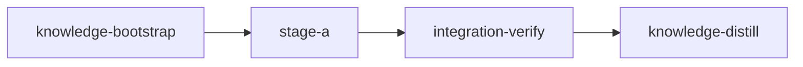

# Canonical Plan Template

Read when writing plan YAML. Copy and adapt this single-implementation-stage example; add stages only when the necessity test in ../SKILL.md requires them. This is the canonical bookend template.

````markdown
# Plan: [Title]

## Overview
[2–3 sentences: what this accomplishes and why.]

## Goals
- [Primary goal]  - [Constraint / non-goal]

## Execution Diagram


## Stages

### 1. Knowledge Bootstrap
Explore codebase, populate `doc/loom/knowledge/`. Acceptance: the knowledge check passes against the committed baseline.

### 2–N. [Feature stages]
Purpose, dependencies, tasks (with subagent assignments + file ownership), files, acceptance, verification, and the risk-checklist walk: the areas that apply and the contract covering each.

### Integration Verification
Full test command, lint and build (zero tolerance), parallel code-review subagents (fix or dispute every finding, never defer one), reviewer suggestions weighed, functional smoke test. Depends on all feature stages.

### Knowledge Distillation
Curate memories → knowledge, unimplemented reviewer suggestions included; update README/CONTRIBUTING. Depends on integration-verify.

---

<!-- loom METADATA -->

```yaml
loom:
  version: 2
  stages:
    - id: knowledge-bootstrap
      name: "Bootstrap Knowledge Base"
      summary: "Maps the codebase into the knowledge base so later stages start informed."
      stage_type: knowledge
      description: |
        Explore codebase and populate doc/loom/knowledge/.
        Use parallel subagents and skills to maximize performance.
        Run loom knowledge sync to rebuild derived retrieval artifacts and perform
        any one-time flat-to-hierarchical upgrade. The knowledge directory scaffold
        and source graph are created automatically at loom init and at run startup,
        so this stage exists to write CONTENT, never to create the directory or seed
        it from static analysis.
        Spawn parallel Explore subagents (entry-points, patterns, conventions),
        each returning loom knowledge update commands. Review mistakes.md first.
        TIER ROUTING: findings ~40 lines or fewer go inline in the tier-1 file;
        larger findings go via loom knowledge update <category>/<slug> with a
        2-4 line tier-1 summary + link. INDEX.md regenerates automatically on
        every knowledge write; there is no final index step.
        Use loom knowledge CLI, NOT Write/Edit. NEVER Claude Code auto-memory.
      dependencies: []
      acceptance:
        # fails only on structural issues the committed baseline does not record
        - "loom knowledge check --strict --baseline doc/loom/knowledge/check-baseline.txt"
      files: ["doc/loom/knowledge/**"]
      working_dir: "."
      artifacts:
        - "doc/loom/knowledge/architecture.md"
        - "doc/loom/knowledge/entry-points.md"

    - id: stage-a
      name: "Feature A"
      summary: "Adds feature A behind its public entry point, with tests for the rejected cases."
      stage_type: standard
      skills: ["loom-rust"]
      description: |
        Implement feature A. [Exact paths, signatures, patterns to follow,
        step-by-step subtasks, wiring, error handling — see Section 4.]
        [Name the public surface the contracts call, e.g.
        feature_a::create(name: &str) -> Result<Record, CreateError>: the
        contract session writes them from this description before any code.]
        Use parallel subagents and skills to maximize performance.
        MEMORY: record mistakes/decisions/surprises via loom memory immediately;
        NEVER loom knowledge (implementation stage); NEVER auto-memory.
      dependencies: ["knowledge-bootstrap"]
      acceptance: ["cargo test --lib feature_a::"]
      files: ["src/feature_a/**", "tests/feature_a_contracts.rs"]
      working_dir: "."
      artifacts: ["src/feature_a/mod.rs"]
      contracts:                   # risk area: untrusted input
        - id: rejects-empty-name
          file: tests/feature_a_contracts.rs
          test: rejects_empty_name
          scenario: "calls feature_a::create with an empty name"
          rejects: "a create that stores the empty name instead of returning CreateError"

    - id: integration-verify
      name: "Integration Verification"
      summary: "Confirms feature A are wired into the running program and the full suite passes."
      stage_type: integration-verify
      description: |
        Final verification after all stages. Verify FUNCTIONAL INTEGRATION,
        not just tests passing. NEVER Claude Code auto-memory.
        CONTEXT: read the plan (doc/plans/), loom memory show --all,
        doc/loom/knowledge/INDEX.md and only the relevant sections.
        BUILD & TEST (zero tolerance — fix ALL warnings/errors): full suite,
        lint as errors, build.
        CODE REVIEW: spawn parallel loom-code-reviewer subagents (security,
        architecture, test coverage); fix ALL findings with an engineer agent.
        Every finding is fixed or disputed, never deferred.
        SUGGESTIONS: weigh every pending reviewer suggestion the signal lists;
        resolve each one implemented with loom memory resolve <id>
        --outcome implemented --reason <what changed>; leave the rest pending.
        FUNCTIONAL: prove features are WIRED IN (CLI/API/UI reachable); run a
        smoke test of the primary use case end-to-end.
        Record discoveries to loom memory for knowledge-distill, including any
        knowledge file contradicted by the tree: loom memory note "stale-knowledge: ...".
      dependencies: ["stage-a"]
      acceptance:
        - "cargo test"             # the full test command: required on integration-verify in v2
        - "cargo clippy -- -D warnings"
        - "cargo build"
        - "myapp --help"           # functional smoke (was `truths`)
        # ADD functional acceptance for YOUR feature, e.g.:
        # - 'myapp --help | rg -q "new-command"'
      working_dir: "."
      wiring:
        - source: "src/main.rs"
          pattern: "feature_a::run"        # CONSUMER (call site), not just `mod feature_a`
          description: "Feature A invoked from main"
      wiring_tests:
        - name: "feature A reachable"
          command: "myapp feature-a --help"
          success_criteria:
            exit_code: 0

    - id: knowledge-distill
      name: "Knowledge Distillation"
      summary: "Records what this plan learned in the knowledge base and updates the user docs."
      stage_type: knowledge-distill
      description: |
        Curate all stage memories into permanent knowledge; update user docs.
        NEVER Claude Code auto-memory.
        SINGLE-AGENT: do NOT spawn subagents — memories are compact summaries;
        lean on them and keep code spot-reads narrow.
        START with loom memory pending --group (corrections, mistakes,
        decisions, other); read the plan and the knowledge sections it touches.
        CORRECTIONS FIRST: apply every `stale-knowledge:` memory in place with
        loom knowledge replace-section <file> "<heading>" "<body>" - never with
        loom knowledge update, which appends the fix below the stale text.
        Then curate mistakes (prevention rules), patterns, decisions, conventions via
        loom knowledge update. TIER ROUTING: findings ~40 lines or fewer go
        inline in the tier-1 file; larger findings go via loom knowledge update
        <category>/<slug> with a 2-4 line tier-1 summary + link. INDEX.md
        regenerates automatically on every knowledge write; then loom review prunes
        stale entries.
        Update README/CONTRIBUTING for changed behavior (relevant sections only);
        if nothing user-facing changed, skip but record WHY in memory.
        SUGGESTIONS: record every unimplemented reviewer suggestion (listed
        under suggestions by loom memory pending --group) in concerns or the
        topic it belongs to, then resolve it promoted, merged or discarded.
        RECEIPTS: every Note/Decision/Question taken into knowledge gets
        loom memory resolve <id> --outcome promoted|merged|discarded|deferred
        right after the write that used it (--target/--reason as appropriate);
        finish with loom memory pending --strict and resolve whatever it lists.
        LAST, if this stage removed structural issues, ratchet the baseline:
        loom knowledge check --write-baseline doc/loom/knowledge/check-baseline.txt
      dependencies: ["integration-verify"]
      acceptance:
        - "loom knowledge check --strict --baseline doc/loom/knowledge/check-baseline.txt"   # fails only on NEW structural issues; never opens the context store
        - "loom memory pending --strict"    # fails if any memory event lacks a receipt — reads .loom/work/memory only
      files: ["doc/loom/knowledge/**", "README.md", "CONTRIBUTING.md"]
      working_dir: "."
```

<!-- END loom METADATA -->
````

**Sequential stages when files overlap** — two stages editing the SAME file chain with `dependencies` so loom serializes the worktrees (example in `authoring-detail.md`). **Large fan-out (>~6 workers)** — an `EXECUTION PLAN - HIERARCHICAL` table; example in `parallelization.md`.
