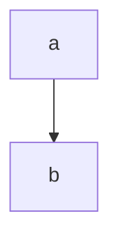

# GFM document

| Stage |   State |
| :---- | ------: |
| one   |    done |
| two   | running |

- [x] written
- [ ] reviewed

This is ~~gone~~ text with <https://example.com> in it.

```rust
fn main() {}
```


